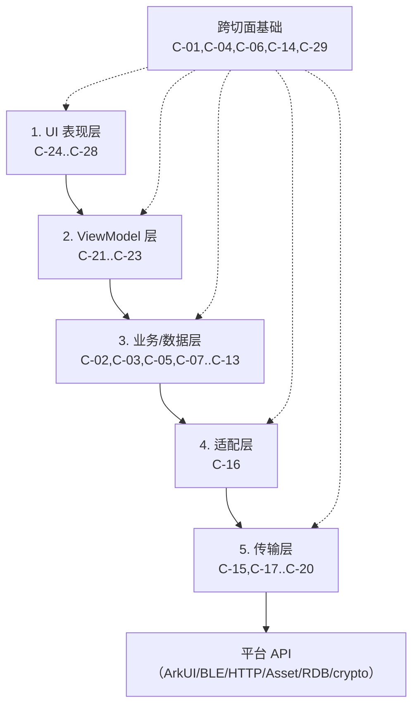
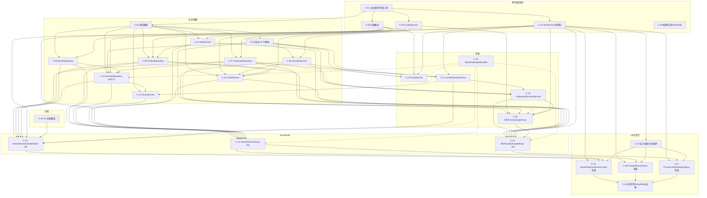

# 组件图与组件契约需求（Component Graph v1.0）

- **Artifact ID**: COMPONENT-GRAPH-001
- **Producer**: agent:delivery-planner
- **Type**: Delivery Plan / Component Graph（规划工件，非实现）
- **Status**: Proposed（待 G-005 Artifact Validation Gate 批准）
- **Date**: 2026-10-17
- **Task**: `wp-005-plan`（task 分支 `task/wp-005-plan`，父分支 `feat/yaocore-app`，base commit `c1642ef`）
- **Workflow**: STANDARD / GATED_AUTO（`config/project.md` L17-19）
- **Target Stage**: `implementation`（本图覆盖到实现阶段入口，不含 release/发布）
- **Upstream（冻结/已批准）**:
  - G-004 契约基线 @ `697762c`：`artifacts/20-architecture/contract-baseline.md`（CB）、`adr-001`..`adr-004`、`project-constraints.md`（PC）、`i18n-resource-design.md`（I18N-DESIGN）
  - `artifacts/10-verification/wp-002-protocol-fixture-validation.md`（WP2）@ `6c75037`
  - `artifacts/10-verification/wp-003-cross-artifact-consistency.md`（WP3）@ `54c1d78`
  - `config/project.md`；`input/requirements/`、`input/architecture/`、`input/design/`、`input/data/`（wp-005 handoff pin）
- **Downstream**: wp-006 DES-001A/DES-001B、交付任务 T-01..T-22、TEST-001、独立评审、Component/Integration/Stage Gate
- **Scope 纪律**: 本文件只做组件边界、依赖、契约需求与 FR 映射；不定义类/函数签名、不写实现、不改 `input/`、不新增架构裁定。所有契约/范围以 G-004 为准；基线未覆盖项见 `delivery-plan.md` §9 `PLANNING_BLOCKERS`。

---

## 0. 规划结论摘要

1. **组件数：29 个（C-01..C-29）**，覆盖架构五层（UI / ViewModel / 业务与仓储 / 适配 / 传输）与跨切面基础（公共类型、加密、存储、i18n、构建工具）。全部组件当前状态为 **UNIMPLEMENTED**（脚手架仅有 Hello World）。
2. **首个实现切片**不是“从 UI 开始”，而是 **构建/测试基线（T-01）→ 详细设计（T-03/T-04）→ 公共模型/协议映射（T-06）→ Crypto/Security（T-07）**；UI 依赖链在领域服务与 ViewModel 稳定后才启动。
3. **依赖以契约/工件就绪为准**：G-004 已批准 CB/ADR/PC/I18N；wp-006 DES-001 是组件级接口的下一道就绪门；wp-002 向量是协议契约测试的输入；原应用代码（LEGACY-001）只作行为参考，不作权威。
4. **计划不覆盖**：release/发布、真实硬件/真机测试、ESP32 固件构建、`input/` 文档修订、`origin/main` 同步。实机测试由用户自行进行；工程证据边界见 `delivery-plan.md` §6。
5. **wp-006 需要补齐的接口清单**按组件列于 §5；每项均可在 DES-001A/B 中独立评审，不要求在本图中提前给出签名。

---

## 1. 规划口径

### 1.1 组件状态词表

| 状态 | 含义 |
|---|---|
| `UNIMPLEMENTED` | 只有规划边界，没有产品代码 |
| `IN_PROGRESS` | 已有实现，未完成 Component Quality Gate |
| `IMPLEMENTED_UNVERIFIED` | 代码完成，构建/测试/评审证据不完整 |
| `STABLE` | 通过 Component Quality Gate，可参与集成 |
| `FAILED` | Gate 失败或实现被回退 |

> 本文件所有组件的初始状态均为 `UNIMPLEMENTED`；后续状态由各任务 Gate 更新，不以“任务完成”代替 Gate PASS。

### 1.2 测试类型缩写

- **UT**：纯单元测试（Hypium/本地测试运行器；无真实网络/硬件）。
- **CT**：契约测试（wp-002 向量、golden fixture、schema/DTO 校验、MockGatewayService）。
- **IT**：集成测试（Mock/仿真器、跨组件、仓库持久化、ViewModel+UI 数据流）。
- **SEC**：独立安全评审证据（quality-reviewer）。
- **PERF**：NFR 4.3 计时/节流测量（TEST-001 定义口径）。

### 1.3 引用缩写

| 缩写 | 工件 |
|---|---|
| CB | `artifacts/20-architecture/contract-baseline.md` |
| ADR-001..004 | `artifacts/20-architecture/adr-00x-*.md` |
| PC | `artifacts/20-architecture/project-constraints.md` |
| I18N-DESIGN | `artifacts/20-architecture/i18n-resource-design.md` |
| WP2 / WP3 | wp-002 / wp-003 验证报告 |
| REQ / ARCH / UIUX / DM | `input/requirements/`、`input/architecture/`、`input/design/`、`input/data/` |
| LEGACY-001 | `input/existing/original_app/**`（行为参考，非权威） |

### 1.4 组件划分原则

- 一个组件 = 一个可独立交接、可独立测试、有明确对外契约的代码边界；不是每个文件一个组件。
- 业务/仓储层不依赖 UI/ViewModel；传输层不依赖 UI/ViewModel；跨层通信通过接口端口 + 组合根注入（见 §4.3/§4.4）。
- Mock/仿真只存在于测试/开发路径，生产组合根不引用（SC-11）。
- 组件边界只表达职责和依赖；具体类、函数、状态机、错误类型归 wp-006 DES-001。

### 1.5 复杂度/风险定义

- **复杂度**：`S`（单会话可完成）/`M`（约一个标准会话）/`L`（需要拆分或较长会话）。
- **风险**：`L`（低）/`M`（中）/`H`（高：安全、协议互操作、跨层或外部依赖）。
- 复杂度和风险用于任务切分与评审深度，不改变 G-004 的强制约束。

---

## 2. 架构层与组件映射

| 架构层（ARCH §2） | 组件 | 说明 |
|---|---|---|
| 1. UI 表现层 | C-24, C-25, C-26, C-27, C-28 | 页面、复用组件、导航壳、EntryAbility/权限/模块配置 |
| 2. ViewModel 层 | C-21, C-22, C-23 | 状态聚合、控制三态、节流、配网/设置状态机驱动 |
| 3. 业务逻辑与数据层 | C-02, C-03, C-05, C-07, C-08, C-09, C-10, C-11, C-12, C-13 | 领域模型、协议映射、安全服务、仓储、场景、认证、邀请 |
| 4. 适配层 | C-16 | 空调品牌适配器（Gree/Haier/Midea/Generic） |
| 5. 转发与传输层 | C-15, C-17, C-18, C-19, C-20 | 云、局域网、发现、BLE 配网、Mock 测试替身 |
| 跨切面/基础 | C-01, C-04, C-06, C-14, C-29 | 公共类型/工具、密码学原语、存储、i18n、构建/仿真/README |

> C-04（CryptoService）与 C-06（Storage）虽在依赖方向上服务业务层，但被传输/安全/仓储共同使用，故列为跨切面基础；这不改变 ARCH 的五层职责划分。

---

## 3. 组件清单

> **层**：以下各表的分组标题（§3.1..§3.6）即组件所属架构层/跨切面。
> 列说明：**对外接口/契约锚点**列出该组件必须遵守的规范来源与建议接口名（签名由 DES-001 定义）；**上游 → 下游**为组件级依赖（提供者 → 消费者），不是 Agent 顺序；**代码范围**为建议路径，wp-006/实现可在不改变组件边界的前提下微调；**测试范围**按 §1.2 缩写。

### 3.1 跨切面/基础（Foundation）

| ID | 组件 | 职责（一句话） | 对外接口/契约锚点 | 上游 → 下游 | 目标代码范围 | 测试范围 | 状态 | 复杂度/风险 |
|---|---|---|---|---|---|---|---|---|
| C-01 | 公共类型、常量与工具 | 提供协议/设备/存储常量、统一错误/结果类型、时间戳/字节/hex/base64url/数值规范化工具，不含业务状态。 | CB §2.5/§3；ADR-001 §2.5；PC PR-02/PR-04；`ProtocolConstants`、`DeviceConstants`、`DateTimeUtil`、`BytesUtil`、`AppError` | 平台 API → C-02..C-29 | `entry/src/main/ets/common/constants/**`、`common/types/**`、`common/utils/**` | UT（时间戳、JSON 原子、hex/base64url、常量） | UNIMPLEMENTED | S / L |
| C-04 | CryptoService | 封装 `@ohos.security.cryptoFramework` 的 SHA-256/HMAC/X25519/AES-256-CTR/随机/常数时间比较；GCM 仅保留扩展常量，不实现运行分支。 | ADR-002 §2/§4；BLE §4；STD §4.1；SC-15；RFC7748 向量；CB §3 | C-01 → C-05, C-13, C-19 | `entry/src/main/ets/service/crypto/**` | UT/CT（RFC7748、HMAC、CTR 流、DER↔raw、常数时间） | UNIMPLEMENTED | M / H |
| C-06 | 存储服务（Preferences/RDB/Asset Store） | 封装 Preferences、RelationalStore、Asset Store，提供事务、别名、迁移、内存擦除与测试替身。 | ADR-002 §8.3；SC-09/SC-12；PRIV；CB §7.1；`PreferenceStore`、`RdbStore`、`SecretStore`、`SecureBuffer` | C-01 → C-07..C-13, C-15 | `entry/src/main/ets/service/storage/**` | UT（内存替身、别名生命周期、擦除、迁移）；IT（持久化/重启，条件允许时） | UNIMPLEMENTED | M / H |
| C-14 | I18nService 与资源包 | locale 解析/持久化、rawfile 加载、`t(key, params)`、fallback、复数、观察者通知；错误码/状态来源键映射；资源包与 parity 检查脚本。 | I18N-DESIGN §2-§7；CB §4.4/§6.1/§6.3；ADR-004 §7.2；STD §2.3；`I18nService.t`、`setLocale`、`errorCodeToI18nKey`、`stateSourceToI18nKey` | C-01, C-02 → C-15, C-17, C-19, C-21..C-27 | `service/i18n/**`；`resources/base/element/string.json`；`resources/en_US/element/string.json`；`resources/rawfile/i18n/{zh-CN,en-US}.json`；`tools/i18n/check_i18n.py` | UT（fallback/插值/复数/缺 key）；CT（CHK-01..09 parity）；IT（运行时切换） | UNIMPLEMENTED | M / M |
| C-29 | 构建/仿真/README 工具 | 提供可复现构建/测试脚本、Python 仿真器/TLS 夹具适配、契约 crosscheck 集成、README 与限制说明。 | AGENTS.md 测试要求；WP2 §7；ADR-002 §7.3；I18N-DESIGN §6；`tools/simulator/**`、`tools/contract/**`、`README.md` | 实现证据（C-01..C-28）→ Gate/测试 | `tools/simulator/**`、`tools/contract/**`、`tools/build/**`、`README.md` | 工具自测；可复现运行；证据报告 | UNIMPLEMENTED | M / M |

### 3.2 业务逻辑与数据层（Domain / Repository）

| ID | 组件 | 职责（一句话） | 对外接口/契约锚点 | 上游 → 下游 | 目标代码范围 | 测试范围 | 状态 | 复杂度/风险 |
|---|---|---|---|---|---|---|---|---|
| C-02 | 领域模型与枚举 | 定义 Family/Member/Room/Device/Gateway/Scene/CloudConfig/Invite 等内部模型、枚举与不变量（不含 wire 字段名）。 | CB §2/§6/§7；DM §1-§5；ADR-003 §9；ADR-004 §2.1；`Family`、`Member`、`Room`、`DeviceState`、`GatewayRoute`、`Scene` | C-01 → C-03, C-05..C-16, C-21..C-23 | `entry/src/main/ets/model/**` | UT（不变量、默认值、状态枚举） | UNIMPLEMENTED | M / M |
| C-03 | 协议 DTO、映射与校验 | 定义 schema 线格式 DTO、解析/序列化、线格式↔内部模型映射、别名回退、偏差计数、identity/discover/control/cloud 校验。 | CB §2.1-§2.5/§4.3/§5.1/§7.1；ADR-001 §1/§4/§5；`mapDiscoverResponse`、`mapControlAck`、`serializeControlRequest`、`parseIdentityV20/V21`、`mapCloudCommand/Shadow`、`ProtocolDeviation` | C-01, C-02 → C-05, C-10, C-15, C-17, C-18, C-19, C-21 | `entry/src/main/ets/service/protocol/**` | UT/CT（golden fixture、别名、fail-closed、云映射） | UNIMPLEMENTED | H / M |
| C-05 | SecurityService | 构造 canonical 串、HMAC 签名/验签、响应验签、时间窗/nonce 生成与缓存、correlation 校验、错误分类；失败一律 fail-closed。 | CB §3；ADR-002 §2；README L55-157；4 份向量；`CanonicalBuilder`、`RequestSigner`、`ResponseVerifier`、`NonceCache`、`Clock` | C-01, C-03, C-04 → C-13, C-17, C-18, C-19, C-21 | `entry/src/main/ets/service/security/**` | UT/CT（4 控制向量、响应/发现向量、时间/nonce 负例）；SEC | UNIMPLEMENTED | H / H |
| C-07 | GatewayRepository | 网关路由记录、绑定状态、通道档案（P-HMAC/P-TLS-PIN/P-BLOCKED）、pins/tlsEnabled/port/last known IP、per-gateway secret 引用；不存明文 secret。 | ADR-002 §4/§6/§8.3；ADR-004 §5；CB §7；DM §4；`GatewayRoute`、`GatewayProfile`、`GatewayCredentialPort` | C-01, C-02, C-06 → C-10, C-17, C-18, C-19, C-21, C-23 | `entry/src/main/ets/repository/GatewayRepository.ets` | UT（route CRUD、profile 迁移、pin 绑定、无 secret 泄漏）；CT | UNIMPLEMENTED | H / H |
| C-08 | FamilyRepository | 家庭、成员、邀请注册表、回执、GUEST 到期、角色/RBAC 数据、本地权威与接触式收敛。 | ADR-003 §5/§6/§9/§10；ADR-004 §4；CB §7；DM §1；`Family`、`Member`、`InvitationRecord`、`Receipt` | C-02, C-06, C-12 → C-13, C-21, C-22, C-23 | `entry/src/main/ets/repository/FamilyRepository.ets` | UT（家庭切换、角色矩阵、到期、回执状态机、无实时在线声明）；IT | UNIMPLEMENTED | H / H |
| C-09 | RoomRepository | 房间 CRUD、排序/图标、删除保护（设备置空/禁用/未分配）、仅 roomId 索引、改名不影响 ID。 | ADR-004 §1/§2；CB §8.1；DM §2.1/§2.3；`Room`、`DeviceAssignmentPort` | C-02, C-06 → C-10, C-21, C-22 | `entry/src/main/ets/repository/RoomRepository.ets` | UT（创建/改名/删除保护/排序）；IT with C-10 | UNIMPLEMENTED | M / M |
| C-10 | DeviceRepository | 设备 SSOT、discover 合并/仲裁（`stateEpochMs`）、未分配/禁用、dismissed tombstone、ACK 状态应用、场景引用查询；不发网络请求。 | ADR-004 §1/§2/§6；CB §2.2/§2.5/§8.1；DM §2.2/§2.3；`applyDiscoverSnapshot`、`applyControlAck`、`assignRoom`、`renameDevice`、`removeDevice`、`listByRoom` | C-01..C-03, C-06, C-07, C-09 → C-11, C-21, C-22 | `entry/src/main/ets/repository/DeviceRepository.ets` | UT/CT（陈旧包丢弃、别名、缺字段、离线、tombstone、房间删除）；IT | UNIMPLEMENTED | H / H |
| C-11 | SceneService | 场景 CRUD、串行动作执行、逐步 ACK 进度、局部失败不回滚、设备引用清理。 | DM §5；UIUX §4.6；FR-SCN-001；`SceneExecutor`、`SceneStepResult`、`DeviceControlPort` | C-02, C-06, C-10, C-17（端口）→ C-22 | `entry/src/main/ets/service/scene/SceneService.ets` | UT（串行、局部失败、不回滚、引用清理）；IT | UNIMPLEMENTED | M / M |
| C-12 | AuthService | 本地用户档案、PBKDF2\|SHA256 120k 加盐、会话/解锁、RBAC 判定（App 策略层，非密码学边界）。 | FR-FAM-003/004；NFR 4.2；PRIV；DM §1.2；ADR-003 §6.3；`createProfile`、`unlock`、`verifyPassword`、`canControl`、`isAdmin` | C-01, C-02, C-06 → C-08, C-13, C-22, C-23 | `entry/src/main/ets/service/auth/AuthService.ets` | UT（KDF 参数、盐、角色矩阵、锁定）；CT | UNIMPLEMENTED | M / H |
| C-13 | InviteService | YCI1/YCR1 容器生成/解析、KEY_WRAP/CODE_KEK、AEAD、回执、邀请校验、轮换引导；不实现服务器。 | ADR-003 §2-§8；D-009/D-013；CB §7；`createJoinRequest`、`createInvitation`、`acceptInvitation`、`verifyReceipt`、`revokeInvitation`、`rotateGatewaySecret` | C-01..C-06, C-08, C-10, C-12 → C-22, C-23 | `entry/src/main/ets/service/invite/**` | UT/CT（容器向量、AAD 篡改、过期/maxUses、回执、双路径）；SEC | UNIMPLEMENTED | H / H |

### 3.3 适配层（Adapter）

| ID | 组件 | 职责（一句话） | 对外接口/契约锚点 | 上游 → 下游 | 目标代码范围 | 测试范围 | 状态 | 复杂度/风险 |
|---|---|---|---|---|---|---|---|---|
| C-16 | AC 品牌适配器组 | 统一 AC 命令模型与品牌适配（Gree/Haier/Midea/Generic）；7 值 `mode`、16..30°C、percent 单位；仅做参数映射，不发网络。 | FR-DEV-004；CB §6.2/§6.3；ADR-001 §2；DM §2.2；`AcAdapter`、`AcAdapterFactory`、`AcCommand` | C-01, C-02 → C-21 | `entry/src/main/ets/adapter/ac/**` | UT（品牌归一、7 值白名单、温度 clamp、非标准模式不回发）；CT | UNIMPLEMENTED | S / M |

### 3.4 传输层（Transport / Cloud / BLE / Mock）

| ID | 组件 | 职责（一句话） | 对外接口/契约锚点 | 上游 → 下游 | 目标代码范围 | 测试范围 | 状态 | 复杂度/风险 |
|---|---|---|---|---|---|---|---|---|
| C-15 | CloudService | IoTDA 配置、Token 手工管理、CreateCommand 签名命令、影子轮询、完成判定、错误映射；不做 Token 自动刷新。 | CB §7.1/§8.2；ADR-001 §2；D-012/D-014；CC/SR schema；PR-09/PR-10；`CloudConfig`、`CloudCommandClient`、`ShadowReader`、`CloudCompletionEvaluator` | C-01..C-05, C-06, C-07（端口）→ C-21, C-23 | `entry/src/main/ets/service/cloud/**` | UT/CT（paras 映射、签名、Token 过期、错误映射、DeviceInventoryJson fail-closed）；IT（Mock） | UNIMPLEMENTED | M / H |
| C-17 | LocalGatewayService | LAN HTTP/HTTPS 请求、HMAC 全链、响应验签/correlation、时间窗/nonce、重试/幂等、P-HMAC/P-TLS-PIN/P-BLOCKED、DEV-ONLY 拒收、错误分类。 | CB §3/§4/§8.6；ADR-001 §2；ADR-002 §2/§6；SC-11/SC-13/SC-15；`IGatewayClient.discover/control/probe`、`TransportProfile`、`TlsPinVerifier` | C-01..C-05, C-06, C-07（端口）, C-14 → C-11, C-18, C-19, C-21 | `service/gateway/LocalGatewayService.ets`、`HttpTransport.ets`、`TlsPinVerifier.ets` | UT/CT（profile、pin mismatch、超时、DEV-ONLY、correlation、幂等）；IT | UNIMPLEMENTED | H / H |
| C-18 | GatewayDiscoveryService | UDP/mDNS 定位候选、手动 IP（仅已绑定、强校验）、上次已知地址、签名 discover 验证、候选去重/退避；身份以 discover+Security1 为准。 | README L48-53；ADR-004 §5；CB §2.1/§3；`GatewayLocator`、`DiscoveryCandidate`、`ManualAddressPolicy` | C-01..C-03, C-05, C-07（端口）, C-17 → C-19, C-21, C-23 | `service/gateway/GatewayDiscoveryService.ets` | UT（候选去重、手动 IP 规则、退避、不得经手动 IP 创建绑定）；CT（mDNS/模拟 UDP；见 PB-01） | UNIMPLEMENTED | H / H |
| C-19 | BleProvisioningService | BLE 扫描/连接/MTU、GATT `0x2901` 动态映射、`proto-ver` 能力门禁、Security1 全流程、protobuf 编解码、身份 v2.0/v2.1 协商、Wi-Fi 下发/轮询/完成、绑定探针编排、取消清理。 | BLE §2-§8；ADR-001 §3；ADR-002 §3；FR-GW-001..003；PR-12/PR-13；`IBleProvisioningClient`、`ProvisioningState`、`Security1Session`、`ProtocommCodec`、`IdentityNegotiator` | C-01, C-03..C-07, C-14, C-17, C-18 → C-23 | `service/ble/**` | UT/CT（Security1/RFC7748/protobuf 向量、身份 fail-closed、状态机、清理）；IT（Mock BLE） | UNIMPLEMENTED | H / H |
| C-20 | MockGatewayService / MockBleProvisioningClient | 确定性实现 `IGatewayClient`/`IBleProvisioningClient`；注入 TLS pin-match/pin-mismatch/handshake-fail、ACK/错误/重放/延迟；不进入生产组合根。 | ARCH §4.1/§4.2；ADR-002 §7.3；SC-11；`MockGatewayService`、`MockBleProvisioningClient`、`MockScenario` | C-02..C-05, C-17/C-19 接口 → C-10, C-11, C-21..C-23, 测试 | `entry/src/ohosTest/ets/mock/**`（首选）；如需 debug 运行，`entry/src/main/ets/service/mock/**` 且生产组合根禁止 import | UT/IT（模式矩阵、TLS 注入、确定性）；SEC 检查生产排除 | UNIMPLEMENTED | M / M |

### 3.5 ViewModel 层

| ID | 组件 | 职责（一句话） | 对外接口/契约锚点 | 上游 → 下游 | 目标代码范围 | 测试范围 | 状态 | 复杂度/风险 |
|---|---|---|---|---|---|---|---|---|
| C-21 | Home/Device/Climate/Door ViewModel 组 | 首页/设备/温控/门锁状态流、过滤、三态 PENDING/COMMITTED/REVERT、55ms 节流、TouchUp 强同步、门锁四阶段/超时/提醒。 | UIUX §4.3/4.4；ADR-004 §6；FR-DEV-001/002/003；FR-HOME-001..004；CB §2.3；`HomeViewModel`、`DeviceViewModel`、`ClimateViewModel`、`DoorViewModel`、`ControlUiState` | C-07, C-09, C-10, C-14, C-15, C-16, C-17, C-20（测试）→ C-25 | `entry/src/main/ets/viewmodel/{HomeViewModel,DeviceViewModel,ClimateViewModel,DoorViewModel}.ets` | UT（三态、节流、门锁超时/离线、错误映射）；IT（Mock） | UNIMPLEMENTED | H / H |
| C-22 | Family/Room/Scene ViewModel 组 | 家庭切换/成员/RBAC、房间 CRUD 与未分配池、场景执行进度、邀请流程状态。 | FR-FAM/ROOM/SCN；ADR-003/004；UIUX §4.1/4.2/4.6；`FamilyViewModel`、`RoomViewModel`、`SceneViewModel` | C-08..C-14, C-17（端口）, C-20（测试）→ C-25, C-26 | `entry/src/main/ets/viewmodel/{FamilyViewModel,RoomViewModel,SceneViewModel}.ets` | UT（角色矩阵、房间删除、场景局部失败、邀请状态）；IT | UNIMPLEMENTED | H / H |
| C-23 | BleProvisioning/Settings ViewModel 组 | 配网状态机 UI 驱动、权限/取消/重试、设置页语言/云/TLS/高级 IP/关于、Token 过期提示。 | UIUX §3/§4.5；BLE §7；ADR-002 §6/§7；ADR-004 §5/§7.2；FR-GW-001..003；FR-SET-002/003；D-012/D-015；`BleProvisioningViewModel`、`SettingsViewModel` | C-07, C-12, C-13, C-14, C-15, C-18, C-19, C-20（测试）→ C-27 | `entry/src/main/ets/viewmodel/{BleProvisioningViewModel,SettingsViewModel}.ets` | UT（状态机、取消清理、Token 过期、语言切换）；IT（Mock BLE） | UNIMPLEMENTED | H / H |

### 3.6 UI 表现层与应用基础设施

| ID | 组件 | 职责（一句话） | 对外接口/契约锚点 | 上游 → 下游 | 目标代码范围 | 测试范围 | 状态 | 复杂度/风险 |
|---|---|---|---|---|---|---|---|---|
| C-24 | 设计系统与复用 UI 组件 | 主题 token（颜色/圆角/阴影/光晕/动效/节流常量）、背景光核、StatusBanner/ClimateCard/LightCard/DoorCard/SceneCard/RoomCard、通用按钮/输入/对话框/空状态。 | UIUX §2/§5；STD §2.1/§2.2；I18N-07/08；`AppTheme`、`AppMotionTokens`、卡片组件 | C-01, C-14 → C-25, C-26, C-27, C-28 | `entry/src/main/ets/common/theme/**`、`entry/src/main/ets/components/**` | 构建/UI smoke；视觉评审；i18n 键检查 | UNIMPLEMENTED | M / M |
| C-25 | Home/Rooms/Device Control 页面 | 4 Tab 中的 Home/Rooms、房间列表/未分配池、设备控制页（灯/空调/门锁/传感器）、三态反馈、门锁四阶段、场景入口。 | UIUX §3/§4.2-4.4；FR-HOME/ROOM/DEV；`HomePage`、`RoomsPage`、`DeviceControlPage` | C-14, C-21, C-22, C-24 → C-28 | `entry/src/main/ets/pages/{HomePage,RoomsPage,DeviceControlPage}.ets` | 构建/UI smoke；VM 交互；i18n；可访问性 | UNIMPLEMENTED | H / H |
| C-26 | Family/Room/Scene 页面 | 家庭成员/权限/邀请（YCR1/YCI1 展示与扫码/粘贴）、房间管理、场景卡片/执行反馈。 | UIUX §4.1/4.2/4.6；FR-FAM/ROOM/SCN；ADR-003；`FamilyManagePage`、`RoomManagePage`、`ScenePage` | C-14, C-22, C-24 → C-28 | `entry/src/main/ets/pages/{FamilyManagePage,RoomManagePage,ScenePage}.ets` | 构建/UI smoke；VM 交互；i18n；RBAC 可见性 | UNIMPLEMENTED | M / H |
| C-27 | Provisioning/Settings/About/Profile 页面 | 6 步配网向导、权限/取消/错误、设置（语言/云/安全/高级 IP/通知）、关于/隐私说明、Profile Tab（个人档案/家庭入口/设置/关于）。 | UIUX §3/§4.5；BLE §7；ADR-002/004；FR-GW/SET；D-012/D-015；`ProvisioningPage`、`SettingsPage`、`AboutPage`、`ProfilePage` | C-14, C-23, C-24 → C-28 | `entry/src/main/ets/pages/{ProvisioningPage,SettingsPage,AboutPage,ProfilePage}.ets` | 构建/UI smoke；VM 状态机；i18n；安全文案评审 | UNIMPLEMENTED | H / H |
| C-28 | 应用壳、EntryAbility、权限与模块配置 | EntryAbility 生命周期、Index/Tabs/NavDestination 导航壳、组合根/依赖注入、权限声明与运行时申请、module.json5/pages 配置、应用级资源/主题/备份配置。 | ARCH §2；UIUX §3；BLE §6；SC-11；PL-06/07；FR-GW-001；`AppCompositionRoot`、`NavigationService`、`PermissionGate` | C-14, C-21..C-27 → 运行时入口 | `entry/src/main/ets/entryability/**`、`pages/Index.ets`、`common/AppContext.ets`、`module.json5`、`resources/base/profile/main_pages.json`、`AppScope/app.json5` | 构建；启动 smoke；权限流程评审；生产 Mock 排除检查 | UNIMPLEMENTED | H / H |

---

## 4. 依赖图

### 4.1 分层单向依赖（架构约束）

- 本图箭头 = **调用/依赖方向（consumer → provider）**；与 §4.2 的“提供方向”箭头相反，阅读时以图注为准。
- 实线 = 允许的编译期调用方向；虚线 = 跨切面基础可被各层依赖。UI 可直接依赖 **C-14（i18n）**、**C-21..C-23（VM）**、**C-24（设计系统）**；不得直接依赖 C-04/C-06/C-07..C-13/C-15..C-20/C-29。
- **禁止**：UI → BIZ/TR 直接调用；VM → 平台网络/蓝牙/存储 API；BIZ/TR → UI/VM；TR → BIZ 仓储实现（通过接口端口注入）；生产代码 → C-20 Mock。
- 端口/依赖倒置：C-07（路由/凭据）、C-10（设备状态应用）、C-17（控制发送）在跨层场景以 `GatewayCredentialPort`、`DeviceStatePort`、`DeviceControlPort` 等接口注入；端口接口由 DES-001 定义，组合根 C-28 绑定实现。

### 4.2 组件级依赖图（关键边）

> 图例：实线 = **提供方向（provider → consumer，即被依赖者 → 依赖者）**；与 §4.1 的“调用/依赖方向”箭头相反。虚线 = 运行期端口注入（依赖倒置；接口由 DES-001 定义、组合根绑定）或仅测试/Mock 注入（生产组合根禁止）；C-29 不参与运行时依赖，只为 T-01/T-05/T-21 提供构建、仿真与文档证据。为可读性省略了部分“同层多消费者”边，完整上下游见 §3 各行（§3 的“上游 → 下游”同样是提供方向）。

### 4.3 跨层禁止项（评审强制）

| # | 禁止项 | 依据 |
|---|---|---|
| F-01 | UI 组件直接调用 `@ohos.net.http`、`@ohos.bluetooth.ble`、`@ohos.security.asset`、RDB 或 crypto API | PL-06；STD §2.2；ARCH §2 |
| F-02 | ViewModel 直接做协议序列化/签名/解密或持有平台句柄 | PL-06；STD §2.2 |
| F-03 | Repository 直接发 LAN/云请求（设备控制由 SceneService/LocalGatewayService 端口完成） | ADR-004 §2；CB §2 |
| F-04 | 传输层直接依赖 UI/ViewModel 或 `MockGatewayService` 生产实现 | SC-11；ARCH §4.2 |
| F-05 | 生产组合根 import `MockGatewayService`/`MockBleProvisioningClient`/`DEV-ONLY` 分支 | SC-11；ADR-004 §7.1 |
| F-06 | 业务/安全层使用 UI 文案或中文字面量；错误 `message` 直接展示 | CB §4.4；I18N-02；ADR-001 §2.2 |
| F-07 | Repositories 以 `roomName`/`deviceName` 作为索引；改名/换房触发协议动作 | FR-ROOM-002/006；DP-01 |
| F-08 | 云路径复用网关 `result_code` 数值空间或把 IoTDA 受理当执行确认 | CB §7.1；PR-10；ADR-001 §2.2-4 |
| F-09 | 在 HMAC 校验失败/时间窗失败时降级、跳过验签或回退明文 | SC-15；ADR-002 §2 |
| F-10 | 为不同 locale 维护不同业务代码/分支 | I18N-01；I18N-DESIGN §6 CHK-08 |

### 4.4 循环依赖控制

- C-09（RoomRepository）删除房间需要更新 C-10（DeviceRepository）设备归属：C-09 只定义 `DeviceAssignmentPort`，由 C-10 实现并在组合根注入；编译期依赖为 C-09 → 端口，C-10 → C-09（读取房间存在性/名称），不形成编译期环。
- C-17（LocalGatewayService）需要 per-gateway secret/pin：C-17 定义 `GatewayCredentialPort`，C-07 实现；C-17 不 import C-07 实现。
- C-19（BLE）绑定阶段需要写入路由/设备：C-19 返回 `BleProvisioningResult` + 回调事件，由 C-23/C-07/C-10 在应用层完成持久化，不把仓储实现塞进 BLE 服务。
- C-15（CloudService）需要 cloud config/token：通过 C-06/C-07 暴露的 `CloudConfigStore`/`CloudCredentialPort` 注入；不在传输层直接读 Preferences 细节。

---

## 5. wp-006 DES-001 接口需求指针

> 本节是 wp-006 的**需求清单**，不是接口定义。DES-001A/B 必须为每项给出可实现的契约（签名、错误类型、状态机、数据不变量、测试 seam）；若某项与 G-004 冲突，必须走 Change Impact，不得在实现中静默裁定。

| 组件 | 需由 DES-001 补齐的接口/契约 | 计划任务 |
|---|---|---|
| C-01 | `DateTimeUtil`（UTC 紧凑格式、±120s 判断）；`BytesUtil`/`Base64Url`（hex 小写、b64url 无 padding）；JSON 原子编码/紧凑数字；`AppError`/`Result` 类型；协议常量表。 | T-06 |
| C-02 | 全部领域模型/枚举/默认值/不变量；`GatewayRoute.profile` 与 `tlsEnabled/pins` 关系；`DeviceState` 的 `stateEpochMs` 派生；场景/邀请/云配置模型。 | T-06/T-09 |
| C-03 | DTO 接口；`mapDiscoverResponse`、`mapControlAck`、`serializeControlRequest`、`parseIdentityV20/V21`、`mapCloudCommand`、`mapShadow`；严格/宽容边界；`ProtocolDeviation` 计数；字段映射表（CB §2）。 | T-06 |
| C-04 | X25519 raw key 导入/导出（DER↔32B）；SHA-256/HMAC；AES-256-CTR 连续流；随机数格式；常数时间比较；GCM 仅保留常量/注释；错误映射。 | T-07 |
| C-05 | canonical builder（控制/发现/响应）；`RequestSigner`/`ResponseVerifier`；`NonceCache`（300s、失败不消耗）；`Clock` 注入；correlation；失败类型与 fail-closed 路径。 | T-07 |
| C-06 | `PreferenceStore`/`RdbStore`/`SecretStore` 接口；事务/迁移/别名生命周期；Asset Store 可用性/错误；内存擦除；测试替身。 | T-08 |
| C-07 | `GatewayRoute` CRUD；profile 迁移（P-HMAC/P-TLS-PIN/P-BLOCKED）；pin 绑定/轮换；`GatewayCredentialPort`；last-known IP；禁止明文 secret 的审计点。 | T-08 |
| C-08 | Family/Member/Invitation/Receipt 状态机；RBAC 查询；GUEST 到期；接触式收敛；D-010 的“无实时在线”边界。 | T-09 |
| C-09 | Room CRUD/排序/图标；删除保护的 `DeviceAssignmentPort`；改名/换房事件；不得下行协议。 | T-09 |
| C-10 | SSOT 合并/仲裁（`updatedAt`/`stateEpochMs`）；别名/deviation；dismissed tombstone；ACK 状态应用；未分配/禁用；查询/事件流。 | T-09 |
| C-11 | 场景执行状态机；步骤结果/局部失败/不回滚；设备引用清理；`DeviceControlPort`。 | T-09 |
| C-12 | PBKDF2 参数/盐/迭代；本地档案/会话；RBAC 矩阵；Admin 转让/解散钩子；不把 `canControl` 当密码学边界。 | T-13 |
| C-13 | YCI1/YCR1 编解码；KEY_WRAP/CODE_KEK 派生；AEAD/AAD；`expireAt`/`maxUses`/`inviteId` 去重；回执 HMAC；轮换引导；双路径 UI 文案键。 | T-13 |
| C-14 | `I18nService.t`/`setLocale`/`onLocaleChanged`；locale 解析/fallback；插值/复数；错误码/状态来源键映射；资源加载失败降级；CHK-01..09 检查器。 | T-10 |
| C-15 | `CloudConfig`；CreateCommand 请求/响应；shadow 轮询；`CloudCompletionEvaluator`（内置 `LastRequestId/LastSeq` + `DeviceInventoryJson`）；Token 过期；云错误命名空间；未知响应 fail-closed。 | T-14 |
| C-16 | `AcAdapter` 接口/工厂；品牌归一化；7 值 mode/16..30°C/percent 映射；不支持品牌回退；禁止非标准 mode 出站。 | T-14 |
| C-17 | `IGatewayClient`；`HttpTransport`（超时/重试/连接复用）；`TlsPinVerifier`（SPKI-SHA256、pin-match/mismatch/handshake-fail）；profile 选择；DEV-ONLY 拒收；错误分类；`GatewayCredentialPort`。 | T-11 |
| C-18 | `GatewayLocator`（mDNS/UDP/manual/last-known）；候选生命周期/去重/退避；签名 discover 验证链；手动 IP 仅已绑定；不得以定位信息创建绑定；PB-01 的报文假设。 | T-11 |
| C-19 | `IBleProvisioningClient`；配网状态机；GATT 串行/MTU/0x2901 映射；`proto-ver` 门禁；`Security1Session`；protobuf 编解码；`IdentityNegotiator` v2.0/v2.1；Wi-Fi 流程；取消/清理；Mock seam。 | T-12 |
| C-20 | Mock 行为矩阵（normal/offline/ack-lost/replay/timeout/dev-only）；TLS 四模式；确定性种子/延迟；生产排除断言；与 Python 仿真器的夹具对齐。 | T-11 |
| C-21 | VM 状态模型/命令/事件；三态 PENDING/COMMITTED/REVERT；55ms 节流/TouchUp；门锁四阶段/10s 超时/离线；错误 toast/key；测试 seam。 | T-15 |
| C-22 | VM 状态模型；家庭切换/成员/RBAC；房间删除/未分配池；场景进度/局部失败；邀请流程状态；导航事件。 | T-16 |
| C-23 | 配网状态机映射；权限/取消/清理；设置页语言/云/TLS/高级 IP/关于；Token 过期提示；手动 IP 强校验；D-012/D-015 UI 文案。 | T-16 |
| C-24 | 主题 token/暗黑模式；卡片 props/slots/state 变体；动效常量；i18n 键；可访问性；空/错误/加载态。 | T-17 |
| C-25 | 页面导航参数；VM 绑定；三态/门锁四阶段/房间池；空/错误/加载；i18n/可访问性。 | T-17 |
| C-26 | 家庭成员/邀请展示（YCR1/YCI1、扫码/粘贴）；角色/房间授权 UI；房间管理；场景卡片/进度；RBAC 可见性。 | T-18 |
| C-27 | 6 步配网向导；权限/错误/取消；设置分区（语言/云/安全/高级 IP/通知）；关于/隐私；安全文案。 | T-18 |
| C-28 | 组合根/依赖注入；导航图；EntryAbility 生命周期；权限声明/运行时申请；module.json5/pages；Mock 生产排除；启动失败处理。 | T-17 |
| C-29 | 构建/测试脚本接口；仿真器 `--tls`；crosscheck；README 结构；证据路径/限制说明。 | T-01/T-02/T-05/T-21 |

---

## 6. 组件 ↔ FR 映射

> **口径**：`WP3 §3` 为 G-004 前的设计支撑度（覆盖/部分/缺口）；`G-004 后` 为按已批准契约/ADR 的规划评审（完整/部分/需实现验证）。二者都不是实现完成度；所有组件仍 `UNIMPLEMENTED`。实现证据由 T-06..T-19 产出。

| FR | WP3 §3 判定 | G-004 后设计支撑 | 主责组件 | 规划备注 |
|---|---|---|---|---|
| FR-FAM-001 家庭创建/多家庭 | 覆盖 | 完整 | C-08, C-12, C-22, C-26 | 本地 UUID、activeFamilyId；无服务器 |
| FR-FAM-002 成员邀请 | 部分（C-020/C-009） | 完整（D-009；KEY_WRAP 主路径） | C-13, C-08, C-12, C-04, C-05, C-22, C-26 | CODE_KEK 仅弱路径；6 位码；回执 |
| FR-FAM-003 权限/移除 | 部分 | 完整（ADR-003 §6/§9） | C-08, C-12, C-22, C-26 | 移除=提示轮换；无实时在线（D-010） |
| FR-FAM-004 退出家庭 | **缺口** | 部分（本地语义+引导，ADR-003 §10） | C-08, C-12, C-22, C-26 | 不承诺跨设备强一致；Admin 转让/解散为本地流程 |
| FR-ROOM-001 房间创建/ID | 覆盖 | 完整 | C-09, C-22, C-26 | UUID；本地 |
| FR-ROOM-002 命名/ID 不变 | 覆盖 | 完整 | C-09, C-10, C-22, C-25/26 | 仅 roomId 索引 |
| FR-ROOM-003 加入/换房 | 部分（C-005/C-015） | 完整（ADR-004 §1/§2） | C-09, C-10, C-22, C-25 | 本地动作，不下行 |
| FR-ROOM-004 房间删除保护 | 部分 | 完整 | C-09, C-10, C-22, C-25 | `roomId=""`、`isUnassigned=true`、`isEnabled=false` |
| FR-ROOM-005 设备删除 | 部分 | 完整（dismissed） | C-10, C-22, C-25 | tombstone；不自动复活 |
| FR-ROOM-006 设备命名/ID | 部分（C-010/C-006） | 完整（两级 ID） | C-03, C-10, C-22, C-25 | 线上裸 id；复合键仅本地派生 |
| FR-HOME-001 家庭/网关状态 | 部分（RTT 来源） | 部分（RTT 口径归 TEST-001） | C-07, C-10, C-15, C-17, C-21, C-25 | 测量口径见 delivery-plan §6 |
| FR-HOME-002 房间快捷栏 | 覆盖 | 完整 | C-09, C-10, C-21, C-25 | — |
| FR-HOME-003 环境/人体看板 | 覆盖 | 完整 | C-03, C-10, C-21, C-25 | 5 值 `stateSource` |
| FR-HOME-004 快捷设备卡片 | 覆盖 | 完整 | C-10, C-16, C-21, C-25 | 只读降级也显示 |
| FR-GW-001 BLE 权限/扫描 | 部分（API 级别） | 完整（按当前 SDK 验证） | C-19, C-27, C-28 | `ACCESS_BLUETOOTH` 运行时授权；10s 提示 |
| FR-GW-002 Security1 | 覆盖 | 完整 | C-04, C-19 | X25519/PoP/AES-CTR；身份 v2.0/v2.1 |
| FR-GW-003 Wi-Fi/绑定 | 覆盖 | 完整 | C-07, C-17, C-18, C-19, C-23, C-27 | 三要素：HMAC 双向 + gatewayId + LED |
| FR-DEV-001 真实 ACK | 覆盖 | 完整 | C-05, C-10, C-17, C-21, C-25 | 验签+correlation+`result_code==0`+`reported_state` |
| FR-DEV-002 灯光/55ms | 覆盖 | 完整 | C-10, C-17, C-21, C-25 | 55ms 合并；TouchUp 强同步 |
| FR-DEV-003 门锁/门磁 | 部分（C-024） | 完整（ADR-004 §6；D-016） | C-10, C-17, C-21, C-25 | 四阶段；10s；UNCONFIRMED/UNKNOWN |
| FR-DEV-004 空调/多品牌 | 部分（C-025） | 完整（CB §6.3） | C-16, C-17, C-21, C-25 | 7 值 mode；16..30°C；percent |
| FR-DEV-005 状态溯源 | 部分（C-016） | 完整（CB §6.1） | C-03, C-10, C-14, C-21, C-25 | 5 值；未知值记录偏差 |
| FR-SCN-001 场景执行 | 覆盖 | 完整 | C-11, C-17, C-22, C-26 | 串行；局部失败不回滚 |
| FR-SET-001 成员管理面板 | 部分 | 完整 | C-08, C-12, C-22, C-26 | 与 FAM 共用 |
| FR-SET-002 加密/密钥配置 | 部分（C-019） | 完整（ADR-002 §3-§8） | C-04, C-05, C-07, C-13, C-17, C-19, C-23, C-27 | P-TLS-PIN 依赖 FC-01/02；P-HMAC 如实标注 |
| FR-SET-003 云/i18n | 部分（C-023/C-018） | 完整（云 §7.1；i18n 设计） | C-14, C-15, C-23, C-27 | Token 手工；zh-CN/en-US |
| NFR-4.1 传输安全 | 部分 | 完整（HMAC 必做 + 条件 TLS） | C-04, C-05, C-17, C-19 | 无固件 v2.1 时仅 P-HMAC；不宣称机密性 |
| NFR-4.2 存储隐私 | 部分 | 完整（存储边界） | C-06, C-07, C-12, C-13 | PBKDF2 120k；Asset Store；用后擦除 |
| NFR-4.3 性能 | 待定义 | 需实现验证（TEST-001 口径） | C-21, C-25 | p95/55ms/60-120fps；无实机条件下只作工程估算 |

**汇总**：26 项 FR 中，WP3 原始判定为覆盖 11 / 部分 14 / 缺口 1；按 G-004 设计支撑重评为 25 项具备可执行设计输入、FR-FAM-004 为 v1 声明性本地语义（不承诺跨设备强一致）。实现完成度仍为 0（全部组件 `UNIMPLEMENTED`）。

---

## 7. 组件 → 任务/Gate 索引

| 组件 | 主任务 | Gate | 备注 |
|---|---|---|---|
| C-01, C-02, C-03 | T-06 | CQG-T06 | 基础/协议映射；后续所有任务的前置 |
| C-04, C-05 | T-07 | CQG-T07 + SEC（T-20） | 安全核心；向量门禁 |
| C-06, C-07 | T-08 | CQG-T08 | 存储/路由；Asset Store 风险 |
| C-08, C-09, C-10, C-11 | T-09 | CQG-T09 | SSOT/房间/场景；FR 覆盖核心 |
| C-14 | T-10 | CQG-T10 | i18n；UI 前置 |
| C-17, C-18, C-20 | T-11 | CQG-T11；IG-1 | LAN/Mock；TLS pin 风险 |
| C-19 | T-12 | CQG-T12；IG-1 | BLE；Security1 高风险 |
| C-12, C-13 | T-13 | CQG-T13 + SEC | 认证/邀请；离线凭据高风险 |
| C-15, C-16 | T-14 | CQG-T14 | 云/AC；PB-02 影响云完成判定 |
| C-21 | T-15 | CQG-T15；IG-2 | 设备控制三态/门锁 |
| C-22, C-23 | T-16 | CQG-T16；IG-2 | 家庭/房间/场景/配网/设置 |
| C-24, C-25, C-28 | T-17 | CQG-T17；IG-3 | UI 壳/首页/房间/控制页 |
| C-26, C-27 | T-18 | CQG-T18；IG-3 | 家庭/场景/配网/设置页 |
| C-29 | T-01/T-02/T-05/T-21 | Gate 证据 | 构建基线/README/仿真器/维护 |

**状态更新规则**：组件只有在对应 CQG PASS 后才能从 `UNIMPLEMENTED` → `STABLE`；任何上游契约变更（G-004 修订、DES-001 接口变更、CB 字段映射变更）必须把受影响组件标 `STALE` 并触发 Change Impact，不得沿用旧证据。

---

*组件图结束。本文件只定义组件边界、依赖与契约需求；接口签名/状态机/错误分类由 wp-006 DES-001 完成；实现与证据由 T-06..T-22 产出。*
