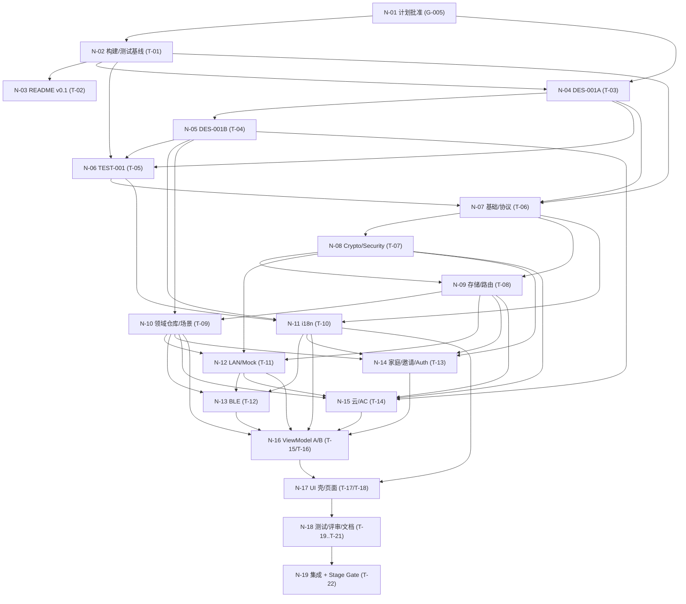

# 交付计划与最小必要路径（Delivery Plan v1.0）

- **Artifact ID**: DELIVERY-PLAN-001
- **Producer**: agent:delivery-planner
- **Type**: Delivery Plan / Minimum Necessary Path / Task Graph
- **Status**: Proposed（待 G-005 Artifact Validation Gate 批准）
- **Date**: 2026-10-17
- **Task**: `wp-005-plan`（task 分支 `task/wp-005-plan`，父分支 `feat/yaocore-app`，base commit `c1642ef`）
- **Workflow**: STANDARD / GATED_AUTO
- **Target Stage**: `implementation`
- **Upstream**:
  - G-004 @ `697762c`：CB、ADR-001..004、PC、I18N-DESIGN（均已 Accepted，ADR 文件头 Status 行同步为 P2）
  - WP2 @ `6c75037`；WP3 @ `54c1d78`
  - `artifacts/30-plan/component-graph.md`（COMPONENT-GRAPH-001，本任务并行交付）
  - `config/project.md`；wp-005 handoff pin 的 15 项输入
- **Downstream**: wp-006 DES-001A/B、T-01..T-22、TEST-001、Component/Integration/Stage Gate、后续 release 阶段
- **Scope 纪律**: 本计划只覆盖到 `implementation` 阶段；不进入 release/发布；不写实现代码；不改 `input/`；不新增架构裁定。基线未覆盖项见 §9。

---

## 0. 摘要

| 项 | 值 |
|---|---|
| 组件数 | **29**（C-01..C-29，见 `component-graph.md`） |
| 任务数 | **22**（T-01..T-22；其中 20 个主路径执行任务 + 独立评审/文档收尾 2 个）。略高于 12-20 的估算，原因是 29 个组件与 G-004 安全/契约门禁；每个任务仍为单会话规模，超过 `L` 必须拆分。 |
| 里程碑 | **6**（M1..M6） |
| Gate | G-005（计划）、G-006..G-008（设计/测试计划）、CQG-Txx（组件质量）、G-010..G-013（集成）、G-014（Stage Gate） |
| 首个 READY 节点 | **T-01 构建与测试基线验证**（G-005 PASS 后 READY） |
| 主执行模型 | 主 worktree **串行**；逻辑并行组仅供未来多 worktree/多会话；同一时间仅一个活动交接 |
| 目标停止点 | Stage Gate `implementation` PASS → `PAUSED_AT_STAGE`；不自动进入 testing/release |
| 工程证据边界 | ArkTS 构建 + 静态检查 + 单测 + 契约/Mock 仿真 + 独立评审；**不包含真机/硬件/真实网络** |

**核心判断**：本项目不是“55 个旧文件平移”，而是 29 个组件按契约重建。实现风险集中在安全/协议（Crypto、Security、LAN、BLE、Invite、Cloud）与 UI/VM 集成；因此路径顺序为 **基线 → 设计 → 契约/安全核心 → 领域/传输 → VM/UI → 全量验证 → 集成**，不按页面顺序推进。

---

## 1. 规划原则与执行模型

### 1.1 依赖以工件/契约为准

- 任务 READY 的条件是：上游 **Artifact revision + Gate 证据** 就绪，不是某个 Agent 空闲。
- G-004 已批准契约基线；wp-006 DES-001 是组件接口的下一道就绪门；wp-002 向量是契约测试的输入；wp-003 的 P0/P1 清单已由 G-004 闭环。
- Agent 身份只决定“谁执行”，不决定顺序；同一角色可执行多个任务，同一任务必须由一个角色完成并提交。

### 1.2 串行主路径与逻辑并行组

- 当前运行时：主 worktree 串行，一个活动交接；每个任务在 `task/<task-id>` 分支上由 repository-manager 准备，专业 Agent 提交后由 repository-manager 合并到 `feat/yaocore-app`。
- 本计划给出**串行可执行顺序**（§2 节点表 + §3 任务顺序）。逻辑并行组只在未来具备多 worktree/多会话时启用；启用前必须满足：写范围不重叠、契约冻结、每个 worktree 独立交接。
- 逻辑并行组见 §2.4；即使并行，Gate 仍按集成点串行判定。

### 1.3 任务粒度

- `S`：半会话内完成；`M`：约一个标准会话；`L`：一个长会话或需拆分。
- 任务超过 `L` 或出现跨组件契约不清时，**先拆任务/补 DES-001**，不把未定义接口塞进实现。
- 每个任务必须可独立交接：输入 revision、写范围、DoD、Gate、证据路径齐全。

### 1.4 计划不做什么（Minimum Necessary Path 剪枝）

- 不新建 REQ/ARCH/ADR/UML 工件：G-004 已批准，UML 按 CB §8.5 不单独产出；DES-001 只补组件级接口。
- 不重跑 wp-002 的 Python 套件作为主门禁；只复用其向量/夹具与仿真器形态。
- 不做 release/打包/推送；不合并到 `main`（`main_merge_mode: review_request_when_remote`，后续 release 阶段处理）。
- 不做真实硬件/真机/ESP32 固件构建；不修改 `input/`；不把文档维护轮次塞进实现关键路径。
- 不机械迁移旧 615 条内联字典；按 I18N-DESIGN §5 分类重建（T-10）。

### 1.5 输入路径缩写（任务表中的 `@ revision` 均指向这些文件）

| 缩写 | 路径 | 本计划使用的 revision |
|---|---|---|
| G-004 | `artifacts/20-architecture/{contract-baseline,adr-001..004,project-constraints,i18n-resource-design}.md` | `697762c`（G-004 批准） |
| PLAN | `artifacts/30-plan/{component-graph,delivery-plan}.md` | G-005 记录的 wp-005 commit |
| WP2 | `artifacts/10-verification/wp-002-protocol-fixture-validation.md` | `6c75037` |
| WP3 | `artifacts/10-verification/wp-003-cross-artifact-consistency.md` | `54c1d78` |
| REQ | `input/requirements/YaoCore_HarmonyOS_App_Requirements.md` | wp-005 handoff pin |
| ARCH | `input/architecture/App_System_Architecture.md` | wp-005 handoff pin |
| UIUX | `input/design/UI_UX_Specification.md` | wp-005 handoff pin |
| DM | `input/data/Data_and_State_Models.md` | wp-005 handoff pin |
| BLE | `input/existing/docs/BLE配网设计.md` | wp-005 handoff pin |
| INV | `artifacts/00-project-intake/inventory.md` | `fc66ec4` |
| DES-A / DES-B | `artifacts/40-detailed-design/des-001a-foundation-transport.md` / `des-001b-domain-presentation.md` | G-006 / G-007 |
| TEST-001 | `artifacts/60-testing/test-plan.md` | G-008 |
| T-xx | 该任务的交付 commit | 各 Gate/Checkpoint 记录 |

### 1.6 规划假设（低风险，可验证）

| ID | 假设 | 验证点 |
|---|---|---|
| A-PLAN-01 | `hvigorw` 可完成至少 ArkTS 编译/HAP 打包；测试运行路径可在 T-01 实证 | T-01 |
| A-PLAN-02 | 主 worktree 串行足以完成本计划；不需要多 worktree | 运行时约束 |
| A-PLAN-03 | 无真机条件下，单元/契约/Mock 测试可覆盖核心逻辑；UI 渲染/性能只作有限证据 | §6.6 |
| A-PLAN-04 | wp-002 向量/夹具可作为 ArkTS 测试的期望来源（复制并标注来源/哈希） | T-05/T-06/T-07 |
| A-PLAN-05 | P-TLS-PIN 在无固件 v2.1 时保持 mock/条件路径；不宣称真实 TLS 可用 | T-11、FC-01/02 |
| A-PLAN-06 | T-01..T-22 的 future commit 由各 Gate/Checkpoint 记录；本计划中的 `@ G-00x`/`@ commit(T-xx)` 为 revision 标签 | 每个 handoff pin |

---

## 2. Minimum Necessary Path

### 2.1 节点表

> 状态：`READY` = 当前可开始；`READY_ON_GATE` = 依赖 Gate 通过后立即可开始；`BLOCKED` = 上游未就绪。节点是“工件/结果”而不是 Agent。

| 节点 | 目标/产出 | 依赖 | 状态（计划交付时） | 证据/Gate | 重规划触发器 |
|---|---|---|---|---|---|
| N-01 | 交付计划批准（本文件 + component-graph） | G-004；wp-005 handoff | **READY** | G-005；本文件 | 用户覆盖 D-009..D-012；范围变更 |
| N-02 | 构建/测试基线可复现 | N-01 | READY_ON_GATE | T-01 `build-baseline.md`；G-009 | `hvigorw`/签名/测试运行器不可用 |
| N-03 | README v0.1（已验证命令/限制） | N-02 | BLOCKED | T-02 README；Artifact Validation | 构建命令变化 |
| N-04 | DES-001A：基础/协议/安全/存储/传输接口 | N-01, N-02 + G-004 | READY_ON_GATE | T-03；G-006 | 基线冲突；PB-01/PB-02 未决 |
| N-05 | DES-001B：领域/云/适配/VM/UI 接口 | N-04 | BLOCKED | T-04；G-007 | DES-A 接口变更 |
| N-06 | TEST-001：测试计划/骨架/测量口径 | N-02, N-04, N-05 | BLOCKED | T-05；G-008 | 测试运行器不可用；向量缺口 |
| N-07 | 基础模型/协议映射（C-01..C-03） | N-04, N-06, N-02 | BLOCKED | T-06；CQG-T06 | DTO/映射契约变更 |
| N-08 | Crypto/Security（C-04..C-05） | N-07 | BLOCKED | T-07；CQG-T07 | 向量失败；API 不可用 |
| N-09 | 存储/网关路由（C-06..C-07） | N-07, N-08 | BLOCKED | T-08；CQG-T08 | Asset Store API 限制 |
| N-10 | 领域仓库/场景（C-08..C-11） | N-05, N-09 | BLOCKED | T-09；CQG-T09 | 仲裁/未分配语义不清 |
| N-11 | i18n/资源包（C-14） | N-05, N-06, N-07 | BLOCKED | T-10；CQG-T10 | key parity/资源布局问题 |
| N-12 | LAN/Mock（C-17, C-18, C-20） | N-08, N-09, N-10 | BLOCKED | T-11；CQG-T11；IG-1 | TLS pin API 不可行；PB-01 |
| N-13 | BLE 配网（C-19） | N-10, N-11, N-12 | BLOCKED | T-12；CQG-T12；IG-1 | Security1/固件行为不符 |
| N-14 | 家庭/邀请/Auth（C-12, C-13） | N-08, N-09, N-10, N-11 | BLOCKED | T-13；CQG-T13；IG-1 | 邀请容器/回执语义问题 |
| N-15 | 云/AC 适配（C-15, C-16） | N-05, N-08, N-09, N-10, N-12 | BLOCKED | T-14；CQG-T14 | PB-02；IoTDA 响应未知 |
| N-16 | ViewModel A/B（C-21..C-23） | N-10..N-15 | BLOCKED | T-15/T-16；CQG-T15/16；IG-2 | VM/服务契约变更 |
| N-17 | UI 壳/页面（C-24..C-28） | N-16, N-11 | BLOCKED | T-17/T-18；CQG-T17/18；IG-3 | 导航/设计系统返工 |
| N-18 | 全量测试/独立评审/文档收尾 | N-17 | BLOCKED | T-19/T-20/T-21；IG-4 | 测试失败；评审 FAIL |
| N-19 | 集成 + Stage Gate（implementation） | N-18 | BLOCKED | T-22；G-013/G-014 | 关键缺陷；证据不足 |

### 2.2 依赖图



### 2.3 关键路径（串行主路径）

```text
G-005 → T-01 → T-02 → T-03 → T-04 → T-05 → T-06 → T-07 → T-08 → T-09
→ T-10 → T-11 → T-12 → T-13 → T-14 → T-15 → T-16 → T-17 → T-18
→ T-19 → T-20 → T-21 → T-22 → G-014（PAUSED_AT_STAGE）
```

- 关键路径上安全/协议任务（T-07、T-08、T-11、T-12、T-13）风险最高；任一 FAIL 触发 Failure Escalation，不反复局部补丁。
- T-03 与 T-01 逻辑上可并行；串行顺序先 T-01/T-02，以便 README 和测试运行路径尽早确定。
- T-10（i18n）只依赖 T-06，可在 T-07 之后插入；放在 T-07..T-09 之后是为了让 UI 前置资源一次成型。

### 2.4 逻辑并行组（未来多 worktree 时）

| 组 | 可并行节点/任务 | 前提 | 不建议并行的原因（当前） |
|---|---|---|---|
| PG-1 | T-01（基线）∥ T-03（DES-A） | 仅当 T-03 不消费构建基线事实；G-005 PASS | 本计划**不使用**：T-03 需要 T-01 的命令/环境事实，串行更安全 |
| PG-2 | T-07（SEC）∥ T-10（i18n） | T-06 完成；C-01..03 接口冻结 | 安全任务需要专注；i18n 可后置 |
| PG-3 | T-12（BLE）∥ T-14（云/AC） | T-08..T-10 完成；契约冻结 | 两者都依赖 T-11 的传输接口；串行更安全 |
| PG-4 | T-15（VM-A）∥ T-16（VM-B） | 领域服务/传输/云契约稳定 | 共享导航/错误映射；串行便于统一 |
| PG-5 | T-20（评审）∥ T-21（文档收尾） | T-19 完成；评审只读 | 评审发现可能改变 README/限制说明；串行避免返工 |

> 并行前提：每个 worktree 独立 `task/` 分支、独立 handoff、写范围无重叠；共享仓库的 pin/begin 注册表允许并行读，但一个 worktree 只能一个活动交接。

### 2.5 重规划触发器（全局）

1. **G-004 变更**：用户覆盖 D-009..D-012、ADR/CB 修订、FC-01/02 固件提前可用 → 触发 Change Impact；T-03/T-04/T-11..T-14 受影响。
2. **构建基线失败**：T-01 无法产出可复现构建/测试命令 → 暂停 T-06 之后的实现 Gate；先解决环境/签名/运行器。
3. **DES-001 接口未冻结**：T-03/T-04 有 `UNRESOLVED` 项 → 阻塞对应实现任务；不得在代码中猜。
4. **组件 Gate 连续两次 FAIL**：停止局部修补，按 Failure Escalation 回退到设计/契约层。
5. **测试运行器不可用**：T-05 无法提供可执行测试骨架 → 测试证据降级为 `BLOCKED`，需用户/环境决策。
6. **PB-01/PB-02 未决**：仅阻塞 C-18 UDP 部分 / C-15 外部模块云完成判定；其余路径继续。
7. **范围蔓延**：引入 release/PR、完整文档修订、真实设备联调 → 超出 Target Stage，停止并报告。
8. **上下文/预算超限**：单任务超过 `L` 或返工 > 1 次 → 拆分任务/补设计，不压缩测试。

---

## 3. 任务图（T-01..T-22）

> 通用 DoD（所有代码任务）：`hvigorw` 构建通过；`codeLinter`/静态检查通过；相关 UT/CT/IT 通过；无硬编码用户文案（I18N-02）；无秘密/证书/HAP/构建目录进入提交（SC-07）；文件已提交且 `git diff --cached --check` 通过；手头任务只写声明范围。下列各任务只列**额外** DoD 与关键证据。

### 3.1 阶段 A：基线、设计与测试计划

#### T-01 — 构建与测试基线验证（BL-001）

- **目标**：在一个干净工作区确认 `ohpm`/`hvigorw`/SDK/Java/Node 可用，产出可复现的安装、构建、静态检查、单元/契约测试命令，并确认无真机条件下的测试运行路径。
- **角色**：implementation-engineer
- **输入**：`config/project.md` @ pin；G-004（PL-01..03/PL-09）@ `697762c`；`build-profile.json5`、`entry/build-profile.json5`、`hvigorfile.ts`、`entry/hvigorfile.ts` @ `c1642ef`；`state/reports/wp-000-repo-bootstrap.md` @ `c1642ef`（工具链侦察）
- **写范围**：`artifacts/50-implementation/build-baseline.md`；`tools/build/**`；`entry/src/ohosTest/**`（测试探针/测试模块配置）；`entry/src/test/**`（若本地单元测试需要）；仅在构建/测试依赖必需时最小修改 `build-profile.json5`、`entry/build-profile.json5`、`oh-package.json5`、`entry/oh-package.json5`（必须在报告中逐项说明）
- **DoD**：
  1. 记录 `ohpm --version`、`hvigorw --version`、SDK/Java/Node 版本与环境变量。
  2. 验证并记录 `ohpm install`（或等价）、`hvigorw clean assembleHap --no-daemon`（或 `assembleApp`）、`hvigorw ... codeLinter`、单元/契约测试命令；区分**已通过**、**未运行**、**环境阻塞**。
  3. 创建一个最小 Hypium/本地测试探针并实际运行；若不能运行，记录根因、错误输出和可行的替代路径（不虚报 PASS）。
  4. 记录签名/HAP 打包行为（`signingConfigs: []` 的影响）与是否可以产出未签名 HAP。
  5. 报告中给出“后续任务可直接复用”的命令块与前置条件。
- **Gate**：G-009（Build Baseline Artifact Validation）+ CQG-T01 的构建证据
- **依赖**：G-005 PASS
- **规模/风险**：M / M
- **并行性**：串行主路径第一个；T-03 依赖其输出

#### T-02 — README-001 v0.1（早期交付）

- **目标**：项目根 README 说明产品、前提、**已验证**的安装/构建/测试命令、当前交付状态、已知限制与仓库结构。
- **角色**：technical-writer
- **输入**：T-01 `build-baseline.md` @ commit(T-01)；`config/project.md` @ pin；G-004 PC @ `697762c`；`artifacts/00-project-intake/inventory.md` @ `fc66ec4`（MISSING README-001）
- **写范围**：`README.md`
- **DoD**：所有命令与 T-01 证据一致；明确“脚手架/规划阶段、无业务实现、无真机测试、Mock/仿真为工程证据”；给出后续文档/工件路径；不复制框架介绍冒充产品 README；中英术语一致。
- **Gate**：Artifact Validation（README-001）
- **依赖**：T-01
- **规模/风险**：S / L

#### T-03 — DES-001A 详细设计（基础/协议/安全/存储/传输）

- **目标**：把 C-01..C-07、C-12..C-13、C-17..C-20 的组件契约冻结到可实现粒度。
- **角色**：solution-architect
- **输入**：G-004 @ `697762c`；`component-graph.md` @ G-005；T-01 @ commit(T-01)；WP2 @ `6c75037`；WP3 @ `54c1d78`
- **写范围**：`artifacts/40-detailed-design/des-001a-foundation-transport.md`
- **DoD**：
  1. 对 `component-graph.md` §5 中 C-01..C-07、C-12、C-13、C-17..C-20 的接口需求逐项给出：接口签名（ArkTS 语义）、输入/输出、错误类型、状态机/不变量、依赖注入端口、测试 seam、traceability（FR/约束 ID）。
  2. 明确 canonical/HMAC/时间/nonce/响应验签/N前后端错误分类的边界；不改变 G-004 语义。
  3. 明确 TLS pin 校验的候选实现路径和失败语义；对 PB-01/PB-02 标注 `UNRESOLVED` 或给出去风险方案（不擅自定架构）。
  4. 明确 mock/仿真注入点与生产排除要求。
  5. 不复制 CB 全文；用路径+章节引用。
- **Gate**：G-006（Artifact Validation）
- **依赖**：G-005；T-01（构建基线事实）
- **规模/风险**：L / H
- **并行性**：串行（T-01 输出作为输入）

#### T-04 — DES-001B 详细设计（领域/云/适配/VM/UI）

- **目标**：把 C-08..C-11、C-14..C-16、C-21..C-29 的组件契约冻结到可实现粒度。
- **角色**：solution-architect
- **输入**：G-004 @ `697762c`；`component-graph.md` @ G-005；DES-001A @ G-006；T-01 @ commit(T-01)；WP2 @ `6c75037`；WP3 @ `54c1d78`
- **写范围**：`artifacts/40-detailed-design/des-001b-domain-presentation.md`
- **DoD**：按 `component-graph.md` §5 逐项给出领域 repository 状态机/SSOT 仲裁/房间删除/场景执行/邀请状态、云完成判定、AC 适配、I18n API、VM 状态模型、页面导航/绑定、组合根/权限；与 DES-A 的共享类型一致；所有 FR 有 component→interface→test 的映射；PB-02 明确处置。
- **Gate**：G-007（Artifact Validation）
- **依赖**：T-03
- **规模/风险**：L / H

#### T-05 — TEST-001 测试计划与可执行测试骨架

- **目标**：产出 TEST-001 计划、向量/夹具清单、Hypium/Python 分工、Mock/TLS 形态、NFR 4.3 测量口径，并搭建可运行的测试骨架/仿真器。
- **角色**：test-engineer
- **输入**：G-004 @ `697762c`；`component-graph.md` @ G-005；DES-A/B @ G-006/G-007；WP2 §7 @ `6c75037`；T-01 @ commit(T-01)
- **写范围**：`artifacts/60-testing/test-plan.md`；`tools/simulator/**`；`tools/contract/**`；`tools/test-fixtures/iotda/product-profile.json`；`entry/src/ohosTest/ets/test/contract/fixtures/**`；`entry/src/ohosTest/ets/test/README.md`
- **DoD**：
  1. §6 全部测试分层/向量复用/边界写实；不把未运行项写成 PASS。
  2. 适配 `gateway_contract_server.py` 到 `tools/simulator/`（DEV-only、PUBLIC TEST DATA 标注），新增 `--tls --cert --key`，启动打印 SPKI-SHA256；提供公开测试证书/密钥材料（仅测试）。
  3. `crosscheck_protocol_assets.py` 适配并运行 66/66；`product-profile.json` 由 `state-report.schema.json` 反推（P-15）。
  4. 给出 NFR 4.3 的可执行测量脚本/伪代码或 harness 约定；明确不可测项。
  5. 测试骨架可被 T-06 起直接复用；记录精确命令与前置条件。
- **Gate**：G-008（Artifact Validation）
- **依赖**：T-01、T-03、T-04
- **规模/风险**：M / H

### 3.2 阶段 B：核心基础与领域服务

#### T-06 — 基础模型、协议 DTO/映射（C-01..C-03）

- **目标**：实现公共类型/常量/工具、领域模型、schema DTO 与线格式↔内部模型映射；为安全/仓储/传输提供可编译基础。
- **角色**：implementation-engineer
- **输入**：DES-A @ G-006；TEST-001 @ G-008；G-004 CB §2/§4/§5/§6 @ `697762c`；WP2 @ `6c75037` 向量清单
- **写范围**：`entry/src/main/ets/common/**`；`entry/src/main/ets/model/**`；`entry/src/main/ets/service/protocol/**`；`entry/src/ohosTest/ets/test/foundation/**`
- **DoD**：实现 `mapDiscoverResponse`/`mapControlAck`/`serializeControlRequest`/identity v2.0 解析/云命令/影子映射；别名回退与 `protocolDeviation`；时间戳/`request_id`/`seq` 规则；golden fixture（discover/ACK）UT 通过；identity 多余字段 fail-closed；构建/lint 通过。
- **Gate**：CQG-T06
- **依赖**：T-03、T-05、T-01
- **规模/风险**：M / M

#### T-07 — CryptoService + SecurityService（C-04..C-05）

- **目标**：实现密码学原语封装与 HMAC/响应验签/时间/nonce/correlation 全链。
- **角色**：implementation-engineer
- **输入**：DES-A @ G-006；WP2 向量 @ `6c75037`；BLE §4；ADR-002 §2 @ `697762c`
- **写范围**：`entry/src/main/ets/service/crypto/**`；`entry/src/main/ets/service/security/**`；`entry/src/ohosTest/ets/test/security/**`
- **DoD**：4/4 控制 HMAC 向量、响应验签向量、发现请求向量、RFC7748、AES-256-CTR 连续流、常数时间比较、±120s/300s 负例全部通过；签名失败/时间失败不消耗 nonce；无秘密日志；构建/lint 通过。
- **Gate**：CQG-T07（安全评审证据供 T-20 消费）
- **依赖**：T-06
- **规模/风险**：H / H

#### T-08 — 存储服务 + GatewayRepository（C-06..C-07）

- **目标**：实现 Preferences/RDB/Asset Store 封装、网关路由/通道档案/pin/secret 引用。
- **角色**：implementation-engineer
- **输入**：DES-A @ G-006；G-004 ADR-002 §8.3/§4/§6、SC-09/SC-12 @ `697762c`
- **写范围**：`entry/src/main/ets/service/storage/**`；`entry/src/main/ets/repository/GatewayRepository.ets`；`entry/src/ohosTest/ets/test/storage/**`
- **DoD**：route CRUD、P-HMAC/P-TLS-PIN/P-BLOCKED 迁移、pin 绑定/轮换、last-known IP、Asset alias 生命周期、内存擦除；单元测试用 fake store；无明文 secret/日志；构建/lint 通过。
- **Gate**：CQG-T08
- **依赖**：T-06、T-07
- **规模/风险**：H / H

#### T-09 — Family/Room/Device/Scene 仓储与服务（C-08..C-11）

- **目标**：实现家庭/成员/邀请注册表、房间、设备 SSOT/仲裁、场景执行。
- **角色**：implementation-engineer
- **输入**：DES-B @ G-007；G-004 ADR-003/ADR-004、CB §2/§6 @ `697762c`；TEST-001 @ G-008
- **写范围**：`entry/src/main/ets/repository/{FamilyRepository,RoomRepository,DeviceRepository}.ets`；`entry/src/main/ets/service/scene/**`；`entry/src/ohosTest/ets/test/domain/**`
- **DoD**：`stateEpochMs` 陈旧包丢弃；未分配/禁用；dismissed tombstone；房间删除保护；改名/换房零网络；场景串行/局部失败不回滚；邀请/回执状态机（不实现加密容器，留给 T-13）；测试通过。
- **Gate**：CQG-T09
- **依赖**：T-04、T-08
- **规模/风险**：H / H

#### T-10 — I18nService、资源包与检查器（C-14）

- **目标**：实现 locale 解析/fallback/插值/复数/运行时切换，建立 zh-CN/en-US 资源与 CHK-01..09 检查器。
- **角色**：implementation-engineer
- **输入**：I18N-DESIGN @ `697762c`；DES-B @ G-007；TEST-001 @ G-008；CB §4.4/§6.1/§6.3
- **写范围**：`entry/src/main/ets/service/i18n/**`；`resources/base/element/string.json`；`resources/en_US/element/string.json`；`resources/rawfile/i18n/{zh-CN,en-US}.json`；`tools/i18n/check_i18n.py`；`entry/src/ohosTest/ets/test/i18n/**`
- **DoD**：资源布局符合 I18N-DESIGN §3；key parity 100%；fallback 不抛异常；插值/复数正确；错误码/状态来源键映射；运行时切换不重启；CHK-01..09 可运行并报告；UI 硬编码扫描基线形成（允许清单）。
- **Gate**：CQG-T10
- **依赖**：T-04、T-05、T-06
- **规模/风险**：M / M
- **备注**：T-10 会修改现有 `resources/base/element/string.json`；handoff 需 `snapshot_paths` 覆盖现有资源文件，保留模板原有键，不覆盖框架元数据。

#### T-11 — LocalGatewayService + GatewayDiscoveryService + Mock（C-17, C-18, C-20）

- **目标**：实现 LAN HTTP/HTTPS+HMAC 全链、发现/手动 IP/上次地址、TLS pin 三态、DEV-ONLY 拒收与 Mock 注入。
- **角色**：implementation-engineer
- **输入**：DES-A @ G-006；G-004 ADR-001/ADR-002、CB §3/§4/§8.6 @ `697762c`；TEST-001 @ G-008；WP2 仿真器证据
- **写范围**：`entry/src/main/ets/service/gateway/**`；`entry/src/ohosTest/ets/mock/**`；`entry/src/ohosTest/ets/test/gateway/**`
- **DoD**：`IGatewayClient` 实现；控制/发现 canonical 与验签；时间窗/nonce；correlation；精确重传幂等；P-HMAC/P-TLS-PIN/P-BLOCKED；pin mismatch/handshake fail 硬失败；DEV-ONLY 拒收；手动 IP 仅已绑定且强校验；Mock TLS 四模式；与 Python 仿真器契约测试；生产组合根不引用 Mock。
- **Gate**：CQG-T11；IG-1（与 T-12/T-13 一起）
- **依赖**：T-07、T-08、T-09
- **规模/风险**：H / H
- **备注**：先做一个 TLS API 可行性 spike（`@ohos.net.http` vs `@ohos.net.socket` + `@ohos.security.cert`）；若不能按 SPKI pin 校验，记录为 R-03 并升级，不得降级为“跳过校验”。

#### T-12 — BleProvisioningService（Security1/身份 v2.0/v2.1）（C-19）

- **目标**：实现 BLE 配网全状态机与 Security1/protobuf/身份协商。
- **角色**：implementation-engineer
- **输入**：DES-A @ G-006；G-004 ADR-001 §3、ADR-002 §3、BLE §2-§8 @ `697762c`；TEST-001 @ G-008；WP2 @ `6c75037` BLE 向量
- **写范围**：`entry/src/main/ets/service/ble/**`；`entry/src/ohosTest/ets/test/ble/**`
- **DoD**：扫描/连接/MTU/0x2901 动态映射；`proto-ver` 能力门禁；Security1 step0/step1/CTR 流；protobuf 向量；`yaocore-id` v2.0/v2.1 协商与 fail-closed；Wi-Fi 扫描/下发/状态/`yaocore-done`；取消清理（stopScan/GATT/内存擦除）；Mock BLE 测试；无真机。
- **Gate**：CQG-T12；IG-1
- **依赖**：T-10、T-11
- **规模/风险**：H / H

#### T-13 — AuthService + InviteService（C-12..C-13）

- **目标**：实现本地 PBKDF2 档案/RBAC 与 YCI1/YCR1 离线凭据全链。
- **角色**：implementation-engineer
- **输入**：DES-A @ G-006；G-004 ADR-003、ADR-004 §4、D-009/D-013 @ `697762c`；TEST-001
- **写范围**：`entry/src/main/ets/service/auth/**`；`entry/src/main/ets/service/invite/**`；`entry/src/ohosTest/ets/test/family/**`
- **DoD**：PBKDF2|SHA256 120k 加盐；本地会话/RBAC 矩阵；YCI1 容器/AAD/AEAD；YCR1 加入请求；KEY_WRAP 主路径 + CODE_KEK 弱路径；expireAt/maxUses/inviteId 去重；回执 HMAC；轮换引导；安全文案键；测试通过。
- **Gate**：CQG-T13（安全评审证据供 T-20）
- **依赖**：T-08、T-09、T-10
- **规模/风险**：H / H

#### T-14 — CloudService + AC 品牌适配器（C-15..C-16）

- **目标**：实现 IoTDA 配置/签名命令/影子轮询/完成判定/Token 过期，以及 AC 品牌适配。
- **角色**：implementation-engineer
- **输入**：DES-B @ G-007；G-004 CB §7.1/§6.2/§6.3、ADR-001 §2 @ `697762c`；CC/SR schema；TEST-001
- **写范围**：`entry/src/main/ets/service/cloud/**`；`entry/src/main/ets/adapter/ac/**`；`entry/src/ohosTest/ets/test/cloud/**`；`entry/src/ohosTest/ets/test/adapter/**`
- **DoD**：`paras` 10 字段映射；`CmdId=3001`；`Value` 紧凑 JSON 原子；`Sign` canonical；X-Auth-Token；shadow 轮询；完成判定（内置 `LastRequestId/LastSeq` + `DeviceInventoryJson`，后者 fail-closed/见 PB-02）；Token 过期提示；云错误命名空间；AC 7 值 mode/16..30/percent；测试通过。
- **Gate**：CQG-T14
- **依赖**：T-04、T-08、T-09、T-11
- **规模/风险**：M / H

### 3.3 阶段 C：ViewModel 与 UI

#### T-15 — ViewModel A：Home/Device/Climate/Door（C-21）

- **目标**：实现首页/设备/温控/门锁状态流、三态控制、55ms 节流、TouchUp、门锁四阶段。
- **角色**：implementation-engineer
- **输入**：DES-B @ G-007；G-004 ADR-004 §6、CB §2.3 @ `697762c`；UIUX §4.3/4.4；TEST-001
- **写范围**：`entry/src/main/ets/viewmodel/{HomeViewModel,DeviceViewModel,ClimateViewModel,DoorViewModel}.ets`；`entry/src/ohosTest/ets/test/viewmodel/device/**`
- **DoD**：PENDING/COMMITTED/REVERT；仅在验签+correlation+`result_code==0`+`reported_state` 后 COMMITTED；55ms 合并/TouchUp 强同步；门锁 SECURED/UNCONFIRMED/UNKNOWN、10s、离线区分；状态来源标签；测试通过。
- **Gate**：CQG-T15；IG-2
- **依赖**：T-09、T-10、T-11、T-12、T-14
- **规模/风险**：H / H

#### T-16 — ViewModel B：Family/Room/Scene/Provisioning/Settings（C-22..C-23）

- **目标**：实现家庭/成员/RBAC、房间/未分配池、场景进度、配网状态机、设置/语言/云/TLS/高级 IP。
- **角色**：implementation-engineer
- **输入**：DES-B @ G-007；G-004 ADR-002/003/004、D-012/D-015 @ `697762c`；UIUX §3/§4.1/4.2/4.5/4.6；TEST-001
- **写范围**：`entry/src/main/ets/viewmodel/{FamilyViewModel,RoomViewModel,SceneViewModel,BleProvisioningViewModel,SettingsViewModel}.ets`；`entry/src/ohosTest/ets/test/viewmodel/admin/**`
- **DoD**：RBAC 可见性；房间删除/指派；场景进度与局部失败；配网权限/取消/重试/清理；设置项持久化；语言切换；Token 过期；手动 IP 强校验；测试通过。
- **Gate**：CQG-T16；IG-2
- **依赖**：T-10、T-11、T-12、T-13、T-14
- **规模/风险**：H / H

#### T-17 — UI 壳、设计系统、Home/Rooms/DeviceControl 页面（C-24, C-25, C-28）

- **目标**：实现 4 Tab/NavDestination 导航壳、EntryAbility/权限/module 配置、主题/复用组件、Home/Rooms/DeviceControl 页面。
- **角色**：implementation-engineer
- **输入**：DES-B @ G-007；UIUX §2/§3/§4.2-4.4 @ pin；G-004 SC-11/PL-06 @ `697762c`；T-15/T-16 @ CQG
- **写范围**：`entry/src/main/ets/entryability/**`；`pages/Index.ets`；`common/theme/**`；`components/**`；`pages/{HomePage,RoomsPage,DeviceControlPage}.ets`；`entry/src/main/module.json5`；`resources/base/profile/main_pages.json`；`AppScope/app.json5`；`entry/src/ohosTest/ets/test/ui/shell/**`
- **DoD**：导航壳/4 Tab/二级页返回；权限声明与运行时申请；主题/暗黑/动效 token；卡片/空/错误/加载态；三态 UI；房间/未分配池；编译/启动 smoke；生产 Mock 排除；i18n 键引用；无硬编码文案。
- **Gate**：CQG-T17；IG-3
- **依赖**：T-10、T-15、T-16、T-01
- **规模/风险**：H / H

#### T-18 — Family/Room/Scene/Provisioning/Settings/About/Profile 页面（C-26..C-27）

- **目标**：实现家庭/成员/邀请、房间管理、场景、6 步配网向导、设置/关于/Profile 页面。
- **角色**：implementation-engineer
- **输入**：DES-B @ G-007；UIUX §3/§4.1/4.5/4.6 @ pin；G-004 ADR-002/003/004、D-012/D-015/D-016 @ `697762c`；T-16 @ CQG；T-17 壳
- **写范围**：`entry/src/main/ets/pages/{FamilyManagePage,RoomManagePage,ScenePage,ProvisioningPage,SettingsPage,AboutPage,ProfilePage}.ets`；`entry/src/ohosTest/ets/test/ui/pages/**`
- **DoD**：邀请展示/扫码/粘贴（YCR1/YCI1）；成员角色/移除/到期；房间管理；场景进度；配网向导 6 步/取消/错误；设置语言/云/TLS/高级 IP；关于/隐私；Profile Tab 家庭入口；i18n/RBAC 可见性/安全文案；编译/UI smoke。
- **Gate**：CQG-T18；IG-3
- **依赖**：T-16、T-17
- **规模/风险**：H / H

### 3.4 阶段 D：全量验证、评审、文档与集成

#### T-19 — 全量测试执行与报告

- **目标**：在最新集成候选上运行构建、静态检查、全量 UT/CT/IT、i18n 检查、NFR 工程估算，产出可追溯测试报告。
- **角色**：test-engineer
- **输入**：T-01..T-18 @ CQG；TEST-001 @ G-008；`component-graph.md` @ G-005
- **写范围**：`artifacts/60-testing/execution-report.md`；`artifacts/60-testing/coverage-summary.md`；`reports/test/**`
- **DoD**：每个 FR/组件有测试映射；通过/失败/未运行分列；无“未运行=通过”；失败项含复现命令与证据；i18n CHK-01..09 报告；性能测量结果标注 `MOCK_ONLY`/`ESTIMATE`/`UNAVAILABLE`；测试数据无真实秘密。
- **Gate**：IG-4（测试证据）；Artifact Validation
- **依赖**：T-17、T-18
- **规模/风险**：M / M

#### T-20 — 独立评审（REV-001）

- **目标**：对安全核心与全应用做独立、可复现的代码/架构/安全/性能/集成评审。
- **角色**：quality-reviewer（不得评审自己写的代码）
- **输入**：T-19 @ commit(T-19)；T-07/T-08/T-11/T-12/T-13 安全证据；G-004 PC（SC-01..SC-16）@ `697762c`；`component-graph.md` @ G-005
- **写范围**：`artifacts/70-review/review-001-independent.md`
- **DoD**：逐项检查：分层依赖/禁止项（`component-graph.md` §4.3）、SC-01..SC-16、秘密/日志、Mock 生产排除、HMAC 全链/fail-closed、TLS pin 语义、时间/nonce、邀请容器、ACK 防乐观、i18n 硬编码、测试真实性；发现按严重度/复现/违反来源记录；给出 PASS/FAIL 与残余风险；不修改被评审代码。
- **Gate**：独立评审 PASS（供 G-013/G-014）
- **依赖**：T-19
- **规模/风险**：M / H

#### T-21 — README 收尾与文档维护轮次

- **目标**：更新 README 为最终实现状态；把 P-01..P-17、E-01..E-12、FC-01..FC-05、ADR Status 行同步等 P2 项形成可执行维护计划；不修改 `input/`。
- **角色**：technical-writer
- **输入**：T-02 README @ commit(T-02)；T-19 测试报告 @ commit(T-19)；T-20 评审 @ commit(T-20)；CB §5.2/§10/§11 @ `697762c`
- **写范围**：`README.md`；`artifacts/80-maintenance/documentation-maintenance-round.md`；`artifacts/80-maintenance/firmware-coordination-tracker.md`
- **DoD**：README 含已验证命令、当前功能/限制、Mock 与真机边界、安全声明（P-HMAC 如实标注）、测试/评审入口；维护计划含 P/E/FC 表、owner/时机/门禁影响；明确 `input/` 不修改；ADR Status 行同步作为 P2 提案（需 Change Impact，不在本任务改 ADR）。
- **Gate**：Artifact Validation（README-001 最终版 + 维护计划）
- **依赖**：T-19、T-20
- **规模/风险**：M / L

#### T-22 — 集成与 implementation Stage Gate 证据

- **目标**：在精确 revision 上完成构建、集成/契约/回归测试，汇总 Stage Gate 证据；由 Orchestrator 判定 G-014。
- **角色**：integration-engineer
- **输入**：T-19 @ commit(T-19)；T-20 @ commit(T-20)；T-21 @ commit(T-21)；全部 CQG 证据；G-004 @ `697762c`
- **写范围**：`artifacts/50-implementation/integration-report.md`；`artifacts/50-implementation/stage-gate-implementation.md`
- **DoD**：集成构建通过；跨组件契约测试/回归通过；列出组件 revision、Gate 结果、未运行项、已知限制；Stage Gate 清单逐项有证据；不声称 release 完成；PASS 后由 Orchestrator 写 `state/gates/G-014` 并 `PAUSED_AT_STAGE`。
- **Gate**：G-013（Integration）+ G-014（Stage Gate，Orchestrator 判定）
- **依赖**：T-20、T-21、T-19
- **规模/风险**：M / M

---

## 4. 门禁与里程碑

### 4.1 Component Quality Gate（CQG）通用检查项

> `CQG-Txx` 是任务级 Component Quality Gate 的命名，不占用 G-0xx 全局序号；每个 CQG 必须有独立证据，不能以“任务完成”替代。

| 检查 | 要求 | 证据 |
|---|---|---|
| 构建 | `hvigorw` ArkTS 构建通过（命令由 T-01 固化） | 构建日志/报告 |
| 静态检查 | `codeLinter`/类型检查通过；无未受控 `any` | 报告 |
| 单元测试 | 组件 UT 通过；安全/协议关键路径含负例 | 测试日志 |
| 契约测试 | 向量/golden fixture/Mock 通过；失败含复现 | 测试报告 |
| 契约符合 | 对照 DES-001 + G-004；无新增语义 | 评审记录 |
| 分层/依赖 | 无 §4.3 禁止项；端口方向正确 | 评审记录 |
| 安全 | 无秘密/日志泄漏；fail-closed；Mock 生产排除 | SEC 记录 |
| i18n | 无硬编码 UI 文案；key 存在 | CHK 报告（适用时） |
| 代码评审 | 作者之外的评审（T-20 或组件级 review） | 评审记录 |
| 可追溯 | 组件/FR/测试链接 | traceability 表 |

**PASS 规则**：所有 Must 项有当前 revision 证据；已知失败在明确接受的边界内；否则 `FAILED`/`UNVERIFIED`。作者不能给自己的代码最终 PASS。

### 4.2 Integration Gate 触发点

| Gate | 触发点 | 参与组件 | 必检 |
|---|---|---|---|
| G-010（IG-1 协议/安全核心） | T-11/T-12/T-13 完成 | C-04..C-07, C-12..C-13, C-17..C-20 | HMAC 全链、Mock/仿真 discover→control→ACK、BLE 状态机 mock、邀请容器、DEV-ONLY、错误语义 |
| G-011（IG-2 领域/VM） | T-15/T-16 完成 | C-08..C-11, C-21..C-23 | SSOT/仲裁、房间删除、场景、三态/节流/门锁、配网/设置 VM |
| G-012（IG-3 UI+VM） | T-17/T-18 完成 | C-14, C-21..C-28 | 导航/启动、页面数据流、i18n、权限、Mock 排除、UI 文案 |
| G-013（IG-4 全量） | T-19/T-20/T-21 完成 | 全部 C-01..C-29 | 全量构建/测试、独立评审、README/限制、回归 |
| G-014（Stage Gate） | G-013 PASS 后 | 全部 | 见 §4.4 |

### 4.3 里程碑

| 里程碑 | 范围 | 可演示/可验证状态 | 退出 Gate |
|---|---|---|---|
| **M1 可复现基线** | T-01, T-02 | 干净环境按 README 命令完成构建/静态检查/测试探针；已知限制写明 | G-009 + README Artifact Validation |
| **M2 设计与测试契约冻结** | T-03..T-05 | DES-A/B + TEST-001 可评审；接口/测试口径冻结；PB-01/PB-02 有处置 | G-006/G-007/G-008 |
| **M3 核心基础** | T-06..T-09 | 模型/协议映射/安全/存储/领域仓库单元+契约测试通过；HMAC/RFC7748/SSOT 证据 | CQG-T06..T-09 |
| **M4 端到端链路（Mock）** | T-10..T-14 | Mock/仿真 discover→control→ACK；BLE 状态机；邀请容器接受；云命令/影子 mock；locale 切换 | CQG-T10..T-14 + G-010 |
| **M5 VM/UI 集成** | T-15..T-18 | 4 Tab、设备三态、房间池、场景、配网向导、设置/语言；Mock 环境可演示 | CQG-T15..T-18 + G-011/G-012 |
| **M6 全量验证与 Stage Gate** | T-19..T-22 | 全量测试/评审/README/集成报告；Stage Gate PASS；`PAUSED_AT_STAGE` | G-013/G-014 |

### 4.4 Stage Gate（implementation）判定清单

- [ ] G-004 契约基线仍 `VALID`，无未处置 Change Impact；D-009..D-016 未被用户覆盖或已重评。
- [ ] 29 个组件均有状态；所有进入集成的组件为 `STABLE`，未完成项有明确范围排除与风险接受。
- [ ] T-01 构建/测试基线、T-03/T-04 DES-001、T-05 TEST-001、T-19 测试报告、T-20 评审、T-21 README/维护计划、T-22 集成报告均 `VALID`。
- [ ] 构建/静态检查/UT/CT/IT 通过；无 P0/P1 未关闭缺陷；失败/未运行项如实列出。
- [ ] i18n CHK-01..09 通过；无硬编码 UI 文案；key parity 100%。
- [ ] SC-01..SC-16 独立评审通过；无秘密/证书/HAP/构建目录入库；Mock 生产排除；P-TLS-PIN 未就绪时 P-HMAC 如实标注。执行 SC-07 提交前检查（`git status --short --ignored`、`git check-ignore` 抽查、`git diff --cached --name-only`）。
- [ ] v1 范围符合：door/light/sensor/ac 完整控制；其余只读降级；无 GCM 运行分支；云 Token 手工；无固件构建链。
- [ ] FR 追溯完整：26 项 FR/NFR 有 component→task→test 链接；FR-FAM-004 的 v1 限制已声明。
- [ ] 实机/真实网络测试未完成项列为用户自行执行，不作为 Agent 阻塞条件（CP-03）。
- [ ] Target Stage = implementation 已达到；写 Checkpoint，`PAUSED_AT_STAGE`，不自动进入 testing/release。

---

## 5. 首批任务建议（串行前 5 个）

1. **T-01 构建与测试基线验证**（READY 第一个）：先证明工具链/构建/测试运行路径；所有后续 Gate 依赖这个事实。
2. **T-02 README-001 v0.1**：用 T-01 的已验证命令写早期 README，避免最后补文档时命令失真。
3. **T-03 DES-001A**：基础/协议/安全/存储/传输接口；逻辑上可与 T-01 并行，串行排在 README 后。
4. **T-04 DES-001B**：领域/云/适配/VM/UI 接口；依赖 DES-A 的共享类型。
5. **T-05 TEST-001**：在实现前冻结测试分层/向量/测量口径；避免先写代码再补测试标准。

> 这 5 个任务完成后，T-06（基础/协议映射）是第一个产品代码任务；T-07（Crypto/Security）是第一个高风险安全任务。

---

## 6. 测试策略骨架（TEST-001 预告）

### 6.1 分层

| 层 | 范围 | 工具/形态 | 主要证据 |
|---|---|---|---|
| L1 单元 | 纯函数/DTO/映射/时间/nonce/仓储逻辑/节流/VM 状态/i18n | Hypium 或 T-01 确认的本地测试运行器；fake stores/clocks | 通过/失败日志、覆盖率（条件允许） |
| L2 契约 | canonical/HMAC/响应验签/发现签名/BLE Security1/protobuf/ACK/identity/云命令/i18n parity | wp-002 向量 + golden fixtures + Python crosscheck + Mock | 向量逐项 PASS；失败复现 |
| L3 集成 | discover→control→ACK、BLE 配网 mock、邀请接受、云命令/影子 mock、VM+UI 数据流、仓库持久化 | MockGatewayService + Python 仿真器 + TLS mock | 集成报告/追踪 |
| L4 性能 | ACK p95、55ms 节流、60/120fps | 计量 harness/虚拟时钟/设备 profiler | 工程估算或 `UNAVAILABLE` |

### 6.2 wp-002 §7 向量复用清单

**保留 Python（DEV-only，不进入 App 构建）**：
- `gateway_contract_server.py` → `tools/simulator/`（含 `--tls --cert --key`，公开测试证书，启动打印 SPKI-SHA256）。
- `crosscheck_protocol_assets.py` → `tools/contract/crosscheck.py`（66/66 硬检查）。
- `derive_module_key.py` 保留为网关侧运维工具，不在 App 路径。

**移植为 ArkTS/Hypium**：
- `hmac-sha256-test-vectors.json` 4 向量（canonical + 签名 + JSON 原子）。
- `response-auth-test-vectors.json`（响应 canonical/签名）。
- `discovery-request-auth-test-vectors.json`（发现请求签名）。
- BLE Security1 编解码常量、protobuf step0/Wi-Fi 向量、RFC7748 三元组。
- ACK golden fixture（`control-ack*.json`）、discover DTO fixture。
- 身份端点严格解析（`get_identity`、多余字段 fail-closed）。
- ACK 语义：`result_code==0`、`idempotent_replay`、1004/1005/1008 路径。

**不移植/改写**：
- 网关 C 源码断言、Arduino 源断言、依赖旧 `module.json5` 的字符串断言；按新 App 实现重写行为测试。
- 外部模块 HMAC 向量属网关↔模块域，App 不实现（仅理解状态来源）。

### 6.3 Hypium 与 Python 工具分工

| 方向 | Hypium/ArkTS | Python（DEV-only） |
|---|---|---|
| 协议纯函数 | ✅ 主 | 交叉验证 |
| DTO/映射/仓储/VM/i18n | ✅ 主 | — |
| HTTP/TLS 仿真 | Mock + 可选仿真器 | ✅ 主（仿真器/crosscheck） |
| schema 结构校验 | golden fixture + 结构断言 | ✅ crosscheck |
| BLE | Mock/向量 | 仅向量来源/静态检查 |
| 性能 | 虚拟时钟/计量 harness | 仿真器计时辅助（不作为产品性能） |

### 6.4 Mock/TLS 仿真形态

- `MockGatewayService` 模式：`normal`、`offline`、`ack-lost`、`replay`、`timeout`、`dev-only`、`pin-match`、`pin-mismatch`、`handshake-fail`；确定性种子/可注入延迟。
- `MockBleProvisioningClient`：扫描/连接/能力门禁/Security1/身份/Wi-Fi 状态机，可注入 PoP 错误、GATT busy、超时、取消。
- Python 仿真器 TLS：自签名测试证书，**PUBLIC TEST DATA ONLY**；`--tls` 同端口 HTTPS；测试断言 pin-match/pin-mismatch/handshake-fail；不进入生产，不作为硬件证据。
- 生产组合根（C-28）不 import Mock；CI/评审用静态/构建检查验证（SC-11）。

### 6.5 NFR 4.3 可执行测量口径草案

| 指标 | 测量点 | 样本/环境 | 报告 | 限制 |
|---|---|---|---|---|
| ACK p95 ≤ 500ms | `t0`=写入请求前；`t1`=响应验签 + correlation + `result_code==0` + `reported_state` 通过并应用；分 `transportMs`/`commitMs` | 每动作/每 profile N≥100；丢弃前 5 次 warm-up；单调时钟；Mock localhost 与仿真器 LAN 分开；记录设备/网络/commit | p50/p95/max、样本数、环境、profile | 仅定义环境内的工程证据；真实 LAN/真机 `USER_RUN_REQUIRED`，不得外推 |
| 55ms 节流 | 虚拟时钟/请求日志：55ms 窗口最多 1 个在途，最新值胜出；TouchUp 立即最终值 | 20 次拖动/1s；fake clock 精确；集成用真实计时报告 | 请求数、窗口内合并数、TouchUp 延迟 | 不把 UI 帧率与节流混为一谈 |
| 60/120fps | ArkUI frame callback/profiler：10s 滚动/动画；平均 FPS、p95 帧时间 | 设备/模拟器；记录分辨率/刷新率/负载 | `DEVICE_ONLY`/`EMULATOR_ONLY`/`UNAVAILABLE` | 无设备时仅静态审查（UI 线程无同步 IO、LazyForEach、缓存），标残余风险 |

- 所有性能结果必须标注 `MOCK_ONLY`、`ESTIMATE`、`EMULATOR_ONLY` 或 `UNAVAILABLE`；不得把 Mock 数字写成产品验收 PASS。
- TEST-001 负责把上述口径变成可执行脚本/报告格式，并在 T-19 输出。

### 6.6 无实机条件下的证据边界

| 可证明 | 不可证明 |
|---|---|
| ArkTS 编译/构建、静态检查 | 真机 UI 渲染/触感/帧率 |
| 纯逻辑/契约/向量/Mock 行为 | 真实 BLE/GATT/MTU/射频 |
| 仓库持久化（模拟器/宿主能力允许时） | 真实网关固件/局域网时延/TLS 证书链 |
| FAIL/REVERT 路径 | 真实硬件 ACK/门磁到位 |
| i18n 键/fallback/切换 | 系统级语言/字体/布局膨胀的最终视觉 |

- 用户自行执行的真机清单应在 README/测试报告中列出；Agent 不阻塞、不伪造。

### 6.7 测试数据与秘密纪律

- 仅使用 `PUBLIC_TEST_SECRET`/公开测试证书；不提交真实 Wi-Fi/PoP/HMAC/云 Token/签名材料（SC-01..SC-03）。
- 测试夹具来源/哈希记录在 `tools/test-fixtures/README` 或测试计划；复制 wp-002 向量时保留来源。
- 日志/异常不得含密码、PoP、会话密钥、设备私钥（SC-06）。

### 6.8 TEST-001 输出物

`artifacts/60-testing/test-plan.md` + 可运行骨架 + 向量清单 + 测量口径 + 仿真器 TLS 形态 + 无实机边界 + 失败/未运行记录模板。

---

## 7. 文档/维护与协同项排期

> 本节全部为 **P2/非阻塞**。实现阶段不修改 `input/`；文档维护轮次在 Stage Gate 后或独立 `docs/` 任务执行。G-004 的 CB §10/§11 是权威清单，本节只排期。

### 7.1 补丁提案 P-01..P-17

| ID | 目标 | 摘要 | 关联 | 时机/owner |
|---|---|---|---|---|
| P-01 | `Gateway_API_Specification.md` discover 示例 | 按 schema 重写；补 `generatedAt/security`、删 `keyId`、`online/power/...` | E-01 | 文档轮次 / technical-writer |
| P-02 | `protocol/README.md` 身份措辞 | "display name"→`gatewayName`；两 `serviceId` 命名空间 | E-05 | 同上 |
| P-03 | API ACK 示例 | 删 `success`、补 `server_time`、`reported_state.online` | E-02 | 同上 |
| P-04 | API 结果码表 | 替换为 CB §4.1 统一表 + `error_code` | E-03 | 同上 |
| P-05 | API 身份示例 | `YaoCoreGateway` + `gatewayName` | E-04 | 同上 |
| P-06 | 仿真器生成边界 | 按 schema 上界生成；接受侧宽容注释 | WP2-F06 | T-05（测试资产） |
| P-07 | API 通道档案 | P-HMAC/P-TLS-PIN 表述 | E-12 | 文档轮次 |
| P-08 | DM §3 GCM | 标注 `EXT-GCM-001` 归档 | E-08 | 文档轮次 |
| P-09 | 需求/数据模型邀请码 | 6 位 Crockford Base32 | E-06 | 文档轮次 |
| P-10 | UIUX 设置页 | 增加语言入口 | C-018 | 文档轮次 |
| P-11 | DM 两级标识 | 复合键分解存储注释 | E-07 | 文档轮次 |
| P-12 | DM 成员/邀请 | ADR-003 §9 字段增补 | C-017/C-020 | 文档轮次 |
| P-13 | UIUX 门锁 | 三态/文案纪律 | C-024 | 文档轮次 |
| P-14 | DM mode/speed/stateSource | 7 值/percent/5 值 | E-09/E-10/E-11 | 文档轮次 |
| P-15 | 测试资产 | 由 SR 反推 `product-profile.json` | WP2-F04 | T-05 |
| P-16 | 主文档页首 | 版本头机制 | C-013 | 文档轮次 |
| P-17 | 协议目录 | v2.1 身份 request/response schema 提案 | ADR-002 §3 | 固件协同/后续 ADR |

### 7.2 勘误 E-01..E-12

| ID | 目标 | 问题 | 取代/处置 | 关联补丁 |
|---|---|---|---|---|
| E-01 | API discover 示例 | 字段名/缺 required/多 `keyId` | schema 命名 + `generatedAt/security` | P-01 |
| E-02 | API ACK 示例 | `success`/缺 `server_time`/`reported_state` | schema ACK | P-03 |
| E-03 | API 结果码表 | 与仿真器冲突 | CB §4.1 | P-04 |
| E-04 | API 身份示例 | `SmartHomeService`/`displayName` | `YaoCoreGateway`/`gatewayName` | P-05 |
| E-05 | README 身份措辞 | 未给键名 | `gatewayName` | P-02 |
| E-06 | 需求/数据模型邀请码 | 6~8 位 | 6 位 CAC | P-09 |
| E-07 | DM/需求 ID 示例 | 复合串当主键 | 两级标识 | P-11 |
| E-08 | DM/API GCM | v1 正常路径 | `EXT-GCM-001` 归档 | P-08 |
| E-09 | DM 空调 mode | 5 值 | 7 值 | P-14 |
| E-10 | DM 风扇 speed | 1~5 档 | percent 0..100 | P-14 |
| E-11 | 需求/DM stateSource | 4 值 | 5 值 | P-14 |
| E-12 | API 请求路径 | 未区分通道档案 | ADR-002 §6 | P-07 |

### 7.3 固件协同 FC-01..FC-05

| ID | 项 | v1 阶段性策略 | 对计划的影响 |
|---|---|---|---|
| FC-01 | `yaocore-id` v2.1 + TLS 发布/轮换 | 无 v2.1 → v2.0/P-HMAC；App 不阻塞 | T-12 走 v2.0 兼容；P-TLS-PIN 仅 Mock/条件；不宣称机密性 |
| FC-02 | ACK `error_code` 补齐 + 1008 | App 容忍缺失；1008 预留映射 | T-11/T-14 测试含缺失/1008 合成用例 |
| FC-03 | `key_id` 滚动 `app-key-v1→v2` | v1 不滚动；材料轮换走 BLE | T-08 只存版本标签；不实现自动滚动 |
| FC-04 | 控制密钥轮换固件流程 | BLE 重配唯一路径 | T-13 只做引导/重配；不做空中轮换 |
| FC-05 | EXT-LAN-STATE-001 / EXT-ROOM-STATE-001 / EXT-FAMILY-COORD-001 / EXT-ACL-001 | v1 不做 | 不建运行分支；文档跟踪 |

**门禁处理**：FC-01..FC-05 **不阻塞 v1 实现**；但任何“真实 TLS/机密性/扩展设备控制”的完成声明必须等固件，证据标注 `MOCK_ONLY`/`FIRMWARE_PENDING`。跟踪文件由 T-21 生成。

### 7.4 P2 项与 ADR Status 行同步

| ID | 项 | 处置 | 时机 |
|---|---|---|---|
| P2-01 | ADR-001..004 文件头 `Status: Proposed` → `Accepted`（G-004） | 仅元数据；需 Artifact Validation + Change Impact 记录；不改技术内容 | Stage Gate 后独立 docs 任务；不阻塞 |
| P2-02 | ADR-004 §8 交叉引用 `CB §8.4` → ADR-004 §5.2/CB §9 R-21 | 勘误 | 文档轮次 |
| P2-03 | DATA-001 修订提案（P-11/P-12） | 提案文本，不直接改 `input/` | 文档轮次 |
| P2-04 | UIUX 修订提案（P-10/P-13） | 同上 | 文档轮次 |
| P2-05 | 版本头机制（C-013/P-16） | 流程建议 | 文档轮次 |
| P2-06 | i18n 615 条旧字典迁移登记表 | 逐条分类/审查，不机械迁移 | T-10 启动，文档轮次收尾 |
| P2-07 | `product-profile.json` / 仿真器边界 | 测试资产，P-15/P-06 | T-05 |

---

## 8. 风险与恢复检查点

### 8.1 风险表

| ID | 风险 | 影响 | 概率 | 缓解/触发 |
|---|---|---|---|---|
| R-01 | `hvigorw` 构建/HAP 签名/测试运行器在无真机环境不可用 | T-01 阻塞，后续 Gate 无构建证据 | 中 | T-01 先验证；记录未签名构建/本地测试路径；不可用则升级用户/环境决策 |
| R-02 | Hypium 测试必须设备/模拟器 | 单测证据无法在仓库内产生 | 中 | T-01 确认；备选纯 TS/逻辑测试 harness；UI/设备测试标 `USER_RUN_REQUIRED`，不伪造 PASS |
| R-03 | HarmonyOS HTTP/TLS 客户端不支持 SPKI pin 自定义校验 | P-TLS-PIN 无法实现，需架构裁定 | 中 | T-11 spike；`@ohos.net.socket`+cert 备选；失败则升级 solution-architect，不降级跳过校验 |
| R-04 | Asset Store API/别名/迁移语义与归档不同 | C-06/C-07 返工，密钥存储风险 | 中 | T-08 先做 API 探针；fake store + 集成；安全评审 |
| R-05 | BLE Security1/GATT/0x2901 在 ArkTS 上实现复杂，无真机 | C-19 高返工/无法验证 | 高 | 向量驱动 + Mock；严格串行/清理；真实互操作标用户执行 |
| R-06 | 邀请容器/KEY_WRAP 实现错误导致密钥泄露 | 安全 HIGH | 中 | T-13 向量/AAD 篡改/负例；T-20 独立评审；不宣称强于设计 |
| R-07 | 云 `DeviceInventoryJson` 无字段级契约（PB-02） | 外部模块云完成判定不完整 | 中 | 先支持内置 `LastRequestId/LastSeq`；外部路径 fail-closed；等待裁定 |
| R-08 | UDP/mDNS 发现报文无契约（PB-01） | 发现功能部分/不互操作 | 中 | 先 mDNS/手动/上次地址；raw UDP 留待裁定；BLE 绑定不受影响 |
| R-09 | UI/VM 范围大（4 Tab + 6 二级页） | 上下文/返工 | 高 | T-17/T-18 拆分；设计系统先行；Mock 驱动 |
| R-10 | i18n 615 条迁移成本被低估 | 文本遗漏/硬编码 | 中 | T-10 只建键空间/检查器；迁移登记表逐条；CHK 门禁 |
| R-11 | 测试覆盖不足/只测 happy path | 安全/回归缺陷 | 中 | 每组件负例；T-19 失败/未运行分列；T-20 评审 |
| R-12 | D-009..D-012 用户覆盖/固件提前变化 | 返工/契约变更 | 低-中 | Change Impact；重规划触发器；设计批次隔离 |
| R-13 | 串行执行上下文/预算超限 | 任务质量下降 | 中 | 每任务单会话；2 批设计；Checkpoint；超 `L` 拆分 |
| R-14 | 文档维护/P2 被遗忘 | 交付不完整/ADR 状态不一致 | 低 | T-21 维护计划；Checkpoint 跟踪；不阻塞 Stage Gate |
| R-15 | 误用旧文档/旧代码作为权威 | 协议/字段错误 | 中 | 只读 G-004/CB；评审引用约束 ID；旧代码仅行为参考 |
| R-16 | Mock 进入生产路径 | 安全/合规失败 | 低-中 | C-28 组合根排除；T-11/T-20 检查；SC-11 |
| R-17 | 测试/构建产物（HAP/证书）误提交 | 安全/仓库污染 | 低 | SC-02/SC-07；`.gitignore`；T-20 审计 |

### 8.2 接口冻结顺序

1. **基础/协议/安全**：C-01 → C-02 → C-03 → C-04 → C-05（DES-A 冻结；T-06/T-07 实现验证）。
2. **存储/路由**：C-06 → C-07（DES-A；T-08）。
3. **领域**：C-09/C-08/C-10/C-11（DES-B；T-09）；C-09↔C-10 通过端口，先冻结 `DeviceAssignmentPort`。
4. **传输**：C-17/C-18/C-20（DES-A；T-11）→ C-19（DES-A；T-12）。
5. **业务安全/云/适配/i18n**：C-12/C-13/C-15/C-16/C-14（DES-A/B；T-13/T-14/T-10）。
6. **VM/UI**：C-21/C-22/C-23 → C-24/C-25/C-26/C-27/C-28（DES-B；T-15..T-18）。

- 冻结点 = G-006/G-007 + 对应 CQG；冻结后接口变更必须走 Change Impact，并把受影响任务/组件标 `STALE`。
- 未冻结接口不得被下游任务“先写后改”；若实现中发现缺口，回到 DES-001 补契约，不在代码中静默扩展。

### 8.3 检查点建议

| Checkpoint | 时点 | 必须记录 |
|---|---|---|
| CP-006 | G-005 PASS 后 | 计划 revision、首个 READY T-01、分支/worktree、活跃交接 |
| CP-007 | M1（T-01/T-02）后 | 构建/测试命令、README revision、环境阻塞 |
| CP-008 | M2（T-03..T-05）后 | DES-A/B/TEST-001 revision、接口冻结、PB-01/02 状态 |
| CP-009 | M4（T-10..T-14 + G-010）后 | 安全/传输/领域证据、FC/TLS 状态、未运行项 |
| CP-010 | M5（T-15..T-18 + G-012）后 | VM/UI 集成证据、i18n 报告、已知缺陷 |
| CP-011 | M6 / G-014 后 | 全量测试/评审/集成证据、Stage Gate 判定、`PAUSED_AT_STAGE` |

- 检查点必须包含：当前/目标 Stage、工件/组件状态、已完成/证据、开放澄清/假设/决策/风险、当前最小路径、下一 ready action、blocker、未提交代码的 Git snapshot ref。
- 每个 Gate 后更新 `state/project-state.md`；每个任务后至少更新任务状态与证据指针，不要求全量重写。

### 8.4 失败/恢复策略

- **快照前置**：任何修改现有文件的 handoff 必须在 `snapshot_paths` 覆盖前身；本计划中至少 T-10（现有 `string.json`）、T-17（`pages/Index.ets`、`module.json5`、`main_pages.json`、`AppScope/app.json5`）、T-18（若页面文件已存在）、T-21（README）需要；独立评审的 `review_targets` 同样需要快照。
- 任务失败：`finish <task> --failed`，保留证据；不在同一分支反复重试。
- 组件 Gate FAIL：根因分类（实现/接口/契约/设计/环境）；修复后重跑构建+测试+评审；连续两次 FAIL → Failure Escalation/回退设计。
- 契约变更：只重算受影响组件；把下游标 `STALE`；不重跑无关任务。
- 构建/测试环境不可用：暂停实现 Gate，保留设计/文档进展；升级用户/环境决策；不伪造 PASS。
- 评审 FAIL：作者修复后必须重跑受影响测试并重新评审；不得引用旧 PASS。

---

## 9. PLANNING_BLOCKERS

> 以下为 G-004 未覆盖、且会影响特定组件互操作/完成判定的必要决策。**本计划不擅自裁定**；在解决前，相关任务可做“无该决策也可交付”的子集，但不得声称完整覆盖。

### PB-01 — UDP/mDNS 发现报文格式未定义（影响 C-18 / T-11）

- **证据**：`input/existing/docs/网关接口协议.md` L9 仅说明“mDNS 发布 `_yaocore._tcp`，同时监听 UDP 发现请求；UDP/mDNS 只用于定位”；protocol README L48-53/L132 只说明“UDP 是未认证定位，不返回设备状态”，未给报文 schema/端口/字段；ARCH/PRD/UIUX 无报文定义。
- **影响**：C-18 的 raw UDP 定位无法与真实固件互操作；mDNS 标准服务发现、手动 IP、上次已知地址、BLE 返回 IP 可独立实现。
- **候选方案（不选择）**：
  - A. v1 仅实现 mDNS `_yaocore._tcp` + HTTP 签名 discover + 手动/上次地址；raw UDP 作为扩展/固件协同（需确认是否满足 FR-HOME-001）。
  - B. 在 DES-001 定义 UDP JSON 报文并作为 App/固件协同提案（需固件确认，不能单方成为契约）。
  - C. v1 排除 UDP 发现，依赖 BLE 配网返回 IP + 手动 IP；功能标注部分。
- **路由**：solution-architect（DES-001A）+ 固件协同；在决定前 T-11 只实现 A 的无争议子集，raw UDP 标 `UNRESOLVED`。
- **阻塞范围**：不阻塞 T-01..T-10；阻塞 T-11 的 raw UDP 完成声明；不阻塞 BLE 绑定主路径。

### PB-02 — `DeviceInventoryJson` 字段级结构未定义（影响 C-15 / T-14）

- **证据**：CB §7.1、D-014 规定非内置设备经 `DeviceInventoryJson`（≤8192，JSON 字符串，按稳定 `device_id` 键的状态数组）承载；`state-report.schema.json` L47-51 只有属性存在性与长度约束，无 JSON 内部 schema；冻结语料无 fixture/示例。
- **影响**：云路径对“外部模块设备”的完成判定（`lastRequestId/lastSeq` 匹配 + 新鲜度）无法可靠实现；内置 `*_LastRequestId/*_LastSeq` 路径不受影响。
- **候选方案（不选择）**：
  - A. DES-001B 定义 App 侧解析契约（字段来源：SR/`deviceState`），作为固件协同提案；实现 fail-closed + fixture。
  - B. 等固件提供 `DeviceInventoryJson` schema/fixture；v1 外部模块云完成判定标 `UNSUPPORTED`（但 D-014 要求支持两种承载，需 Change Impact）。
  - C. 外部模块设备仅走 LAN 状态，云路径只读属性，不参与完成判定。
- **路由**：solution-architect（DES-001B）+ 固件协同；T-14 先实现内置属性路径与 fail-closed 解析器，外部路径待定。
- **阻塞范围**：不阻塞 LAN/UI/核心云命令；阻塞“外部模块设备云完成判定”的完整声明。

### PB-03（条件性，非当前阻塞）— TLS SPKI pin 校验 API 可行性

- 不是基线缺口，而是实现可行性风险：若 `@ohos.net.http`/`@ohos.net.socket` + `@ohos.security.cert` 无法按 SPKI-SHA256 pin 校验自签名证书，则 ADR-002 §6 的 P-TLS-PIN 需要架构重评（不能用“跳过校验”替代）。
- **处置**：T-11 先做 spike；若不可行，记录证据并按 Failure Escalation 路由 solution-architect，不在实现中降级。此前的 P-TLS-PIN 证据全部标 `MOCK_ONLY`。

---

## 10. 追踪与交付定义

- **Traceability**：`FR → 组件（component-graph §6）→ 任务（§3）→ 测试（§6/T-19）→ Gate`。T-19 报告必须给出 FR/组件/测试矩阵；T-22 Stage Gate 报告引用该矩阵。
- **本计划交付物**：`artifacts/30-plan/component-graph.md` + `artifacts/30-plan/delivery-plan.md`。
- **计划完成定义**：G-005 PASS；首个 READY 节点 T-01 可派发；无未记录的架构裁定；PLANNING_BLOCKERS 明确路由；Target Stage 停止条件明确。
- **计划不完成定义**：组件/任务没有依赖或 Gate；任务写范围重叠；把 Mock/设计当成实现证据；把未运行测试写成 PASS；擅自修改 `input/` 或已批准基线。

---

*交付计划结束。下一步：G-005 评估 → T-01（构建与测试基线）→ T-02（README v0.1）→ T-03/T-04（DES-001A/B）→ T-05（TEST-001）。*
