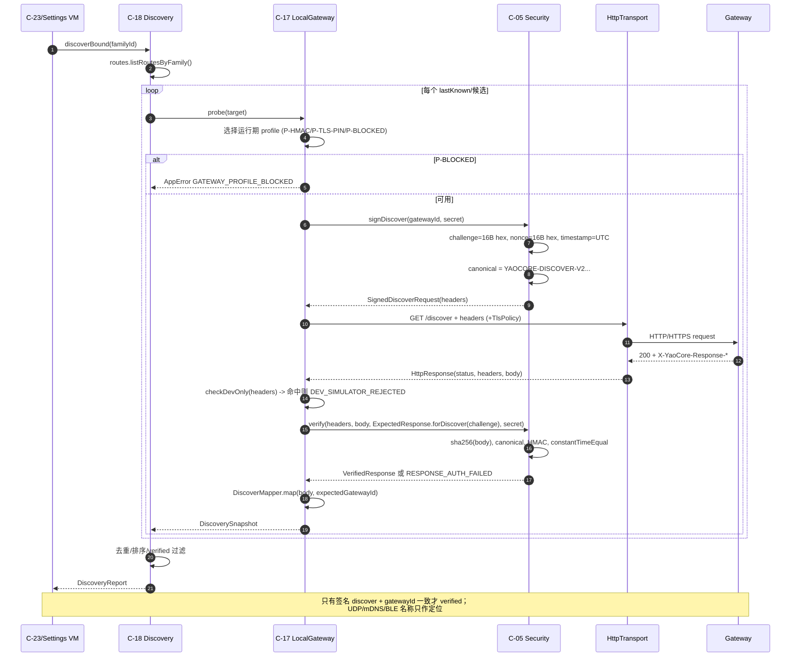
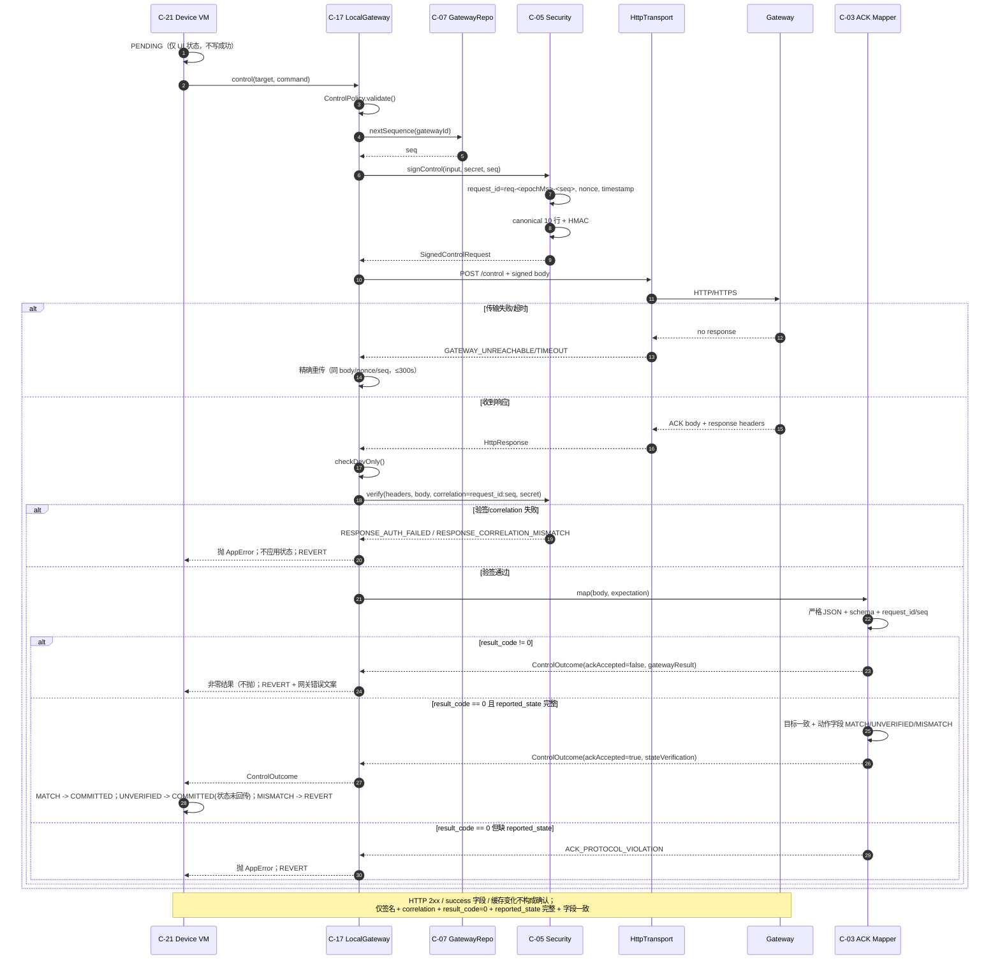
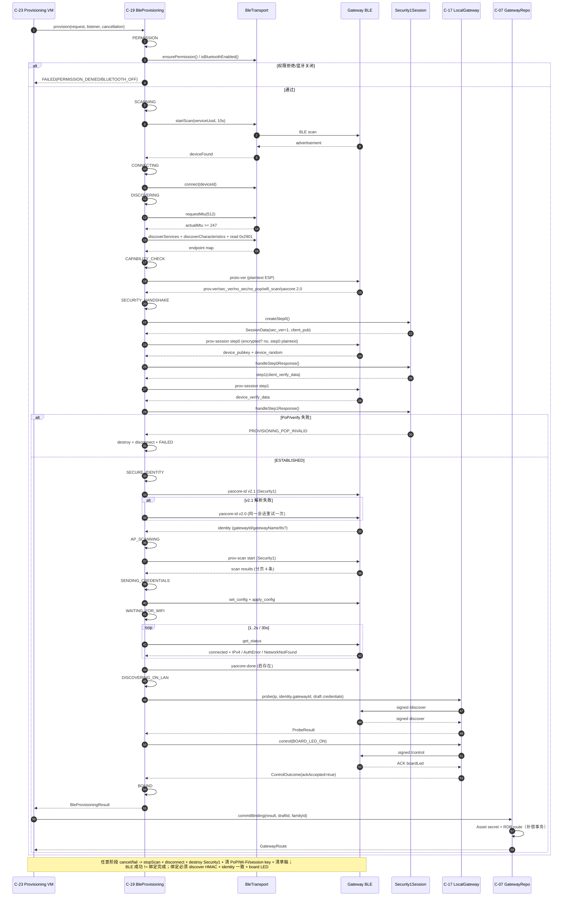

# DES-001A 基础、协议、安全与传输详细设计

- **Artifact ID**: DES-001A
- **Producer**: agent:solution-architect
- **Type**: Detailed Design / Interface Contract（可实现粒度，不含产品实现代码）
- **Status**: Accepted（G-006 PASS @ `6c186f0`；2026-10-17 依 G-007 增量同步 §27.4；T-12 裁定同步（2026-10-17）见 §0.5；冻结签名未变更）
- **Gate**: G-006 PASS（Accepted @ 6c186f0）；已扩展：DES-001B §23（G-007 批准，2026-10-17）
- **Date**: 2026-10-17
- **Revision**: T-12 裁定同步（2026-10-17，`wp-046-t12-rulings`）：R-1 草稿重签、R-2/D-4 错误码唯一命名、R3-01 歧义写失败码；依据 REV-T12-001/002/003。仅澄清契约，未改变冻结签名或 G-004 语义。格式修复（2026-10-17，`wp-048-des-format-fix`）：§3.2.3 行级注记移出 code 单元格，恢复 T-10 解析器兼容（96 行）；裁定语义不变，见附录 D。
- **Task**: `wp-008-des-a`（T-03；task 分支 `task/wp-008-des-a`，父分支 `feat/yaocore-app`，base commit `fad8856`）
- **Workflow**: STANDARD / GATED_AUTO（`config/project.md`）
- **Target Stage**: `implementation`
- **Upstream（冻结/已批准）**:
  - G-004 契约基线 @ `697762c`：`contract-baseline.md`、`adr-001`..`adr-004`、`project-constraints.md`、`i18n-resource-design.md`
  - G-005 规划：`artifacts/30-plan/component-graph.md`、`artifacts/30-plan/delivery-plan.md`
  - T-01 构建基线：`artifacts/50-implementation/build-baseline.md` @ commit(T-01)
  - WP2 @ `6c75037`、WP3 @ `54c1d78`
  - 冻结输入：`input/api/protocol/**`、`input/existing/docs/BLE配网设计.md`、`input/data/Data_and_State_Models.md`、`input/architecture/App_System_Architecture.md`、`input/standards/ArkTS_Coding_Standards.md`
- **Downstream**:
  - T-04 DES-001B（共享类型消费/扩展）
  - T-05 TEST-001（测试骨架、夹具、host/device 分工）
  - T-06..T-09、T-11..T-14 实现任务
  - T-20 独立评审、G-006/G-010/G-013/G-014
- **Scope 纪律**:
  1. 本文**不新增架构裁定**。所有安全语义、错误语义、通道档案、密钥模型、身份版本、存储边界均以 G-004 基线为准；本文只把基线细化为接口、状态机、数据结构、测试 seam。
  2. 本文**不写产品实现代码**。代码块中的 `interface`/`class` 声明是契约声明，允许实现者据此编码；禁止在本文中实现业务算法。
  3. 引用基线采用“缩写 + 章节”，缩写与路径见 §1.2；不复制基线全文。
  4. 本文不修改 `input/`、现有代码、契约基线；与基线冲突时以基线为准并登记 `UNRESOLVED`/`RISK`。
  5. D-018 host 测试架构是本文的强制交付面；所有纯逻辑组件必须可在无设备环境直接测试。

---

## 0. 结论摘要

### 0.1 覆盖范围

本文覆盖 **14 个组件**（以 `component-graph.md` §3 的实际编号为准）：

| 组别 | 组件 | 本文处理深度 |
|---|---|---|
| 基础 | C-01 公共类型/常量/工具 | 完整契约 |
| 领域 | C-02 领域模型 | 共享模型面完整（含 Room/Scene/CloudConfig 形状）；DES-001B 扩展行为/仓储/UI |
| 协议 | C-03 协议 DTO/映射/校验 | LAN/BLE 完整；云 DTO/映射保留 DES-001B |
| 安全 | C-04 CryptoService | 完整契约（含 C-12/C-13 所需 KDF/AEAD） |
| 安全 | C-05 SecurityService | 完整契约 |
| 存储 | C-06 存储服务 | 完整契约 |
| 仓储 | C-07 GatewayRepository | 完整契约 |
| 仓储 | C-08 FamilyRepository | 基础接口面；成员/邀请生命周期由 DES-001B 扩展 |
| 认证 | C-12 AuthService | 完整契约 |
| 凭据 | C-13 InviteService | 容器/校验/回执契约面；UI 流程由 DES-001B 扩展 |
| 传输 | C-17 LocalGatewayService | 完整契约 |
| 传输 | C-18 GatewayDiscoveryService | 完整契约；UDP/mDNS 线格式 `UNRESOLVED`（PB-01） |
| 传输 | C-19 BleProvisioningService | 完整契约 |
| 测试 | C-20 MockGatewayService / MockBleProvisioningClient | 完整契约 |

> **编号映射说明（必须保留）**：任务提示中的“C-12 FamilyRepository”“C-13 AuthService”与 `component-graph.md` 的编号不一致。本文按 `component-graph.md` 执行：
> - 任务提示的 “C-12 FamilyRepository” → **C-08 FamilyRepository**；
> - 任务提示的 “C-13 AuthService” → **C-12 AuthService**；
> - `component-graph.md` 的 **C-13 InviteService** 也纳入本文（`delivery-plan.md` §3.1 T-03 的 DoD 明确包含 C-12..C-13）。
> 该映射不改变任何组件职责；仅用于避免实现任务取错契约。

### 0.2 契约条目计数

本文以 5 类契约条目组织每个组件：`API`（公开类型/方法）、`ERR`（错误码与映射）、`STATE`（状态机/不变量）、`SEAM`（依赖注入与测试 seam）、`TRACE`（追溯）。共 **70 条**（14 × 5），编号为 `DES-A-Cxx-API/ERR/STATE/SEAM/TRACE`，索引见 §28.3。

### 0.3 关键设计结论（不改变 G-004 语义）

1. **端口/适配器内聚**：每个需要平台 API 的组件拆为“纯逻辑 + 端口 + 平台适配器”。端口集中在 `entry/src/main/ets/contracts/**`（port-only 层），生产组合根只装配适配器；host 测试只装配 fake。该结构是 D-018 的实现基础，不改变 `component-graph.md` 的组件边界。
2. **错误双命名空间**：App 自有错误使用 `AppError.code`（`SCREAMING_SNAKE`，动态 HTTP 码为 `HTTP_<status>`）；网关错误使用 `GatewayResultCode`（`0/1001..1008` + 未知码 fail-closed）。两者在类型上分离，禁止互相复用数值空间（ADR-001 §2.6；CB §4.2）。
3. **canonical 单一来源**：`CanonicalBuilder` 是唯一 canonical 串构造器；`RequestSigner`、`ResponseVerifier`、BLE `Security1Session`、Mock、测试夹具全部消费它，禁止各自拼接（CB §3；PROTO L57-157）。
4. **ACK 判定链显式化**：签名 → correlation → `result_code==0` → `reported_state` 结构完整 → 目标/字段一致性。`ControlOutcome` 同时暴露 `ackAccepted` 与 `stateVerification`，VM 的三态只能消费该结果（FR-DEV-001；SC-13；SC-14）。
5. **秘密不返回裸字节**：`SecretStore.withSecret()` / `GatewayCredentialPort.withCommandSecret()` 以回调方式暴露秘密，回调结束后由存储层清零；`command_secret` 只以 `Uint8Array` 存在，不以 `string` 持久化（SC-06；SC-09）。
6. **TLS pin 候选路径明确**：v1 推荐 **`@ohos.net.socket` TLSSocket + `getRemoteCertificate()` + `@ohos.security.cert` + SHA-256(SPKI) 手动校验**（API 14+ 可用）；`@ohos.net.http.certificatePinning`（API 12+）作为 PB-03 验证后的快速路径。两条路径都以 `TlsPinVerifier`/`HttpTransport` 端口隔离；失败一律 P-BLOCKED，禁止明文回退（ADR-002 §6）。
7. **发现服务不猜协议**：PB-01 未决，`IDiscoveryTransport` 只返回“定位候选”，不定义 UDP 报文或 mDNS 服务类型；C-18 只对已绑定网关做签名 discover 验证，手动 IP 永不创建绑定（ADR-004 §5；PR-06）。
8. **BLE 身份 fail-closed**：`yaocore-id` v2.0 严格解析；v2.1 先请求、失败在同一 Security1 会话内重试一次 v2.0；任何多余字段、常量不符、pin 格式非法均终止配网（ADR-001 §3；ADR-002 §3.2；PR-07）。
9. **host 测试可运行**：`entry/src/test/**` 覆盖 canonical/HMAC/DTO/状态机/仓储仲裁/邀请容器/认证策略；`entry/src/ohosTest/**` 覆盖 cryptoFramework 向量、Asset Store/RDB、HTTP/TLS、BLE。`hvigorw test` 是 host 门禁命令；设备测试在无设备/无签名环境标记 `UNAVAILABLE`，不得写成 PASS（BB §5；CP-03）。
10. **未决项显式化**：PB-01（发现线格式）、PB-03（TLS pin API）、identity v2.1 schema、secret 编码、ADR-003 join-key 别名与 header 键序、BLE `prov-ctrl`/`yaocore-done` 精确响应等均登记为 `UNRESOLVED`/`RISK`，实现不得静默猜测。

### 0.4 未决项速览

| ID | 项 | 状态 | 处置 |
|---|---|---|---|
| `UNRESOLVED-DISCOVERY-WIRE` | UDP 报文格式、mDNS 服务类型/TXT | `UNRESOLVED`（PB-01） | `IDiscoveryTransport` seam；UDP adapter 不实现；mDNS 服务类型由构造参数注入 |
| `RISK-TLS-PIN-API` | HarmonyOS pin API 精确语义 | `RISK`（PB-03） | T-11 spike；A/B 双路径；失败重评 ADR-002 §6，不跳过校验 |
| `UNRESOLVED-IDENTITY-V21` | v2.1 schema 不在仓库 | `UNRESOLVED`（P-17/FC-01） | 解析契约按 ADR-002 §3.2 定义；T-12 用合成夹具；固件到位后补 schema |
| `RISK-SECRET-ENCODING` | `command_secret` 的 hex→raw 语义 | `RISK` | 本文定义为“hex 是传输编码，HMAC 使用解码后的原始字节”；需固件确认 |
| `RISK-JOIN-ALIAS` | ADR-003 `yaocore.invite.join.<inviteId>` 在加入请求阶段无 inviteId | `RISK` | v1 使用 `yaocore.invite.join.<memberId>`；登记维护提案 |
| `RISK-INVITE-HEADER-ORDER` | ADR-003 §3.1 “字典序”与示例字段顺序不一致 | `RISK` | 生成侧按字典序；解析侧使用收到的 header 原始字节作 AAD |
| `UNRESOLVED-BLE-CTRL-PROTO` | `prov-ctrl` 精确 protobuf 字段 | `UNRESOLVED` | 以 ESP-IDF 5.2 `wifi_ctrl.proto` 为准（BLE §5）；T-12 交叉验证 |
| `RISK-BLE-DONE-ACK` | `yaocore-done` 响应体形状未定义 | `RISK` | GATT 读写成功即视为 ACK；若返回 JSON 则仅识别 `status`/`ok`，未知字段不阻断 |
| `RISK-PARTIAL-DISCOVER` | 单设备解析失败时的快照语义 | `RISK` | `DiscoverySnapshot.isPartial=true`；部分快照不得触发“网关已移除”判定 |
| `UNRESOLVED-CLOUD-COMPLETION` | 云完成判定（PB-02） | `UNRESOLVED`（DES-B） | 不在 DES-A 范围；由 C-15/T-14 处置，不影响本文 LAN ACK |

### 0.5 T-12 裁定同步（2026-10-17）

> **裁定人**：solution-architect（任务 `wp-046-t12-rulings`）。**输入**：REV-T12-001 `artifacts/70-review/t12-review.md`、REV-T12-002 `artifacts/70-review/t12-review-b.md`、REV-T12-003 `artifacts/70-review/t12-review-c.md`、`artifacts/50-implementation/t12-fix-report.md`、`t12-fix2-report.md`。**边界**：本节只澄清既有契约语义与命名，不重写冻结签名、不改变 G-004 的网关结果码/双轨判定/安全语义；实现代码对齐另列后续任务。

| 裁定 | 结论 | 落点 | 实现状态（@ `d9d868a`） |
|---|---|---|---|
| **R-1 草稿重签** | `request.credentialDraftId` 一次性消费；C-19 探针成功后**必须**以新 draft id 重签同一命令密钥并写入 `result.credentialDraftId`；C-23/C-07 只能使用 `result.credentialDraftId`；失败/取消销毁原/新 id；重签失败 fail-closed | §5.1.6、§10.3、§16.8、§16.9、§16.11 | 已实现（`BindingProbe.LazyDraftCredentialPort.reissue()`；`BleProvisioningService` post-probe 清理） |
| **R-2/D-4 错误码命名** | 响应头验签/相关性唯一使用 `RESPONSE_AUTH_FAILED` / `RESPONSE_CORRELATION_MISMATCH`；`CONTROL_RESPONSE_AUTH_FAILED` 退役；`ACK_CORRELATION_MISMATCH` 仅保留给 ACK body `request_id`/`seq`；protocomm 非零 `Status` 统一保留 `PROVISIONING_SECURITY_HANDSHAKE_FAILED`，不新增细分 code | §3.2.3、§8.2、§14.4、§15.5、§16.4、§16.10、§17.2、§17.4、§18.7；CB §4.2/§4.5 | C-05/C-17/C-03/C-19 已符合；C-20 mock 仍产出退役别名，列入后续对齐（不改本轮代码） |
| **R3-01 歧义写失败** | 非确认 busy 的写失败（无法证明写未发生）→ `PROVISIONING_GATT_INCOMPLETE`（非重试），清理会话并断开；本次配网终止，重试时从 Security1 step0 重来；确认 busy 才允许同一密文重试一次（适配器以 `retryable=write-busy` 标记；`details` 白名单相应增补 `retryable`） | §3.2.1、§16.2、§16.10、§16.11 | 已实现（`mapWriteError` 仅 `2900011`/`2901004` 标记 `retryable=write-busy`；其他写失败 `GATT_INCOMPLETE`） |

> **未决/后续**：C-20 `MockGatewayService` 的 `CONTROL_RESPONSE_AUTH_FAILED`/header→`ACK_CORRELATION_MISMATCH` 映射与本节目标不一致（见 CB §4.5 对齐状态）；不在 `wp-046` 改代码，须由后续实现任务修复并重跑 host 测试。T-19 仍需在真实设备确认 `2900011`/`2901004`/`2900099` 的平台语义（R3-02）与 protocomm 非零 `Status` 的固件行为。

**发现并记录的下游冲突（不在本轮修改）**：

1. `artifacts/40-detailed-design/des-001b-domain-presentation.md` 的 C-23 配网流（约 L3867-3869）仍把 `submit` 生成的原始 `draftId` 传给 `commitBinding(result, draftId, familyId)`，并写有“`result.credentialDraftId` 必须等于 `draftId`”。按 R-1，原 id 已被 C-19 探针消费，必须改为 `commitBinding(result, result.credentialDraftId, familyId)`；失败清理也必须销毁 `result.credentialDraftId`（若存在），而不是只销毁原 id。该文件不在 `wp-046` 写范围，列入 Change Impact/后续 DES-B 同步。
2. 同文件 §10.2（约 L3410）仍把 `CONTROL_RESPONSE_AUTH_FAILED` 作为 ACK 错误示例；按 R-2/D-4，header 失败应为 `RESPONSE_AUTH_FAILED`/`RESPONSE_CORRELATION_MISMATCH`，ACK body 失败才是 `ACK_CORRELATION_MISMATCH`。同样列入后续文档同步。
3. `artifacts/50-implementation/t11-transport.md`（历史实现报告，约 L168/L326）记录了旧的 `CONTROL_RESPONSE_AUTH_FAILED`/mock 映射；作为历史证据保留，不回写；CQG/后续报告应以 CB §4.5 为准。
4. DES-A §3.2.1 的 `details` 白名单原先不含 `retryable`，与 R2-01 的 `retryable=write-busy` 标记冲突；本轮已按 R3-01 边界增补 `retryable`（仅限非敏感机械标记）。

---

## 1. 范围、基线引用与阅读约定

### 1.1 目标与非目标

**目标**：把 `component-graph.md` §5 中 C-01..C-08、C-12、C-13、C-17..C-20 的接口需求冻结到“实现者无需再决策契约”的粒度，供 T-06..T-09、T-11..T-14 直接消费。

**非目标**：
- 不实现业务逻辑、不写生产代码、不生成 HAP。
- 不定义 DES-001B 的 ViewModel/UI/云/AC 适配/I18n 实现；只给出共享类型边界（§27）。
- 不修改 G-004 的协议语义、错误码表、通道档案、密钥模型、家庭凭据模型。
- 不决定 PB-01/PB-02/PB-03 的架构；只给 seam 与处置路径。

**设计细化声明（非新裁定）**：以下内容是“把既有需求落到接口”的必要细化，均不改变 G-004 语义；若评审认为其中任一项构成新裁定，应按 Change Impact 回到对应 ADR，而不是在实现中静默采用。
1. `request_id = req-<epochMillis>-<seq>` 的具体拼接（CB §2.5 只给格式与作用域）。
2. 初始 `command_secret` 通过 `SecretDraftStore` 在配网前由用户输入/保存，绑定成功后写入 Asset Store（BLE §6-133；REQ FR-SET-002 的“管理 HMAC 控制密钥”）。
3. 运行期 P-BLOCKED 与持久 profile 分离（ADR-002 §6 定义三档案；本文明确 P-BLOCKED 不持久化）。
4. `ControlOutcome` 的 `ackAccepted`/`stateVerification` 分离（FR-DEV-001/SC-13 的判定链细化）。
5. 超时/重试/会话 TTL 等 `DES-PARAM` 默认值（§26.4），可调整。
6. C-04 增加 HKDF/GCM/PBKDF2 以服务 ADR-003 邀请容器与 DP-04；LAN GCM 仍禁止。

### 1.2 基线缩写与路径

| 缩写 | 路径 | 本文使用章节 |
|---|---|---|
| CB | `artifacts/20-architecture/contract-baseline.md` | §2/§3/§4/§5/§7/§8 |
| ADR-001 | `artifacts/20-architecture/adr-001-protocol-authority-and-error-semantics.md` | §1/§2/§3/§4/§5 |
| ADR-002 | `artifacts/20-architecture/adr-002-lan-security-channel.md` | §2/§3/§4/§6/§7/§8 |
| ADR-003 | `artifacts/20-architecture/adr-003-family-credential-distribution.md` | §2..§9 |
| ADR-004 | `artifacts/20-architecture/adr-004-home-room-device-boundaries.md` | §1/§2/§5/§6/§7 |
| PC | `artifacts/20-architecture/project-constraints.md` | §2/§3/§4/§5/§6/§7 |
| I18N | `artifacts/20-architecture/i18n-resource-design.md` | §2..§7 |
| CG | `artifacts/30-plan/component-graph.md` | §3/§4/§5/§7 |
| DP | `artifacts/30-plan/delivery-plan.md` | §3.1..§3.2、§4、§6 |
| BB | `artifacts/50-implementation/build-baseline.md` | §5/§7/§8/§9 |
| WP2 | `artifacts/10-verification/wp-002-protocol-fixture-validation.md` | §4/§5/§6/§7 |
| WP3 | `artifacts/10-verification/wp-003-cross-artifact-consistency.md` | §2/§4/§6 |
| PROTO | `input/api/protocol/README.md` | L32-157、L183-189 |
| SCHEMA | `input/api/protocol/*.schema.json` | 各文件 |
| BLE | `input/existing/docs/BLE配网设计.md` | §2..§7 |
| DM | `input/data/Data_and_State_Models.md` | §1..§5 |
| ARCH | `input/architecture/App_System_Architecture.md` | §2/§3/§4 |
| REQ | `input/requirements/YaoCore_HarmonyOS_App_Requirements.md` | FR/NFR 条目 |
| STD | `input/standards/ArkTS_Coding_Standards.md` | L5-28、L53-64 |

### 1.3 术语与状态词

| 词 | 含义 |
|---|---|
| **端口（Port）** | `contracts/**` 中的纯接口/纯类型，不含平台 API；可被 host 测试直接引用。 |
| **适配器（Adapter）** | 实现端口的平台封装（`@ohos.*`），只在生产组合根或 ohosTest 中装配。 |
| **纯逻辑组件** | 不 import `@ohos.*`、可在 `entry/src/test` 直接运行的组件（C-01/C-02/C-03/C-05/C-06 逻辑面/C-07/C-08/C-12/C-13/C-17 编排面/C-18 策略面/C-19 状态机/C-20）。 |
| **持久化档案** | `GatewayRoute.profile` 的持久值，仅 `P-HMAC` 或 `P-TLS-PIN`。 |
| **运行期档案** | 一次请求中实际使用的档案，可为 `P-BLOCKED`；`P-BLOCKED` 永不写入持久化档案。 |
| **ACK 接受** | 响应签名 + correlation + `result_code==0` + `reported_state` 结构完整。 |
| **状态验证** | ACK 的目标与动作相关字段是否与请求一致。 |
| **UNRESOLVED** | 基线未定义且实现不得猜测；必须由 spike、固件协同或 Change Impact 关闭。 |
| **RISK** | 已有设计处置，但存在实现/环境/固件不确定性。 |

### 1.4 与 `component-graph.md` 的职责对应

| 本文组件 | CG 组件 | 职责锚点 | 本文新增的“可实现粒度”内容 |
|---|---|---|---|
| C-01 | C-01 | 常量/错误/时间/字节/JSON | `AppError`、`JsonNode`、`HttpHeaders`、端口清单、host 安全导入规则 |
| C-02 | C-02 | 领域模型 | `DeviceState`/`GatewayRoute`/`ControlOutcome`/`DiscoverySnapshot`/`BleProvisioningResult` 字段与不变量 |
| C-03 | C-03 | DTO/映射 | 严格/宽容矩阵、DTO 接口、`ProtocolDeviation` 枚举、partial snapshot |
| C-04 | C-04 | 密码学原语 | `CryptoPort`、X25519 DER↔raw、CTR 流、GCM 邀请专用、PBKDF2/HKDF、错误映射 |
| C-05 | C-05 | HMAC/响应验签 | `CanonicalBuilder`、`RequestSigner`、`ResponseVerifier`、`NonceCache`、`ClockSkewTracker` |
| C-06 | C-06 | Preferences/RDB/Asset | 键空间、迁移注册表、`SecureBytes`、回调式秘密访问、fake 边界 |
| C-07 | C-07 | 网关路由/凭据 | route CRUD、profile 迁移、pin 绑定/轮换、序列分配、绑定事务 |
| C-08 | C-08 | 家庭/成员 | 基础仓储 API、角色/到期/收敛边界（DES-B 扩展） |
| C-12 | C-12 | 本地认证/RBAC | PBKDF2 参数、会话、RBAC 决策、锁定 |
| C-13 | C-13 | 离线凭据 | `YCI1`/`YCR1` 容器 API、KEK 派生、回执、状态机 |
| C-17 | C-17 | LAN 客户端 | `IGatewayClient`、请求策略、重试/幂等、错误分类、ACK 编排 |
| C-18 | C-18 | 发现/手动 IP | 候选模型、验证链、退避、手动策略、PB-01 seam |
| C-19 | C-19 | BLE 配网 | 状态机、GATT 映射、Security1、identity、Wi-Fi、绑定、清理 |
| C-20 | C-20 | Mock | 场景矩阵、确定性、生产排除、Python 仿真器对齐 |

---

## 2. 总体结构

### 2.1 目录布局

> 目标路径以 `CG §3` 的“目标代码范围”为基础，允许在不改变组件边界的前提下细化。`contracts/**` 是 port-only 层，归入 C-01 的“公共类型”语义；平台适配器只被组合根/ohosTest 引用。

```text
entry/src/main/ets/
├── common/                                  # C-01 纯类型/常量/工具（无平台 import）
│   ├── constants/
│   │   ├── ProtocolConstants.ets
│   │   ├── DeviceConstants.ets
│   │   ├── StorageConstants.ets
│   │   └── SecurityConstants.ets
│   ├── types/
│   │   ├── AppError.ets
│   │   ├── Result.ets
│   │   ├── JsonNode.ets
│   │   ├── HttpHeaders.ets
│   │   ├── SecureBytes.ets
│   │   ├── NameValue.ets
│   │   └── CancellationToken.ets
│   └── utils/
│       ├── DateTimeUtil.ets
│       ├── BytesUtil.ets
│       ├── Base64Url.ets
│       ├── Utf8.ets
│       ├── JsonParser.ets
│       ├── JsonCanonicalizer.ets
│       ├── IpAddressUtil.ets
│       └── UuidUtil.ets
├── contracts/                               # port-only；C-01 类型扩展；无实现
│   ├── ClockPort.ets
│   ├── RandomPort.ets
│   ├── IdPort.ets
│   ├── LoggerPort.ets
│   ├── MetricsPort.ets
│   ├── CryptoPort.ets
│   ├── PreferencesStore.ets
│   ├── RdbStore.ets
│   ├── SecretStore.ets
│   ├── SecretDraftPort.ets
│   ├── MigrationPort.ets
│   ├── GatewayRoutePort.ets
│   ├── GatewayCredentialPort.ets
│   ├── GatewayAddressPort.ets
│   ├── GatewayClient.ets
│   ├── DeviceStatePort.ets
│   ├── DeviceControlPort.ets
│   ├── HttpTransport.ets
│   ├── TlsPinVerifier.ets
│   ├── BleTransport.ets
│   ├── BleProvisioningClient.ets
│   ├── DiscoveryTransport.ets
│   ├── SecretVerifier.ets
│   └── InvitationApplicationPort.ets
├── model/                                   # C-02 领域模型（无平台 import）
│   ├── DeviceTypes.ets
│   ├── DeviceState.ets
│   ├── GatewayRoute.ets
│   ├── ControlModels.ets
│   ├── DiscoveryModels.ets
│   ├── ProvisioningModels.ets
│   └── FamilyModels.ets
├── service/
│   ├── crypto/                              # C-04
│   │   ├── CryptoService.ets
│   │   ├── CryptoErrors.ets
│   │   ├── X25519KeyCodec.ets
│   │   ├── AesCtrStream.ets
│   │   └── adapters/OhosCryptoProvider.ets
│   ├── protocol/                            # C-03
│   │   ├── ProtocolErrors.ets
│   │   ├── ProtocolDeviation.ets
│   │   ├── dto/DiscoverDto.ets
│   │   ├── dto/ControlRequestDto.ets
│   │   ├── dto/ControlAckDto.ets
│   │   ├── dto/IdentityDto.ets
│   │   ├── DiscoverMapper.ets
│   │   ├── ControlAckMapper.ets
│   │   ├── ControlRequestSerializer.ets
│   │   └── IdentityParser.ets
│   ├── security/                            # C-05
│   │   ├── CanonicalBuilder.ets
│   │   ├── RequestSigner.ets
│   │   ├── ResponseVerifier.ets
│   │   ├── NonceCache.ets
│   │   ├── ClockSkewTracker.ets
│   │   └── SecurityErrors.ets
│   ├── storage/                             # C-06
│   │   ├── StorageService.ets
│   │   ├── MigrationRegistry.ets
│   │   ├── SecretDraftStore.ets
│   │   ├── StorageErrors.ets
│   │   └── adapters/
│   │       ├── PreferencesStoreAdapter.ets
│   │       ├── RdbStoreAdapter.ets
│   │       └── AssetStoreSecretStore.ets
│   ├── auth/                                # C-12
│   │   ├── AuthService.ets
│   │   ├── AuthModels.ets
│   │   ├── RbacPolicy.ets
│   │   └── AuthErrors.ets
│   ├── invite/                              # C-13
│   │   ├── InviteService.ets
│   │   ├── InviteContainer.ets
│   │   ├── InviteCrypto.ets
│   │   ├── InviteModels.ets
│   │   └── InviteErrors.ets
│   ├── gateway/                             # C-17/C-18
│   │   ├── LocalGatewayService.ets
│   │   ├── GatewayDiscoveryService.ets
│   │   ├── GatewayErrors.ets
│   │   ├── GatewayRequestPolicy.ets
│   │   ├── ProbeBackoff.ets
│   │   ├── ManualAddressPolicy.ets
│   │   ├── adapters/OhosHttpTransport.ets
│   │   ├── adapters/SocketTlsPinVerifier.ets
│   │   └── discovery/MdnsDiscoveryTransport.ets
│   └── ble/                                 # C-19
│       ├── BleProvisioningService.ets
│       ├── ProvisioningStateMachine.ets
│       ├── GattEndpointMap.ets
│       ├── GattRequestQueue.ets
│       ├── Security1Session.ets
│       ├── ProtocommCodec.ets
│       ├── ProtobufCodec.ets
│       ├── IdentityNegotiator.ets
│       ├── WifiProvisioningFlow.ets
│       ├── BleErrors.ets
│       └── adapters/OhosBleTransport.ets
├── repository/                              # C-07/C-08
│   ├── GatewayRepository.ets
│   └── FamilyRepository.ets
├── service/i18n/                            # C-14；DES-001B
├── adapter/ac/                              # C-16；DES-001B
├── service/cloud/                           # C-15；DES-001B
├── viewmodel/                               # C-21..C-23；DES-001B
├── pages/                                   # C-25..C-27；DES-001B
├── components/                              # C-24；DES-001B
└── entryability/                            # C-28；DES-001B
```

**测试目录**（D-018 的落位）：

```text
entry/src/test/                              # host；无设备；无 @ohos.*
├── List.test.ets
├── support/
│   ├── FakeClock.ets
│   ├── FakeRandomSource.ets
│   ├── FakeIdGenerator.ets
│   ├── InMemoryPreferencesStore.ets
│   ├── InMemoryRdbStore.ets
│   ├── InMemorySecretStore.ets
│   ├── TestSha256Hmac.ets
│   ├── TestCryptoProvider.ets
│   ├── FakeHttpTransport.ets
│   ├── FakeDiscoveryTransport.ets
│   ├── FakeGatewayPeer.ets
│   ├── RecordingLogger.ets
│   └── FixtureLoader.ets
├── fixtures/
│   ├── ProtocolVectors.ets
│   ├── DiscoverGolden.ets
│   ├── ControlAckGolden.ets
│   └── InviteGolden.ets
├── foundation/
├── protocol/
├── security/
├── storage/
├── repository/
├── auth/
├── invite/
├── discovery/
└── ble/                                     # 状态机/编解码纯逻辑
entry/src/ohosTest/ets/                      # 设备/模拟器；平台 API
├── test/
│   ├── List.test.ets
│   ├── contract/
│   ├── crypto/
│   ├── storage/
│   ├── gateway/
│   ├── ble/
│   └── ui/
└── mock/
    ├── MockGatewayService.ets
    ├── MockBleProvisioningClient.ets
    ├── MockScenario.ets
    └── MockBleTransport.ets
```

### 2.2 依赖方向（强制）

```text
common  ←  model  ←  contracts  ←  service/*  ←  repository/*  ←  viewmodel/*  ←  pages/*
   ↑          ↑           ↑              ↑
   └──────────┴───────────┴──────────────┴── 任何层都可依赖 common/contracts
平台适配器（adapters/**）只依赖 contracts + 平台 API；只被 entryability（C-28）或 ohosTest 装配。
```

| 规则 | 内容 | 验证 |
|---|---|---|
| D-01 | `common/**` 不得 import `model/**`、`contracts/**`、`service/**`、`repository/**`、`viewmodel/**`、`pages/**`、`@ohos.*` | `tools/contract/check_layering.py` |
| D-02 | `model/**` 只 import `common/**`；不得 import `@ohos.*` | 同上 |
| D-03 | `contracts/**` 只 import `common/**`、`model/**`；不得 import 任何实现/平台 API | 同上 |
| D-04 | `service/protocol/**`、`service/security/**`、`service/crypto/CryptoService.ets`、`service/storage/{StorageService,MigrationRegistry,SecretDraftStore}`、`service/auth/{AuthService,RbacPolicy}`、`service/invite/{InviteService,InviteContainer,InviteCrypto}`、`service/gateway/{LocalGatewayService,GatewayDiscoveryService,ManualAddressPolicy,ProbeBackoff}`、`service/ble/**`（除 adapters）不得 import `@ohos.*` | `tools/contract/check_host_safe_imports.py` |
| D-05 | `repository/**` 只 import `common/**`、`model/**`、`contracts/**`；不得 import `service/**` 实现、`@ohos.*` | `check_layering.py` |
| D-06 | 适配器不得被纯逻辑组件 import；只被组合根/ohosTest import | `check_layering.py` + 依赖图检查 |
| D-07 | 生产 `entry/src/main/ets/**` 不得 import `MockGatewayService`/`MockBleProvisioningClient`/`entry/src/ohosTest/**` | `check_production_mock_exclusion.py` |
| D-08 | 禁止 UI/ViewModel → `@ohos.net.*`/`@ohos.bluetooth.*`/`@ohos.security.asset`/RDB/crypto 的直接调用 | PC PL-06；评审 + 静态扫描 |

### 2.3 组合根装配（契约级，不在本文实现）

C-28 负责以下装配；DES-001B 定义 `AppCompositionRoot` 的具体形态：

```text
Clock/Random/Id/Logger/Metrics         → 生产适配器
CryptoProvider (OhosCryptoProvider)    → CryptoService (实现 CryptoPort)
MigrationRegistry                        ← FamilyRepository.registerMigrations / StorageService v1
Preferences/RDB/Asset adapters         → StorageService
Storage + Crypto + Clock + Id          → AuthService / GatewayRepository / FamilyRepository
Crypto + Clock + Random + NonceCache   → SecurityService (RequestSigner/ResponseVerifier)
HttpTransport + TlsPinVerifier         → LocalGatewayService
LocalGatewayService + GatewayRoutePort → GatewayDiscoveryService
BleTransport + Crypto + Clock + IGatewayClient + SecretDraftStore → BleProvisioningService
```

**约束**：组合根必须显式传入所有依赖（构造器注入），不得使用全局单例/服务定位器；不得在业务组件内部 `new` 平台适配器（SC-11、PL-06）。

---

## 3. 横切约定

### 3.1 类型与命名

1. 所有公开类型以 `export class` 或 `export interface` 声明；禁止 `any`（PC PL-04）。动态 JSON 只经 `JsonNode`，不直接 `JSON.parse` 后强转。
2. 公开方法必须声明返回类型（含 `Promise<T>`）；禁止隐式 `any`。
3. 可空值用 `T | undefined`；禁止用 `null` 表示业务缺省（`JsonNode` 的 JSON `null` 是唯一例外）。
4. 集合参数用 `ReadonlyArray<T>`；返回集合用 `ReadonlyArray<T>` 或 `Promise<ReadonlyArray<T>>`。
5. 所有跨组件时间使用 **UTC 紧凑字符串** `yyyyMMddTHHmmssZ`；内部计算使用 epoch 毫秒 `number`。禁止本地时区。
6. 所有错误码、状态、枚举值为英文 `SCREAMING_SNAKE` 或 schema 规定的小写词表；用户文案只经 i18n key。
7. 方法命名：查询 `get/list/has`；变更 `create/update/set/remove/apply/commit`；校验 `validate/verify/parse`；纯转换 `map/serialize/format`。
8. **数据类构造器**：本文只列字段；实现按字段声明顺序提供构造器（必填字段在前、可选字段在后），或提供静态工厂；构造器必须执行 §5.2 的不变量校验。不得用无参构造 + 可变字段绕过不变量。

### 3.2 错误体系

#### 3.2.1 `AppError`

```ts
export enum ErrorCategory {
  PROTOCOL = 'PROTOCOL',
  SECURITY = 'SECURITY',
  TRANSPORT = 'TRANSPORT',
  GATEWAY = 'GATEWAY',
  STORAGE = 'STORAGE',
  AUTH = 'AUTH',
  INVITE = 'INVITE',
  PROVISIONING = 'PROVISIONING',
  CONFIG = 'CONFIG',
  INTERNAL = 'INTERNAL'
}

export class AppError extends Error {
  readonly code: string;
  readonly category: ErrorCategory;
  readonly retryable: boolean;
  readonly i18nKey: string;
  readonly details: ReadonlyArray<NameValue>;
  constructor(code: string, category: ErrorCategory, i18nKey: string,
              retryable: boolean, details?: ReadonlyArray<NameValue>);
}
```

**规则**：
- `code` 是稳定机读字符串；同一语义不得在不同组件使用不同 code。
- `details` 只允许非敏感字段：`gatewayId`、`deviceId`、`requestId`、`seq`、`httpStatus`、`attempt`、`state`、`field`、`retryable`（仅限非敏感机械标记，如 `write-busy`；T-12 裁定同步，2026-10-17）。**禁止**放入 secret、PoP、Wi-Fi 密码、token、完整证书、session key。
- `i18nKey` 由 `ErrorCatalog` 统一映射（§24）；业务代码不拼接文案。
- `message` 仅用于开发日志，英文、不含用户数据；UI 不展示 `message`（CB §2.3/§4.4）。
- `AppError` 可被 `throw`；`Promise` 方法以 reject 返回 `AppError`。禁止抛出裸 `Error`/`string`。

#### 3.2.2 结果类型

- 异步服务方法统一返回 `Promise<T>`，失败 reject `AppError`。
- 纯校验/解析函数可返回 `Result<T>`，用于调用方需要分支而不想捕获异常的场合；同一函数不得同时提供“抛异常”和“返回 Result”两套语义。
- `Result<T>` 不得吞掉 `AppError`；`Result.fail` 必须携带 `AppError`。

```ts
export class Result<T> {
  readonly ok: boolean;
  readonly value: T | undefined;
  readonly error: AppError | undefined;
  static ok<T>(value: T): Result<T>;
  static fail<T>(error: AppError): Result<T>;
}
```

#### 3.2.3 App 错误码表（稳定字符串）

> 命名规范：`SCREAMING_SNAKE`；动态 HTTP 码为 `HTTP_<status>`（如 `HTTP_500`）。本表是**唯一 App 命名空间**；不得复用网关 `result_code`（ADR-001 §2.2-6）。

| 组 | code | 类别 | 可重试 | i18n 键 |
|---|---|---|---|---|
| 协议 | `PROTOCOL_INVALID_JSON` | PROTOCOL | 否 | `errors.app.protocol_invalid_json` |
| 协议 | `PROTOCOL_DUPLICATE_KEY` | PROTOCOL | 否 | `errors.app.protocol_invalid_json` |
| 协议 | `PROTOCOL_UNKNOWN_FIELD` | PROTOCOL | 否 | `errors.app.protocol_invalid_json` |
| 协议 | `PROTOCOL_MISSING_FIELD` | PROTOCOL | 否 | `errors.app.protocol_invalid_json` |
| 协议 | `PROTOCOL_INVALID_TYPE` | PROTOCOL | 否 | `errors.app.protocol_invalid_json` |
| 协议 | `PROTOCOL_VALUE_OUT_OF_RANGE` | PROTOCOL | 否 | `errors.app.protocol_invalid_json` |
| 协议 | `PROTOCOL_INVALID_TIMESTAMP` | PROTOCOL | 否 | `errors.app.protocol_invalid_timestamp` |
| 协议 | `PROTOCOL_INVALID_IDENTIFIER` | PROTOCOL | 否 | `errors.app.protocol_invalid_identifier` |
| 协议 | `PROTOCOL_BODY_TOO_LARGE` | PROTOCOL | 否 | `errors.app.protocol_invalid_json` |
| 协议 | `PROTOCOL_UNSUPPORTED_VERSION` | PROTOCOL | 否 | `errors.app.protocol_unsupported_version` |
| 安全 | `CRYPTO_UNAVAILABLE` | SECURITY | 否 | `errors.app.crypto_unavailable` |
| 安全 | `CRYPTO_INVALID_KEY` | SECURITY | 否 | `errors.app.crypto_invalid_key` |
| 安全 | `CRYPTO_OPERATION_FAILED` | SECURITY | 否 | `errors.app.crypto_operation_failed` |
| 安全 | `CRYPTO_STREAM_BROKEN` | SECURITY | 否 | `errors.app.crypto_operation_failed` |
| 安全 | `CRYPTO_TAG_MISMATCH` | SECURITY | 否 | `errors.app.crypto_tag_mismatch` |
| 安全 | `SIGNATURE_INVALID` | SECURITY | 否 | `errors.app.signature_invalid` |
| 安全 | `NONCE_REUSED` | SECURITY | 是 | `errors.app.nonce_reused` |
| 安全 | `TIMESTAMP_OUT_OF_WINDOW` | SECURITY | 是 | `errors.app.timestamp_out_of_window` |
| 安全 | `RESPONSE_AUTH_FAILED` | SECURITY | 否 | `errors.app.control_response_auth_failed` |
| 安全 | `RESPONSE_CORRELATION_MISMATCH` | SECURITY | 否 | `errors.app.ack_correlation_mismatch` |
| 传输 | `LOCAL_REQUEST_FAILED` | TRANSPORT | 是 | `errors.app.local_request_failed` |
| 传输 | `HTTP_<status>` | TRANSPORT | 视状态 | `errors.app.http_error`（参数 `{status}`） |
| 传输 | `GATEWAY_UNREACHABLE` | TRANSPORT | 是 | `errors.app.gateway_unreachable` |
| 传输 | `GATEWAY_TIMEOUT` | TRANSPORT | 是 | `errors.app.gateway_timeout` |
| 传输 | `DEV_SIMULATOR_REJECTED` | TRANSPORT | 否 | `errors.app.dev_simulator_rejected` |
| 传输 | `TLS_PIN_MISMATCH` | SECURITY | 否 | `errors.app.tls_pin_mismatch` |
| 传输 | `TLS_HANDSHAKE_FAILED` | SECURITY | 否 | `errors.app.tls_handshake_failed` |
| 传输 | `TLS_UNAVAILABLE_ADVERTISED` | SECURITY | 否 | `errors.app.tls_unavailable_advertised` |
| 传输 | `TLS_PROFILE_INCONSISTENT` | SECURITY | 否 | `errors.app.tls_profile_inconsistent` |
| 传输 | `TLS_PIN_CONFIG_INVALID` | SECURITY | 否 | `errors.app.tls_pin_config_invalid` |
| 传输 | `TLS_VERIFIER_UNAVAILABLE` | SECURITY | 否 | `errors.app.tls_verifier_unavailable` |
| 网关 | `CONTROL_RESPONSE_AUTH_FAILED` | GATEWAY | 否 | `errors.app.control_response_auth_failed` |
| 网关 | `ACK_CORRELATION_MISMATCH` | GATEWAY | 否 | `errors.app.ack_correlation_mismatch` |
| 网关 | `ACK_PROTOCOL_VIOLATION` | GATEWAY | 否 | `errors.app.ack_protocol_violation` |
| 网关 | `ACK_STATE_MISMATCH` | GATEWAY | 否 | `errors.app.ack_state_mismatch` |
| 网关 | `GATEWAY_ID_MISMATCH` | GATEWAY | 否 | `errors.app.gateway_id_mismatch` |
| 网关 | `GATEWAY_NOT_BOUND` | GATEWAY | 否 | `errors.app.gateway_not_bound` |
| 网关 | `GATEWAY_PROFILE_BLOCKED` | GATEWAY | 否 | `errors.app.gateway_profile_blocked` |
| 网关 | `MANUAL_ADDRESS_REJECTED` | GATEWAY | 否 | `errors.app.manual_address_rejected` |
| 网关 | `MANUAL_ADDRESS_NOT_BOUND` | GATEWAY | 否 | `errors.app.manual_address_not_bound` |
| 网关 | `DISCOVERY_INVALID_RESPONSE` | GATEWAY | 否 | `errors.app.discovery_invalid_response` |
| 网关 | `DISCOVERY_NO_CANDIDATES` | GATEWAY | 是 | `errors.app.discovery_no_candidates` |
| 网关 | `DISCOVERY_TRANSPORT_UNAVAILABLE` | GATEWAY | 是 | `errors.app.discovery_transport_unavailable` |
| 存储 | `STORAGE_NOT_INITIALIZED` | STORAGE | 否 | `errors.app.storage_not_initialized` |
| 存储 | `STORAGE_RDB_ERROR` | STORAGE | 是 | `errors.app.storage_error` |
| 存储 | `STORAGE_PREFERENCES_ERROR` | STORAGE | 是 | `errors.app.storage_error` |
| 存储 | `STORAGE_MIGRATION_FAILED` | STORAGE | 否 | `errors.app.storage_migration_failed` |
| 存储 | `ASSET_UNAVAILABLE` | STORAGE | 否 | `errors.app.asset_unavailable` |
| 存储 | `ASSET_NOT_FOUND` | STORAGE | 否 | `errors.app.asset_not_found` |
| 存储 | `ASSET_ACCESS_DENIED` | STORAGE | 否 | `errors.app.asset_access_denied` |
| 存储 | `ASSET_IO_FAILED` | STORAGE | 是 | `errors.app.asset_io_failed` |
| 存储 | `SECRET_DESTROYED` | STORAGE | 否 | `errors.app.secret_destroyed` |
| 存储 | `SECRET_ALIAS_INVALID` | STORAGE | 否 | `errors.app.secret_alias_invalid` |
| 存储 | `SECRET_ENCODING_INVALID` | STORAGE | 否 | `errors.app.secret_encoding_invalid` |
| 认证 | `AUTH_PROFILE_NOT_FOUND` | AUTH | 否 | `errors.app.auth_profile_not_found` |
| 认证 | `AUTH_PROFILE_EXISTS` | AUTH | 否 | `errors.app.auth_profile_exists` |
| 认证 | `AUTH_PASSWORD_INVALID` | AUTH | 是 | `errors.app.auth_password_invalid` |
| 认证 | `AUTH_SESSION_INVALID` | AUTH | 否 | `errors.app.auth_session_invalid` |
| 认证 | `AUTH_SESSION_EXPIRED` | AUTH | 否 | `errors.app.auth_session_expired` |
| 认证 | `AUTH_RBAC_DENIED` | AUTH | 否 | `errors.app.auth_rbac_denied` |
| 认证 | `AUTH_KDF_FAILED` | AUTH | 否 | `errors.app.auth_kdf_failed` |
| 邀请 | `INVITE_INVALID` | INVITE | 否 | `errors.app.invite_invalid` |
| 邀请 | `INVITE_VERSION_UNSUPPORTED` | INVITE | 否 | `errors.app.invite_invalid` |
| 邀请 | `INVITE_EXPIRED` | INVITE | 否 | `errors.app.invite_expired` |
| 邀请 | `INVITE_REVOKED` | INVITE | 否 | `errors.app.invite_revoked` |
| 邀请 | `INVITE_MAX_USES` | INVITE | 否 | `errors.app.invite_max_uses` |
| 邀请 | `INVITE_AEAD_FAILED` | INVITE | 否 | `errors.app.invite_invalid` |
| 邀请 | `INVITE_CODE_INVALID` | INVITE | 是 | `errors.app.invite_code_invalid` |
| 邀请 | `INVITE_JOIN_REQUEST_INVALID` | INVITE | 否 | `errors.app.invite_invalid` |
| 邀请 | `INVITE_RECEIPT_INVALID` | INVITE | 否 | `errors.app.invite_receipt_invalid` |
| 邀请 | `INVITE_KEY_MISSING` | INVITE | 否 | `errors.app.invite_key_missing` |
| 配网 | `PROVISIONING_PERMISSION_DENIED` | PROVISIONING | 否 | `provisioning.error.permission_denied` |
| 配网 | `PROVISIONING_BLUETOOTH_OFF` | PROVISIONING | 是 | `provisioning.error.bluetooth_off` |
| 配网 | `PROVISIONING_DEVICE_NOT_FOUND` | PROVISIONING | 是 | `provisioning.error.device_not_found` |
| 配网 | `PROVISIONING_MULTIPLE_DEVICES` | PROVISIONING | 否 | `provisioning.error.multiple_devices` |
| 配网 | `PROVISIONING_CONNECT_FAILED` | PROVISIONING | 是 | `provisioning.error.connect_failed` |
| 配网 | `PROVISIONING_GATT_INCOMPLETE` | PROVISIONING | 否 | `provisioning.error.gatt_incomplete` |
| 配网 | `PROVISIONING_GATT_BUSY` | PROVISIONING | 是 | `provisioning.error.gatt_busy` |
| 配网 | `PROVISIONING_MTU_TOO_SMALL` | PROVISIONING | 否 | `provisioning.error.mtu_too_small` |
| 配网 | `PROVISIONING_CAPABILITY_UNSUPPORTED` | PROVISIONING | 否 | `provisioning.error.capability_unsupported` |
| 配网 | `PROVISIONING_POP_INVALID` | PROVISIONING | 是 | `provisioning.error.pop_invalid` |
| 配网 | `PROVISIONING_SECURITY_HANDSHAKE_FAILED` | PROVISIONING | 是 | `provisioning.error.security_handshake_failed` |
| 配网 | `PROVISIONING_IDENTITY_INVALID` | PROVISIONING | 否 | `provisioning.error.identity_invalid` |
| 配网 | `PROVISIONING_WIFI_SCAN_FAILED` | PROVISIONING | 是 | `provisioning.error.wifi_scan_failed` |
| 配网 | `PROVISIONING_WIFI_AUTH_ERROR` | PROVISIONING | 是 | `provisioning.error.auth_error` |
| 配网 | `PROVISIONING_WIFI_NETWORK_NOT_FOUND` | PROVISIONING | 是 | `provisioning.error.network_not_found` |
| 配网 | `PROVISIONING_WIFI_TIMEOUT` | PROVISIONING | 是 | `provisioning.error.wifi_timeout` |
| 配网 | `PROVISIONING_DONE_REJECTED` | PROVISIONING | 是 | `provisioning.error.done_rejected` |
| 配网 | `PROVISIONING_BINDING_PROBE_FAILED` | PROVISIONING | 是 | `provisioning.error.binding_probe_failed` |
| 配网 | `PROVISIONING_BINDING_IDENTITY_MISMATCH` | PROVISIONING | 否 | `provisioning.error.binding_identity_mismatch` |
| 配网 | `PROVISIONING_BOARD_LED_UNCONFIRMED` | PROVISIONING | 是 | `provisioning.error.board_led_unconfirmed` |
| 配网 | `PROVISIONING_CANCELLED` | PROVISIONING | 是 | `provisioning.error.cancelled` |
| 配网 | `PROVISIONING_CREDENTIAL_MISSING` | PROVISIONING | 否 | `provisioning.error.credential_missing` |
| 配网 | `PROVISIONING_SECRET_DRAFT_EXPIRED` | PROVISIONING | 否 | `provisioning.error.credential_missing` |
| 内部 | `INTERNAL_ERROR` | INTERNAL | 否 | `errors.app.internal_error` |
| 配置 | `CONFIGURATION_ERROR` | CONFIG | 否 | `errors.app.configuration_error` |

> 说明：`HTTP_<status>` 的具体 i18n 键统一为 `errors.app.http_error`，以 `{status}` 参数区分；不得为每个 HTTP 码建一个键。
> 说明：网关 `result_code` 的 i18n 键为 `errors.gateway.<error_code>`，见 §24；不在本表重复。
>
> **表注（行级，T-12 裁定，2026-10-17）**：为保持本表可被 T-10 `parseDeclaredCodes` 机读（code 必须独占单元格），行级注记统一置于表后。
> - `CONTROL_RESPONSE_AUTH_FAILED`：**DEPRECATED**，仅兼容读取，禁止新发；响应头验签/相关性的 canonical code 为 `RESPONSE_AUTH_FAILED` / `RESPONSE_CORRELATION_MISMATCH`（SECURITY）。
> - `ACK_CORRELATION_MISMATCH`：仅表示 ACK body 的 `request_id`/`seq` 不等，不得用于响应头 correlation。
>
> **T-12 裁定同步（2026-10-17）**：响应头验签/相关性失败的唯一 canonical code 为 `RESPONSE_AUTH_FAILED` / `RESPONSE_CORRELATION_MISMATCH`（SECURITY）；`CONTROL_RESPONSE_AUTH_FAILED` 已退役，禁止新发（仅兼容读取，i18n 同键）；`ACK_CORRELATION_MISMATCH` 只表示 ACK body 的 `request_id`/`seq` 不等，不得用于响应头 correlation。完整映射与代码对齐状态见 CB §4.5。

#### 3.2.4 网关结果码（仅类型分离，语义引用 CB §4.1）

```ts
export enum GatewayResultCode {
  SUCCESS = 0,
  INVALID_REQUEST = 1001,
  UNSUPPORTED_SECURITY = 1002,
  TIMESTAMP_REJECTED = 1003,
  BAD_SIGNATURE = 1004,
  REPLAY = 1005,
  UNSUPPORTED_COMMAND = 1006,
  DEVICE_OFFLINE = 1007,
  HARDWARE_TIMEOUT = 1008
}
```

- 语义、HTTP 建议值、可重试分类以 `CB §4.1` 为准；本文只增加 `GatewayResultClassifier` 的返回契约。
- **物理位置**：`GatewayResultCode`、`GatewayResultClass`、`GatewayResultClassifier` 都是纯值/纯函数，放在 `common/types/GatewayResult.ets`（C-01），避免 `model/**`/`service/protocol/**` 反向依赖 `service/security/**`；C-05 只使用 `AppError`，不实现分类器。

```ts
export class GatewayResultClassifier {           // C-01, common/types/GatewayResult.ets
  static classify(resultCode: number, errorCode?: string): GatewayResultClass;
}
export class GatewayResultClass {                // C-01, common/types/GatewayResult.ets
  readonly known: boolean;
  readonly success: boolean;
  readonly stableName: string;      // 0 -> 'success'; 1004 -> 'bad_signature'; 未知 -> 'unknown_<code>'
  readonly retryable: boolean;
  readonly i18nKey: string;         // 'errors.gateway.<stableName>' 或 'errors.gateway.unknown'
}
```

- **未知码**（`1009..9999` 及任何非表值）→ `known=false`、`success=false`、`retryable=false`、`stableName='unknown_<code>'`，并记录 `protocolDeviation`。禁止把未知码当成功（ADR-001 §2.2-3）。
- `result_code==0` 且 `error_code` 存在 → 记录偏差，不改变成功判定（CB §4.3-5）。

### 3.3 时间、ID、nonce

| 概念 | 契约 | 实现要点 |
|---|---|---|
| UTC 紧凑时间 | `DateTimeUtil.formatUtcCompact(epochMs): string`；`parseUtcCompact(text): number` | 严格 `^[0-9]{8}T[0-9]{6}Z$`；范围校验；`Date.UTC` |
| 时间窗 | `DateTimeUtil.isWithinWindow(nowMs, tsMs, windowMs=120000): boolean` | 含边界：`abs(diff) <= 120000` |
| 时钟 | `Clock.nowMs(): number`（wall clock） | 生产用系统时钟；host 用 `FakeClock`；不自动校时 |
| 单调计时 | 测量/超时使用 `MonotonicClock`（DES-B 定义）或 `Clock` + 记录起点 | 不用 wall clock 做超时差值 |
| `request_id` | `req-<epochMillis>-<seq>`；`epochMillis` 为 13 位十进制；`seq` 为分配的十进制序号 | 唯一性由 `(epochMillis, seq)` 保证；精确重传复用同一字符串 |
| `seq` | 每网关持久化单调整数 `0..2147483647`；同一命令精确重传复用 | C-07 `command_sequence` 表；达到上限且无在途命令时重置 0 并记录事件 |
| `nonce`（控制） | 16 字节随机 → 32 位小写 hex；`^[a-z0-9]{32}$`（满足 schema `^[A-Za-z0-9_-]{8,64}$`） | `RandomSource.nextBytes(16)`；每次新命令重新生成；300s 内不得重复 |
| `challenge`（发现） | 16 字节随机 → 32 位小写 hex | 每次 discover 新生成；响应 correlation 必须逐字符相等 |
| `nonce`（发现请求） | 16 字节随机 → 32 位小写 hex | 与 challenge 独立生成；不得复用 |
| `server_time` / `generatedAt` / `updatedAt` | 网关时钟，UTC 紧凑 | 仅展示/仲裁输入；`server_time` 不参与成功判定（CB §2.5） |
| 时钟偏差提示 | `ClockSkewTracker.observe(serverTime, localNowMs)` | `abs(skew) > 120000` → 记录 warning；不自动修改签名时钟 |

**禁止**：用本地时区格式化；用 `Date.toString()`；用秒级时间戳替代毫秒；在 `request_id` 中放入密钥/设备名。

### 3.4 JSON 严格解析与 canonical 序列化

协议入站必须经过 `JsonParser`，禁止直接 `JSON.parse(text) as T`。原因：需要检测重复键、未知字段、尾随内容、非有限数字，并保留原始 body 字节用于响应验签。

```ts
export enum JsonKind { NULL, BOOLEAN, NUMBER, STRING, OBJECT, ARRAY }

export class NameValueNode {
  readonly name: string;
  readonly value: JsonNode;
  constructor(name: string, value: JsonNode);
}

export class JsonNode {
  readonly kind: JsonKind;
  readonly booleanValue: boolean;
  readonly numberValue: number;
  readonly stringValue: string;
  readonly objectValue: Map<string, JsonNode>;
  readonly arrayValue: ReadonlyArray<JsonNode>;
  static object(entries: ReadonlyArray<NameValueNode>): JsonNode;
  static array(items: ReadonlyArray<JsonNode>): JsonNode;
  static string(value: string): JsonNode;
  static number(value: number): JsonNode;
  static boolean(value: boolean): JsonNode;
  static nullNode(): JsonNode;
  has(key: string): boolean;
  get(key: string): JsonNode | undefined;
  require(key: string): JsonNode;
  keys(): ReadonlyArray<string>;
}

export class JsonParser {
  static parse(text: string, limits?: JsonLimits): JsonNode;
}
export class JsonLimits {
  readonly maxBytes: number;        // 默认 65536
  readonly maxDepth: number;        // 默认 16
  readonly maxStringLength: number; // 默认 8192
}
```

**`JsonParser` 必须**：
1. 拒绝重复键（`PROTOCOL_DUPLICATE_KEY`）。
2. 拒绝尾随非空白内容（`PROTOCOL_INVALID_JSON`）。
3. 拒绝 `NaN`/`Infinity`/`-Infinity`（JSON 不允许）。
4. 拒绝未转义的控制字符与非法转义。
5. 拒绝未配对代理项（lone surrogate）；非 ASCII 字符按 UTF-8 原样保留。
6. 超过 `maxBytes/maxDepth/maxStringLength` → `PROTOCOL_BODY_TOO_LARGE`。
7. 保留对象键的插入顺序（用于测试/诊断；业务不得依赖顺序，除明确要求字典序的邀请头生成）。

**canonical 序列化**：
- 控制请求 body：固定字段顺序，紧凑无空白；`value` 缺省时省略；字符串用 JSON 转义（保留非 ASCII 原字符，不转 `\uXXXX`）；数字用有限紧凑 JSON 表示。
- 邀请头：`JsonCanonicalizer.stringifySorted(node)` 按键名字典序输出，紧凑无空白；数组顺序保持。
- 响应 body 的哈希：对**收到的原始 UTF-8 字节**做 SHA-256，不重新序列化（避免空白/转义差异）。

### 3.5 秘密生命周期与日志

1. 秘密只用 `Uint8Array`/`SecureBytes`；禁止用 `string` 持久化。UI 输入密码/PoP 的字符串不可避免，使用后立即清空输入控件，并尽快转成字节。
2. `SecureBytes` 契约：

```ts
export class SecureBytes {
  static from(source: Uint8Array): SecureBytes;
  static fromHex(hex: string): SecureBytes;
  readonly length: number;
  withView<T>(fn: (view: Uint8Array) => T): T; // destroyed 后抛 SECRET_DESTROYED
  toHex(): string;                             // 仅协议/测试；调用方最短持有
  destroy(): void;                             // fill(0) 并标记
}
```

3. `SecretStore` 不返回裸字节，只提供回调：

```ts
export interface SecretStore {
  put(alias: string, secret: SecureBytes): Promise<void>;
  withSecret<T>(alias: string, fn: (secret: Uint8Array) => Promise<T>): Promise<T>;
  remove(alias: string): Promise<void>;
  list(prefix: string): Promise<ReadonlyArray<string>>;
}
```

4. `LoggerPort` 只接受 `tag`、英文 `message`、`ReadonlyArray<NameValue>`；禁止传入 `Uint8Array`、`SecureBytes`、密码、PoP、token、session key、完整证书。
5. 异常 `details` 同样受第 4 条约束；`AppError` 构造函数不自动序列化 `cause`。
6. 测试断言不得打印秘密；夹具使用 `PUBLIC TEST DATA ONLY`（SC-03）。
7. 内存擦除：`SecureBytes.destroy()`、`AesCtrStream.destroy()`、`Security1Session.destroy()`、`AuthService.lockAll()`、`SecretDraftStore.clearAll()` 必须在以下时点调用：取消、失败、成功完成、应用进入后台（C-28 调用）、会话锁定。

### 3.6 异步、取消与并发

- 所有 I/O 方法返回 `Promise`；禁止阻塞 UI 线程。
- 长流程（BLE 配网、发现、批量探测）接受 `CancellationToken`；每个阶段开始/结束检查 `throwIfCancelled()`。
- `CancellationToken` 契约：

```ts
export interface CancellationToken {
  readonly cancelled: boolean;
  onCancel(listener: () => void): void;
  throwIfCancelled(): void; // 取消 -> AppError PROVISIONING_CANCELLED / DISCOVERY_* 由调用方映射
}
```

- 同一网关的 `control` 调用串行化（每网关一把异步互斥锁）；不同网关可并行。
- `seq` 分配与 `pending` 登记必须在同一临界区，避免并发拿到同一序号。
- 回调/监听器必须可注销；组件销毁时注销全部监听器（SC-11 的 Mock 排除同样要求无泄漏）。

### 3.7 端口清单（`contracts/**`）

| 端口 | 主要方法 | 生产实现 | host fake |
|---|---|---|---|
| `ClockPort` | `nowMs()` | 系统时钟 | `FakeClock` |
| `RandomPort` | `nextBytes(n): Promise<Uint8Array>` | cryptoFramework Random | `FakeRandomSource` |
| `IdPort` | `newId(): string` | `util.generateRandomUUID` | `FakeIdGenerator` |
| `LoggerPort` | `debug/info/warn/error` | hilog 适配 | `RecordingLogger` |
| `MetricsPort` | `record(name, valueMs, tags)` | 内存/日志 | `RecordingMetrics` |
| `CryptoPort` | §7.2 | `CryptoService` | `TestCryptoProvider` / `FakeCryptoPort` |
| `PreferencesStore` | `getString/putString/delete/flush` | Preferences 适配 | `InMemoryPreferencesStore` |
| `RdbStore` | `execute/query/transaction` | RelationalStore 适配 | `InMemoryRdbStore` |
| `SecretStore` | §3.5 | Asset Store 适配 | `InMemorySecretStore` |
| `SecretDraftPort` | `put/take/destroy/clearAll` | C-06 `SecretDraftStore` | `InMemorySecretDraftStore` |
| `MigrationSink`/`MigrationRegistryPort` | `register`/`migrate` | C-06 `MigrationRegistry` | `InMemoryMigrationRegistry` |
| `GatewayRoutePort` | `listRoutes/getRoute/isBound/listByFamily` | C-07 | 内存仓储 |
| `GatewayCredentialPort` | `withCommandSecret` / `tlsMaterial` | C-07 | 内存凭据 |
| `GatewayAddressPort` | `updateLastKnownAddress` | C-07 | 内存 |
| `GatewaySequencePort` | `nextSequence/peekSequence/resetSequenceIfIdle` | C-07 | 内存 |
| `GatewayClient` | `discover/control/probe` | C-17 | `FakeGatewayPeer` / `MockGatewayService` |
| `DeviceStatePort` | `applyDiscoverSnapshot/applyControlAck`（DES-B） | C-10 | 内存 |
| `DeviceControlPort` | `send(command)`（DES-B/C-11） | C-17 | `FakeGatewayPeer` |
| `HttpTransport` | `send(request, tlsPolicy)` | `OhosHttpTransport` | `FakeHttpTransport` |
| `TlsPinVerifier` | `verify(...)` | `SocketTlsPinVerifier` | `FakeTlsPinVerifier` |
| `BleTransport` | 扫描/连接/GATT | `OhosBleTransport` | `MockBleTransport` |
| `BleProvisioningClient` | `startScan/stopScan/provision/cancel` | C-19 | `MockBleProvisioningClient` |
| `DiscoveryTransport` | `scan(...)` | mDNS/（UDP 待 PB-01） | `FakeDiscoveryTransport` |
| `SecretVerifier` | `verify(gatewayId, secret)` | C-17 签名 discover | 内存断言 |
| `InvitationApplicationPort` | `applyInvitedGateway(entry)` | C-07 | 内存 |

```ts
export interface ClockPort { nowMs(): number; }

export interface RandomPort { nextBytes(length: number): Promise<Uint8Array>; }

export interface IdPort { newId(): string; }

export interface LoggerPort {
  debug(tag: string, message: string, fields?: ReadonlyArray<NameValue>): void;
  info(tag: string, message: string, fields?: ReadonlyArray<NameValue>): void;
  warn(tag: string, message: string, fields?: ReadonlyArray<NameValue>): void;
  error(tag: string, message: string, fields?: ReadonlyArray<NameValue>): void;
}

export interface MetricsPort {
  record(name: string, valueMs: number, tags?: ReadonlyArray<NameValue>): void;
}
```

### 3.8 ArkTS 实现约束（来自 STD）

1. 禁止非受控 `any`；所有外部 JSON 使用 `JsonNode` + 明确 DTO（PC PL-04/PL-05）。
2. 类成员必须显式初始化或声明为可选；禁止依赖 `undefined` 隐式状态。
3. 不使用 `eval`、`Function` 构造器、动态 `require`。
4. 不使用原型链猴子补丁；不修改平台对象原型。
5. 模块级不得持有可变的秘密/会话状态；状态属于实例，生命周期由组合根管理。
6. 禁止在 UI 层直接调用 crypto/HTTP/BLE/Asset/RDB（PC PL-06；CG §4.3 F-01/F-02）。
7. 数值 clamp：亮度/湿度 0..100；温度 -40..125；目标温度 16..30；`seq` 0..2147483647；`port` 1..65535。越界是错误，不静默 clamp（除非映射层明确“容忍入站”）。

---
## 4. C-01 公共类型、常量与工具

**契约 ID**：`DES-A-C01-API` / `DES-A-C01-ERR` / `DES-A-C01-STATE` / `DES-A-C01-SEAM` / `DES-A-C01-TRACE`
**职责**：提供协议/设备/存储常量、统一错误/结果类型、时间戳/字节/hex/base64url/JSON/数值规范化工具；不含业务状态、不做 I/O。
**路径**：`entry/src/main/ets/common/**`、`entry/src/main/ets/contracts/**`（port-only 扩展）。

### 4.1 公开契约（`DES-A-C01-API`）

#### 4.1.1 协议常量

```ts
export class ProtocolConstants {
  static readonly PROTOCOL_VERSION_20: string = '2.0';
  static readonly PROTOCOL_VERSION_21: string = '2.1';
  static readonly SERVICE_ID_CLOUD: string = 'SmartHomeService';
  static readonly SERVICE_ID_IDENTITY: string = 'YaoCoreGateway';
  static readonly ALG_HMAC_SHA256: string = 'HMAC-SHA256';
  static readonly KEY_ID_V1: string = 'app-key-v1';
  static readonly CMD_ID_CONTROL: number = 2001;
  static readonly CMD_ID_CLOUD: number = 3001;
  static readonly TIME_WINDOW_SECONDS: number = 120;
  static readonly NONCE_TTL_SECONDS: number = 300;
  static readonly DEFAULT_GATEWAY_PORT: number = 9200;
  static readonly DISCOVER_PATH: string = '/discover';
  static readonly CONTROL_PATH: string = '/control';
  static readonly HEALTH_PATH: string = '/health';
  static readonly CANONICAL_DISCOVER_TAG: string = 'YAOCORE-DISCOVER-V2';
  static readonly CANONICAL_RESPONSE_TAG: string = 'YAOCORE-RESPONSE-V1';
  static readonly RESPONSE_KIND_DISCOVER: string = 'discover';
  static readonly RESPONSE_KIND_CONTROL: string = 'control';
  static readonly KEY_ID_PATTERN: RegExp = /^[a-z0-9][a-z0-9._-]{0,31}$/;
  static readonly HEX_LOWER_32: RegExp = /^[0-9a-f]{32}$/;
  static readonly HEX_LOWER_64: RegExp = /^[0-9a-f]{64}$/;
  static readonly PIN_PATTERN: RegExp = /^[0-9a-f]{64}$/;
  static readonly REQUEST_ID_PATTERN: RegExp = /^[A-Za-z0-9][A-Za-z0-9_.:-]{0,126}$/;
  static readonly DEVICE_ID_PATTERN: RegExp = /^[A-Za-z0-9][A-Za-z0-9_.-]{0,62}$/; // v1 禁止 ':'（ADR-001 §5）
  static readonly DISCOVER_REQUEST_ID_PATTERN: RegExp = /^[A-Za-z0-9][A-Za-z0-9_.:-]{0,127}$/; // 入站容忍
  static readonly UTC_COMPACT_PATTERN: RegExp = /^[0-9]{8}T[0-9]{6}Z$/;
  static readonly ACTION_PATTERN: RegExp = /^[A-Z][A-Z0-9_]{0,46}$/;
  static readonly NONCE_PATTERN: RegExp = /^[A-Za-z0-9_-]{8,64}$/;
  static readonly MAX_SEQ: number = 2147483647;
  static readonly MAX_PIN_COUNT: number = 4;
  static readonly MAX_REQUEST_ID_LENGTH: number = 127;
  static readonly MAX_DEVICE_ID_LENGTH: number = 63;
  static readonly MAX_ACTION_LENGTH: number = 47;
  static readonly MAX_MODE_LENGTH_OUTBOUND: number = 15;
  static readonly MAX_MODE_LENGTH_INBOUND: number = 32;
  static readonly MAX_IDENTIFIER_LENGTH_INBOUND: number = 128;
}
```

#### 4.1.2 HTTP 头常量

```ts
export class ProtocolHeaders {
  static readonly CHALLENGE: string = 'X-YaoCore-Challenge';
  static readonly REQUEST_NONCE: string = 'X-YaoCore-Request-Nonce';
  static readonly REQUEST_TIMESTAMP: string = 'X-YaoCore-Request-Timestamp';
  static readonly REQUEST_ALG: string = 'X-YaoCore-Request-Alg';
  static readonly REQUEST_KEY_ID: string = 'X-YaoCore-Key-Id';
  static readonly REQUEST_SIGN: string = 'X-YaoCore-Request-Sign';
  static readonly RESPONSE_ALG: string = 'X-YaoCore-Response-Alg';
  static readonly RESPONSE_KEY_ID: string = 'X-YaoCore-Key-Id';
  static readonly RESPONSE_CORRELATION: string = 'X-YaoCore-Response-Correlation';
  static readonly RESPONSE_SIGN: string = 'X-YaoCore-Response-Sign';
  static readonly SIMULATOR: string = 'X-YaoCore-Simulator';
  static readonly CONTENT_TYPE: string = 'Content-Type';
  static readonly CONTENT_LENGTH: string = 'Content-Length';
  static readonly DEV_ONLY_VALUE: string = 'DEV-ONLY';
  static readonly DEV_SIMULATOR_ONLY: string = 'DEV_SIMULATOR_ONLY';
}
```

#### 4.1.3 设备与动作词表

```ts
export enum DeviceType {
  DOOR = 'door',
  LIGHT = 'light',
  SENSOR = 'sensor',
  AC = 'ac',
  SWITCH = 'switch',
  CAMERA = 'camera',
  CURTAIN = 'curtain',
  FAN = 'fan',
  SPEAKER = 'speaker'
}

export enum DeviceAction {
  OPEN = 'OPEN',
  CLOSE = 'CLOSE',
  TURN_ON = 'ON',
  TURN_OFF = 'OFF',
  SET_BRIGHTNESS = 'SET_BRIGHTNESS',
  SET_COLOR = 'SET_COLOR',
  SET_TARGET_TEMPERATURE = 'SET_TARGET_TEMPERATURE',
  SET_MODE = 'SET_MODE',
  SET_POSITION = 'SET_POSITION',
  SET_SPEED = 'SET_SPEED',
  SET_VOLUME = 'SET_VOLUME',
  SET_DEVICE_NAME = 'SET_DEVICE_NAME',
  SET_DEVICE_ROOM = 'SET_DEVICE_ROOM',
  STOP = 'STOP',
  BOARD_LED_ON = 'BOARD_LED_ON',
  BOARD_LED_OFF = 'BOARD_LED_OFF',
  PING = 'PING'
}

export class DeviceConstants {
  static readonly SUPPORTED_TYPES: ReadonlyArray<DeviceType> =
    [DeviceType.DOOR, DeviceType.LIGHT, DeviceType.SENSOR, DeviceType.AC];
  static readonly READ_ONLY_TYPES: ReadonlyArray<DeviceType> =
    [DeviceType.SWITCH, DeviceType.CAMERA, DeviceType.CURTAIN, DeviceType.FAN, DeviceType.SPEAKER];
  static readonly AC_MODES: ReadonlyArray<string> =
    ['AUTO', 'COOL', 'HEAT', 'DRY', 'FAN', 'ECO', 'SLEEP'];
  static readonly STATE_SOURCES: ReadonlyArray<string> =
    ['sensor.physical', 'device.feedback', 'automation.local', 'app.lan', 'app.cloud'];
  static readonly LOCAL_ONLY_ACTIONS: ReadonlyArray<DeviceAction> =
    [DeviceAction.SET_DEVICE_NAME, DeviceAction.SET_DEVICE_ROOM];
  static readonly GATEWAY_ACTIONS: ReadonlyArray<DeviceAction> =
    [DeviceAction.BOARD_LED_ON, DeviceAction.BOARD_LED_OFF, DeviceAction.PING];
  static readonly DEFAULT_TARGET_TEMP_MIN: number = 16;
  static readonly DEFAULT_TARGET_TEMP_MAX: number = 30;
  static readonly BRIGHTNESS_MIN: number = 0;
  static readonly BRIGHTNESS_MAX: number = 100;
  static readonly DOOR_CONFIRM_TIMEOUT_MS: number = 10000; // ADR-004 §6.2
  static isSupported(type: DeviceType): boolean;
  static isAcMode(value: string): boolean;
  static isStateSource(value: string): boolean;
  static actionToStateField(action: DeviceAction): string | undefined;
  static actionToValueKind(action: DeviceAction): ActionValueKind;
}

export enum ActionValueKind { NONE = 'NONE', BOOLEAN = 'BOOLEAN', NUMBER = 'NUMBER', STRING = 'STRING', COLOR = 'STRING_COLOR' }
```

> `actionToStateField` 的映射：`ON/OFF → power`、`OPEN/CLOSE → open`、`SET_BRIGHTNESS → brightness`、`SET_COLOR → color`、`SET_TARGET_TEMPERATURE → targetTemp`、`SET_MODE → mode`、`BOARD_LED_* → boardLed`；`SET_POSITION/SET_SPEED/SET_VOLUME` 在 v1 LAN schema 无字段 → 返回 `undefined`，由控制策略拒绝（CB §6.2）。

#### 4.1.4 存储常量

```ts
export class StorageConstants {
  static readonly PREFERENCES_NAME: string = 'yaocore_prefs';
  static readonly RDB_NAME: string = 'yaocore.db';
  static readonly RDB_BASE_VERSION: number = 1; // C-06 基础表版本；最终版本由 MigrationRegistry
  static readonly PREF_LOCALE_MODE: string = 'app.locale.mode';
  static readonly PREF_ACTIVE_FAMILY_ID: string = 'app.activeFamilyId';
  static readonly PREF_LAST_PROFILE_ID: string = 'app.lastProfileId';
  static readonly PREF_LAST_KNOWN_WIFI_SSID: string = 'ble.lastSsid';
  static readonly ASSET_PREFIX_GATEWAY_HMAC: string = 'yaocore.gateway.hmac.';
  static readonly ASSET_PREFIX_GATEWAY_HMAC_PENDING: string = 'yaocore.gateway.hmac.pending.';
  static readonly ASSET_CLOUD_TOKEN: string = 'yaocore.cloud.token.v2';
  static readonly ASSET_PREFIX_AUTH_HASH: string = 'yaocore.auth.profile.';
  static readonly ASSET_PREFIX_INVITE_JOIN: string = 'yaocore.invite.join.';
  static readonly ASSET_PREFIX_INVITE_SEED: string = 'yaocore.invite.seed.';
  static gatewayHmacAlias(gatewayId: string): string;
  static gatewayHmacPendingAlias(gatewayId: string, rotationId: string): string;
  static authHashAlias(profileId: string): string;
  static inviteJoinAlias(memberId: string): string;
  static inviteSeedAlias(inviteId: string): string;
}
```

#### 4.1.5 时间与 ID 工具

```ts
export class DateTimeUtil {
  static formatUtcCompact(epochMs: number): string;
  static parseUtcCompact(text: string): number; // 非法 -> AppError PROTOCOL_INVALID_TIMESTAMP
  static isWithinWindow(nowMs: number, timestampMs: number, windowMs: number): boolean;
  static nowUtcCompact(clock: ClockPort): string;
  static formatRequestId(epochMs: number, seq: number): string; // 'req-<epochMs>-<seq>'
}

export class UuidUtil {
  static newUuid(ids: IdPort): string;
  static isValidUuid(value: string): boolean;
}
```

#### 4.1.6 字节/编码工具

```ts
export class BytesUtil {
  static hexLower(bytes: Uint8Array): string;
  static hexToBytes(hex: string): Uint8Array; // 允许大小写；用于测试/邀请 bundle
  static hexToBytesStrictLower(hex: string): Uint8Array; // pin 等必须小写
  static concat(parts: ReadonlyArray<Uint8Array>): Uint8Array;
  static utf8(text: string): Uint8Array;
  static fromUtf8(bytes: Uint8Array): string;
  static zeroize(bytes: Uint8Array): void;
  static copyOf(bytes: Uint8Array): Uint8Array;
}

export class Base64Url {
  static encode(bytes: Uint8Array): string; // 无 padding，-_ 字母表
  static decode(text: string): Uint8Array;  // 非法 -> AppError INVITE_INVALID/SECRET_ENCODING_INVALID
  static isValid(text: string): boolean;
}

export class Utf8 {
  static encode(text: string): Uint8Array;
  static decode(bytes: Uint8Array): string; // 非法 UTF-8 -> AppError PROTOCOL_INVALID_JSON
}
```

#### 4.1.7 IP 工具（手动地址/诊断）

```ts
export class IpAddressUtil {
  static isValidIpv4(value: string): boolean;
  static isAllowedLanIpv4(value: string): boolean; // 拒绝 0.0.0.0/8、127/8、169.254/16、224/4、255.255.255.255
  static isValidPort(port: number): boolean;       // 1..65535
  static format(address: string, port: number): string;
}
```

#### 4.1.8 HTTP 头容器

```ts
export class NameValue {
  readonly name: string;
  readonly value: string;
  constructor(name: string, value: string);
}

export class HttpHeaders {
  static from(entries: ReadonlyArray<NameValue>): HttpHeaders;
  static fromMap(map: Map<string, string>): HttpHeaders;
  get(name: string): string | undefined; // 大小写不敏感
  require(name: string): string;        // 缺失 -> AppError PROTOCOL_MISSING_FIELD
  has(name: string): boolean;
  entries(): ReadonlyArray<NameValue>;   // name 保留原样，查找用小写
}
```

#### 4.1.9 数值/JSON 原子编码

```ts
export type CommandValue = string | number | boolean;

export class JsonAtom {
  static encode(value: CommandValue | undefined): string;
  static isCommandValue(value: Object): boolean;
  static normalizeNumber(value: number): string; // 有限、紧凑；NaN/Inf -> AppError
  static normalizeString(value: string): string; // 校验 UTF-16 合法性，返回 JSON 字符串
}
```

- `encode(undefined)` 返回空串（canonical 中为空行）。
- `encode('制冷')` 返回 `"制冷"`（保留非 ASCII，不转 `\u`）。
- `encode(24.0)` 返回 `24`；`encode(true)` 返回 `true`。
- `null`/数组/对象 → `AppError PROTOCOL_INVALID_TYPE`。

```ts
export class JsonCanonicalizer {
  static stringify(node: JsonNode, sortKeys: boolean): string; // 紧凑无空白；sortKeys=true 时键名字典序
  static stringifySorted(node: JsonNode): string;
}
```

#### 4.1.10 偏差类型（共享值对象）

```ts
export enum DeviationCode {
  ALIAS_FIELD_USED='ALIAS_FIELD_USED',
  ALIAS_CONFLICT='ALIAS_CONFLICT',
  SUCCESS_FIELD_IGNORED='SUCCESS_FIELD_IGNORED',
  ROOM_NAME_MISSING='ROOM_NAME_MISSING',
  UNKNOWN_DEVICE_TYPE='UNKNOWN_DEVICE_TYPE',
  UNKNOWN_STATE_SOURCE='UNKNOWN_STATE_SOURCE',
  NON_STANDARD_AC_MODE='NON_STANDARD_AC_MODE',
  LOWERCASE_COLOR_NORMALIZED='LOWERCASE_COLOR_NORMALIZED',
  OVERSIZE_INBOUND_IDENTIFIER='OVERSIZE_INBOUND_IDENTIFIER',
  ERROR_CODE_ON_SUCCESS='ERROR_CODE_ON_SUCCESS',
  DEVICE_SKIPPED='DEVICE_SKIPPED'
}

export class ProtocolDeviation {
  readonly code: DeviationCode;
  readonly gatewayId?: string;
  readonly deviceId?: string;
  readonly field?: string;
  readonly detail?: string;       // 非敏感、短文本
  constructor(code: DeviationCode, gatewayId?: string, deviceId?: string,
              field?: string, detail?: string);
}
```

- 物理位置：`common/types/ProtocolDeviation.ets`；`model/**` 与 `service/protocol/**` 都可依赖 `common/**`，避免反向依赖。
- `detail` 只允许字段名/原因码；禁止设备名/密钥/完整报文。

#### 4.1.11 端口类型

`contracts/**` 的接口声明见 §3.7；C-01 只声明基础端口（Clock/Random/Id/Logger/Metrics/CancellationToken），其余由对应组件章节给出完整签名。

### 4.2 错误（`DES-A-C01-ERR`）

- 本组件抛出的错误全部为 `AppError`，使用 §3.2.3 的 `PROTOCOL_*`、`CRYPTO_*`、`INTERNAL_ERROR`。
- 工具函数不得抛平台 `BusinessError`；平台错误必须在适配器边界转换为 `AppError`。
- `DateTimeUtil.parseUtcCompact` 对非法输入抛 `PROTOCOL_INVALID_TIMESTAMP`；不得返回 `NaN`。
- `Base64Url.decode` 对 padding/非法字符/空串抛 `INVITE_INVALID`（在邀请上下文）或 `SECRET_ENCODING_INVALID`（在存储上下文）；由调用方映射，工具本身只抛 `SECRET_ENCODING_INVALID`，C-13 包装为 `INVITE_INVALID`。
- `BytesUtil.hexToBytesStrictLower` 对非小写/奇数长度抛 `SECRET_ENCODING_INVALID`；C-07/C-03 在 pin 上下文映射为 `TLS_PIN_CONFIG_INVALID`。通用 `hexToBytes` 抛 `SECRET_ENCODING_INVALID`。

### 4.3 状态机与不变量（`DES-A-C01-STATE`）

1. **无全局可变状态**：常量类只有 `static readonly`；工具类无实例状态。
2. **时间不变式**：`parseUtcCompact(formatUtcCompact(ms)) === ms`（秒级截断；调用方传入毫秒需先截断到秒）。实现必须把毫秒截断到秒，避免 round-trip 失败。
3. **时间窗不变式**：`isWithinWindow(now, ts, 120000)` 对 `now-ts = ±120000` 返回 `true`；对 `±120001` 返回 `false`。
4. **ID 不变式**：`formatRequestId(epochMs, seq)` 满足 `REQUEST_ID_PATTERN` 且长度 ≤127；`seq` 必须在 `0..MAX_SEQ`。
5. **hex 不变式**：`hexLower(hexToBytes(s)) === s.toLowerCase()`；`hexToBytesStrictLower` 对含大写输入失败。
6. **base64url 不变式**：`decode(encode(b))` 字节级相等；输出不含 `=`。
7. **JSON 原子不变式**：`JsonAtom.encode` 的输出若是字符串，必须是合法 JSON 字符串；数字不得为 `NaN/Infinity`；不得包含未转义换行。
8. **UTF-8 不变式**：`Utf8.decode(Utf8.encode(s)) === s`；非法字节序列必须失败，不得替换为 `�`。

### 4.4 依赖注入与测试 seam（`DES-A-C01-SEAM`）

- `DateTimeUtil` 的 `nowUtcCompact(clock)` 通过 `ClockPort` 注入；纯格式化/解析函数不依赖时钟。
- `UuidUtil.newUuid(ids)` 通过 `IdPort` 注入；host 测试使用 `FakeIdGenerator` 产生固定序列。
- 所有工具为纯函数，host 测试直接调用；不需要 mock 框架。
- 测试 seam：
  - `DateTimeUtil`：闰年、月末、时区边界、非法日期、秒级截断、±120s 边界。
  - `BytesUtil`/`Base64Url`：空数组、单字节、非 3 倍数长度、非法字符、padding、往返。
  - `JsonAtom`：`24` vs `24.0`、`true/false`、空串、中文、引号/反斜杠/控制字符、`NaN/Infinity/null/数组/对象` 负例。
  - `JsonParser`：重复键、尾随内容、深度、超长、lone surrogate、非法转义。
  - `HttpHeaders`：大小写不敏感、重复头（后者覆盖/前者保留？定义：`from` 保留全部；`get` 返回最后一个；`require` 缺失抛错）。

### 4.5 Traceability（`DES-A-C01-TRACE`）

| 约束/需求 | 映射 |
|---|---|
| CB §2.5/§3 | 时间戳、request_id、seq、nonce、canonical 常量 |
| ADR-001 §2.5 | `request_id` 格式、seq 上限、时间格式 |
| PC PR-02/PR-04 | canonical/时间格式 |
| PC SC-15 | 常数时间比较由 C-04 提供；C-01 不提供非恒定时间签名比较 |
| PC PL-04/PL-05 | 禁止 `any`、JSON 明确类型 |
| STD L53-64 | UTF-8/秘密不日志 |
| WP2 §5 | 24 vs 24.0、Unicode 值、nonce TTL 夹具 |
| T-06 | 本组件是 T-06 的第一批交付 |

---

## 5. C-02 领域模型（共享面）

**契约 ID**：`DES-A-C02-API` / `DES-A-C02-ERR` / `DES-A-C02-STATE` / `DES-A-C02-SEAM` / `DES-A-C02-TRACE`
**职责**：定义 Family/Member/Room/Device/Gateway/Scene/CloudConfig/Invite 的内部模型、枚举与不变量（不含 wire 字段名）。本文只冻结 C-01..C-08、C-12、C-13、C-17..C-20 所需的共享面；DES-001B 扩展 Room/Scene/CloudConfig/UI 模型。
**路径**：`entry/src/main/ets/model/**`。

### 5.1 公开契约（`DES-A-C02-API`）

#### 5.1.1 标识与设备枚举

```ts
export class DeviceKey {
  readonly gatewayId: string;
  readonly deviceId: string;
  constructor(gatewayId: string, deviceId: string);
  globalId(): string; // gatewayId + ':' + deviceId；仅派生，禁止反向解析
  equals(other: DeviceKey): boolean;
}

export enum StateSource { SENSOR_PHYSICAL='sensor.physical', DEVICE_FEEDBACK='device.feedback', AUTOMATION_LOCAL='automation.local', APP_LAN='app.lan', APP_CLOUD='app.cloud' }
export enum AcMode { AUTO='AUTO', COOL='COOL', HEAT='HEAT', DRY='DRY', FAN='FAN', ECO='ECO', SLEEP='SLEEP' }
export enum TransportProfile { P_HMAC='P-HMAC', P_TLS_PIN='P-TLS-PIN', P_BLOCKED='P-BLOCKED' }
```

> `DeviceType`/`DeviceAction` 的权威定义在 `common/constants/DeviceConstants.ets`（C-01），因为 C-01 的 `DeviceConstants`/`ControlPolicy` 需要它们；C-02 通过 `import` 使用，不重复定义。`StateSource`/`AcMode`/`TransportProfile` 由 C-02 定义。

#### 5.1.2 设备快照与本地状态

```ts
export class DeviceSnapshot {
  readonly deviceId: string;
  readonly deviceName: string;
  readonly roomNameHint: string;       // 空串 = 无提示
  readonly deviceTypeRaw: string;
  readonly deviceType: DeviceType | undefined;
  readonly isSupported: boolean;
  readonly brand?: string;
  readonly isOnline: boolean;
  readonly powerStatus?: boolean;
  readonly openStatus?: boolean;
  readonly brightness?: number;
  readonly color?: string;             // 大写 #RRGGBB
  readonly temperature?: number;
  readonly humidity?: number;
  readonly presence?: boolean;
  readonly targetTemperature?: number; // 16..30
  readonly mode?: string;              // 原始值，≤32
  readonly modeStandard: boolean;      // 是否在 7 值词表
  readonly stateSource?: string;       // 原始值
  readonly stateSourceKnown: boolean;
  readonly triggerDeviceId?: string;
  readonly automationId?: string;
  readonly lastRequestId?: string;
  readonly lastSeq?: number;
  readonly updatedAt: string;          // UTC 紧凑
  readonly stateEpochMs: number;       // 单调派生
}

export class DeviceStatePatch {
  readonly deviceId: string;
  readonly isOnline: boolean;
  readonly powerStatus?: boolean;
  readonly openStatus?: boolean;
  readonly brightness?: number;
  readonly color?: string;
  readonly temperature?: number;
  readonly humidity?: number;
  readonly presence?: boolean;
  readonly targetTemperature?: number;
  readonly mode?: string;
  readonly modeStandard: boolean;
  readonly stateSource?: string;
  readonly stateSourceKnown: boolean;
  readonly triggerDeviceId?: string;
  readonly automationId?: string;
  readonly lastRequestId?: string;
  readonly lastSeq?: number;
  readonly updatedAt: string;
  readonly stateEpochMs: number;
}

export class DeviceState {
  readonly key: DeviceKey;
  readonly familyId: string;
  readonly snapshot: DeviceSnapshot;
  readonly deviceName: string;         // 本地显示名（权威）
  readonly roomId: string;             // '' = 未分配
  readonly isEnabled: boolean;
  readonly isUnassigned: boolean;
  readonly isDismissed: boolean;       // tombstone
}

export class RoomRef {
  readonly roomId: string;
  readonly roomName: string;
  constructor(roomId: string, roomName: string);
}
```

**字段语义**：
- `snapshot.deviceName` 是网关侧名，仅首次导入提示；`DeviceState.deviceName` 是本地权威（ADR-004 §1.2/§2.1）。
- `roomNameHint` 仅导入建议；本地 `roomId` 权威。
- `isSupported` 由 `DeviceConstants.SUPPORTED_TYPES` 决定；`switch/camera/curtain/fan/speaker` 与未知类型为 `false`（只读降级，D-011）。
- `modeStandard=false` 时保留原始 `mode` 供展示，禁止回发（CB §6.3）。
- `stateSourceKnown=false` 时保留原始值，记录偏差；UI 用通用标签（CB §6.1）。
- `stateEpochMs` 由 C-10 合并时维护：`max(prior, parse(updatedAt))`；同一 `updatedAt` 允许幂等应用，但 `idempotent_replay` 不重复应用（§14.3）。

#### 5.1.3 网关路由与 TLS 材料

```ts
export class GatewayAddress {
  readonly ip: string;
  readonly port: number;
  constructor(ip: string, port: number);
}

export class TlsMaterial {
  readonly pins: ReadonlyArray<string>;   // 1..4 个 64 位小写 hex
  readonly port: number;                   // 1..65535
  readonly pinAlg: string;                 // 'sha256-spki-der'
}

export class GatewayRoute {
  readonly gatewayId: string;
  readonly familyId: string;
  readonly gatewayName: string;
  readonly localIp: string;                // 当前地址；可为空串（未探明）
  readonly port: number;                   // 默认 9200
  readonly profile: TransportProfile;      // 持久值：P-HMAC | P-TLS-PIN；禁止 P-BLOCKED
  readonly tlsEnabled: boolean;
  readonly pins: ReadonlyArray<string>;
  readonly pinAlg: string;                 // 'sha256-spki-der' 或 ''（P-HMAC）
  readonly keyId: string;                  // 'app-key-v1'
  readonly credentialAlias: string;        // 'yaocore.gateway.hmac.<gatewayId>'
  readonly lastKnownIp: string;            // '' = 无
  readonly lastSeenAt?: string;            // UTC 紧凑
  readonly createdAt: string;
  readonly updatedAt: string;
}
```

**不变量**：
- `profile=P-HMAC` ⇔ `tlsEnabled=false`、`pins.length=0`、`pinAlg=''`。
- `profile=P-TLS-PIN` ⇔ `tlsEnabled=true`、`pins.length∈[1,4]`、`pinAlg='sha256-spki-der'`、所有 pin 匹配 `^[0-9a-f]{64}$`。
- `P-BLOCKED` 只存在于运行期 `EffectiveTransportProfile`，不进入 `GatewayRoute`。
- `port` 与 `pins` 必须同一来源（同一次 identity v2.1 响应）；不得拼接不同来源（ADR-002 §4.2）。
- `gatewayId`/`deviceId` v1 禁止 `:`；`GatewayRoute` 构造器校验。

#### 5.1.4 控制命令与结果

```ts
export class DeviceControlCommand {
  readonly gatewayId: string;
  readonly target: string;                 // deviceId 或 gatewayId（board LED/PING）
  readonly action: DeviceAction;
  readonly value?: CommandValue;
  readonly requestedAtMs: number;
}

export enum StateVerification { MATCH='MATCH', UNVERIFIED='UNVERIFIED', MISMATCH='MISMATCH' }

export class GatewayBoardState {
  readonly gatewayId: string;
  readonly isOnline: boolean;
  readonly boardLed: boolean;
  readonly updatedAt: string;
}

export class ControlOutcome {
  readonly requestId: string;
  readonly seq: number;
  readonly resultCode: number;
  readonly errorCode?: string;
  readonly serverTime?: string;
  readonly idempotentReplay: boolean;
  readonly ackAccepted: boolean;            // 签名+correlation+result_code==0+reported_state 完整
  readonly reportedState?: DeviceStatePatch;
  readonly gatewayBoardState?: GatewayBoardState;
  readonly stateVerification: StateVerification;
  readonly gatewayResult: GatewayResultClass;
  readonly shouldApplyState: boolean;       // false 当 idempotentReplay 且原命令已应用
}
```

**`ackAccepted` 定义**：响应验签通过、correlation 匹配、`request_id`/`seq` 严格相等、`result_code===0`、`reported_state` 存在且通过 schema 结构校验。缺一不可（SC-13）。
**`stateVerification` 定义**：将 `reportedState` 的目标与动作字段和请求比较；字段缺失 → `UNVERIFIED`；存在但不等 → `MISMATCH`；相等 → `MATCH`。
**`shouldApplyState`**：`ackAccepted && reportedState !== undefined && !(idempotentReplay && alreadyApplied)`；`alreadyApplied` 由 C-10 根据 `(requestId,seq,updatedAt)` 判定。
**`GatewayResultClass`**：物理定义在 `common/types/GatewayResult.ets`（C-01），`GatewayResultClassifier` 也在 C-01；C-05 只使用 `AppError`。C-02 只引用，不实现分类。

#### 5.1.5 发现快照

```ts
export class DiscoverySecurity {
  readonly alg: string;
  readonly keyId: string;
  readonly timeWindowSeconds: number;
  readonly nonceTtlSeconds: number;
}

export class DiscoverySnapshot {
  readonly gatewayId: string;
  readonly gatewayName: string;
  readonly serviceId: string;
  readonly protocolVersion: string;
  readonly generatedAt: string;
  readonly security: DiscoverySecurity;
  readonly devices: ReadonlyArray<DeviceSnapshot>;
  readonly isPartial: boolean;             // 有设备被跳过/字段缺失
  readonly deviations: ReadonlyArray<ProtocolDeviation>;
}
```

- `isPartial=true` 时，C-10 不得把“未出现在 devices 中”的已知设备标记为“网关已移除”；只能保留旧记录。
- `devices` 的顺序不承诺；C-10 以 `DeviceKey` 索引。
- `ProtocolDeviation`/`DeviationCode` 的物理位置是 `common/types/ProtocolDeviation.ets`（C-01），避免 `model/**` 反向依赖 `service/protocol/**`；C-03 只提供 sink/counter 与映射逻辑。

#### 5.1.6 配网结果与身份

```ts
export enum IdentityVersion { V20='2.0', V21='2.1' }

export class ProvisioningTlsMaterial {
  readonly pins: ReadonlyArray<string>;
  readonly port: number;
  readonly pinAlg: string;
}

export class BleProvisioningIdentity {
  readonly version: IdentityVersion;
  readonly gatewayId: string;
  readonly gatewayName: string;
  readonly tls?: ProvisioningTlsMaterial;   // v2.1 且宣告 LAN TLS 时存在
}

export class BleProvisioningResult {
  readonly identity: BleProvisioningIdentity;
  readonly ip: string;
  readonly port: number;
  readonly boardLedConfirmed: boolean;
  readonly credentialDraftId: string;      // 新绑定为非空；重新配网沿用已有 secret 时为空串
  readonly completedAt: string;
}
```

- `port`：有 TLS 时取 `tls.port`；否则 `DEFAULT_GATEWAY_PORT`。
- `credentialDraftId` 指向 C-06 `SecretDraftStore` 中的一次性命令密钥；C-07 在 `commitBinding` 中消费并清除。重新配网且已绑定 secret 时可传空串，表示沿用现有 Asset Store 值（仅当 `expectedGatewayId` 已绑定且用户未更换密钥）。
- **草稿重签（R-1 裁定，2026-10-17）**：`request.credentialDraftId` 是一次性消费输入；C-19 在绑定探针中消费原 draft，仅在探针与 LED 确认全部成功后以新 id 重签同一命令密钥，并把**新 id** 放入 `result.credentialDraftId`。C-23/C-07 必须使用 `result.credentialDraftId`；原 `request.credentialDraftId` 在探针开始后即失效。失败/取消必须销毁原 id 与新 id。详见 §16.8。
- `BleProvisioningResult` **不含** PoP、Wi-Fi 密码、session key、命令密钥明文。

#### 5.1.7 家庭/成员/房间/场景/云配置基础模型

> 本文只定义 C-08/C-12/C-13 共享的基础字段；完整生命周期/UI 字段由 DES-001B 扩展（ADR-003 §9 的提案字段已纳入，避免二次改型）。

```ts
export enum MemberRole { ADMIN='ADMIN', MEMBER='MEMBER', GUEST='GUEST' }
export enum MemberStatus { ACTIVE='ACTIVE', INVITED='INVITED', DISABLED='DISABLED', EXPIRED='EXPIRED' }
export enum InviteMode { KEY_WRAP='KEY_WRAP', CODE_KEK='CODE_KEK' }
export enum InvitationStatus { PENDING='PENDING', ACCEPTED='ACCEPTED', EXPIRED='EXPIRED', REVOKED='REVOKED' }

export class Family {
  readonly familyId: string;
  readonly familyName: string;
  readonly ownerMemberId: string;
  readonly createdAt: string;
  readonly updatedAt: string;
  readonly gatewayIds: ReadonlyArray<string>;
}

export class FamilyMember {
  readonly memberId: string;
  readonly familyId: string;
  readonly userId: string;
  readonly displayName: string;
  readonly role: MemberRole;
  readonly status: MemberStatus;
  readonly joinedAt: string;
  readonly allowedRoomIds: ReadonlyArray<string>;
  readonly expiresAt?: string;              // GUEST 必填
  readonly memberDeviceId?: string;
  readonly joinedVia?: string;              // INVITE_KEY_WRAP | INVITE_CODE_KEK | ADMIN_LOCAL
  readonly secretsVersion?: string;
  readonly lastSyncedAt?: string;           // 接触式收敛；不表示实时在线
}

export class InvitationRecord {
  readonly inviteId: string;
  readonly familyId: string;
  readonly familyName: string;
  readonly inviterId: string;
  readonly targetRole: MemberRole;          // MEMBER | GUEST
  readonly allowedRoomIds: ReadonlyArray<string>;
  readonly mode: InviteMode;
  readonly status: InvitationStatus;
  readonly expireAt: string;
  readonly maxUses: number;
  readonly usedCount: number;
  readonly payloadString: string;           // YCI1 密文文本；非秘密
  readonly seedAlias: string;               // Asset Store 别名，不存明文 seed
  readonly codeSaltHex?: string;
  readonly kdfIterations?: number;
  readonly memberId?: string;               // KEY_WRAP 绑定的 memberId
  readonly acceptedAt?: string;
  readonly acceptedByMemberId?: string;
  readonly receipt?: string;
  readonly revokedAt?: string;
  readonly revokedReason?: string;
}

export class Room {
  readonly roomId: string;                  // UUID，永久不变
  readonly familyId: string;
  readonly roomName: string;
  readonly icon?: string;
  readonly orderIndex: number;
  readonly createdAt: string;
  readonly updatedAt: string;
}

export class SceneAction {
  readonly gatewayId: string;              // 两级标识：网关作用域
  readonly targetDeviceId: string;         // 裸 deviceId（线上/模型）；不存复合串
  readonly action: DeviceAction;
  readonly value?: CommandValue;
  readonly delayMs?: number;
}

export class Scene {
  readonly sceneId: string;                // UUID
  readonly familyId: string;
  readonly sceneName: string;
  readonly icon: string;
  readonly actions: ReadonlyArray<SceneAction>; // 串行顺序即数组顺序
  readonly isEnabled: boolean;
}

export class CloudConfig {
  readonly endpoint: string;               // IoTDA region 域名
  readonly projectId: string;
  readonly deviceId: string;               // 网关的 IoTDA 设备 ID
  readonly accessTokenAlias: string;       // Asset Store 别名；不存明文 token
  readonly shadowEndpoint?: string;        // 可选覆盖
}
```

> `Room`/`Scene`/`CloudConfig` 的**模型形状**由 C-02 冻结，供 T-06/T-09/T-14 共享；仓储/执行/UI/云客户端行为归 DES-001B（C-09/C-11/C-15）。`CloudConfig` 只存 token 别名，不存 token 明文（CB §7.1；ADR-002 §8.3）。

**不变量**：
- `targetRole∈{MEMBER,GUEST}`；ADMIN 不可被邀请。
- `GUEST` 的 `allowedRoomIds.length >= 1`；`MEMBER` 可为空。
- `GUEST` 的 `expiresAt` 必填；`MEMBER/ADMIN` 可为 `undefined`。
- `maxUses>=1`；`KEY_WRAP` 的 `maxUses` 必须为 1（一个成员公钥对应一个封装）。
- `usedCount<=maxUses`；`status=ACCEPTED` 仅在回执校验通过后写入。
- 同一 `familyId` 至少保留一个本地 `ADMIN`；不得移除最后一个 ADMIN。
- `FamilyMember.lastSyncedAt` 只表示“本机最近一次接触式同步”，UI 不得表述为在线（D-010；DP-05）。
- `Room.roomId` 不可变；`Room.roomName` 可改；`DeviceState.roomId` 引用 `Room.roomId`；`SceneAction.targetDeviceId` 只存裸 `deviceId`，执行时与当前 `gatewayId` 组合（两级标识）。
- `Scene.actions` 顺序即执行顺序；禁用场景不执行；动作值必须是合法 `CommandValue`。
- `CloudConfig.accessTokenAlias` 不得是 token 本身；token 只在 Asset Store（`yaocore.cloud.token.v2`）。

### 5.2 错误（`DES-A-C02-ERR`）

- 模型构造器/不变量校验抛 `AppError`：
  - 非法 ID/端口/pin/时间 → `PROTOCOL_INVALID_IDENTIFIER`、`PROTOCOL_VALUE_OUT_OF_RANGE`、`TLS_PIN_CONFIG_INVALID`、`PROTOCOL_INVALID_TIMESTAMP`。
  - 家庭/成员不变量 → `AUTH_RBAC_DENIED`（最后一个 ADMIN）或 `CONFIGURATION_ERROR`（模型构造非法）。
- 模型层不做 I/O，不抛存储/网络错误。

### 5.3 状态机与不变量（`DES-A-C02-STATE`）

1. **两级标识**：`DeviceKey.globalId()` 是派生值；持久化分别存 `gatewayId`/`deviceId`；禁止解析 `globalId`（ADR-001 §5.2）。
2. **状态仲裁**：`stateEpochMs` 单调不减；仅当 `newEpoch >= priorEpoch` 才应用新状态；相等时允许幂等覆盖，但 `idempotentReplay` 不重复应用（CB §2.5）。
3. **本地/网关字段分离**：`deviceName`、`roomId`、`isEnabled`、`isUnassigned`、`isDismissed` 为本地权威；`snapshot` 为网关权威。
4. **未分配/禁用**：`roomId=''` ⇔ `isUnassigned=true`；房间删除后 `isEnabled=false`；重新指派后 `isUnassigned=false`、`isEnabled=true`（DP-02）。
5. **离线不是清空**：`snapshot.isOnline=false` 时保留最后已知状态字段；不得把亮度等置空（ADR-004 §2.5）。
6. **tombstone**：`isDismissed=true` 的设备不因 discover 再次出现而自动纳管；用户显式“重新添加”才清除（DP-03）。
7. **只读降级**：`isSupported=false` 的设备可展示状态，但控制策略拒绝；不得隐藏（D-011）。
8. **profile 状态**：持久 `profile` 只有 P-HMAC/P-TLS-PIN；运行期 P-BLOCKED 不改变持久值（§10.4）。
9. **成员状态**：`EXPIRED` 是 GUEST 到期的冻结态；`EXPIRED` 不自动变为 `ACTIVE`；续期/重新邀请由 C-12/C-13 处理（ADR-004 §4）。
10. **邀请状态**：`PENDING → ACCEPTED|EXPIRED|REVOKED`；`ACCEPTED/EXPIRED/REVOKED` 终态；`maxUses` 用尽后不再接受（ADR-003 §5.2）。

### 5.4 依赖注入与测试 seam（`DES-A-C02-SEAM`）

- 模型为纯数据类；构造器校验不依赖时钟/随机/平台。
- `stateEpochMs` 派生通过 `DateTimeUtil.parseUtcCompact`；host 测试可直接构造。
- 测试重点：字段默认值、profile 不变量、`DeviceKey` 派生、`mode`/`stateSource` 未知值、`DeviceState` 组合、`FamilyMember` GUEST 到期。
- `ControlOutcome` 是纯值对象，C-17/C-10/VM 均可直接构造；测试可断言 `ackAccepted`/`stateVerification`/`shouldApplyState`。

### 5.5 Traceability（`DES-A-C02-TRACE`）

| 需求/约束 | 映射 |
|---|---|
| FR-ROOM-002/006、DP-01 | 仅 ID 索引、改名不改 ID、复合键派生 |
| FR-ROOM-004、DP-02 | 房间删除保护、未分配/禁用 |
| FR-ROOM-005、DP-03 | dismissed tombstone |
| FR-DEV-005、CB §6.1 | 5 值 `stateSource` + 未知值偏差 |
| FR-DEV-004、CB §6.3 | 7 值 `AcMode` + 非标准模式回发禁止 |
| FR-GW-003、ADR-002 §4 | `TlsMaterial`/pin 不变量 |
| FR-FAM-002/003/004、ADR-003 §9 | `FamilyMember`/`InvitationRecord` 字段 |
| FR-ROOM-001..006、ADR-004 §1/§2 | `Room`/`DeviceState` 本地归属/删除保护 |
| FR-SCN-001、DM §5 | `Scene`/`SceneAction` 串行模型 |
| FR-SET-003、CB §7.1 | `CloudConfig` 配置/Token 别名 |
| D-010/DP-05 | `lastSyncedAt` 非在线语义 |
| T-06/T-09/T-13 | 模型由 T-06 落地；T-09/T-13 消费 |

---

## 6. C-03 协议 DTO、映射与校验

**契约 ID**：`DES-A-C03-API` / `DES-A-C03-ERR` / `DES-A-C03-STATE` / `DES-A-C03-SEAM` / `DES-A-C03-TRACE`
**职责**：定义 schema 线格式 DTO、严格解析/序列化、线格式↔内部模型映射、别名回退、偏差计数、identity/discover/control 校验。云命令/影子映射的 DTO 与映射由 DES-001B 扩展（C-15），本文只保留 `CloudCanonicalFields` 的输入契约（C-05 使用）。
**路径**：`entry/src/main/ets/service/protocol/**`。

### 6.1 公开契约（`DES-A-C03-API`）

#### 6.1.1 DTO（线格式）

```ts
export interface DiscoverResponseDto {
  protocolVersion: string;
  gatewayId: string;
  gatewayName: string;
  serviceId: string;
  generatedAt: string;
  security: SecurityBlockDto;
  devices: DeviceDto[];
}

export interface SecurityBlockDto {
  alg: string;
  keyId: string;
  timeWindowSeconds: number;
  nonceTtlSeconds: number;
}

export interface DeviceDto {
  deviceId: string;
  deviceName: string;
  roomName: string;
  deviceType: string;
  brand?: string;
  online: boolean;
  power?: boolean;
  open?: boolean;
  brightness?: number;
  color?: string;
  temperature?: number;
  humidity?: number;
  presence?: boolean;
  targetTemp?: number;
  mode?: string;
  lastRequestId?: string;
  lastSeq?: number;
  stateSource?: string;
  triggerDeviceId?: string;
  automationId?: string;
  updatedAt: string;
}

export interface ControlRequestDto {
  request_id: string;
  cmd_id: number;                 // 2001
  seq: number;
  target: string;
  payload: ControlPayloadDto;
  timestamp: string;
  nonce: string;
  alg: string;                    // HMAC-SHA256
  key_id: string;                 // app-key-v1
  sign: string;                   // 64 hex lower
}

export interface ControlPayloadDto {
  action: string;
  value?: string | number | boolean;
}

export interface ControlAckDto {
  request_id: string;
  seq: number;
  result_code: number;
  message: string;
  error_code?: string;
  server_time: string;
  idempotent_replay?: boolean;
  reported_state?: DeviceStateDto | GatewayStateDto;
}

export interface DeviceStateDto {
  deviceId: string;
  online: boolean;
  power?: boolean;
  open?: boolean;
  brightness?: number;
  color?: string;
  temperature?: number;
  humidity?: number;
  presence?: boolean;
  targetTemp?: number;
  mode?: string;
  lastRequestId?: string;
  lastSeq?: number;
  stateSource?: string;
  triggerDeviceId?: string;
  automationId?: string;
  updatedAt: string;
}

export interface GatewayStateDto {
  gatewayId: string;
  online: boolean;
  boardLed: boolean;
  updatedAt: string;
}

export interface IdentityV20Dto {
  protocolVersion: string;        // '2.0'
  serviceId: string;              // 'YaoCoreGateway'
  gatewayId: string;
  gatewayName: string;
}

export interface IdentityV21Dto {
  protocolVersion: string;        // '2.1'
  serviceId: string;              // 'YaoCoreGateway'
  gatewayId: string;
  gatewayName: string;
  security?: IdentitySecurityDto;
}

export interface IdentitySecurityDto {
  lan?: IdentityLanDto;
}

export interface IdentityLanDto {
  tls: boolean;
  port: number;
  pins: string[];
  pinAlg: string;                 // 'sha256-spki-der'
}
```

> DTO 只描述 **schema 线格式**。入站别名（`isOnline`/`powerStatus`/`openStatus`/`targetTemperature`）不进入 DTO；由 `DiscoverMapper` 在 `JsonNode` 层读取并计偏差（ADR-001 §1.2-3）。

#### 6.1.2 发现映射

```ts
export class DiscoverMapper {
  static map(body: Uint8Array, context: DiscoverMapContext, deviations: ProtocolDeviationSink): DiscoverySnapshot;
}

export class DiscoverMapContext {
  readonly expectedGatewayId?: string;   // 绑定校验；无则不校验
  readonly nowMs: number;                // 用于偏差/时钟提示，不用于新鲜度拒绝
}
```

**映射规则**（对照 CB §2.1/§2.2）：
- 顶层：`protocolVersion` 必须 `2.0`（v2.1 的 discover 未定义 → `PROTOCOL_UNSUPPORTED_VERSION`）；`serviceId` 必须 `SmartHomeService`；`security.alg` 必须 `HMAC-SHA256`；`keyId` 必须 `app-key-v1`；`timeWindowSeconds==120`；`nonceTtlSeconds==300`；任一不符 → `DISCOVERY_INVALID_RESPONSE`。
- `gatewayId`/`gatewayName` 校验 schema 边界；v1 `gatewayId` 禁止 `:`；`expectedGatewayId` 存在且不等 → `GATEWAY_ID_MISMATCH`。
- `devices[]`：逐项映射；每项内部失败 → 跳过该设备并记录偏差，`isPartial=true`；顶层结构失败 → 整份拒绝。
- `roomName` 缺失/空串：`roomNameHint=''`，记录 `ROOM_NAME_MISSING`，保留设备（ADR-004 §2.1-5）。
- `deviceType` 未知：`deviceType=undefined`、`deviceTypeRaw=原值`、`isSupported=false`，记录 `UNKNOWN_DEVICE_TYPE`。
- `mode`：词表内 → `modeStandard=true`；表外 → `modeStandard=false`，记录 `NON_STANDARD_AC_MODE`；入站接受 ≤32，出站 ≤15。
- `stateSource`：5 值内 → `stateSourceKnown=true`；否则保留原文、`false`，记录 `UNKNOWN_STATE_SOURCE`。
- `color`：接受 `^#[0-9A-Fa-f]{6}$`，归一化为大写；若原值非大写，记录 `LOWERCASE_COLOR_NORMALIZED`。
- 别名：仅当 canonical 字段缺失时读取 `isOnline→online`、`powerStatus→power`、`openStatus→open`、`targetTemperature→targetTemp`，记录 `ALIAS_FIELD_USED`；canonical 与别名同时存在且值不同 → 优先 canonical，记录 `ALIAS_CONFLICT`。
- `success`：任何取值一律忽略，记录 `SUCCESS_FIELD_IGNORED`；不参与任何判定。
- 入站 `deviceId`/`requestId` 允许 ≤128（ADR-001 §4.2），但 v1 `deviceId` 仍禁止 `:`；超 63 但 ≤128 的记录 `OVERSIZE_INBOUND_IDENTIFIER`，仅用于展示/关联。
- `stateEpochMs = parseUtcCompact(updatedAt)`；若 `updatedAt` 缺失/非法 → 跳过该设备（无法仲裁），`isPartial=true`。

#### 6.1.3 控制请求序列化

```ts
export class ControlRequestSerializer {
  static toJsonNode(request: ControlRequestDto): JsonNode;
  static serialize(request: ControlRequestDto): Uint8Array;
}
```

- 固定字段顺序：`request_id, cmd_id, seq, target, payload, timestamp, nonce, alg, key_id, sign`。
- `payload` 仅 `{action, value?}`；`value` 缺省时省略。
- 紧凑无空白；UTF-8；无末尾换行。
- 出站上界：`request_id≤127`、`target≤63`、`action≤47`、`mode≤15`（PC PR-01；ADR-001 §4.2）。
- 序列化前必须完成结构校验；非法 → `PROTOCOL_*`。

#### 6.1.4 ACK 映射

```ts
export class ControlAckMapper {
  static map(body: Uint8Array, expected: AckExpectation,
             deviations: ProtocolDeviationSink): ControlOutcome;
}

export class AckExpectation {
  readonly requestId: string;
  readonly seq: number;
  readonly target: string;
  readonly action: DeviceAction;
  readonly requestedValue?: CommandValue;
  alreadyApplied: boolean;               // 原 ACK 是否已应用（精确重传场景；C-17 更新）
}
```

**判定顺序**（实现契约，SC-13）：
1. 严格 JSON 解析与 ACK schema 校验（required/type/unknown/additionalProperties）。
2. `request_id` 逐字符等于 `expected.requestId`；`seq` 严格相等；不等 → `ACK_CORRELATION_MISMATCH`。
3. `result_code` → `GatewayResultClassifier.classify(resultCode, errorCode)`。
4. 非 0 → `ackAccepted=false`；`reportedState` 可为空；`stateVerification=UNVERIFIED`；返回 `ControlOutcome`（不抛异常；由 VM 显示网关错误）。
5. 0 → 必须有 `reported_state`（schema `allOf`）；缺失 → `ACK_PROTOCOL_VIOLATION`（抛 `AppError`，`ackAccepted=false`）。
6. `reported_state` 判别：
   - 有 `deviceId` 无 `gatewayId` → `DeviceStateDto`，映射为 `DeviceStatePatch`（只含 ACK 可提供的字段；不含 `deviceName/roomName/deviceType`）；
   - 有 `gatewayId` 无 `deviceId` → `GatewayStateDto`，映射为 `GatewayBoardState`；
   - 两者都有/都无 → `ACK_PROTOCOL_VIOLATION`。
7. 目标一致性：`deviceState.deviceId === expected.target` 或 `gatewayState.gatewayId === expected.target`；否则 `ACK_STATE_MISMATCH`（`ackAccepted` 仍可为 true？定义：目标不一致是协议违规，`ackAccepted=false`，抛 `ACK_STATE_MISMATCH`）。
8. 字段一致性：按 `actionToStateField(action)` 比较；字段缺失 → `UNVERIFIED`；存在且不等 → `MISMATCH`；相等 → `MATCH`。布尔动作 `OPEN/CLOSE/ON/OFF` 的目标值由 action 决定（`OPEN/ON→true`，`CLOSE/OFF→false`）。
9. `idempotent_replay=true`：不改变 `ackAccepted`；`shouldApplyState = !(idempotentReplay && expected.alreadyApplied)`。
10. `result_code==0` 且 `error_code` 存在 → 记录 `ERROR_CODE_ON_SUCCESS`，不改变成功判定。
11. `message` 只进入日志/诊断，禁止进入 `ControlOutcome` 的用户文案路径（可保留在诊断字段，但不得直接展示）。

#### 6.1.5 身份解析

```ts
export class IdentityParser {
  static parseV20(body: Uint8Array): IdentityV20Dto;           // 严格；失败 -> PROVISIONING_IDENTITY_INVALID
  static parseV21(body: Uint8Array): IdentityV21Dto;           // 严格；失败 -> PROVISIONING_IDENTITY_INVALID
  static serializeRequest(version: IdentityVersion): Uint8Array; // {"op":"get_identity","protocolVersion":"2.0|2.1"}
}
```

- v2.0 必须 `additionalProperties:false`；`serviceId==='YaoCoreGateway'`；`protocolVersion==='2.0'`；`gatewayId`/`gatewayName` 边界；任何多余字段 → `PROVISIONING_IDENTITY_INVALID`（PR-07）。
- v2.1：在 v2.0 基础上允许可选 `security`；`security.lan` 若存在：
  - `tls:boolean`；`port:1..65535`；`pins` 1..4 个 `^[0-9a-f]{64}$`；`pinAlg==='sha256-spki-der'`；任一不符 → 失败。
  - `tls=false` 时不得携带 `port/pins/pinAlg`（封闭对象）；否则失败。
  - `security` 内未知字段 → 失败（v2.1 schema 提案为封闭对象；ADR-002 §3.2）。
- v2.1 schema 不在仓库：见 `UNRESOLVED-IDENTITY-V21`；解析器按 ADR-002 §3.2 的字段契约实现，T-12 用合成夹具。

#### 6.1.6 偏差计数

> 物理位置：`DeviationCode`/`ProtocolDeviation` 定义在 `common/types/ProtocolDeviation.ets`（C-01）；`ProtocolDeviationSink`/`DeviationCounter`/`NoopDeviationSink` 定义在 `service/protocol/ProtocolDeviation.ets`（C-03）。这样 `model/DiscoveryModels.ets` 只依赖 `common/**`。

```ts
// DeviationCode / ProtocolDeviation 定义在 common/types/ProtocolDeviation.ets（C-01）
export interface ProtocolDeviationSink {
  record(deviation: ProtocolDeviation): void;
}

export class DeviationCounter implements ProtocolDeviationSink {
  record(deviation: ProtocolDeviation): void;
  counts(): Map<DeviationCode, number>;
  reset(): void;
}
export class NoopDeviationSink implements ProtocolDeviationSink { record(_: ProtocolDeviation): void; }
```

- 偏差只用于诊断/测试/评审，不改变成功判定（除非基线明确要求 fail-closed）。
- 偏差不得包含设备名/密钥/完整报文；`detail` 只允许字段名/原因码。

### 6.2 错误（`DES-A-C03-ERR`）

| 场景 | 错误 |
|---|---|
| JSON 语法/重复键/尾随 | `PROTOCOL_INVALID_JSON` / `PROTOCOL_DUPLICATE_KEY` |
| 顶层 required/const/unknown | `DISCOVERY_INVALID_RESPONSE` / `PROTOCOL_UNKNOWN_FIELD` / `PROTOCOL_MISSING_FIELD` |
| 标识符格式 | `PROTOCOL_INVALID_IDENTIFIER` |
| 时间格式 | `PROTOCOL_INVALID_TIMESTAMP` |
| ACK request_id/seq 不等 | `ACK_CORRELATION_MISMATCH` |
| ACK 缺 reported_state / 双形态 | `ACK_PROTOCOL_VIOLATION` |
| ACK 目标不一致 | `ACK_STATE_MISMATCH` |
| identity 多余字段/常量不符/pin 非法 | `PROVISIONING_IDENTITY_INVALID` |
| 数值越界 | `PROTOCOL_VALUE_OUT_OF_RANGE` |

### 6.3 严格/宽容矩阵（`DES-A-C03-STATE`）

| 边界 | 严格（失败） | 宽容（记录偏差/保留） | 依据 |
|---|---|---|---|
| discover 顶层 required/const/additionalProperties | 是 | 否 | ADR-001 §1.2；schema |
| discover 设备 required（deviceId/deviceName/deviceType/online/updatedAt） | 是（跳过该设备） | `isPartial=true` | ADR-004 §2.5 |
| discover `roomName` 缺失/空 | 否 | 保留设备、`roomNameHint=''`、偏差 | ADR-004 §2.1-5 |
| discover 未知 `deviceType` | 否 | 保留原文、只读、偏差 | CB §8.1 |
| discover 未知 `stateSource` | 否 | 保留原文、通用标签、偏差 | CB §6.1 |
| discover `mode` 表外 | 否 | 保留原文、禁止回发、偏差 | CB §6.3 |
| discover 状态别名 | 否 | 读取回退、偏差 | ADR-001 §1.2-3 |
| discover `success` | 忽略并偏差 | — | ADR-001 §1.2-4 |
| discover 入站 ID 64..128 | 否 | 接受用于展示、偏差 | ADR-001 §4.2 |
| control ACK required/unknown | 是 | — | schema `additionalProperties:false` |
| control ACK `error_code` 缺失 | 否 | 按 result_code 兜底 | CB §4.3 |
| control ACK `success` | 忽略并偏差 | — | ADR-001 §1.2-4 |
| identity v2.0/v2.1 | 是 | 否（fail-closed） | ADR-001 §3；PR-07 |
| outbound control/request | 是（schema 上界） | 否 | ADR-001 §4.2 |

**部分快照不变式**：`isPartial=true` 时，C-10 不得对未出现的设备执行“网关已移除”标记；只能合并已出现的设备。

### 6.4 依赖注入与测试 seam（`DES-A-C03-SEAM`）

- `DiscoverMapper`/`ControlAckMapper`/`IdentityParser` 为纯静态类；输入 `Uint8Array` + `ProtocolDeviationSink`；不依赖平台/时钟。
- `DiscoverMapContext.nowMs` 只用于偏差/诊断；不用于拒绝（时间窗在 C-05/C-17）。
- 测试 seam：
  - `DiscoverGolden.ets`：来自 WP2 `evidence/discover-response.json` 的 golden；断言字段映射/别名/未知类型/`roomName` 缺失。
  - `ControlAckGolden.ets`：`control-ack.json`、`control-ack-replay.json`、`control-ack-bad-sign.json`（1005）、`control-ack-bad-sign-401.json`（1004）；断言判定链。
  - identity：v2.0 schema 合法/多余字段/常量不符；v2.1 合成 `security.lan` 合法/缺字段/大写 pin/多 pin/`tls=false` 携带 pin。
  - 偏差计数：每个 `DeviationCode` 至少一个触发用例。
- 测试只使用 `PUBLIC TEST DATA ONLY` 夹具；不得引入真实 secret。

### 6.5 Traceability（`DES-A-C03-TRACE`）

| 需求/约束 | 映射 |
|---|---|
| FR-DEV-001、SC-13 | ACK 判定链、`ackAccepted` |
| FR-DEV-005、CB §6.1 | `stateSource` 5 值/未知值 |
| FR-DEV-004、CB §6.3 | `mode` 7 值/非标准模式 |
| PR-01/PR-08 | 线格式权威、错误语义 |
| ADR-001 §1/§3/§4/§5 | 别名、identity、宽容边界、两级标识 |
| PR-07 | identity fail-closed |
| WP2 §4/§5/§6 | golden 夹具、别名、边界 |
| T-06 | 本组件主交付 |

---
## 7. C-04 CryptoService

**契约 ID**：`DES-A-C04-API` / `DES-A-C04-ERR` / `DES-A-C04-STATE` / `DES-A-C04-SEAM` / `DES-A-C04-TRACE`
**职责**：封装 `@ohos.security.cryptoFramework` 的 SHA-256/HMAC/HKDF/PBKDF2/X25519/AES-256-CTR/AES-256-GCM/随机/常数时间比较；GCM 仅服务于 ADR-003 邀请容器，**不实现 LAN GCM 运行分支**（`EXT-GCM-001` 仍归档）。
**路径**：`entry/src/main/ets/service/crypto/**`；端口 `contracts/CryptoPort.ets`。

> **范围澄清（非新裁定）**：`CG §3.1` 对 C-04 的描述未列 HKDF/GCM/PBKDF2。本文纳入三者，依据是 ADR-003 §3.1/§4.2（邀请容器 AEAD + HKDF）与 PC DP-04/REQ L152（PBKDF2 120k）；这是对既有基线要求的落地，不是新增架构。LAN 载荷 GCM（`cmd_id=2002`）仍禁止实现。

### 7.1 公开契约（`DES-A-C04-API`）

#### 7.1.1 端口

```ts
export interface CryptoPort {
  sha256(data: Uint8Array): Promise<Uint8Array>;
  hmacSha256(key: Uint8Array, data: Uint8Array): Promise<Uint8Array>;
  hkdfSha256(ikm: Uint8Array, salt: Uint8Array, info: Uint8Array, length: number): Promise<Uint8Array>;
  pbkdf2Sha256(password: Uint8Array, salt: Uint8Array, iterations: number, length: number): Promise<Uint8Array>;

  generateX25519KeyPair(): Promise<X25519KeyPair>;
  importX25519PrivateRaw(raw: Uint8Array): Promise<X25519KeyHandle>;
  importX25519PublicRaw(raw: Uint8Array): Promise<X25519KeyHandle>;
  exportX25519PublicRaw(key: X25519KeyHandle): Promise<Uint8Array>;
  computeX25519(privateKey: X25519KeyHandle, peerPublicRaw: Uint8Array): Promise<Uint8Array>;

  createAesCtrStream(key: Uint8Array, iv: Uint8Array): Promise<AesCtrStream>;
  encryptAesGcm(key: Uint8Array, iv: Uint8Array, aad: Uint8Array, plaintext: Uint8Array): Promise<GcmCiphertext>;
  decryptAesGcm(key: Uint8Array, iv: Uint8Array, aad: Uint8Array,
                ciphertext: Uint8Array, tag: Uint8Array): Promise<Uint8Array>;

  randomBytes(length: number): Promise<Uint8Array>;
  constantTimeEqual(a: Uint8Array, b: Uint8Array): boolean;
}

export class X25519KeyPair {
  readonly privateKey: X25519KeyHandle;
  readonly publicKeyRaw: Uint8Array; // 32B
}

export interface X25519KeyHandle {
  readonly algorithm: string; // 'X25519'
}

export interface AesCtrStream {
  readonly state: AesCtrState;
  readonly bytesProcessed: number;
  process(data: Uint8Array): Promise<Uint8Array>; // 输出长度 == 输入长度
  destroy(): void;
}

export enum AesCtrState { ACTIVE='ACTIVE', BROKEN='BROKEN', DESTROYED='DESTROYED' }

export class GcmCiphertext {
  readonly ciphertext: Uint8Array;
  readonly tag: Uint8Array; // 16B
}
```

#### 7.1.2 生产实现

```ts
export class CryptoService implements CryptoPort {
  constructor(provider: OhosCryptoProvider);
  // 全部 CryptoPort 方法
}
```

- `CryptoService` 只做“参数校验 + 平台调用 + 错误映射 + 缓冲区清理”；不在其中实现业务协议。
- `randomBytes` 必须使用 `cryptoFramework.createRandom()`；禁止 `Math.random()`。
- `constantTimeEqual` 必须遍历最大长度并累积 XOR，不得提前返回（SC-15）。

#### 7.1.3 X25519 DER↔raw 转换

```ts
export class X25519KeyCodec {
  static readonly SPKI_PREFIX: Uint8Array;   // 302a300506032b656e032100
  static readonly PKCS8_PREFIX: Uint8Array;  // 302e020100300506032b656e04220420
  static derToRawPublicKey(der: Uint8Array): Uint8Array; // 严格前缀 + 32B
  static rawToDerPublicKey(raw: Uint8Array): Uint8Array;
  static derToRawPrivateKey(der: Uint8Array): Uint8Array;
  static rawToDerPrivateKey(raw: Uint8Array): Uint8Array;
}
```

- 前缀是 X25519 SubjectPublicKeyInfo/PKCS#8 的固定 DER 包装；必须用 RFC 7748 向量验证端序（BLE §4.3）。
- 不接受任意长度/额外尾部；非法 → `CRYPTO_INVALID_KEY`。
- 私钥 raw 只用于 `importX25519PrivateRaw`；不得记录/返回给业务层。

#### 7.1.4 算法参数

| 算法 | 参数 | 用途 |
|---|---|---|
| SHA-256 | 32B 输出 | 响应 body 哈希、PoP digest、pin、回执 |
| HMAC-SHA256 | key 任意长度（生产 32B） | 控制/发现/响应/回执 |
| HKDF-SHA256 | `ikm`, 16B salt（邀请用 header bytes 作 salt）, info `yaocore-family-invite-v1`, L=32 | 邀请 KEK |
| PBKDF2-HMAC-SHA256 | salt 16B, iterations 120000, L=32 | 本地密码、CODE_KEK |
| X25519 | raw 32B little-endian | BLE Security1、邀请 KEY_WRAP |
| AES-256-CTR | key 32B, iv 16B, NoPadding, 连续流 | BLE Security1 |
| AES-256-GCM | key 32B, iv 12B, tag 16B | 仅邀请容器 |

### 7.2 错误（`DES-A-C04-ERR`）

| 平台/条件 | AppError |
|---|---|
| cryptoFramework 不可用/初始化失败 | `CRYPTO_UNAVAILABLE` |
| key 长度/格式/算法不匹配 | `CRYPTO_INVALID_KEY` |
| 平台 operation 失败 | `CRYPTO_OPERATION_FAILED` |
| CTR 流已 broken/destroyed 或乱序调用 | `CRYPTO_STREAM_BROKEN` |
| GCM tag 校验失败 | `CRYPTO_TAG_MISMATCH` |
| KDF 参数非法（iterations≤0、length≤0） | `PROTOCOL_VALUE_OUT_OF_RANGE` |
| 随机源失败/返回长度不符 | `CRYPTO_OPERATION_FAILED` |

- 平台 `BusinessError.code` 只进入 `details`（数字），不进入用户文案；不得把平台 message 原样拼入 `AppError.message`。
- 任何失败不得返回部分密钥/部分明文；CTR 流失败后必须置 `BROKEN`，调用方必须销毁并重建会话。

### 7.3 状态机与不变量（`DES-A-C04-STATE`）

1. **无长期密钥状态**：`CryptoService` 不缓存 key/secret；每次操作由调用方传入，操作结束清零临时缓冲。
2. **CTR 流**：`ACTIVE → BROKEN`（任何 `process` 失败）或 `ACTIVE → DESTROYED`（显式销毁）；`BROKEN/DESTROYED` 上 `process` 抛 `CRYPTO_STREAM_BROKEN`；不可恢复、不可重新 init。
3. **CTR 连续性**：同一 `AesCtrStream` 的所有 `process` 必须按调用顺序消费；`bytesProcessed` 单调递增；输出长度严格等于输入长度；禁止为每条消息重新使用初始 IV（BLE §4.2）。
4. **X25519**：raw 32B；little-endian；`computeX25519` 输出 32B；全零共享秘密视为失败（低阶点防护，`CRYPTO_INVALID_KEY`）。
5. **GCM**：`iv` 12B，一次一密；`tag` 16B；解密失败不得返回明文；禁止在 LAN 控制路径调用（ADR-002 §5）。
6. **PBKDF2**：`iterations` 必须 `>=120000`（生产固定 120000；测试可低值但必须标注 `TEST_ONLY`）；`salt` 16B；输出 32B。
7. **HKDF**：`length` 1..8160；`salt` 可为空（邀请场景使用 header bytes，非空）。
8. **随机**：`randomBytes(n)` 返回长度恰为 n；失败不返回全零/可预测值。
9. **常数时间**：`constantTimeEqual` 对任意长度输入不得因首个不等字节提前返回；长度不等时仍遍历最大长度并返回 false。

### 7.4 依赖注入与测试 seam（`DES-A-C04-SEAM`）

- 生产：`CryptoService(new OhosCryptoProvider())`；`OhosCryptoProvider` 是唯一 import `@ohos.security.cryptoFramework` 的文件。
- host 测试：
  - `TestCryptoProvider` 实现 `CryptoPort` 的 **SHA-256/HMAC-SHA256/HKDF-SHA256/PBKDF2-SHA256/constantTimeEqual**（纯 TS，PBKDF2/HKDF 基于 HMAC 迭代，约 250 行，仅测试代码，不进入 main）；
  - `FakeCryptoPort` 对 X25519/CTR/GCM 返回预置值或抛 `CRYPTO_UNAVAILABLE`，用于 C-05/C-13 流程测试；C-13 的 GCM/X25519 用固定向量或 fake；
  - `X25519KeyCodec` 纯函数，host 直接测 DER↔raw。
- device/ohosTest：
  - RFC7748 三元组（BLE §4.3）；
  - AES-256-CTR 连续流（同一流多段，验证字节序列）；
  - AES-256-GCM 向量（邀请容器）；
  - PBKDF2 120k 计时/正确性；
  - HKDF-SHA256 向量；
  - 常数时间比较的行为测试（不测时序）。
- 测试向量来源：WP2 §5、BLE §4.3/§5；测试夹具标注 `PUBLIC TEST DATA ONLY`。
- 禁止把 `TestCryptoProvider` 或 `FakeCryptoPort` import 到 `entry/src/main/ets/**`（D-07 同类检查）。

### 7.5 Traceability（`DES-A-C04-TRACE`）

| 需求/约束 | 映射 |
|---|---|
| FR-GW-002、BLE §4 | X25519/AES-CTR/SHA-256(PoP) |
| ADR-003 §3/§4 | HKDF/AES-GCM（邀请容器） |
| DP-04、REQ L152 | PBKDF2 120k |
| SC-04/SC-05/SC-06 | 每网关独立密钥、用途分离、秘密不日志 |
| SC-15 | 常数时间比较 |
| ADR-002 §5 | LAN GCM 归档，不实现 |
| WP2 §5、BLE §4.3 | 向量门禁 |
| T-07 | 本组件主交付 |

---

## 8. C-05 SecurityService

**契约 ID**：`DES-A-C05-API` / `DES-A-C05-ERR` / `DES-A-C05-STATE` / `DES-A-C05-SEAM` / `DES-A-C05-TRACE`
**职责**：构造 canonical 串、HMAC 签名/验签、响应验签、时间窗/nonce 生成与缓存、correlation 校验、错误分类；失败一律 fail-closed。
**路径**：`entry/src/main/ets/service/security/**`。

### 8.1 公开契约（`DES-A-C05-API`）

#### 8.1.1 canonical 构造器

```ts
export class ControlCanonicalFields {
  readonly requestId: string;
  readonly cmdId: number;       // 2001
  readonly seq: number;
  readonly target: string;
  readonly action: string;
  readonly valueText: string;   // JsonAtom.encode(value)；缺省为空串
  readonly timestamp: string;
  readonly nonce: string;
  readonly alg: string;         // HMAC-SHA256
  readonly keyId: string;       // app-key-v1
}

export class DiscoverCanonicalFields {
  readonly challenge: string;
  readonly timestamp: string;
  readonly nonce: string;
  readonly alg: string;
  readonly keyId: string;
}

export class CloudCanonicalFields {
  readonly requestId: string;
  readonly cmdId: number;       // 3001
  readonly seq: number;
  readonly targetDevice: string;
  readonly action: string;
  readonly valueText: string;
  readonly timestamp: string;
  readonly nonce: string;
  readonly alg: string;
  readonly keyId: string;
}

export class CanonicalBuilder {
  static control(fields: ControlCanonicalFields): string;
  static discover(fields: DiscoverCanonicalFields): string;
  static response(kind: ResponseKind, correlation: string, bodySha256Hex: string): string;
  static cloudCommand(fields: CloudCanonicalFields): string;
}

export enum ResponseKind { DISCOVER='discover', CONTROL='control' }
```

- `control`：10 行，LF 分隔，无末尾换行；顺序 `request_id, cmd_id, seq, target, action, value, timestamp, nonce, alg, key_id`；`valueText` 缺省为空行（PROTO L62-83；CB §3）。
- `discover`：6 行，首行 `YAOCORE-DISCOVER-V2`；顺序 `challenge, timestamp, nonce, HMAC-SHA256, app-key-v1`（PROTO L117-126）。
- `response`：4 行，首行 `YAOCORE-RESPONSE-V1`；`kind` 只能是 `discover`/`control`；`bodySha256Hex` 64 位小写 hex（PROTO L144-157）。
- `cloudCommand`：10 行，逻辑字段与 LAN 控制相同，但取云字段名映射后的值；`cmdId=3001`；无末尾换行（CB §2.4）。C-15 消费，C-05 不实现云请求。
- 所有 builder 只做**字符串拼接**；不计算 HMAC、不校验字段；字段结构校验由调用方/C-03 完成。

#### 8.1.2 请求签名

```ts
export class SigningInput {
  readonly gatewayId: string;
  readonly target: string;
  readonly action: DeviceAction;
  readonly value?: CommandValue;
}

export class DiscoverSigningInput {
  readonly gatewayId: string;
}

export class SignedControlRequest {
  readonly requestId: string;
  readonly seq: number;
  readonly target: string;
  readonly action: string;
  readonly valueText: string;     // JsonAtom.encode；缺省为空串
  readonly timestamp: string;
  readonly nonce: string;
  readonly canonical: string;
  readonly sign: string;          // 64 hex lower
}

export class SignedDiscoverRequest {
  readonly headers: HttpHeaders;
  readonly challenge: string;
  readonly timestamp: string;
  readonly nonce: string;
  readonly canonical: string;
}

export class RequestSigner {
  constructor(crypto: CryptoPort, clock: ClockPort, random: RandomPort, nonces: NonceCache);
  signControl(input: SigningInput, secret: Uint8Array, seq: number): Promise<SignedControlRequest>;
  signDiscover(input: DiscoverSigningInput, secret: Uint8Array): Promise<SignedDiscoverRequest>;
}
```

- `signControl` 的 `seq` 由 C-07 分配；`requestId=DateTimeUtil.formatRequestId(timestampMs, seq)`；`timestamp` 与 `requestId` 使用同一个 `clock.nowMs()` 快照（秒级截断）。
- `nonce` = 16B 随机 → 32 位小写 hex；若 `NonceCache` 报告重复，重新生成最多 3 次；仍重复 → `INTERNAL_ERROR`。
- `signControl` 只返回 DTO 与 canonical；**不返回 secret**。
- `signDiscover` 返回完整请求头：`X-YaoCore-Challenge`、`X-YaoCore-Request-Nonce`、`X-YaoCore-Request-Timestamp`、`X-YaoCore-Request-Alg`、`X-YaoCore-Key-Id`、`X-YaoCore-Request-Sign`。
- `sign`：`hex_lower(HMAC-SHA256(secret, canonical_utf8))`；`secret` 由调用方在 `withCommandSecret` 回调内提供。

#### 8.1.3 响应验签

```ts
export class ExpectedResponse {
  readonly kind: ResponseKind;
  readonly correlation: string;
  static forDiscover(challenge: string): ExpectedResponse;
  static forControl(requestId: string, seq: number): ExpectedResponse;
}

export class VerifiedResponse {
  readonly kind: ResponseKind;
  readonly correlation: string;
  readonly bodySha256Hex: string;
}

export class ResponseVerifier {
  constructor(crypto: CryptoPort);
  verify(headers: HttpHeaders, body: Uint8Array, expected: ExpectedResponse,
         secret: Uint8Array): Promise<VerifiedResponse>;
}
```

**校验顺序（固定）**：
1. `X-YaoCore-Response-Alg === 'HMAC-SHA256'`。
2. `X-YaoCore-Key-Id === 'app-key-v1'`。
3. `X-YaoCore-Response-Correlation` 存在且逐字符等于 `expected.correlation`。
4. `X-YaoCore-Response-Sign` 存在且匹配 `^[0-9a-f]{64}$`。
5. `bodySha256 = hex_lower(SHA-256(body bytes))`。
6. `canonical = CanonicalBuilder.response(kind, correlation, bodySha256)`。
7. `expectedSign = hex_lower(HMAC-SHA256(secret, canonical))`。
8. `crypto.constantTimeEqual(expectedSignBytes, actualSignBytes)`。
9. 任一步失败 → `AppError`：header 缺失/常量不符 → `RESPONSE_AUTH_FAILED` 或 `RESPONSE_CORRELATION_MISMATCH`；签名不等 → `RESPONSE_AUTH_FAILED`。

> 响应验签**不使用**时间窗；`server_time` 不参与判定（CB §2.5）。时间窗只在请求生成/网关侧校验；App 侧用 `ClockSkewTracker` 做提示。

#### 8.1.4 nonce 缓存

```ts
export enum NonceDecision { NEW='NEW', DUPLICATE='DUPLICATE', CAPACITY_EXCEEDED='CAPACITY_EXCEEDED' }

export class NonceCache {
  constructor(clock: ClockPort, ttlMs: number = 300000, capacity: number = 2048);
  checkAndRemember(keyId: string, nonce: string, nowMs: number): NonceDecision;
  contains(keyId: string, nonce: string, nowMs: number): boolean;
  size(): number;
  clear(): void;
}
```

- key 为 `(keyId, nonce)`；TTL 300s；容量满时驱逐最旧条目（`CAPACITY_EXCEEDED` 仅用于诊断；实现可先驱逐再记录并返回 `NEW`）。
- `checkAndRemember` 只在调用方确认“所有结构/时间/签名校验通过”后调用；失败路径不得调用（PROTO L89-103）。
- App 出站 nonce 的重复防护使用同一个 `NonceCache` 实例；若返回 `DUPLICATE`，`RequestSigner` 重新生成。
- Mock/网关侧测试使用独立实例模拟网关重放缓存。

#### 8.1.5 时钟偏差

```ts
export class ClockSkewObservation {
  readonly skewMs: number;
  readonly exceedsWindow: boolean; // abs(skew) > 120000
}

export class ClockSkewTracker {
  constructor(windowMs: number = 120000);
  observe(serverTime: string, localNowMs: number): ClockSkewObservation;
  lastSkewMs(): number | undefined;
}
```

- `serverTime` 解析失败 → `PROTOCOL_INVALID_TIMESTAMP`；由调用方决定是否阻断（通常只记录 warning，不阻断成功判定）。
- 不自动调整签名时钟；仅用于 UI“请校准时间”提示（CB §2.5）。

### 8.2 错误（`DES-A-C05-ERR`）

| 场景 | 错误 |
|---|---|
| header 缺失/常量不符 | `RESPONSE_AUTH_FAILED` |
| correlation 不等 | `RESPONSE_CORRELATION_MISMATCH` |
| 签名不等 | `RESPONSE_AUTH_FAILED` |
| body 为空/超限 | `PROTOCOL_BODY_TOO_LARGE` / `PROTOCOL_INVALID_JSON`（由 C-03 解析时） |
| nonce 重复 | `NONCE_REUSED` |
| 时间窗 | `TIMESTAMP_OUT_OF_WINDOW` |
| 秘密长度不足（<16B） | `CRYPTO_INVALID_KEY` |
| 随机失败 | `CRYPTO_OPERATION_FAILED` |
| canonical 字段非法（空/换行） | `PROTOCOL_VALUE_OUT_OF_RANGE` |

> **T-12 裁定同步（2026-10-17）**：本表 `RESPONSE_AUTH_FAILED` / `RESPONSE_CORRELATION_MISMATCH` 是响应头验签/相关性的唯一 canonical code（SECURITY）；`CONTROL_RESPONSE_AUTH_FAILED` 已退役。C-17/C-18 原样传播，不在调用层重命名。见 CB §4.5。

### 8.3 状态机与不变量（`DES-A-C05-STATE`）

1. **canonical 精确性**：任何字段都不得包含未转义 LF/CR；`JsonAtom.encode` 保证 value 安全；结构校验在签名前完成。
2. **nonce 生命周期**：生成 → （请求成功发出后）缓存 300s → 过期驱逐；同一 `(key_id, nonce)` 在 TTL 内不得再次用于新命令；精确重传复用原 `nonce`/`request_id`/`seq`/`sign`。
3. **失败不消耗 nonce**：这是网关侧规则；App 侧 `MockGatewayService` 必须实现“结构/时间/签名全部通过后才 `checkAndRemember`”。App 出站一旦生成 nonce 即视为已消耗（无法撤回），但不得在新命令中复用。
4. **时间窗**：`abs(localNow - timestamp) <= 120000` 才签名/发送；若本地时钟明显漂移，`signControl` 仍按系统时钟签名（不伪造网关时间）；网关拒绝时映射为 `TIMESTAMP_OUT_OF_WINDOW`/`1003`。
5. **响应验签幂等**：同一响应可重复验签；`ResponseVerifier` 无状态。
6. **correlation**：discover = challenge；control = `requestId + ':' + seq`（十进制无前导零）；不得使用 `seq` 的十六进制/补零形式。
7. **secret 生命周期**：`RequestSigner`/`ResponseVerifier` 不保存 secret；调用方在回调内使用后由 C-06 清零。

### 8.4 依赖注入与测试 seam（`DES-A-C05-SEAM`）

- 依赖 `CryptoPort`、`ClockPort`、`RandomPort`；不 import 平台 API。
- host 测试：
  - 4 份控制 HMAC 向量（`hmac-sha256-test-vectors.json`）：canonical + sign + request DTO；
  - 发现请求向量（`discovery-request-auth-test-vectors.json`）；
  - 响应验签向量（`response-auth-test-vectors.json`）；
  - nonce 负例：重复、TTL 过期、失败不消耗（Mock 侧）；
  - 时间窗边界 ±120000/±120001；
  - correlation 精确匹配/不等；
  - case-insensitive header 查找。
- device/ohosTest：真实 `CryptoService` 跑同一组向量（防止纯 TS fake 与平台实现漂移）。
- 测试向量以 `.ets` 常量生成（`ProtocolVectors.ets`），避免 host 运行期文件 IO；生成脚本保留源文件 SHA-256。
- `ClockedNonceCache` 可使用 `FakeClock` 精确推进 TTL，不 sleep。

### 8.5 Traceability（`DES-A-C05-TRACE`）

| 需求/约束 | 映射 |
|---|---|
| FR-DEV-001、FR-GW-002/003 | HMAC 全链、响应验签 |
| SC-13/SC-15 | 真实 ACK、常数时间、fail-closed |
| PR-02/PR-03/PR-04 | canonical、时间窗、nonce TTL |
| ADR-001 §2、ADR-002 §2 | 错误语义、HMAC 必做 |
| PROTO L57-157 | canonical/响应/发现规则 |
| WP2 §5、WP3 §4.1 | 向量与缺口 |
| T-07 | 本组件主交付 |

---

## 9. C-06 存储服务

**契约 ID**：`DES-A-C06-API` / `DES-A-C06-ERR` / `DES-A-C06-STATE` / `DES-A-C06-SEAM` / `DES-A-C06-TRACE`
**职责**：封装 Preferences、RelationalStore、Asset Store，提供事务、迁移、别名、内存擦除与测试替身。
**路径**：`entry/src/main/ets/service/storage/**`；端口 `contracts/{PreferencesStore,RdbStore,SecretStore}.ets`。

### 9.1 公开契约（`DES-A-C06-API`）

#### 9.1.1 Preferences 端口

```ts
export interface PreferencesStore {
  getString(key: string): Promise<string | undefined>;
  putString(key: string, value: string): Promise<void>;
  delete(key: string): Promise<void>;
  flush(): Promise<void>;
}
```

- 只存非秘密、小型配置（locale、activeFamilyId、lastProfileId、lastSsid）。
- 禁止存 JSON 大对象/数组；复杂数据用 RDB。
- 禁止存 secret/PoP/Wi-Fi 密码/token/私钥（SC-09）。

#### 9.1.2 RDB 端口

```ts
export type RdbValue = string | number | boolean | Uint8Array | null;
export type RdbRow = Map<string, RdbValue>;

export interface RdbTransaction {
  execute(sql: string, args?: ReadonlyArray<RdbValue>): Promise<void>;
  query(sql: string, args?: ReadonlyArray<RdbValue>): Promise<ReadonlyArray<RdbRow>>;
}

export interface RdbStore extends RdbTransaction {
  transaction<T>(fn: (tx: RdbTransaction) => Promise<T>): Promise<T>;
  getVersion(): Promise<number>;
  setVersion(version: number): Promise<void>;
}
```

- `transaction` 必须 `beginTransaction → fn → commit`；异常 `rollBack` 并重抛 `AppError`。
- 查询结果列名保持 SQL 别名；`Uint8Array` 仅用于 BLOB（DES-A 不存秘密 BLOB）。

#### 9.1.3 SecretStore 端口

```ts
export interface SecretStore {
  put(alias: string, secret: SecureBytes): Promise<void>;
  withSecret<T>(alias: string, fn: (secret: Uint8Array) => Promise<T>): Promise<T>;
  remove(alias: string): Promise<void>;
  list(prefix: string): Promise<ReadonlyArray<string>>;
}
```

- `withSecret` 必须在回调结束后 `zeroize` 临时缓冲；异常也清零。
- `alias` 必须匹配 `^[a-zA-Z0-9._-]{1,127}$`；否则 `SECRET_ALIAS_INVALID`。
- `put` 覆盖同别名；调用方负责先验证新值（轮换场景）。
- `list` 只返回别名，不返回秘密。

#### 9.1.4 存储服务与迁移

```ts
export class StorageService {
  constructor(preferences: PreferencesStore, rdb: RdbStore, secrets: SecretStore,
              migrations: MigrationRegistryPort);
  readonly preferences: PreferencesStore;
  readonly rdb: RdbStore;
  readonly secrets: SecretStore;
  initialize(): Promise<void>;
  close(): Promise<void>;
}

export class MigrationRegistry implements MigrationRegistryPort {
  register(version: number, statements: ReadonlyArray<string>): void;
  migrate(rdb: RdbStore): Promise<number>; // 返回最终版本
}
```

> `contracts/MigrationPort.ets` 定义：
> ```ts
> export interface MigrationSink { register(version: number, statements: ReadonlyArray<string>): void; }
> export interface MigrationRegistryPort extends MigrationSink { migrate(rdb: RdbStore): Promise<number>; }
> ```
> C-08 只依赖 `MigrationSink`，避免 repository → service 的反向依赖。

- `StorageService` 构造时把 C-06 的 v1 DDL 注册进 `migrations`；`initialize` 打开 RDB → 读取 `getVersion()` → `migrations.migrate` → 校验 `gw_route`/`gw_sequence` 存在。
- 其他组件在 `StorageService` 构造前调用自己的静态 `registerMigrations(registry)`（如 `FamilyRepository.registerMigrations`），注册自己的版本；`MigrationRegistry` 按版本升序执行。
- `MigrationRegistry` 版本必须从 1 连续；重复注册同一版本 → `CONFIGURATION_ERROR`；迁移失败 → `STORAGE_MIGRATION_FAILED`，不降级、不删除用户数据。
- `close` 只释放句柄，不清数据。

#### 9.1.5 命令密钥草稿（BLE 绑定前）

```ts
export interface SecretDraftPort {
  put(secret: SecureBytes, ttlMs?: number): string; // draftId
  take(draftId: string): SecureBytes;               // 一次性
  destroy(draftId: string): void;
  clearAll(): void;
  size(): number;
}

export class SecretDraftStore implements SecretDraftPort {
  constructor(random: RandomPort, clock: ClockPort);
  put(secret: SecureBytes, ttlMs: number = 600000): string;
  take(draftId: string): SecureBytes;
  destroy(draftId: string): void;
  clearAll(): void;
  size(): number;
}
```

- `SecretDraftPort` 物理定义在 `contracts/SecretDraftPort.ets`；`SecretDraftStore` 是 C-06 的实现（`service/storage`），只被组合根/测试装配。
- 仅内存；不落盘。
- `put` 必须复制传入的 `SecureBytes`（调用方可随后销毁自己的副本）。
- `take` 过期/不存在 → `PROVISIONING_SECRET_DRAFT_EXPIRED` / `PROVISIONING_CREDENTIAL_MISSING`。
- 成功后调用方必须 `destroy()` 返回的 `SecureBytes`；`take` 已从表中移除，避免二次读取。
- 取消/失败/应用后台 → `clearAll()`。

#### 9.1.6 DES-A 表结构（v1）

```sql
CREATE TABLE IF NOT EXISTS gw_route (
  gateway_id TEXT PRIMARY KEY NOT NULL,
  family_id TEXT NOT NULL,
  gateway_name TEXT NOT NULL,
  local_ip TEXT NOT NULL,
  port INTEGER NOT NULL,
  profile TEXT NOT NULL,
  tls_enabled INTEGER NOT NULL,
  pins_json TEXT NOT NULL,
  pin_alg TEXT NOT NULL,
  key_id TEXT NOT NULL,
  credential_alias TEXT NOT NULL,
  last_known_ip TEXT NOT NULL,
  last_seen_at TEXT,
  created_at TEXT NOT NULL,
  updated_at TEXT NOT NULL
);

CREATE TABLE IF NOT EXISTS gw_sequence (
  gateway_id TEXT PRIMARY KEY NOT NULL,
  next_seq INTEGER NOT NULL
);

CREATE TABLE IF NOT EXISTS gw_dismissed_device (
  gateway_id TEXT NOT NULL,
  device_id TEXT NOT NULL,
  dismissed_at TEXT NOT NULL,
  PRIMARY KEY (gateway_id, device_id)
);
```

- `profile` 只允许 `P-HMAC`/`P-TLS-PIN`；`tls_enabled` 0/1；`pins_json` 是 JSON 字符串数组（1..4 个 64 hex）；`pin_alg` 为空或 `sha256-spki-der`。
- `gw_sequence.next_seq` 初始为 0；`nextSequence` 事务内读取/递增。
- `gw_dismissed_device` 供 C-10 使用；DES-A 只定义表，C-10 负责读写。
- DES-001B 注册 v2 迁移：`device_state`、`room`、`family`、`member`、`invitation`、`scene` 等；C-06 不预知这些表。

### 9.2 错误（`DES-A-C06-ERR`）

| 场景 | 错误 |
|---|---|
| 未初始化 | `STORAGE_NOT_INITIALIZED` |
| Preferences 失败 | `STORAGE_PREFERENCES_ERROR` |
| RDB 失败 | `STORAGE_RDB_ERROR` |
| 迁移失败/版本不连续 | `STORAGE_MIGRATION_FAILED` |
| Asset 服务不可用 | `ASSET_UNAVAILABLE` |
| 别名不存在 | `ASSET_NOT_FOUND` |
| 访问被拒/锁屏状态不符 | `ASSET_ACCESS_DENIED` |
| Asset 数据库/IO 错误 | `ASSET_IO_FAILED` |
| 已销毁的 `SecureBytes` | `SECRET_DESTROYED` |
| 非法别名 | `SECRET_ALIAS_INVALID` |
| 非法编码 | `SECRET_ENCODING_INVALID` |

**Asset Store 错误码映射**（`@ohos.security.asset`）：`24000001 → ASSET_UNAVAILABLE`、`24000002 → ASSET_NOT_FOUND`、`24000004/24000005 → ASSET_ACCESS_DENIED`、`24000008/24000009/24000010 → ASSET_IO_FAILED`、`201 → ASSET_ACCESS_DENIED`；其余 → `ASSET_IO_FAILED`。映射只保留数字码，不保留平台 message。

### 9.3 状态机与不变量（`DES-A-C06-STATE`）

1. **迁移单向**：版本只增不减；每个版本迁移在事务内；失败回滚，`getVersion()` 保持旧值。
2. **事务原子性**：`commitBinding` 的“Asset secret + RDB route”跨两个存储，不能共用事务；采用补偿：先写 secret → 写 route → 若 route 失败则删除 secret；若 secret 写失败则不写 route（§10.3）。
3. **秘密边界**：Preferences 中不得出现任何 secret；RDB 中 `pins_json`/`tls_enabled`/alias 是公开/可重建值；secret 只在 Asset Store。
4. **别名生命周期**：`yaocore.gateway.hmac.<gatewayId>` 与 route 同生命周期；`removeLocalBinding` 删除 secret + route，但**不擦除实体网关**（SC-12）。
5. **内存擦除**：`SecureBytes.destroy()` 后 `withView` 抛 `SECRET_DESTROYED`；`SecretDraftStore.clearAll()` 清零所有草稿；`StorageService.close()` 不改变已销毁对象状态。
6. **Asset 可用性**：`AssetStoreSecretStore.initialize` 失败 → `ASSET_UNAVAILABLE`；调用方必须阻断配网/控制，不得回退到 Preferences/明文（SC-09）。
7. **幂等迁移**：`CREATE TABLE IF NOT EXISTS` + `INSERT OR IGNORE`；重复 `initialize()` 安全。
8. **版本标签**：`key_id` 只存 `app-key-v1`；不做自动滚动（FC-03）。

### 9.4 依赖注入与测试 seam（`DES-A-C06-SEAM`）

- 生产适配器：
  - `PreferencesStoreAdapter`（`@ohos.data.preferences`）；
  - `RdbStoreAdapter`（`@ohos.data.relationalStore`）；
  - `AssetStoreSecretStore`（`@ohos.security.asset`，`Accessibility.DEVICE_FIRST_UNLOCKED`）。
- host fake：
  - `InMemoryPreferencesStore`：Map + 失败注入 + 延迟注入；
  - `InMemoryRdbStore`：支持最小 SQL 子集（CREATE/INSERT/SELECT/UPDATE/DELETE/事务）或按仓储方法内存实现；建议实现 `gw_*` 所需的 SQL 子集，避免仓储逻辑与 SQL 绑定过深；
  - `InMemorySecretStore`：Map<alias, Uint8Array>；`withSecret` 返回副本并在回调后清零副本；记录调用次数用于“擦除”断言。
- 测试重点：
  - 迁移 0→1、1→1（幂等）、失败回滚；
  - `SecretStore` 回调后副本为零、`SecureBytes.destroy` 后访问失败；
  - `SecretDraftStore` 过期/一次性/clearAll；
  - route + secret 补偿事务（C-07 使用 fake 注入 route 写失败）。
- 设备测试：Preferences/RDB 重启持久化、Asset Store 增删查、锁屏状态语义（如环境允许）；无设备标 `UNAVAILABLE`。

### 9.5 Traceability（`DES-A-C06-TRACE`）

| 需求/约束 | 映射 |
|---|---|
| SC-09/SC-12 | Asset Store 边界、删除网关不擦实体 |
| NFR-4.2、DP-04 | 本地隐私、密码哈希 |
| ADR-002 §8.3 | 存储边界、别名 |
| ADR-003 §3.2/§5.3 | 加入请求私钥/seed 别名 |
| CB §7.1 | 云 token 别名 |
| T-08 | 本组件主交付 |

---

## 10. C-07 GatewayRepository

**契约 ID**：`DES-A-C07-API` / `DES-A-C07-ERR` / `DES-A-C07-STATE` / `DES-A-C07-SEAM` / `DES-A-C07-TRACE`
**职责**：网关路由记录、绑定状态、通道档案（P-HMAC/P-TLS-PIN/P-BLOCKED 的运行期语义）、pins/tlsEnabled/port/last known IP、per-gateway secret 引用；不存明文 secret。
**路径**：`entry/src/main/ets/repository/GatewayRepository.ets`。

### 10.1 公开契约（`DES-A-C07-API`）

```ts
export interface GatewayRoutePort {
  listRoutes(): Promise<ReadonlyArray<GatewayRoute>>;
  listRoutesByFamily(familyId: string): Promise<ReadonlyArray<GatewayRoute>>;
  getRoute(gatewayId: string): Promise<GatewayRoute | undefined>;
  isBound(gatewayId: string): Promise<boolean>;
}

export interface GatewayCredentialPort {
  withCommandSecret<T>(gatewayId: string, fn: (secret: Uint8Array) => Promise<T>): Promise<T>;
  tlsMaterial(gatewayId: string): Promise<TlsMaterial | undefined>;
}

export interface GatewayAddressPort {
  updateLastKnownAddress(gatewayId: string, address: GatewayAddress): Promise<void>;
}

export interface GatewaySequencePort {
  nextSequence(gatewayId: string): Promise<number>;
  peekSequence(gatewayId: string): Promise<number>;
  resetSequenceIfIdle(gatewayId: string): Promise<number>;
}

export interface SecretVerifier {
  verify(gatewayId: string, secret: Uint8Array): Promise<boolean>;
}

export interface InvitationApplicationPort {
  applyInvitedGateway(entry: InvitedGateway): Promise<void>;
}

export class GatewayRepository implements GatewayRoutePort, GatewayCredentialPort,
    GatewayAddressPort, GatewaySequencePort, InvitationApplicationPort {
  constructor(rdb: RdbStore, preferences: PreferencesStore, secrets: SecretStore,
              secretDrafts: SecretDraftPort, clock: ClockPort, ids: IdPort);

  initialize(): Promise<void>; // 校验表结构；清理遗留 `yaocore.gateway.hmac.pending.*` 别名

  listRoutes(): Promise<ReadonlyArray<GatewayRoute>>;
  listRoutesByFamily(familyId: string): Promise<ReadonlyArray<GatewayRoute>>;
  getRoute(gatewayId: string): Promise<GatewayRoute | undefined>;
  isBound(gatewayId: string): Promise<boolean>;

  commitBinding(result: BleProvisioningResult, draftId: string, familyId: string): Promise<GatewayRoute>;
  applyInvitedGateway(entry: InvitedGateway): Promise<void>;
  updateLastKnownAddress(gatewayId: string, address: GatewayAddress): Promise<void>;
  markSeen(gatewayId: string, atMs: number): Promise<void>;

  setPersistentProfile(gatewayId: string, profile: TransportProfile): Promise<void>;
  pinVerified(gatewayId: string, matchedPin: string): Promise<void>;
  rotateSecret(gatewayId: string, newSecret: SecureBytes, verifier: SecretVerifier): Promise<void>;
  removeLocalBinding(gatewayId: string): Promise<void>;

  nextSequence(gatewayId: string): Promise<number>;
  peekSequence(gatewayId: string): Promise<number>;
  resetSequenceIfIdle(gatewayId: string): Promise<number>;

  withCommandSecret<T>(gatewayId: string, fn: (secret: Uint8Array) => Promise<T>): Promise<T>;
  tlsMaterial(gatewayId: string): Promise<TlsMaterial | undefined>;
}

export class InvitedGateway {
  readonly gatewayId: string;
  readonly familyId: string;
  readonly gatewayName: string;
  readonly commandSecret: SecureBytes;
  readonly tls?: ProvisioningTlsMaterial;
}
```

**方法语义**：
- `commitBinding`：`draftId` 非空时消费 `SecretDraftStore` 中的一次性密钥；为空时沿用已有 secret。写 Asset Store + route；成功后清除草稿。失败按 §10.3 补偿。
- `applyInvitedGateway`：同一事务语义，但秘密来自邀请 bundle；`commandSecret` 由调用方提供并在方法返回后销毁。
- `setPersistentProfile`：只允许 `P-HMAC`/`P-TLS-PIN`；`P-BLOCKED` → `GATEWAY_PROFILE_BLOCKED`（不得持久化）。
- `pinVerified`：若当前 `pins.length>1`，收缩为 `[matchedPin]`，记录轮换事件（ADR-002 §4.4）；若单 pin 匹配，no-op。
- `rotateSecret`：写 pending 别名 `yaocore.gateway.hmac.pending.<gatewayId>.<rotationId>` → `verifier.verify(gatewayId, newSecret)` → 成功后覆盖 active 别名并删除 pending；失败删除 pending，active 不变（ADR-002 §8.4 R4）。旧值在方法结束清零。进程中断留下的 pending 在 `initialize()` 清理。
- `removeLocalBinding`：删除 route + active secret + pending secret 别名 + sequence；不发送任何网络请求，不擦除实体网关（SC-12）。
- `nextSequence`：事务内读取/递增；上限处理见 §10.4。
- `withCommandSecret`：读 Asset Store，回调内提供视图，结束后清零；未绑定/不存在 → `ASSET_NOT_FOUND`/`GATEWAY_NOT_BOUND`。

### 10.2 错误（`DES-A-C07-ERR`）

| 场景 | 错误 |
|---|---|
| 未绑定/route 不存在 | `GATEWAY_NOT_BOUND` |
| secret 不存在 | `ASSET_NOT_FOUND` |
| Asset 不可用/写失败 | `ASSET_UNAVAILABLE` / `ASSET_IO_FAILED` |
| 非法 profile（P-BLOCKED 持久化） | `GATEWAY_PROFILE_BLOCKED` |
| 非法 pin/port | `TLS_PIN_CONFIG_INVALID` |
| 绑定草稿过期/缺失 | `PROVISIONING_SECRET_DRAFT_EXPIRED` / `PROVISIONING_CREDENTIAL_MISSING` |
| 轮换验证失败 | `SIGNATURE_INVALID` 或 `GATEWAY_UNREACHABLE`（由 verifier 映射） |
| 序列达到上限且有在途命令 | `CONFIGURATION_ERROR` |
| RDB 失败 | `STORAGE_RDB_ERROR` |

### 10.3 绑定与补偿事务（`DES-A-C07-STATE`）

**`commitBinding(result, draftId, familyId)` 步骤**：
1. 校验 `result.identity.gatewayId` 非空、`result.ip` 合法、`result.port` 合法、`familyId` 非空；`draftId` 必须等于 `result.credentialDraftId`（两者都为空表示沿用已有 secret），否则 `CONFIGURATION_ERROR`。
2. 读取命令密钥：
   - `draftId` 非空 → `draft = secretDrafts.take(draftId)`；缺失/过期 → `PROVISIONING_SECRET_DRAFT_EXPIRED`；
   - `draftId` 为空 → 必须已有绑定且 `withCommandSecret` 可读；否则 `PROVISIONING_CREDENTIAL_MISSING`；沿用旧 secret，不重写。
3. 读取现有 route（同 `gatewayId`）：
   - 不存在 → 使用入参 `familyId`；
   - 存在 → 保留 `familyId`/`createdAt`（若入参 `familyId` 与现有不同 → `CONFIGURATION_ERROR`，禁止静默迁移家庭归属），更新名称/IP/profile/pins。
4. 计算 `profile`：
   - `identity.version=V20` 或无 `tls` → `P-HMAC`，`pins=[]`，`tlsEnabled=false`，`pinAlg=''`，`port=DEFAULT_GATEWAY_PORT`。
   - `identity.version=V21` 且 `tls` 存在 → `P-TLS-PIN`，`pins=tls.pins`，`port=tls.port`，`pinAlg=tls.pinAlg`，`tlsEnabled=true`。
5. 写 Asset Store `yaocore.gateway.hmac.<gatewayId>`（`SecureBytes` 副本）；`draftId` 为空时跳过。
6. 写 RDB route（事务）。
7. 若第 6 步失败：
   - `draftId` 非空且之前无旧值 → 删除第 5 步写入的 secret；
   - 之前有旧值 → 写回旧值；
   - `draftId` 为空 → 不改 secret；
   - 抛 `STORAGE_RDB_ERROR`。
8. 若第 5 步失败：不写 route；抛 `ASSET_*`。
9. 成功后：清除 draft（`destroy`）、`markSeen`、发 `gateway.bound` 事件（事件类型由 DES-B 定义）。
10. `result.credentialDraftId` 非空时只在此方法内消费；重复调用同一 draftId → `PROVISIONING_SECRET_DRAFT_EXPIRED`（一次性）。

> `BleProvisioningResult` 不含 `familyId` 是有意为之：BLE 层不依赖家庭仓储；C-23 在调用 `commitBinding` 时传入当前 `familyId`。`commitBinding` 的三个参数语义固定：`result`（身份/IP/草稿引用）、`draftId`（一次性命令密钥）、`familyId`（归属）；DES-B 不得改变前两个参数语义。
>
> **R-1 裁定（2026-10-17）**：C-23 只能把 `result.credentialDraftId` 作为 `draftId` 传入 `commitBinding`；禁止传 `request.credentialDraftId`（已被 C-19 探针消费，C-07 的相等校验将拒绝）。"draftId 必须等于 result.credentialDraftId"的既有规则不变。

**`applyInvitedGateway`**：
- 与 `commitBinding` 相同的 route/secret 补偿；`entry.commandSecret` 由调用方在返回后销毁。
- `pins`/`port` 来自邀请 bundle 的 `tls`；若 `tls` 缺失 → P-HMAC。
- 若 route 已存在且 `gatewayId` 相同 → 更新（成员加入/重新分发）；保留 `createdAt`。

### 10.4 状态机与不变量（`DES-A-C07-STATE`）

**持久 profile 迁移**：

| 当前 | 事件 | 目标 | 条件 |
|---|---|---|---|
| （无 route） | `commitBinding` v2.0 | P-HMAC | identity 无 TLS |
| （无 route） | `commitBinding` v2.1 + tls | P-TLS-PIN | pins/port 合法 |
| P-HMAC | `rebind` v2.1 + tls | P-TLS-PIN | 新 pins 验证通过 |
| P-TLS-PIN | `rebind` v2.0 | P-HMAC | 网关不再宣告 TLS（用户显式重新配网） |
| P-TLS-PIN | `pinVerified` 多 pin | P-TLS-PIN（单 pin） | 匹配成功，收缩 pin |
| 任意 | TLS 校验失败 | 运行期 P-BLOCKED | **不改变持久 profile**；禁止明文回退 |
| P-BLOCKED | `rebind` 成功 | P-HMAC/P-TLS-PIN | 仅 BLE 重新配网 |
| 任意 | `removeLocalBinding` | （无 route） | 仅删本机绑定 |

**运行期档案选择**（C-17）：
- 持久 P-HMAC → 运行 P-HMAC；TLS 未宣告，不是“回退”。
- 持久 P-TLS-PIN → 运行 P-TLS-PIN；若 pins 为空/非法 → 运行 P-BLOCKED（`TLS_PROFILE_INCONSISTENT`），不降级。
- TLS 校验失败 → 运行 P-BLOCKED，直到重新配网或显式安全重试成功；**永不**自动切到 P-HMAC。

**pin 规则**：
- `pins` 1..4，有序；任一匹配即通过；匹配成功后若多 pin → 收缩为匹配项（ADR-002 §4.4）。
- pin 与 `gatewayId` 同源；禁止跨网关复用。
- 用户不得手工添加/编辑 pin；唯一来源是 Security1 会话（ADR-002 §4.5）。

**序列**：
- `nextSequence` 事务内 `SELECT next_seq` → `UPDATE next_seq+1` → 返回旧值；初始 0。
- 达到 `MAX_SEQ` 且有在途命令 → `CONFIGURATION_ERROR`；无在途 → 重置 0 并记录事件，返回 0。
- 精确重传复用原 `seq`，不调用 `nextSequence`；由 C-17 `PendingCommand` 持有。

**别名**：
- `credentialAlias = 'yaocore.gateway.hmac.' + gatewayId`；禁止在 alias 中放 secret。
- `keyId` 恒为 `app-key-v1`；v1 不滚动（FC-03）。

### 10.5 依赖注入与测试 seam（`DES-A-C07-SEAM`）

- 依赖 `RdbStore`/`PreferencesStore`/`SecretStore`/`ClockPort`/`IdPort`；不 import 平台 API。
- host 测试：
  - route CRUD/`listRoutesByFamily`/`isBound`；
  - 绑定 v2.0/v2.1、pin 数量/格式、P-BLOCKED 不持久化；
  - 补偿事务：secret 写成功 + route 写失败 → secret 回滚；
  - 多 pin 匹配收缩；轮换成功/失败回写旧值；
  - `nextSequence` 并发（同一网关串行）、上限重置；
  - `removeLocalBinding` 不发网络请求（fake 记录）；
  - `withCommandSecret` 回调后 fake secret 副本为零。
- 设备测试：RDB 重启持久化、Asset Store 真实读写；无设备 `UNAVAILABLE`。

### 10.6 Traceability（`DES-A-C07-TRACE`）

| 需求/约束 | 映射 |
|---|---|
| FR-GW-003、FR-SET-002 | 绑定、TLS 材料、密钥配置 |
| SC-09/SC-12 | secret 只在 Asset Store；删除不擦实体 |
| ADR-002 §4/§6/§8.3 | pin 格式/轮换、三档案、别名 |
| ADR-004 §5 | 手动 IP 仅定位、不创建绑定 |
| PR-06 | 绑定 identity 一致 |
| T-08 | 本组件主交付 |

---
## 11. C-08 FamilyRepository（基础接口面）

**契约 ID**：`DES-A-C08-API` / `DES-A-C08-ERR` / `DES-A-C08-STATE` / `DES-A-C08-SEAM` / `DES-A-C08-TRACE`
**职责**：家庭、成员、邀请注册表、回执、GUEST 到期、角色/RBAC 数据、本地权威与接触式收敛的**数据访问面**。RBAC 判定归 C-12；邀请容器/加密归 C-13；UI 流程归 DES-001B。
**路径**：`entry/src/main/ets/repository/FamilyRepository.ets`。

### 11.1 公开契约（`DES-A-C08-API`）

```ts
export class FamilyRepository {
  static registerMigrations(registry: MigrationSink): void; // 注册 v2 DDL

  constructor(rdb: RdbStore, preferences: PreferencesStore, clock: ClockPort, ids: IdPort);

  initialize(): Promise<void>;

  listFamilies(): Promise<ReadonlyArray<Family>>;
  getFamily(familyId: string): Promise<Family | undefined>;
  getActiveFamily(): Promise<Family | undefined>;
  setActiveFamily(familyId: string): Promise<void>;
  createFamily(familyName: string, ownerMemberId: string): Promise<Family>;
  updateFamilyName(familyId: string, familyName: string): Promise<void>;
  addGatewayToFamily(familyId: string, gatewayId: string): Promise<void>;
  removeGatewayFromFamily(familyId: string, gatewayId: string): Promise<void>;

  listMembers(familyId: string): Promise<ReadonlyArray<FamilyMember>>;
  getMember(familyId: string, memberId: string): Promise<FamilyMember | undefined>;
  getMemberByDeviceId(familyId: string, memberDeviceId: string): Promise<FamilyMember | undefined>;
  upsertMember(member: FamilyMember): Promise<void>;
  removeMember(familyId: string, memberId: string): Promise<void>;
  updateMemberRole(familyId: string, memberId: string, role: MemberRole): Promise<void>;
  updateMemberStatus(familyId: string, memberId: string, status: MemberStatus): Promise<void>;
  extendGuestExpiry(familyId: string, memberId: string, expiresAt: string): Promise<void>;
  expireGuests(familyId: string, nowMs: number): Promise<number>; // 返回变更数量

  listInvitations(familyId: string): Promise<ReadonlyArray<InvitationRecord>>;
  getInvitation(inviteId: string): Promise<InvitationRecord | undefined>;
  putInvitation(record: InvitationRecord): Promise<void>;
  markInvitationStatus(inviteId: string, status: InvitationStatus,
                      patch?: InvitationPatch): Promise<void>;
  incrementUsedCount(inviteId: string): Promise<number>;
  markSynced(memberId: string, atMs: number): Promise<void>;
}

export class InvitationPatch {
  readonly acceptedAt?: string;
  readonly acceptedByMemberId?: string;
  readonly receipt?: string;
  readonly revokedAt?: string;
  readonly revokedReason?: string;
}
```

**语义**：
- `createFamily` 在本机事务内创建 `Family` + 一个 `ADMIN` 成员；`ownerMemberId` 必须等于该成员 ID。
- `setActiveFamily` 只写 Preferences；`familyId` 必须存在。
- `expireGuests`：将所有 `role=GUEST`、`status=ACTIVE`、`expiresAt <= now` 的成员置 `EXPIRED`；不删除、不轮换密钥（D-013）。
- `removeMember`：不得移除最后一个 `ADMIN`；移除只改本地状态/记录，不发送网络请求；调用方必须随后 `AuthService.invalidateSessionsForMember(memberId)`。
- `updateMemberRole`/`updateMemberStatus`/`expireGuests`：只改数据；调用方必须使该成员会话失效（C-12）。
- `markSynced`：更新 `lastSyncedAt`，仅表示“本机最近接触式同步”；不表示在线（D-010）。
- `putInvitation`/`markInvitationStatus`：不修改 `payloadString` 之外的秘密字段；`seedAlias` 只是别名。

### 11.2 错误（`DES-A-C08-ERR`）

| 场景 | 错误 |
|---|---|
| 家庭不存在 | `CONFIGURATION_ERROR`（调用方应先 `getFamily`） |
| 最后一个 ADMIN 被移除/降级 | `AUTH_RBAC_DENIED` |
| GUEST 缺 `expiresAt` | `PROTOCOL_VALUE_OUT_OF_RANGE` |
| `targetRole=ADMIN` 邀请 | `PROTOCOL_VALUE_OUT_OF_RANGE` |
| `usedCount>maxUses` | `INVITE_MAX_USES` |
| RDB 失败 | `STORAGE_RDB_ERROR` |
| 迁移失败 | `STORAGE_MIGRATION_FAILED` |

### 11.3 状态机与不变量（`DES-A-C08-STATE`）

1. **本地权威**：家庭/成员/房间数据只在本地；无服务器；跨设备一致性为“接触式收敛”（ADR-003 §5.2-5；DP-05）。
2. **角色矩阵数据**：`ADMIN/MEMBER/GUEST` 的权限判定由 C-12 执行；C-08 只保证 `role`/`status`/`allowedRoomIds`/`expiresAt` 数据正确。
3. **GUEST 到期**：`ACTIVE → EXPIRED` 由 `expireGuests` 或 C-12 在读取时惰性判定；`EXPIRED` 不自动恢复。
4. **邀请注册表**：`PENDING → ACCEPTED|EXPIRED|REVOKED`；`usedCount` 单调递增；`ACCEPTED` 必须有 `acceptedAt`/`acceptedByMemberId`/`receipt`（由 C-13 提供）。
5. **最后 ADMIN**：同一 `familyId` 至少一个 `ADMIN`；删除/降级最后一个 ADMIN 必须失败。
6. **无实时在线**：`lastSyncedAt` 不是心跳；UI 不得据此显示“在线”。
7. **迁移**：`FamilyRepository.registerMigrations(registry)` 注册 v2（表见 §11.4）；DES-001B 注册后续版本，不得修改 v2 语义。`FamilyRepository.initialize()` 只做连接/索引校验，不重复执行 DDL。

### 11.4 v2 表结构（C-08 注册）

```sql
CREATE TABLE IF NOT EXISTS family (
  family_id TEXT PRIMARY KEY NOT NULL,
  family_name TEXT NOT NULL,
  owner_member_id TEXT NOT NULL,
  gateway_ids_json TEXT NOT NULL,
  created_at TEXT NOT NULL,
  updated_at TEXT NOT NULL
);

CREATE TABLE IF NOT EXISTS family_member (
  member_id TEXT PRIMARY KEY NOT NULL,
  family_id TEXT NOT NULL,
  user_id TEXT NOT NULL,
  display_name TEXT NOT NULL,
  role TEXT NOT NULL,
  status TEXT NOT NULL,
  joined_at TEXT NOT NULL,
  allowed_room_ids_json TEXT NOT NULL,
  expires_at TEXT,
  member_device_id TEXT,
  joined_via TEXT,
  secrets_version TEXT,
  last_synced_at TEXT
);
CREATE INDEX IF NOT EXISTS idx_member_family ON family_member(family_id);

CREATE TABLE IF NOT EXISTS invitation (
  invite_id TEXT PRIMARY KEY NOT NULL,
  family_id TEXT NOT NULL,
  family_name TEXT NOT NULL,
  inviter_id TEXT NOT NULL,
  target_role TEXT NOT NULL,
  allowed_room_ids_json TEXT NOT NULL,
  mode TEXT NOT NULL,
  status TEXT NOT NULL,
  expire_at TEXT NOT NULL,
  max_uses INTEGER NOT NULL,
  used_count INTEGER NOT NULL,
  payload_string TEXT NOT NULL,
  seed_alias TEXT NOT NULL,
  code_salt_hex TEXT,
  kdf_iterations INTEGER,
  member_id TEXT,
  accepted_at TEXT,
  accepted_by_member_id TEXT,
  receipt TEXT,
  revoked_at TEXT,
  revoked_reason TEXT
);
CREATE INDEX IF NOT EXISTS idx_invitation_family ON invitation(family_id);
```

- `allowed_room_ids_json`/`gateway_ids_json` 为 JSON 字符串数组；解析失败 → `STORAGE_RDB_ERROR`/`CONFIGURATION_ERROR`。
- `seed_alias` 指向 Asset Store；不存 seed 明文。
- `payload_string` 是密文容器文本，可重复分享；非秘密。

### 11.5 依赖注入与测试 seam（`DES-A-C08-SEAM`）

- 依赖 `RdbStore`/`PreferencesStore`/`ClockPort`/`IdPort`；纯逻辑，无平台 import。
- host 测试：
  - 家庭创建 + ADMIN 不变量；activeFamilyId；
  - 成员角色/状态/到期；GUEST 缺 expiresAt 负例；
  - 最后 ADMIN 删除/降级失败；
  - 邀请注册表状态迁移、`usedCount` 上限；
  - `markSynced` 不产生在线语义（只写字段）。
- 设备测试：RDB 持久化/重启；无设备 `UNAVAILABLE`。
- DES-001B 扩展测试：家庭切换、成员面板、接触式收敛 UI。

### 11.6 Traceability（`DES-A-C08-TRACE`）

| 需求/约束 | 映射 |
|---|---|
| FR-FAM-001/002/003/004 | 家庭/成员/邀请/退出 |
| ADR-003 §5.2/§9/§10 | 本地权威、GUEST 到期、解散 |
| ADR-004 §4 | GUEST 时效 |
| D-010/DP-05 | 无实时在线、接触式收敛 |
| SC-16 | 离线凭据边界（C-13 主责） |
| T-09 | 本组件主交付（与 DES-B 协作） |

---

## 12. C-12 AuthService

**契约 ID**：`DES-A-C12-API` / `DES-A-C12-ERR` / `DES-A-C12-STATE` / `DES-A-C12-SEAM` / `DES-A-C12-TRACE`
**职责**：本地用户档案、PBKDF2|SHA256 120k 加盐、会话/解锁、RBAC 判定（App 策略层，非密码学边界）。
**路径**：`entry/src/main/ets/service/auth/AuthService.ets`。

### 12.1 公开契约（`DES-A-C12-API`）

```ts
export class LocalProfile {
  readonly profileId: string;
  readonly familyId: string;
  readonly memberId: string;              // 对应 FamilyMember.memberId
  readonly displayName: string;
  readonly hashAlias: string;             // Asset Store；不存明文
  readonly saltHex: string;               // 16B hex；非秘密
  readonly iterations: number;            // 120000
  readonly createdAt: string;
  readonly updatedAt: string;
}

export class SessionInfo {
  readonly sessionId: string;             // 16B hex，内存 only
  readonly profileId: string;
  readonly familyId: string;
  readonly memberId: string;
  readonly role: MemberRole;
  readonly createdAtMs: number;
  readonly lastActivityMs: number;
  readonly expiresAtMs: number;
}

export class PolicyDecision {
  readonly allowed: boolean;
  readonly reason: string;                // 稳定原因码；不直接展示
  static allow(): PolicyDecision;
  static deny(reason: string): PolicyDecision;
}

export class AuthPolicy {
  readonly idleTimeoutMs: number;         // 默认 15 * 60 * 1000
  readonly absoluteTimeoutMs: number;     // 默认 24 * 60 * 60 * 1000
  static defaults(): AuthPolicy;
}

export class AuthService {
  static registerMigrations(registry: MigrationSink): void; // 注册 v3 auth_profile

  constructor(crypto: CryptoPort, storage: StorageService, families: FamilyRepository,
              clock: ClockPort, random: RandomPort, ids: IdPort, policy: AuthPolicy);

  initialize(): Promise<void>;

  createProfile(input: CreateProfileInput): Promise<LocalProfile>;
  getProfile(profileId: string): Promise<LocalProfile | undefined>;
  listProfiles(familyId: string): Promise<ReadonlyArray<LocalProfile>>;
  changePassword(profileId: string, oldPassword: string, newPassword: string): Promise<void>;

  unlock(profileId: string, password: string): Promise<SessionInfo>;
  lock(sessionId: string): Promise<void>;
  lockAll(): Promise<void>;
  invalidateSessionsForMember(memberId: string): void; // 角色/状态变更后调用
  getSession(sessionId: string): SessionInfo | undefined;
  getActiveSession(): SessionInfo | undefined;
  touch(sessionId: string): void;

  verifyPassword(profileId: string, password: string): Promise<boolean>;
  isAdmin(session: SessionInfo): boolean;
  canControl(session: SessionInfo, device: DeviceState, room: RoomRef | undefined): PolicyDecision;
  canManageFamily(session: SessionInfo): PolicyDecision;
  canManageRooms(session: SessionInfo): PolicyDecision;
  canInvite(session: SessionInfo): PolicyDecision;
  canExecuteScene(session: SessionInfo): PolicyDecision;
}

export class CreateProfileInput {
  readonly profileId: string;
  readonly familyId: string;
  readonly memberId: string;
  readonly displayName: string;
  readonly password: string;
  readonly role: MemberRole;
}
```

**RBAC 矩阵**（与 DM/ADR 一致；C-12 只做策略判断，不改变密码学边界）：

| 能力 | ADMIN | MEMBER | GUEST |
|---|---|---|---|
| 控制设备/执行场景 | 允许 | 允许 | 仅 `allowedRoomIds` 内、未过期、设备已启用/已分配 |
| 家庭成员管理/邀请/移除 | 允许 | 拒绝 | 拒绝 |
| 房间/网关/密钥管理 | 允许 | 拒绝 | 拒绝 |
| 查看家庭全部设备 | 允许 | 允许 | 仅授权房间（只读/受限） |

**`canControl` 规则**：
1. session 有效且未过期；否则 `deny('SESSION_EXPIRED')`。
2. 成员状态 `ACTIVE`；`EXPIRED/DISABLED/INVITED` → `deny('MEMBER_INACTIVE')`。
3. device `isEnabled=false` → `deny('DEVICE_DISABLED')`；`isUnassigned=true` → `deny('DEVICE_UNASSIGNED')`。
4. `ADMIN/MEMBER` → allow。
5. `GUEST` → `device.roomId !== ''` 且 `allowedRoomIds` 包含 `device.roomId`；否则 `deny('ROOM_NOT_ALLOWED')`。
6. 设备类型不受支持 → `deny('UNSUPPORTED_DEVICE_TYPE')`（只读降级）。
7. 设备离线不改变策略（允许发命令，由传输层返回离线）。

### 12.2 错误（`DES-A-C12-ERR`）

| 场景 | 错误 |
|---|---|
| 档案不存在 | `AUTH_PROFILE_NOT_FOUND` |
| 档案已存在 | `AUTH_PROFILE_EXISTS` |
| 密码错误 | `AUTH_PASSWORD_INVALID` |
| 会话不存在/已锁定 | `AUTH_SESSION_INVALID` |
| 会话超时 | `AUTH_SESSION_EXPIRED` |
| KDF/哈希失败 | `AUTH_KDF_FAILED` |
| 无权限 | `AUTH_RBAC_DENIED` |
| 密码长度/空 | `PROTOCOL_VALUE_OUT_OF_RANGE` |
| Asset/存储失败 | 透传 `ASSET_*`/`STORAGE_*` |

- 密码错误不得区分“档案不存在/密码错误”给 UI（统一 `AUTH_PASSWORD_INVALID`），避免枚举。
- 失败计数/锁定：`AUTH_LOCKED_OUT` 预留；v1 至少实现指数退避（连续失败 5 次后延迟 30s，仅本机内存），不持久化锁定状态（避免 DoS）。

### 12.3 状态机与不变量（`DES-A-C12-STATE`）

1. **KDF 参数**：PBKDF2|SHA256，salt 16B 随机，iterations 120000，输出 32B；salt 存 RDB，hash 存 Asset Store（别名 `yaocore.auth.profile.<profileId>`）；禁止明文/可逆存储（DP-04）。
2. **密码字符串**：UI 传入的 `string` 不可避免；`AuthService` 立即 `Utf8.encode` 为字节，使用后 `zeroize`；字符串本身无法擦除，记录为残留风险（§26）。
3. **会话**：仅内存；`sessionId` 16B 随机 hex；`idleTimeoutMs` 15min、`absoluteTimeoutMs` 24h；`touch` 更新 `lastActivityMs`；过期惰性判定 + 读取时清理。
4. **锁定**：`lock`/`lockAll` 清除会话与派生密钥缓冲；应用进入后台由 C-28 调用 `lockAll()`（DES-B）。
5. **RBAC 非密码学边界**：`canControl` 只是 App 策略；持有 `commandSecret` 的设备可绕过 App 直接控制网关（ADR-003 §6.3；DP-06）。UI 必须如实声明。
6. **档案与成员一致**：`LocalProfile.memberId` 必须存在于 `FamilyMember`；`familyId` 一致；成员被移除后 `canControl` 失败（C-08 状态）。
7. **角色/状态变更**：成员角色/状态/GUEST 到期变化后，C-08/C-22 必须调用 `AuthService.invalidateSessionsForMember(memberId)`；否则 `SessionInfo.role` 可能陈旧。`canControl` 仍以 session 中的角色做快速判断，但 session 失效优先。
8. **密码变更**：验证旧密码 → 写新 hash → 清除所有会话；失败不改变旧 hash。
9. **迁移**：`AuthService.registerMigrations(registry)` 注册 v3（`auth_profile`）；`initialize()` 不重复 DDL；DES-001B 不改 v3 语义。

### 12.4 v3 表结构（C-12 注册）

```sql
CREATE TABLE IF NOT EXISTS auth_profile (
  profile_id TEXT PRIMARY KEY NOT NULL,
  family_id TEXT NOT NULL,
  member_id TEXT NOT NULL,
  display_name TEXT NOT NULL,
  hash_alias TEXT NOT NULL,
  salt_hex TEXT NOT NULL,
  iterations INTEGER NOT NULL,
  created_at TEXT NOT NULL,
  updated_at TEXT NOT NULL
);
CREATE INDEX IF NOT EXISTS idx_auth_profile_family ON auth_profile(family_id);
```

- `hash_alias` 指向 Asset Store（`yaocore.auth.profile.<profileId>`）；`salt_hex` 是公开盐（16B hex）；`iterations=120000`。
- 不存密码/hash 明文；`hash_alias` 只是别名。
- `AuthService.registerMigrations(registry)` 在 `StorageService` 构造前注册 v3；`initialize()` 只校验表/加载档案，不重复 DDL。

### 12.5 依赖注入与测试 seam（`DES-A-C12-SEAM`）

- 依赖 `CryptoPort`/`StorageService`/`FamilyRepository`/`ClockPort`/`RandomPort`/`IdPort`；纯逻辑，无平台 import。
- host 测试：
  - PBKDF2 参数（iterations=120000、salt 16B、hash 32B）；120k 用例标记 `SLOW`，或使用预计算向量避免重复；
  - 错误密码/不存在档案统一错误；
  - 会话 idle/absolute 超时（`FakeClock` 推进）；
  - `lockAll` 后 `getSession` 为空；
  - RBAC 矩阵（ADMIN/MEMBER/GUEST/EXPIRED/DISABLED/UNASSIGNED/unsupported type）；
  - 最后一个 ADMIN 保护（与 C-08 联合）。
- device 测试：真实 cryptoFramework PBKDF2 120k 性能/正确性；Asset Store 读写。
- 安全评审：确认没有把 `canControl` 当密码学边界；UI 文案键存在。

### 12.6 Traceability（`DES-A-C12-TRACE`）

| 需求/约束 | 映射 |
|---|---|
| FR-FAM-003/004 | 权限/移除/退出 |
| NFR-4.2、DP-04 | PBKDF2 120k、隐私 |
| ADR-003 §6.3、DP-06 | 无用户级鉴权、GUEST 非密码学边界 |
| ADR-004 §4 | GUEST 到期 |
| SC-16 | 安全边界如实声明 |
| T-13 | 本组件主交付 |

---

## 13. C-13 InviteService（契约面）

**契约 ID**：`DES-A-C13-API` / `DES-A-C13-ERR` / `DES-A-C13-STATE` / `DES-A-C13-SEAM` / `DES-A-C13-TRACE`
**职责**：YCI1/YCR1 容器生成/解析、KEY_WRAP/CODE_KEK、AEAD、回执、邀请校验、轮换引导；不实现服务器。UI 流程/扫码/粘贴由 DES-001B 扩展。
**路径**：`entry/src/main/ets/service/invite/**`。

> 本文纳入 C-13 是为了满足 `delivery-plan.md` §3.1 T-03 的 DoD（C-12..C-13）与 T-13 的输入需求；所有语义来自 ADR-003，不新增裁定。

### 13.1 公开契约（`DES-A-C13-API`）

```ts
export class JoinRequest {
  readonly v: number;                    // 1
  readonly memberId: string;             // 16B 随机 hex
  readonly pub: string;                  // b64url 32B X25519 public
  readonly createdAt: string;            // UTC
  readonly displayName?: string;
}

export class JoinRequestContainer {
  readonly text: string;                 // 'YCR1.<b64url(joinReq)>'
  readonly joinRequest: JoinRequest;
}

export class InviteKdf {
  readonly mode: InviteMode;
  readonly alg: string;                  // 'X25519-HKDF-SHA256' | 'PBKDF2-SHA256-120000+HKDF-SHA256'
  readonly adminEphemeralPub?: string;   // b64url 32B，仅 KEY_WRAP
  readonly salt?: string;                // b64url 16B，仅 CODE_KEK
  readonly iterations?: number;          // 120000，仅 CODE_KEK
}

export class InviteHeader {
  readonly v: number;                    // 1
  readonly inviteId: string;
  readonly familyId: string;
  readonly familyName: string;
  readonly targetRole: MemberRole;       // MEMBER | GUEST
  readonly allowedRoomIds: ReadonlyArray<string>;
  readonly expireAt: string;
  readonly maxUses: number;
  readonly kdf: InviteKdf;
  readonly keyId: string;                // app-key-v1
}

export class GatewaySecretEntry {
  readonly gatewayId: string;
  readonly name?: string;
  readonly commandSecretHex: string;     // >=16B lower hex；解码为原始字节后用于 HMAC
  readonly tls?: TlsMaterial;
}

export class FamilySecretBundle {
  readonly v: number;                    // 1
  readonly familyId: string;
  readonly issuedAt: string;
  readonly keyId: string;                // app-key-v1
  readonly seedHex: string;              // 32B hex
  readonly gateways: ReadonlyArray<GatewaySecretEntry>;
}

export class InvitationContainer {
  readonly text: string;                 // 'YCI1.<header>.<iv>.<ciphertext||tag>'
  readonly header: InviteHeader;
  readonly inviteId: string;
  readonly mode: InviteMode;
}

export class CreateInvitationInput {
  readonly familyId: string;
  readonly targetRole: MemberRole;
  readonly allowedRoomIds: ReadonlyArray<string>;
  readonly maxUses: number;              // 默认 1
  readonly ttlMs: number;                // 默认 24h
  readonly mode: InviteMode;
  readonly joinRequest?: JoinRequestContainer; // KEY_WRAP 必填
  readonly familyName?: string;
}

export class InvitationCreationResult {
  readonly container: InvitationContainer;
  readonly code?: string;                // CODE_KEK 仅此一次返回；不持久化
  readonly record: InvitationRecord;
}

export class AcceptInvitationOptions {
  readonly code?: string;                // CODE_KEK
  readonly nowMs: number;
}

export class AcceptedInvitation {
  readonly familyId: string;
  readonly familyName: string;
  readonly memberId: string;
  readonly role: MemberRole;
  readonly allowedRoomIds: ReadonlyArray<string>;
  readonly appliedGatewayIds: ReadonlyArray<string>;
  readonly receipt: string;
}

export class ReceiptVerification {
  readonly valid: boolean;
  readonly inviteId?: string;
  readonly memberId?: string;
  readonly acceptedAt?: string;
}

export class RotationPlan {
  readonly gatewayId: string;
  readonly steps: ReadonlyArray<string>; // i18n 键或动作标识；不直接展示
}

export class InviteService {
  constructor(crypto: CryptoPort, secrets: SecretStore, families: FamilyRepository,
              routes: GatewayRoutePort, credentials: GatewayCredentialPort,
              applications: InvitationApplicationPort, clock: ClockPort,
              random: RandomPort, ids: IdPort);

  createJoinRequest(displayName?: string): Promise<JoinRequestContainer>;
  createInvitation(input: CreateInvitationInput): Promise<InvitationCreationResult>;
  acceptInvitation(containerText: string, options: AcceptInvitationOptions): Promise<AcceptedInvitation>;
  verifyReceipt(receiptText: string, inviteId: string): Promise<ReceiptVerification>;
  revokeInvitation(inviteId: string): Promise<void>;
  rotateGatewaySecret(gatewayId: string): Promise<RotationPlan>;
}
```

### 13.2 容器格式与密码学（不改变 ADR-003）

**YCR1**：
```text
YCR1.<b64url(joinReq)>
joinReq = {"v":1,"memberId":"<16B hex>","pub":"<b64url 32B>","createdAt":"<UTC>","displayName":"..."}
```
- `memberId` 16B 随机 hex；`pub` 是成员一次性 X25519 公钥。
- 私钥只存 Asset Store：`yaocore.invite.join.<memberId>`（见 `RISK-JOIN-ALIAS`；ADR-003 写作 `<inviteId>`，但加入请求阶段尚无 inviteId）。
- `YCR1` 解析严格：2 段、前缀、b64url 无 padding、JSON 严格、字段封闭、`pub` 32B、`createdAt` UTC。

**YCI1**：
```text
YCI1.<b64url(header)>.<b64url(iv)>.<b64url(ciphertext||tag)>
```
- `header` = 紧凑 UTF-8 JSON，**键名字典序**（`JsonCanonicalizer.stringifySorted`），无空白；解析时使用收到的 header 原始字节作 AAD。
- `iv` = 12B 随机；`ciphertext||tag`：AES-256-GCM，tag 16B（追加在密文末尾）。
- AAD = header 原始字节（b64url 解码后的字节），任何头字段改动导致解封失败。
- 明文 = `FamilySecretBundle` JSON：
```json
{
  "v": 1,
  "familyId": "<uuid>",
  "issuedAt": "<UTC>",
  "keyId": "app-key-v1",
  "seed": "<32B hex>",
  "gateways": [
    {
      "gatewayId": "<id>",
      "name": "<optional>",
      "commandSecret": "<>=16B lower hex>",
      "tls": { "pins": ["<64 hex>"], "port": 9200 }
    }
  ]
}
```
- `commandSecret` 的 hex 是**传输编码**；解码为原始字节后用于 HMAC（见 `RISK-SECRET-ENCODING`，需固件确认）。
- `tls` 仅当该网关已宣告 TLS；pins/port 必须同源；pin 64 位小写 hex。

**KEK 派生**：
- KEY_WRAP：`shared = X25519(memberPriv, adminEphemeralPub)`；`KEK = HKDF-SHA256(ikm=shared, salt=headerBytes, info="yaocore-family-invite-v1", L=32)`。
- CODE_KEK：`pass = PBKDF2-HMAC-SHA256(normalize(code), salt, 120000, 32)`；`KEK = HKDF-SHA256(ikm=pass, salt=headerBytes, info="yaocore-family-invite-v1", L=32)`。
- 码规范：6 位 Crockford Base32 去歧义字母表 `0123456789ABCDEFGHJKMNPQRSTVWXYZ`；输入大小写不敏感；`O→0`、`I/L→1`；显示大写（ADR-003 §4.2；ADR-004 §3）。
- 解封失败统一 `INVITE_INVALID`（不区分版本/码/篡改，防 oracle）。
- GCM `iv` 一次一密；禁止复用；`header` 大小上限 4096B；明文上限 32KB；容器总长上限 65536B。

**回执**：
```text
receipt = hex_lower(HMAC-SHA256(bundle.seed,
  "YAOCORE-INVITE-RECEIPT-V1\n" + inviteId + "\n" + memberId + "\n" + acceptedAt))
```
- `memberId` 使用加入请求的 `memberId`；`acceptedAt` UTC 紧凑。
- `verifyReceipt` 必须常数时间比较；失败 → `INVITE_RECEIPT_INVALID`。
- Admin 侧 `seed` 存 Asset Store `yaocore.invite.seed.<inviteId>`；`InvitationRecord.seedAlias` 只存别名。

### 13.3 错误（`DES-A-C13-ERR`）

| 场景 | 错误 |
|---|---|
| 容器前缀/段数/编码非法 | `INVITE_INVALID` |
| 版本未知 | `INVITE_VERSION_UNSUPPORTED` |
| header 字段/角色/房间非法 | `INVITE_INVALID` |
| 过期 | `INVITE_EXPIRED` |
| 已撤销 | `INVITE_REVOKED` |
| maxUses 用尽 | `INVITE_MAX_USES` |
| GCM tag/AAD 失败 | `INVITE_INVALID`（内部记录 `INVITE_AEAD_FAILED`，不区分 oracle） |
| 码格式/归一化失败 | `INVITE_CODE_INVALID` |
| 加入请求非法 | `INVITE_JOIN_REQUEST_INVALID` |
| 私钥/seed 别名缺失 | `INVITE_KEY_MISSING` |
| 回执 HMAC 失败 | `INVITE_RECEIPT_INVALID` |
| 轮换未完成 | `INVITE_ROTATION_INCOMPLETE` |
| 存储/Asset 失败 | 透传 `STORAGE_*`/`ASSET_*` |

### 13.4 状态机与不变量（`DES-A-C13-STATE`）

1. **邀请注册表**：`PENDING → ACCEPTED|EXPIRED|REVOKED`；`ACCEPTED/EXPIRED/REVOKED` 终态；`maxUses` 用尽后不再接受（ADR-003 §5.2）。
2. **KEY_WRAP 一次性**：一个 `YCR1` 公钥对应一个 `YCI1` 封装；`maxUses` 必须 1；接受后销毁成员私钥。
3. **CODE_KEK 弱模式**：默认 `maxUses=1`、24h；UI 必须显示弱模式警告；码与密文建议分信道（ADR-003 §4.2/§8）。
4. **离线校验**：`expireAt` 由成员设备本地时钟严格检查；不依赖服务器；时钟错误是可用性风险（ADR-003 §5.2）。
5. **回执**：回执到达 Admin 后才 `usedCount++`/`ACCEPTED`；未到达保持 `PENDING` 直至过期；这是检测控制，不是阻止控制（ADR-003 §5.4）。
6. **撤销=轮换**：`revokeInvitation` 只改本地状态；真正失效需逐网关 BLE 轮换（ADR-003 §6；`rotateGatewaySecret` 返回引导计划，不在本服务内执行 BLE）。
7. **成员去重**：同一成员设备对同一 `inviteId` 只接受一次；Admin 注册表按 `inviteId` 去重。
8. **无实时同步**：成员/角色/房间变化只在接触式交换时收敛；UI 不得暗示实时（D-010）。
9. **秘密擦除**：加入私钥、KEK、`seed`、`commandSecret` 临时缓冲在成功/失败/取消后清零。

### 13.5 依赖注入与测试 seam（`DES-A-C13-SEAM`）

- 依赖 `CryptoPort`/`SecretStore`/`FamilyRepository`/`GatewayRoutePort`/`GatewayCredentialPort`/`InvitationApplicationPort`/`ClockPort`/`RandomPort`/`IdPort`；纯逻辑，无平台 import。
- host 测试：
  - YCR1/YCI1 往返；header 字典序；AAD 篡改失败；版本前缀失败；
  - KEY_WRAP 固定 X25519 向量（成员/Admin 临时密钥）→ 解封；
  - CODE_KEK 固定码/salt → 解封；错误码/归一化；PBKDF2 120k 用例标记 `SLOW`，容器往返可用预计算 KEK 避免每个用例重复 120k；
  - expireAt/maxUses/inviteId 去重；
  - 回执 HMAC 正确/篡改；
  - 私钥/seed 缺失；`SecureBytes` 擦除断言；
  - `maxUses>1` 的 CODE_KEK；KEY_WRAP `maxUses!=1` 拒绝。
- device 测试：真实 cryptoFramework GCM/X25519/HKDF/PBKDF2；无设备 `UNAVAILABLE`。
- 安全评审：弱模式文案、无 oracle、无秘密日志、回执常数时间。
- 夹具：`InviteGolden.ets` 由 T-05 生成，标注 `PUBLIC TEST DATA ONLY`。

### 13.6 Traceability（`DES-A-C13-TRACE`）

| 需求/约束 | 映射 |
|---|---|
| FR-FAM-002/003/004 | 邀请/移除/退出 |
| ADR-003 §3/§4/§5/§6/§8 | 容器、封装、校验、撤销、威胁模型 |
| ADR-002 §8 | 每网关 secret/pin |
| SC-16、DP-05/DP-06 | 离线凭据、无实时在线、GUEST 边界 |
| D-009/D-010/D-013 | 主路径/状态一致性/到期轮换 |
| T-13 | 本组件主交付 |

---
## 14. C-17 LocalGatewayService

**契约 ID**：`DES-A-C17-API` / `DES-A-C17-ERR` / `DES-A-C17-STATE` / `DES-A-C17-SEAM` / `DES-A-C17-TRACE`
**职责**：LAN HTTP/HTTPS 请求、HMAC 全链、响应验签/correlation、时间窗/nonce、重试/幂等、P-HMAC/P-TLS-PIN/P-BLOCKED、DEV-ONLY 拒收、错误分类。
**路径**：`entry/src/main/ets/service/gateway/LocalGatewayService.ets`、`GatewayRequestPolicy.ets`；端口 `contracts/{GatewayClient,HttpTransport,TlsPinVerifier}.ets`；适配器 `adapters/**`。

### 14.1 公开契约（`DES-A-C17-API`）

#### 14.1.1 客户端接口与目标

```ts
export interface IGatewayClient {
  discover(target: GatewayTarget): Promise<DiscoverySnapshot>;
  control(target: GatewayTarget, command: DeviceControlCommand): Promise<ControlOutcome>;
  probe(target: GatewayTarget, credentials?: GatewayCredentialPort): Promise<ProbeResult>;
}

export class GatewayTarget {
  readonly gatewayId: string;             // 期望/已绑定 gatewayId
  readonly familyId: string;
  readonly address: GatewayAddress;
  readonly profile: TransportProfile;     // 持久 profile：只允许 P-HMAC/P-TLS-PIN；P-BLOCKED 传入 -> GATEWAY_PROFILE_BLOCKED
  readonly pins: ReadonlyArray<string>;   // P-TLS-PIN 时非空
  readonly port: number;
  readonly credentialAlias: string;
}

export class ProbeResult {
  readonly reachable: boolean;
  readonly gatewayId: string;
  readonly gatewayName: string;
  readonly profile: TransportProfile;     // 实际使用的运行期档案
  readonly tlsPinMatched?: string;        // 匹配的 pin；P-HMAC 时为 undefined
  readonly latencyMs: number;
  readonly snapshot?: DiscoverySnapshot;  // probe 可选择不返回设备明细
}

export class GatewayRequestPolicy {
  readonly connectTimeoutMs: number;      // 默认 3000
  readonly readTimeoutMs: number;         // 默认 5000
  readonly maxAttempts: number;           // 默认 3（首次 + 2 次精确重传）
  readonly retryBaseDelayMs: number;      // 默认 300
  readonly retryMaxDelayMs: number;       // 默认 900
  readonly discoverTimeoutMs: number;     // 默认 5000
  readonly allowCleartext: boolean;       // 仅对 P-HMAC 基线生效；P-TLS-PIN 永不使用明文
  static defaults(): GatewayRequestPolicy;
}
```

> `allowCleartext=false` 只用于测试/高安全模式禁用 P-HMAC；它**不能**把 P-TLS-PIN 失败转为明文。P-TLS-PIN 的明文回退在任何配置下都不存在（ADR-002 §6.2-4）。

#### 14.1.2 服务

```ts
export class LocalGatewayService implements IGatewayClient {
  constructor(transport: HttpTransport,
              signer: RequestSigner,
              verifier: ResponseVerifier,
              credentials: GatewayCredentialPort,
              sequences: GatewaySequencePort,
              clock: ClockPort,
              clockSkew: ClockSkewTracker,
              logger: LoggerPort,
              metrics: MetricsPort,
              policy: GatewayRequestPolicy);

  discover(target: GatewayTarget): Promise<DiscoverySnapshot>;
  control(target: GatewayTarget, command: DeviceControlCommand): Promise<ControlOutcome>;
  probe(target: GatewayTarget, credentials?: GatewayCredentialPort): Promise<ProbeResult>;
}
```

#### 14.1.3 HTTP 传输端口

```ts
export class HttpRequest {
  readonly method: string;                // 'GET' | 'POST'
  readonly url: string;                   // http(s)://ip:port/path
  readonly headers: HttpHeaders;
  readonly body?: Uint8Array;
  readonly connectTimeoutMs: number;
  readonly readTimeoutMs: number;
}

export class HttpResponse {
  readonly statusCode: number;
  readonly headers: HttpHeaders;
  readonly body: Uint8Array;
  readonly receivedAtMs: number;
}

export class TlsPolicy {
  readonly enabled: boolean;
  readonly pins: ReadonlyArray<string>;   // 1..4
  readonly port: number;
  readonly pinAlg: string;                // 'sha256-spki-der'
}

export interface HttpTransport {
  send(request: HttpRequest, tls: TlsPolicy | undefined): Promise<HttpResponse>;
}

export class TlsVerification {
  readonly matchedPin: string;           // 64 hex lower
  readonly protocolVersion: string;      // 'TLSv1.2'/'TLSv1.3'
  readonly peerSpkiSha256Hex: string;    // 64 hex lower
}

export interface TlsPinVerifier {
  verify(host: string, port: number, pins: ReadonlyArray<string>,
         timeoutMs: number): Promise<TlsVerification>;
}
```

- `HttpTransport` 必须在返回前完成 TLS pin 校验（路径 A 或 B，见 §19）；pin 失败抛 `TLS_PIN_MISMATCH`，握手失败抛 `TLS_HANDSHAKE_FAILED`，不得返回响应。
- 生产适配器 `OhosHttpTransport` 只被组合根装配；纯逻辑 `LocalGatewayService` 不 import 平台 API。
- `FakeHttpTransport` 记录请求、返回预置响应、注入延迟/超时/签名错误。

### 14.2 请求/响应流水线（`DES-A-C17-API` 续）

#### 14.2.1 `discover`

1. 校验 `target`：`gatewayId` 非空；`profile` 合法；P-TLS-PIN 时 `pins` 非空；P-BLOCKED → `GATEWAY_PROFILE_BLOCKED`。
2. 解析运行期档案：持久 P-HMAC → 运行 P-HMAC；持久 P-TLS-PIN → 运行 P-TLS-PIN；pins 非法 → `TLS_PROFILE_INCONSISTENT`（运行 P-BLOCKED）。
3. 在 `credentials.withCommandSecret(gatewayId, ...)` 内：
   - `signer.signDiscover({gatewayId}, secret)`；
   - 构造 `HttpRequest`：`GET http(s)://ip:port/discover`；headers 含签名头；`Accept: application/json`；
   - `transport.send(request, tlsPolicy)`；
   - `checkDevOnly(response.headers)`；
   - `verifier.verify(response.headers, response.body, ExpectedResponse.forDiscover(challenge), secret)`；
   - `DiscoverMapper.map(response.body, {expectedGatewayId: target.gatewayId, nowMs}, deviations)`。
4. 成功后：`metrics.record('lan.discover.ms', elapsed)`；`clockSkew.observe(snapshot.generatedAt, nowMs)`（仅提示）；返回 snapshot。
5. 失败：按 §14.4 分类；不更新任何仓储状态（C-18/C-23 决定是否更新 last-known）。

#### 14.2.2 `control`

1. 校验命令：
   - `command.gatewayId === target.gatewayId`；否则 `CONFIGURATION_ERROR`。
   - `ControlPolicy.validate(target, command)`（§14.2.3）；非法 → `CONFIGURATION_ERROR`/`PROTOCOL_VALUE_OUT_OF_RANGE`。
2. 运行期档案检查（同上）；P-BLOCKED → `GATEWAY_PROFILE_BLOCKED`，不发送任何请求。
3. 分配 `seq`：`sequences.nextSequence(gatewayId)`；构建 `SigningInput`。
4. 在 `credentials.withCommandSecret` 内：
   - `signed = await signer.signControl(input, secret, seq)`；
   - 构造 `ControlRequestDto`（字段来自 `signed`；`cmd_id=2001`、`alg/key_id` 常量；`payload={action,value}`；`sign=signed.sign`），再用 `ControlRequestSerializer.serialize` 得到 body；
   - 记录 `PendingCommand`（内存，TTL 300s）；
   - 发送/精确重传（§14.3）；
   - 每次响应：`checkDevOnly` → `verifier.verify(headers, body, ExpectedResponse.forControl(requestId, seq), secret)` → `ControlAckMapper.map(body, expectation, deviations)`；
   - 返回 `ControlOutcome`。
5. 成功后：`metrics.record('lan.control.transport.ms', transportMs)`；`metrics.record('lan.control.commit.ms', commitMs)`；`PendingCommand` 完成/移除。
6. 失败：按 §14.4 分类；`PendingCommand` 保留至 TTL，允许调用方用同一 `SignedControlRequest` 精确重传；不得重新签名。

#### 14.2.3 控制策略（`ControlPolicy`）

```ts
export class ControlPolicy {
  static validate(deviceType: DeviceType | undefined, isSupported: boolean,
                  action: DeviceAction, value?: CommandValue): void;
}
```

| 条件 | 结果 |
|---|---|
| `isSupported=false` / `deviceType` 未知 | `CONFIGURATION_ERROR`（只读降级，不下发） |
| `SET_DEVICE_NAME`/`SET_DEVICE_ROOM` | `CONFIGURATION_ERROR`（本地动作，禁止下行；ADR-004 §2.1） |
| `SET_POSITION`/`SET_SPEED`/`SET_VOLUME` | `CONFIGURATION_ERROR`（v1 LAN schema 无字段；CB §6.2） |
| `door` + `OPEN/CLOSE` | 允许 |
| `light` + `ON/OFF/SET_BRIGHTNESS/SET_COLOR` | 允许 |
| `ac` + `ON/OFF/SET_TARGET_TEMPERATURE/SET_MODE` | 允许 |
| `sensor` + 任何控制 | `CONFIGURATION_ERROR` |
| gateway target + `BOARD_LED_ON/OFF`/`PING` | 允许（仅绑定探针/诊断） |
| 其他组合 | `CONFIGURATION_ERROR` |

**值校验**：
- `SET_BRIGHTNESS`：number 0..100；非整数允许（schema number）；出站 JSON 原子紧凑。
- `SET_COLOR`：`^#[0-9A-F]{6}$`；App 归一化大写；小写输入先转大写。
- `SET_TARGET_TEMPERATURE`：number 16..30。
- `SET_MODE`：仅 7 值之一；表外值禁止回发（CB §6.3）。
- `ON/OFF/OPEN/CLOSE/BOARD_LED_*`：boolean 或省略（动作本身表达值）；若提供 value 必须 boolean 且与动作一致。
- `PING`：无 value。
- 字符串值 ≤63（schema）；不得含实际换行；JSON 转义由 `JsonAtom` 处理。

#### 14.2.4 `probe`

- 语义：一次签名 `discover`，返回 `ProbeResult`；不写 C-10 设备仓储，不更新 last-known（调用方决定）。
- `credentials` 参数用于 BLE 绑定：C-19 传入一个 `DraftCredentialPort`（从 `SecretDraftStore` 读取草稿密钥）；不传则用 `this.credentials`。
- 绑定探针额外要求：
  - `snapshot.gatewayId === target.gatewayId`（identity 值）；
  - 可选的 board LED 探针由 C-19 在 `control` 层完成（§16.8）。
- `profile` 返回实际运行档案；P-TLS-PIN 时 `tlsPinMatched` 为匹配 pin。

### 14.3 重试、幂等与超时（`DES-A-C17-STATE`）

**`PendingCommand`**：
```ts
export class PendingCommand {
  readonly gatewayId: string;
  readonly signed: SignedControlRequest;
  readonly body: Uint8Array;          // 精确重传使用同一字节
  readonly expectation: AckExpectation;
  readonly firstSentAtMs: number;
  readonly expiresAtMs: number;      // firstSentAt + 300000
  attempts: number;
  ackApplied: boolean;
}
```

**重试规则**：
- 只做**精确重传**：同一 `request_id`/`seq`/`timestamp`/`nonce`/`sign`/body；不得重新签名/换 nonce。
- 自动重试条件：
  1. 连接失败/超时/网络错误（无响应）；
  2. HTTP 5xx **且**响应没有通过验签的 ACK（无法确认是否执行）；
  3. 响应验签失败**不**自动重试（可能是密钥/攻击；fail-closed，交调用方/诊断）。
- 不自动重试：
  - 已验签 ACK 的 `result_code` 非 0（1004/1005/1001/1002/1003/1006 等）；`1007/1008` 标记 `retryable` 由 VM 决定；
  - `DEV-ONLY`；
  - `TLS_*` 失败（P-BLOCKED）；
  - `ACK_CORRELATION_MISMATCH`/`ACK_PROTOCOL_VIOLATION`（协议/实现缺陷）。
- 次数/退避：`maxAttempts=3`（首次 + 2），`300ms`、`900ms`；总时长不得超过 `expiresAtMs`。
- 重传命中 `idempotent_replay=true`：`ControlOutcome` 正常返回；若原 ACK 已应用（`ackApplied=true`），`shouldApplyState=false`；不得再次应用状态。
- 用户再次触发同一动作 → 新命令/新 seq/新 nonce；不得复用旧 `PendingCommand`。
- 超时：`connectTimeoutMs`/`readTimeoutMs` 由 `HttpTransport` 执行；`LocalGatewayService` 只做总预算与重试；不得无限等待。

**幂等边界**：
- 网关侧 300s 重放缓存先于 120s 新鲜度检查（PROTO L94-103）；App 精确重传可依赖该行为。
- App 重启后不保留 `PendingCommand`（内存 only）；重启后的旧请求不再自动重传；UI 显示未确认状态（DES-B）。
- `seq` 持久化，重启后继续递增；不复用旧 seq。

### 14.4 错误分类（`DES-A-C17-ERR`）

| 条件 | AppError | 可重试 | 备注 |
|---|---|---|---|
| DNS/连接拒绝/网络不可达 | `GATEWAY_UNREACHABLE` | 是 | 精确重传 |
| 连接/读超时 | `GATEWAY_TIMEOUT` | 是 | 精确重传 |
| HTTP 4xx/5xx 且无有效签名 ACK | `HTTP_<status>` | 5xx 是；4xx 否 | 不构成执行确认 |
| 响应头缺失/alg/keyId 不符/签名不等 | `RESPONSE_AUTH_FAILED` | 否 | fail-closed；C-05 唯一 canonical |
| 响应头 correlation 不等（第 2..5 步） | `RESPONSE_CORRELATION_MISMATCH` | 否 | 不解析 body、不应用状态 |
| ACK body `request_id`/`seq` 不等（第 6..7 步） | `ACK_CORRELATION_MISMATCH` | 否 | 协议缺陷；不应用状态 |
| ACK schema/`reported_state` 结构非法 | `ACK_PROTOCOL_VIOLATION` | 否 | 不应用状态 |
| ACK 目标不一致 | `ACK_STATE_MISMATCH` | 否 | 不应用状态 |
| DEV-ONLY 标记 | `DEV_SIMULATOR_REJECTED` | 否 | 生产强制 |
| pin 不匹配 | `TLS_PIN_MISMATCH` | 否 | 运行 P-BLOCKED |
| TLS 握手/证书错误 | `TLS_HANDSHAKE_FAILED` | 否 | 运行 P-BLOCKED |
| 网关宣告 TLS 但记录无 pin/pin 非法 | `TLS_UNAVAILABLE_ADVERTISED` / `TLS_PROFILE_INCONSISTENT` | 否 | 运行 P-BLOCKED |
| 无可用 TLS 实现 | `TLS_VERIFIER_UNAVAILABLE` | 否 | 运行 P-BLOCKED；不得明文回退 |
| 未绑定/凭据缺失 | `GATEWAY_NOT_BOUND` / `ASSET_NOT_FOUND` | 否 | 引导配网 |
| 非零 `result_code` | 不抛异常；`ControlOutcome.gatewayResult` | 按表 | VM 显示网关错误 |

- `HTTP_<status>` 的 `status` 是数字；`details` 含 `httpStatus`。
- `ControlOutcome` 非零结果不是异常；只有“无法获得可信 ACK”才是异常。这样 VM 可以统一处理“执行失败”与“传输失败”。
- 所有错误不得包含 secret/完整 body/证书。
- **T-12 裁定同步（2026-10-17）**：响应头（第 2..5 步）失败使用 `RESPONSE_AUTH_FAILED`/`RESPONSE_CORRELATION_MISMATCH`；ACK body（第 6..7 步）失败使用 `ACK_PROTOCOL_VIOLATION`/`ACK_CORRELATION_MISMATCH`。`CONTROL_RESPONSE_AUTH_FAILED` 已退役，仅兼容读取；不得把 header correlation 映射为 `ACK_CORRELATION_MISMATCH`。见 §18.7 与 CB §4.5。

### 14.5 档案选择与失败语义（`DES-A-C17-STATE` 续）

| 持久 profile | 运行条件 | 运行 profile | 行为 |
|---|---|---|---|
| P-HMAC | 无 TLS 宣告 | P-HMAC | `http://` + HMAC；UI 标注“仅防篡改” |
| P-TLS-PIN | pins 合法、TLS 校验成功 | P-TLS-PIN | `https://` + HMAC + pin |
| P-TLS-PIN | pins 非法/缺失 | P-BLOCKED | `TLS_PROFILE_INCONSISTENT`；不发请求 |
| P-TLS-PIN | pin 不匹配 | P-BLOCKED | `TLS_PIN_MISMATCH`；不发控制 |
| P-TLS-PIN | 握手失败 | P-BLOCKED | `TLS_HANDSHAKE_FAILED`；不发控制 |
| P-HMAC | 网关实际只支持 TLS？ | 不在基线 | 视为连接失败/诊断；不猜测 |

- **禁止**：P-TLS-PIN 失败后自动/静默切到 P-HMAC；用户显式“解除 TLS 绑定（重新配网）”只能经 BLE 重新取得材料（ADR-002 §6.2-4）。
- P-BLOCKED 是运行期状态：C-17 每次请求重新评估持久 profile；若用户重新配网更新了 route，下一次请求可按新 profile 成功。
- **安全事件记录**：pin mismatch/handshake fail 只记录 `gatewayId`、`profile`、`errorCode`、时间；不记录证书/指纹以外的敏感数据（指纹是公开值）。

### 14.6 依赖注入与测试 seam（`DES-A-C17-SEAM`）

- 依赖 `HttpTransport`/`RequestSigner`/`ResponseVerifier`/`GatewayCredentialPort`/`GatewayRoutePort`/`ClockPort`/`LoggerPort`/`MetricsPort`；纯逻辑，无平台 import。
- host 测试：
  - `FakeHttpTransport` 注入 `normal`、`offline`、`timeout`、`ack-lost`、`replay`、`bad-signature`、`bad-correlation`、`dev-only`、`tls-pin-mismatch`、`handshake-fail`；
  - 断言请求头/body/canonical（与 C-05 向量一致）；
  - 精确重传：同一 body 重发、nonce/seq 不变；`idempotent_replay` 不重复应用；
  - 非零 result_code 不抛异常、`ackAccepted=false`；
  - `reported_state` 缺失 → `ACK_PROTOCOL_VIOLATION`；
  - P-BLOCKED 不发请求（Fake transport 记录 0 次）；
  - DEV-ONLY 在验签前拒绝；
  - 超时/重试次数/退避（FakeClock + fake delay）。
- device/ohosTest：
  - 对 Python 仿真器（`tools/simulator`）跑 discover→control→ACK；
  - TLS `--tls` 的 pin-match/pin-mismatch/handshake-fail（T-11/T-05 协作）；
  - 真实 `@ohos.net.http`/TLSSocket 适配器。
- 测试数据：仿真器 secret 为 `PUBLIC TEST DATA ONLY`；不得使用真实家庭密钥。

### 14.7 Traceability（`DES-A-C17-TRACE`）

| 需求/约束 | 映射 |
|---|---|
| FR-DEV-001/002、FR-GW-003 | 真实 ACK、控制、绑定探针 |
| SC-11/SC-13/SC-15 | DEV-ONLY、真实确认、fail-closed |
| NFR-4.1 | HMAC 必做 + 条件 TLS |
| ADR-001 §2、ADR-002 §2/§6/§7 | 错误语义、三档案、Mock TLS |
| PR-06/PR-12 | 绑定身份、GATT（C-19） |
| T-11 | 本组件主交付 |

---

## 15. C-18 GatewayDiscoveryService

**契约 ID**：`DES-A-C18-API` / `DES-A-C18-ERR` / `DES-A-C18-STATE` / `DES-A-C18-SEAM` / `DES-A-C18-TRACE`
**职责**：UDP/mDNS 定位候选、手动 IP（仅已绑定、强校验）、上次已知地址、签名 discover 验证、候选去重/退避；身份以 discover + Security1 为准。
**路径**：`entry/src/main/ets/service/gateway/GatewayDiscoveryService.ets`、`ManualAddressPolicy.ets`、`ProbeBackoff.ets`；mDNS 适配器 `discovery/MdnsDiscoveryTransport.ets`。

### 15.1 公开契约（`DES-A-C18-API`）

```ts
export enum DiscoverySource { LAST_KNOWN='LAST_KNOWN', MDNS='MDNS', UDP='UDP', MANUAL='MANUAL' }

export class DiscoveryCandidate {
  readonly address: GatewayAddress;
  readonly source: DiscoverySource;
  readonly gatewayIdHint?: string;        // 仅定位，不是身份
  readonly gatewayNameHint?: string;
  readonly verified: boolean;
  readonly gatewayId?: string;            // 验签 discover 后
  readonly profile?: TransportProfile;
  readonly latencyMs?: number;
  readonly lastSeenMs: number;
  readonly errorCode?: string;
}

export class DiscoveryOptions {
  readonly familyId: string;
  readonly includeMdns: boolean;          // 默认 true（若适配器可用）
  readonly includeUdp: boolean;           // 默认 false（PB-01 未决）
  readonly timeoutMs: number;             // 默认 3000
  readonly manualAddress?: GatewayAddress;
  readonly cancellation?: CancellationToken;
}

export class DiscoveryReport {
  readonly candidates: ReadonlyArray<DiscoveryCandidate>;
  readonly verified: ReadonlyArray<DiscoveryCandidate>;
  readonly warnings: ReadonlyArray<AppError>;
  readonly elapsedMs: number;
}

export class GatewayDiscoveryService {
  constructor(client: IGatewayClient, routes: GatewayRoutePort,
              mdns: DiscoveryTransport | undefined, udp: DiscoveryTransport | undefined,
              addresses: GatewayAddressPort, clock: ClockPort, logger: LoggerPort);

  discoverBound(options: DiscoveryOptions): Promise<DiscoveryReport>;
  probeManual(gatewayId: string, address: GatewayAddress): Promise<DiscoveryCandidate>;
  probeLastKnown(gatewayId: string): Promise<DiscoveryCandidate | undefined>;
}
```

### 15.2 发现阶段（`DES-A-C18-STATE`）

**阶段顺序**（可并行但排序稳定）：

1. **LAST_KNOWN**：
   - `routes.listRoutesByFamily(familyId)`；对每个 `lastKnownIp`/`localIp` 非空的 route 发起 `probe`；
   - 每个 probe 独立超时（默认 1500ms）；失败记录 warning，不阻断其他 route；
   - 验证条件：`snapshot.gatewayId === route.gatewayId` + 响应验签 + `profile` 与 route 一致。
2. **MDNS**（`includeMdns=true` 且适配器存在）：
   - `mdns.scan(timeoutMs, cancellation)` 返回 `DiscoveryBeacon[]`（地址/端口/可选 hint）；
   - 对每个 beacon：若 `gatewayIdHint` 匹配已绑定 route → `probe` 验签；否则标记为 `verified=false` 的定位候选（不可绑定）；
   - mDNS 服务类型/TXT 未定义（PB-01）→ 适配器由构造参数注入服务类型；默认不启用。
3. **MANUAL**（`options.manualAddress` 存在）：
   - 必须先 `probeManual`（仅已绑定 gatewayId）；不得在 `discoverBound` 中用未绑定地址创建候选；
   - 成功后更新 `lastKnownIp`（C-07 `GatewayAddressPort`）。
4. **UDP**（`includeUdp=true`）：
   - 若 `udp` 未注入 → warning `DISCOVERY_TRANSPORT_UNAVAILABLE`；不阻断其他阶段；
   - 若注入 → 只返回 locator；绝不返回设备状态；不得用 UDP 数据创建绑定（PROTO L132-133）。
   - **PB-01**：raw UDP 报文格式未定 → 生产不注入 UDP 适配器；仅测试可注入 fake。

**去重/排序**：
- 去重键：`(gatewayId ?? gatewayIdHint ?? '', ip, port)`；
- 同一键保留 `verified=true` 优先，其次 `latencyMs` 低者；
- 同一 `gatewayId` 多个地址：保留所有 verified 候选，按 latency 排序；C-23 选择第一个成功者。
- `verified` 候选必须带 `gatewayId` 且与已绑定 route 一致；否则不得标记 verified。

**退避（`ProbeBackoff`）**：
```ts
export class ProbeBackoff {
  constructor(attempts: number = 5, initialDelayMs: number = 500,
              multiplier: number = 2, maxDelayMs: number = 8000);
  nextDelayMs(attempt: number): number;
  totalBudgetMs(): number;
  static forBindingProbe(): ProbeBackoff; // 5 次，约 15.5s；总预算 30s
}
```
- 绑定探针（C-19）与手动 IP 使用有限次数 + 指数退避；超过上限 → `PROVISIONING_BINDING_PROBE_FAILED`/`MANUAL_ADDRESS_REJECTED`；不得无限刷新（BLE §5-11；PR-13）。
- 每个地址独立退避；不同地址可并行。

### 15.3 手动 IP 策略（`ManualAddressPolicy`）

```ts
export class ManualAddressPolicy {
  static validate(input: string, port: number): GatewayAddress;
  static requireBound(route: GatewayRoute | undefined): GatewayRoute;
}
```

1. `input` 必须是合法 IPv4；拒绝 loopback/链路本地/组播/广播/0.0.0.0（`IpAddressUtil.isAllowedLanIpv4`）；`port` 1..65535。
2. 必须有已绑定 route；否则 `MANUAL_ADDRESS_NOT_BOUND`。
3. 只能用于该 `gatewayId`；不得用地址推测 gatewayId。
4. `probeManual` 验证链：
   - 按 route 的 profile 发签名 discover；
   - 验签 + correlation；
   - `snapshot.gatewayId === route.gatewayId`；
   - 成功后才 `updateLastKnownAddress`；失败不猜测、不切换其他候选（ADR-004 §5.2）。
5. **禁止**手动地址创建绑定；首次绑定只能经 BLE（PR-06；ADR-004 §5.2-6）。
6. 频率限制：同一 gatewayId 两次手动探测间隔 ≥2s；连续失败 5 次后提示检查网络/地址（不自动重试更多）。

### 15.4 PB-01 抽象 seam（`DES-A-C18-SEAM`）

```ts
export enum DiscoveryTransportKind { MDNS='MDNS', UDP='UDP' }

export class DiscoveryBeacon {
  readonly address: GatewayAddress;
  readonly gatewayIdHint?: string;
  readonly gatewayNameHint?: string;
  readonly raw?: Uint8Array;       // 仅诊断；不得用于身份
  readonly receivedAtMs: number;
}

export interface DiscoveryTransport {
  readonly kind: DiscoveryTransportKind;
  scan(timeoutMs: number, cancellation?: CancellationToken): Promise<ReadonlyArray<DiscoveryBeacon>>;
}
```

- **PB-01 `UNRESOLVED`**：UDP 报文格式、mDNS 服务类型、TXT 字段、端口约定均未在冻结基线中定义。本文**不定义**这些字节；`DiscoveryTransport` 只返回 locator。
- 生产组合根在 PB-01 关闭前只装配：
  - `LAST_KNOWN`（C-07 route）；
  - `MANUAL`（已绑定）；
  - 可选 mDNS 适配器（服务类型由配置注入；未配置则不装配）。
- `UdpDiscoveryTransport` **不得**在 PB-01 关闭前实现；测试用 `FakeDiscoveryTransport` 验证候选处理/去重/退避。
- 若固件/文档后续定义 UDP 格式，新增 `UdpDiscoveryTransport` 实现同一端口，C-18 逻辑不变；触发 Change Impact 更新 PB-01 与 TEST-001。

### 15.5 错误（`DES-A-C18-ERR`）

| 场景 | 错误 |
|---|---|
| 手动地址格式非法/非 LAN | `MANUAL_ADDRESS_REJECTED` |
| 未绑定 gatewayId | `MANUAL_ADDRESS_NOT_BOUND` |
| 验签/identity 不一致 | `GATEWAY_ID_MISMATCH` / `RESPONSE_AUTH_FAILED`（canonical，见 CB §4.5） |
| 无候选 | `DISCOVERY_NO_CANDIDATES`（warning，不一定是异常） |
| UDP 未实现/未注入 | `DISCOVERY_TRANSPORT_UNAVAILABLE`（warning） |
| 候选 discover 结构非法 | `DISCOVERY_INVALID_RESPONSE`（warning；其他候选继续） |
| 取消 | `PROVISIONING_CANCELLED` 或调用方映射 |

### 15.6 依赖注入与测试 seam（`DES-A-C18-SEAM`）

- 依赖 `IGatewayClient`/`GatewayRoutePort`/`GatewayAddressPort`/`DiscoveryTransport`/`ClockPort`/`LoggerPort`；纯逻辑，无平台 import。
- host 测试：
  - LAST_KNOWN 成功/超时/identity 不符；
  - 多候选去重/排序/verified 优先；
  - mDNS fake 返回 hint/无 hint/重复；
  - 手动 IP 合法/非法/未绑定/identity 不符/成功后更新地址；
  - 退避序列 500/1000/2000/4000/8000；
  - UDP 未注入 warning；
  - 取消。
- device 测试：真实 mDNS（若 API 可用）；真实 LAN 仿真器；无设备 `UNAVAILABLE`。
- PB-01 关闭后新增 UDP adapter 的契约测试；本文不预设字节。

### 15.7 Traceability（`DES-A-C18-TRACE`）

| 需求/约束 | 映射 |
|---|---|
| FR-HOME-001、FR-GW-003 | 网关定位/状态 |
| ADR-004 §5、D-015 | 手动 IP 仅已绑定、高级入口 |
| PR-06 | 定位不是身份 |
| PROTO L48-53/L132-133 | 绑定身份链、UDP 只作 locator |
| PR-13 | 有限退避 |
| PB-01 | UDP/mDNS 线格式未决 |
| T-11 | 本组件主交付 |

---
## 16. C-19 BleProvisioningService

**契约 ID**：`DES-A-C19-API` / `DES-A-C19-ERR` / `DES-A-C19-STATE` / `DES-A-C19-SEAM` / `DES-A-C19-TRACE`
**职责**：BLE 扫描/连接/MTU、GATT `0x2901` 动态映射、`proto-ver` 能力门禁、Security1 全流程、protobuf 编解码、身份 v2.0/v2.1 协商、Wi-Fi 下发/轮询/完成、绑定探针编排、取消清理。
**路径**：`entry/src/main/ets/service/ble/**`；适配器 `adapters/OhosBleTransport.ets`；端口 `contracts/{BleTransport,BleProvisioningClient}.ets`。

### 16.1 公开契约（`DES-A-C19-API`）

#### 16.1.1 客户端接口

```ts
export class BleProvisioningDevice {
  readonly deviceId: string;              // 系统 BLE 地址/句柄；仅本次会话
  readonly name: string;                  // 'YaoCore-GW-XXXXXX'
  readonly rssi: number;
  readonly serviceUuids: ReadonlyArray<string>;
}

export class BleScanFilter {
  readonly serviceUuid: string;           // 7a6e0001-4d7b-4f67-9a21-6d13c52ae3b8
  readonly namePrefix?: string;           // 'YaoCore-GW-'
  readonly timeoutMs: number;             // 默认 10000
}

export interface BleScanListener {
  onDeviceFound(device: BleProvisioningDevice): void;
  onScanFinished(): void;
  onScanError(error: AppError): void;
}

export class BleProvisioningRequest {
  readonly device: BleProvisioningDevice;
  readonly pop: string;                   // 用户输入；仅内存
  readonly credentialDraftId?: string;    // 新绑定时必填；一次性输入，C-19 探针消费后重签新 id（见 §16.8）
  readonly ssid: string;
  readonly wifiPassword: string;          // 仅内存；成功后清零
  readonly familyId: string;
  readonly expectedGatewayId?: string;    // 已知时（重新配网）校验
}

export enum ProvisioningState {
  IDLE='IDLE',
  PERMISSION='PERMISSION',
  SCANNING='SCANNING',
  CONNECTING='CONNECTING',
  DISCOVERING='DISCOVERING',
  CAPABILITY_CHECK='CAPABILITY_CHECK',
  SECURITY_HANDSHAKE='SECURITY_HANDSHAKE',
  SECURE_IDENTITY='SECURE_IDENTITY',
  AP_SCANNING='AP_SCANNING',
  SENDING_CREDENTIALS='SENDING_CREDENTIALS',
  WAITING_FOR_WIFI='WAITING_FOR_WIFI',
  DISCOVERING_ON_LAN='DISCOVERING_ON_LAN',
  BOUND='BOUND',
  FAILED='FAILED',
  CANCELLED='CANCELLED'
}

export class WifiAp {
  readonly ssid: string;
  readonly bssid: string;                 // hex
  readonly channel: number;
  readonly rssi: number;
  readonly auth: number;
}

export class ProvisioningProgress {
  readonly state: ProvisioningState;
  readonly messageKey?: string;           // i18n 键，不含文案
  readonly apList?: ReadonlyArray<WifiAp>;
  readonly identity?: BleProvisioningIdentity;
  readonly error?: AppError;
}

export interface BleProvisioningProgressListener {
  onStateChanged(progress: ProvisioningProgress): void;
  onAccessPoints(aps: ReadonlyArray<WifiAp>): void;
  onError(error: AppError): void;
  onCompleted(result: BleProvisioningResult): void;
}

export interface IBleProvisioningClient {
  startScan(filter: BleScanFilter, listener: BleScanListener): Promise<void>;
  stopScan(): Promise<void>;
  provision(request: BleProvisioningRequest,
            listener: BleProvisioningProgressListener,
            cancellation?: CancellationToken): Promise<BleProvisioningResult>;
  cancel(): Promise<void>;
}
```

#### 16.1.2 服务

```ts
export class BleProvisioningService implements IBleProvisioningClient {
  constructor(transport: BleTransport, crypto: CryptoPort, clock: ClockPort,
              random: RandomPort, gatewayClient: IGatewayClient,
              credentials: GatewayCredentialPort, drafts: SecretDraftPort,
              logger: LoggerPort);
  // credentials 仅用于“重新配网且 credentialDraftId 为空”的已有 secret 读取；
  // 新绑定必须通过 drafts 提供一次性密钥。

  startScan(filter: BleScanFilter, listener: BleScanListener): Promise<void>;
  stopScan(): Promise<void>;
  provision(request: BleProvisioningRequest,
            listener: BleProvisioningProgressListener,
            cancellation?: CancellationToken): Promise<BleProvisioningResult>;
  cancel(): Promise<void>;
}
```

#### 16.1.3 BLE 传输端口

```ts
export class BleServiceRef {
  readonly uuid: string;
}

export class BleCharacteristicRef {
  readonly serviceUuid: string;
  readonly characteristicUuid: string;
  readonly canRead: boolean;
  readonly canWrite: boolean;
  readonly canWriteNoResponse: boolean;
}

export class BleDescriptorRef {
  readonly serviceUuid: string;
  readonly characteristicUuid: string;
  readonly descriptorUuid: string;
}

export interface BleConnection {
  requestMtu(target: number): Promise<number>;             // 返回实际 MTU
  discoverServices(serviceUuid: string): Promise<ReadonlyArray<BleServiceRef>>;
  discoverCharacteristics(serviceUuid: string): Promise<ReadonlyArray<BleCharacteristicRef>>;
  readDescriptor(descriptor: BleDescriptorRef): Promise<Uint8Array>;
  writeCharacteristic(characteristic: BleCharacteristicRef, value: Uint8Array): Promise<void>;
  readCharacteristic(characteristic: BleCharacteristicRef): Promise<Uint8Array>;
  disconnect(): Promise<void>;
}

export interface BleTransport {
  ensurePermission(): Promise<void>;
  isBluetoothEnabled(): Promise<boolean>;
  startScan(filter: BleScanFilter, listener: BleScanListener): Promise<void>;
  stopScan(): Promise<void>;
  connect(deviceId: string, cancellation?: CancellationToken): Promise<BleConnection>;
}
```

- `BleTransport` 的所有方法只暴露 BLE 语义（MTU/GATT），不暴露 `@ohos.bluetooth.ble` 类型；适配器负责映射。
- `requestMtu(512)` 返回实际值；低于 247 → `PROVISIONING_MTU_TOO_SMALL`。
- GATT 操作必须串行；`BleConnection` 实现内部负责，但 `BleProvisioningService` 仍通过 `GattRequestQueue` 串行化“写→读”对。

### 16.2 GATT 发现与端点映射（`DES-A-C19-API` 续）

```ts
export class GattEndpointMap {
  static readonly SERVICE_UUID: string = '7a6e0001-4d7b-4f67-9a21-6d13c52ae3b8';
  static readonly USER_DESCRIPTION_UUID: string = '00002901-0000-1000-8000-00805f9b34fb';
  static readonly PROTO_VER: string = 'proto-ver';
  static readonly PROV_SESSION: string = 'prov-session';
  static readonly PROV_SCAN: string = 'prov-scan';
  static readonly PROV_CONFIG: string = 'prov-config';
  static readonly PROV_CTRL: string = 'prov-ctrl';
  static readonly YAOCORE_ID: string = 'yaocore-id';
  static readonly YAOCORE_DONE: string = 'yaocore-done';

  static build(characteristics: ReadonlyArray<BleCharacteristicRef>,
               descriptors: Map<string, Uint8Array>): GattEndpointMap;
  get(endpoint: string): BleCharacteristicRef; // 缺失 -> PROVISIONING_GATT_INCOMPLETE
  has(endpoint: string): boolean;
  endpoints(): ReadonlyArray<string>;
  requiresDoneEndpoint(): boolean; // yaocore-done 是否存在
}
```

**发现流程（BLE §2）**：
1. 扫描广播 `SERVICE_UUID`；名称 `YaoCore-GW-` 仅辅助过滤/展示。
2. 连接；`requestMtu(512)`；实际 MTU ≥247。
3. 发现 `SERVICE_UUID` 下全部 characteristics。
4. 对每个 characteristic 读取 `0x2901` descriptor（完整 UUID `00002901-0000-1000-8000-00805f9b34fb`）。
5. descriptor UTF-8 文本 = endpoint 名；`\0`/首尾空白去除后精确匹配；建立 endpoint→characteristic 映射。
6. 必需 endpoint：`proto-ver`、`prov-session`、`prov-scan`、`prov-config`、`prov-ctrl`、`yaocore-id`；`yaocore-done` 可选（旧固件）。
7. 缺失/不可读/重名/characteristic 不支持 read+write → `PROVISIONING_GATT_INCOMPLETE`，断开，不猜测（PR-12；BLE §2-43）。

**GATT 请求**：
- 每次 Protocomm 请求 = 向 endpoint characteristic 执行**有响应写** → 从同一 characteristic 读响应；不是通知订阅（BLE §2-45）。
- 严格串行：`GattRequestQueue` 单飞；上一笔写+读完成前不得发下一笔。

```ts
export class GattRequestQueue {
  constructor(timeoutMs: number);
  run<T>(operation: () => Promise<T>): Promise<T>; // 单飞；超时 -> PROVISIONING_GATT_BUSY
  reset(): void;
}
```
- 写失败/读失败/超时/取消 → 清理会话，断开；本次配网终止，用户/上层重试时从 Security1 step0 重来（BLE §4.2）。
- **确认 busy**（平台确认写调用未被受理，例如 `2900011` GATT busy / `2901004` connection congested；适配器以 `retryable=write-busy` 标记）→ 在 `writeRead` 内 50ms 后重试一次，**复用同一密文字节**，不重新加密、不推进 CTR；仍失败 → `PROVISIONING_GATT_BUSY`（retryable）。重试只允许发生在“确认写未发生”的前提下。
- **歧义写失败**（写调用失败但无法证明写未发生，例如 `2900099`、`2900001`、`2901005..2901007`、未知码或无数字码）→ **不得重发同一密文**；立即 `PROVISIONING_GATT_INCOMPLETE`（retryable=false），清理会话并断开；本次配网终止，重试时从 Security1 step0 重新开始（**R3-01 裁定，2026-10-17**）。
- **读 busy/读失败** → 不重发；终止并清理会话。
- **队列超时** → `GattRequestQueue` 永久 `broken`，后续请求立即 `PROVISIONING_GATT_BUSY`；不得开始第二笔 GATT 操作。

> `AppError.retryable` 是调用方级提示（VM 可重新发起整次配网），**不等于**通道自动重发；通道自动重发只允许“确认 busy”的同密文一次。`GATT_INCOMPLETE` 的 retryable=false 表示本次会话不得继续，但用户仍可显式重试（新会话/新 keypair）。

### 16.3 `proto-ver` 能力门禁（`DES-A-C19-STATE`）

```ts
export class ProtoVerInfo {
  readonly provVersion: string;           // 'v1.1' 兼容
  readonly secVer: number;                // 1
  readonly noSec: boolean;                // 必须 false
  readonly noPop: boolean;                // 必须 false
  readonly supportsWifiScan: boolean;     // true
  readonly yaoCoreVersion: string;        // '2.0'
}

export class ProtoVerParser {
  static parse(payload: Uint8Array): ProtoVerInfo; // 失败 -> PROVISIONING_CAPABILITY_UNSUPPORTED
}
```

- 明文 JSON；非空探测值 `ESP`（BLE §3）。
- 验证：
  - `prov.ver` 为 `v1.1` 或 `v1.1.x`；
  - `sec_ver === 1`；
  - `no_sec`/`no_pop` 不为 true；
  - Wi-Fi scan 能力存在（`prov.cap` 包含 `wifi_scan` 或等价字段）；
  - `yaocore` 版本为 `2.0`（对象 `{version:'2.0'}` 或字符串 `'2.0'`）。
- 任一项不满足 → 断开；**禁止**降级 Security0/明文下发 Wi-Fi 密码（PR-12；BLE §3-58）。
- 未知字段忽略；错误结构 fail-closed。

### 16.4 Security1 会话（`DES-A-C19-STATE`）

```ts
export enum Security1State { NEW='NEW', STEP0_SENT='STEP0_SENT', STEP1_SENT='STEP1_SENT', ESTABLISHED='ESTABLISHED', BROKEN='BROKEN', DESTROYED='DESTROYED' }

export class Security1Session {
  constructor(crypto: CryptoPort, random: RandomPort, pop: string);
  readonly state: Security1State;
  readonly clientPublicRaw: Uint8Array;
  createStep0(): Promise<Uint8Array>;                 // SessionData(sec_ver=1, sc0.client_pubkey)
  handleStep0Response(payload: Uint8Array): Promise<Uint8Array>; // 返回 step1 payload
  handleStep1Response(payload: Uint8Array): Promise<void>;       // 校验 device_verify_data
  encrypt(payload: Uint8Array): Promise<Uint8Array>;
  decrypt(payload: Uint8Array): Promise<Uint8Array>;
  destroy(): void;
}
```

**精确流程（BLE §4）**：
1. `NEW`：生成一次性 X25519 keypair；`clientPublicRaw` 32B。
2. `createStep0()`：`SessionData(sec_ver=1, sec1.sc0.client_pubkey=clientPublicRaw)`；状态 `STEP0_SENT`。
3. `handleStep0Response(payload)`：
   - 解析 `device_pubkey`（32B raw）与 `device_random`（16B IV）；
   - `shared = X25519(clientPriv, devicePub)`；
   - `popDigest = SHA256(UTF8(PoP))`；
   - `sessionKey[i] = shared[i] XOR popDigest[i]`（i=0..31）；
   - `stream = AES-256-CTR(sessionKey, iv=device_random)`；
   - `clientVerifyData = stream.process(devicePubRaw)`（32B）；
   - 返回 `SessionData(sec1.sc1.client_verify_data=clientVerifyData)`；状态 `STEP1_SENT`。
4. `handleStep1Response(payload)`：
   - 解析 `device_verify_data`；
   - `plain = stream.process(deviceVerifyData)`；
   - `constantTimeEqual(plain, clientPublicRaw)`；不等 → `PROVISIONING_POP_INVALID`，`destroy()`；
   - 相等 → `ESTABLISHED`。
5. `encrypt/decrypt`：仅 `ESTABLISHED`；使用**同一个连续 CTR 流**，按请求/响应顺序；不得重新 init；不得跳过失败消息后继续复用（BLE §4.2-86）。
6. `destroy()`：清零 key/iv/popDigest/client priv；`state=DESTROYED`；后续调用抛 `CRYPTO_STREAM_BROKEN`/`PROVISIONING_SECURITY_HANDSHAKE_FAILED`。
7. 任何写/读/超时/取消/断开 → `BROKEN` + `destroy()`；重新连接后从 `NEW`/step0 开始；不存在 CTR 会话复用（BLE §7-182）。

**protocomm 非零 `Status`（R-2 / D-4 裁定，2026-10-17）**：
- `SessionResp0/1.status`、Wi-Fi envelope `status`、`resp_set_config`/`resp_get_status` 内层 `Status` 非 0 → 统一 `PROVISIONING_SECURITY_HANDSHAKE_FAILED`（`retryable=true`）；`details.field` 记录阶段（`step0Response`/`step1Response`/`configStatus`/`wifiStatusResponse` 等），但 `field` 不是稳定细分码。
- **保留统一，不新增** `PROVISIONING_PROTOCOMM_*` 细分 stable code：所有非零 status 的恢复动作相同（销毁会话 → 断开 → 从 step0 重来），细分不改变重试/UI 策略，却会新增 i18n 键与代码面；T-19 若证明不同 status 需要不同恢复语义，再走 Change Impact。
- **边界**：Wi-Fi 业务失败（`AuthError`、`NetworkNotFound`、30s 未连接）仍使用 §16.10 的专用 code；PoP 校验不等仍为 `PROVISIONING_POP_INVALID`；不得把这两类折叠进 `SECURITY_HANDSHAKE_FAILED`。

**PoP 纪律**：
- PoP 逐设备、≥128 bit 随机熵（生产建议），不得由 MAC 推导、不得共用（SC-04；BLE §6-153）。
- PoP 与 command secret 用途分离（SC-05）。
- PoP 只在内存；成功后清零；不写日志/存储。
- 错误 PoP 不得泄露/接受 Wi-Fi 凭据；清理会话后可重新配网（BLE §8-2）。

### 16.5 Protocomm/protobuf 编解码（`DES-A-C19-API` 续）

```ts
export class ProtobufWriter { /* varint/length-delimited/int32/bool/string */ }
export class ProtobufReader { /* 严格边界/varint/负数 int32 */ }

export class SessionDataMessage {
  readonly secVer: number;
  readonly clientPubKey?: Uint8Array;
  readonly devicePubKey?: Uint8Array;
  readonly deviceRandom?: Uint8Array;
  readonly clientVerifyData?: Uint8Array;
  readonly deviceVerifyData?: Uint8Array;
}

export class WifiScanStart { readonly blocking: boolean; readonly groupChannels: number; readonly periodMs: number; }
export class WifiScanStatus { readonly scanning: boolean; }
export class WifiScanResult { readonly ssid: Uint8Array; readonly bssid: Uint8Array; readonly channel: number; readonly rssi: number; readonly auth: number; }
export class WifiConfig { readonly ssid: string; readonly password: string; }
export enum WifiStationState { CONNECTED='CONNECTED', CONNECTING='CONNECTING', DISCONNECTED='DISCONNECTED' }
export enum WifiConnectFailedReason { AUTH_ERROR='AUTH_ERROR', NETWORK_NOT_FOUND='NETWORK_NOT_FOUND' }
export class WifiStatus { readonly state: WifiStationState; readonly failReason?: WifiConnectFailedReason; readonly ip4?: string; }

export class ProtocommCodec {
  static encodeSessionDataStep0(clientPubRaw: Uint8Array): Uint8Array;
  static decodeSessionDataStep0(payload: Uint8Array): SessionDataMessage;
  static encodeSessionDataStep1(clientVerifyData: Uint8Array): Uint8Array;
  static decodeSessionDataStep1(payload: Uint8Array): SessionDataMessage;
  static encodeScanStart(): Uint8Array;
  static decodeScanStatus(payload: Uint8Array): WifiScanStatus;
  static decodeScanResult(payload: Uint8Array): WifiScanResult;
  static encodeSetConfig(config: WifiConfig): Uint8Array;
  static encodeApplyConfig(): Uint8Array;
  static encodeGetStatus(): Uint8Array;
  static decodeWifiStatus(payload: Uint8Array): WifiStatus;
  static encodeCustomJson(json: string): Uint8Array;
  static decodeCustomJson(payload: Uint8Array): string;
  static encodeCtrlStop(): Uint8Array;    // UNRESOLVED-BLE-CTRL-PROTO
  static encodeCtrlReset(): Uint8Array;   // UNRESOLVED-BLE-CTRL-PROTO
}
```

**协议权威**：protobuf 定义以 ESP-IDF 5.2 `protocomm/proto/{constants,sec1,session}.proto` 与 `wifi_provisioning/proto/{wifi_constants,wifi_config,wifi_scan,wifi_ctrl}.proto` 为准（BLE §5-104-114）。本文不复制 proto 全文；实现者必须使用这些文件的字段号/枚举。

**已冻结的向量**（BLE §5；WP2 §3.3-D）：
- step0：客户端公钥 `00 01 ... 1f` → `10015a25a201220a20000102030405060708090a0b0c0d0e0f101112131415161718191a1b1c1d1e1f`。
- Wi-Fi config：`get_status 5200`、`apply_config 08047200`。
- 扫描帧（WP2 通过项）：`52080801100018002078`、`08026200`、`08047204...`。
- 负 RSSI int32：`-100` → `9cffffffffffffffff01`；解码必须用 BigInt 或保留低 32 位，再按 two's-complement 转有符号（BLE §5-145-147）。
- `ProtobufReader` 必须拒绝截断/超长/未知 wire type/越界长度；不得把 64-bit varint 直接累加到 JS `Number`（>2^53 丢低位）。

**无自定义帧头**：protobuf 序列化结果直接作为 Protocomm payload；Security1 建立后先经连续 AES-CTR 流再写 GATT（BLE §5-116）。

### 16.6 身份协商（`DES-A-C19-API` 续）

```ts
export class IdentityNegotiator {
  constructor(codec: ProtocommCodec);
  negotiate(session: Security1Session,
            send: (endpoint: string, payload: Uint8Array) => Promise<Uint8Array>): Promise<BleProvisioningIdentity>;
}
```

**协商流程（ADR-002 §3.2）**：
> schema 引用：`input/api/protocol/ble-enrollment-identity-request.schema.json` L6-15；`input/api/protocol/ble-enrollment-identity-response.schema.json` L6-26（v2.0，封闭）；v2.1 为 ADR-002 §3.2 的提案，仓库中暂无 schema（`UNRESOLVED-IDENTITY-V21`）。

1. 在 `yaocore-id` 发 `{"op":"get_identity","protocolVersion":"2.1"}`（Security1 加密）。
2. 若响应通过 v2.1 严格解析 → 返回 `IdentityVersion.V21`；`security.lan` 可选。
3. 若 v2.1 解析失败/旧固件返回 v2.0/拒绝 → **在同一 Security1 会话内重试一次** `2.0` 请求：
   - 通过 v2.0 严格解析 → 返回 `IdentityVersion.V20`；
   - 仍失败 → `PROVISIONING_IDENTITY_INVALID`；终止配网。
4. 任何无法归类的响应 → `PROVISIONING_IDENTITY_INVALID`；禁止猜测/版本剥离。
5. `expectedGatewayId` 存在且响应 `gatewayId` 不等 → `PROVISIONING_BINDING_IDENTITY_MISMATCH`。
6. 降级唯一路径是“网关只支持 2.0”；PoP 绑定使 MITM 无法伪造 2.0 降级（ADR-002 §3.2-5）。
7. 身份端点不承载 PoP/命令密钥/Wi-Fi 密码/云凭据；收到额外字段 → fail-closed（PR-07）。

### 16.7 Wi-Fi 扫描、下发与完成（`DES-A-C19-STATE`）

```ts
export class WifiProvisioningFlow {
  constructor(codec: ProtocommCodec, clock: ClockPort);

  scan(connection: BleConnection, endpoints: GattEndpointMap,
       session: Security1Session, cancellation?: CancellationToken): Promise<ReadonlyArray<WifiAp>>;
  apply(connection: BleConnection, endpoints: GattEndpointMap, session: Security1Session,
        config: WifiConfig): Promise<void>;
  waitForConnection(connection: BleConnection, endpoints: GattEndpointMap,
                    session: Security1Session, cancellation?: CancellationToken): Promise<WifiStatus>;
  finish(connection: BleConnection, endpoints: GattEndpointMap,
         session: Security1Session): Promise<void>;
}
```

**扫描（BLE §5-139）**：
- `prov-scan` 启动阻塞式扫描；分页获取；每页最多 4 条；循环直到 `scan_finished`；总超时 15s；最大页数 20。
- 原始 AP 可按 `SSID+BSSID` 区分；UI 聚合策略由 DES-B 定义；本服务返回原始列表并保留隐藏 SSID 手动输入入口。
- `rssi` 负数按 int32 解码（BigInt/低 32 位）。
- 扫描失败/超时 → `PROVISIONING_WIFI_SCAN_FAILED`；允许重试。

**下发（BLE §5-140）**：
1. `set_config`（SSID + password）；
2. `apply_config`；
3. 每 1..2 秒 `get_status`，总超时 30s；
4. `WifiStationState.CONNECTED` → 取 `ip4`（必须合法 IPv4）；
5. `DISCONNECTED` + `AUTH_ERROR` → `PROVISIONING_WIFI_AUTH_ERROR`；
6. `DISCONNECTED` + `NETWORK_NOT_FOUND` → `PROVISIONING_WIFI_NETWORK_NOT_FOUND`；
7. 超时 → `PROVISIONING_WIFI_TIMEOUT`。
- 失败后固件可能重置状态；App 必须销毁 Security1 会话、断开、重新连接并从 step0 重来；不得复用 CTR/GATT 状态（BLE §7-182）。
- Wi-Fi 密码/PoP 只在内存；成功/失败/取消后清零页面字段与临时字节（SC-06）。

**完成（BLE §5-142）**：
- 取得 `connected` + 最终 IPv4 后，调用 `yaocore-done`：`{"op":"finish","protocolVersion":"2.0"}`。
- 新固件：等待 ACK 后再释放 BLE；旧固件：BLE 可能直接断开，按兼容路径处理。
- `yaocore-done` 不存在（旧固件）→ 可选兼容：跳过 finish，直接进入 LAN 探针；记录 `requiresDoneEndpoint=false`。
- `yaocore-done` 存在但返回错误/超时 → `PROVISIONING_DONE_REJECTED`；不得把 BLE 成功当绑定完成（BLE §5-143）。
- **`RISK-BLE-DONE-ACK`**：响应体形状未定义；只要 GATT 写+读成功且无显式错误即视为 ACK；若返回 JSON，仅识别 `status`/`ok`，未知字段不阻断。

### 16.8 绑定探针（`DES-A-C19-STATE`）

```ts
export class DraftCredentialPort implements GatewayCredentialPort {
  constructor(draft: SecureBytes, tls: TlsMaterial | undefined);
  withCommandSecret<T>(gatewayId: string, fn: (secret: Uint8Array) => Promise<T>): Promise<T>;
  tlsMaterial(gatewayId: string): Promise<TlsMaterial | undefined>;
}
```

- `DraftCredentialPort` 只用于**本次绑定探针**；`withCommandSecret` 在回调结束后不销毁底层 `SecureBytes`（由 C-19 在绑定结束/取消时销毁）；`tlsMaterial` 返回 identity 的 pins/port。
- 不得把 `DraftCredentialPort` 暴露给 UI/VM；只在 C-19 内部构造并传给 `gatewayClient.probe`。

**前置条件**：
- `BleProvisioningResult` 尚未返回；`gatewayId` 来自 identity；`ip` 来自 `get_status`。
- 命令密钥来源二选一：
  - `request.credentialDraftId` 非空 → `SecretDraftStore` 中的一次性密钥；
  - 为空 → `credentials.withCommandSecret(gatewayId, ...)` 读取已有 Asset Store 值（仅重新配网且已绑定；`expectedGatewayId` 必须存在）。
- 不得通过 BLE 发送命令密钥。
- App 必须与网关处于同一 LAN（提示用户切换 Wi-Fi；不重复下发密码）。

**流程**：
1. 用 `ProbeBackoff.forBindingProbe()` 对 `ip:port` 做有限次指数退避。
2. 每次：
   - 构造 `GatewayTarget`（gatewayId=identity.gatewayId；profile 由 identity 决定；pins 由 v2.1 tls 决定）；
   - 调用 `gatewayClient.probe(target, probeCredentials)`；`probeCredentials` 为 `DraftCredentialPort`（草稿）或 `this.credentials`（已有）；
   - 要求响应 `/discover` HMAC 双向通过、`snapshot.gatewayId === identity.gatewayId`、profile 与 identity 一致。
3. 板载 LED 执行回传（README L48-53；BLE §5-143）：
   - `gatewayClient.control(target, {target: gatewayId, action: BOARD_LED_ON, value: true})`；
   - 要求 `ackAccepted` + `gatewayBoardState.boardLed===true` + `stateVerification=MATCH`；
   - `BOARD_LED_ON` 失败 → `PROVISIONING_BOARD_LED_UNCONFIRMED`；**不保存绑定**；
   - 可选 `BOARD_LED_OFF` 复位；复位失败只记录 warning，不影响绑定。
4. 成功 → `BleProvisioningResult`：
   - `identity`、`ip`、`port`（TLS port 或 9200）、`boardLedConfirmed=true`、`credentialDraftId`、`completedAt`。
5. 失败：
   - identity 不一致 → `PROVISIONING_BINDING_IDENTITY_MISMATCH`；
   - 探针/验签失败 → `PROVISIONING_BINDING_PROBE_FAILED`；
   - 超过退避预算 → 同上；提示检查网络/命令密钥；不得无限刷新。
6. **绑定写入不在 C-19 内**：C-23 调 C-07 `commitBinding(result, draftId, familyId)`；C-19 不 import 仓储实现（CG §4.4）。

**草稿所有权与重签（R-1 裁定，2026-10-17）**：

1. `request.credentialDraftId`（非空时）是**一次性输入**：C-19 在首次实际读取命令密钥的探针中以 `SecretDraftPort.take(id)` 消费；原 id 在 `take` 后立即失效，不得再次 `take` 或非消费 `peek`。
2. 探针与 LED 确认全部成功后，C-19 **必须**把同一命令密钥写入**新的 draft id**（`put()` 复制 `SecureBytes`，原文随后 `destroy()`），并以新 id 填入 `BleProvisioningResult.credentialDraftId`。返回原 id 或返回已失效 id 均属契约违反。
3. `BleProvisioningResult.credentialDraftId` 是 C-07 `commitBinding` 的唯一可消费句柄；C-23 必须原样传递 `result.credentialDraftId`，不得传 `request.credentialDraftId`。C-07 的 `draftId === result.credentialDraftId` 校验（§10.3-1）不变。
4. 失败/取消/超时/探针失败/LED 未确认/结果交付前监听器异常：销毁原 id 与已重签的新 id（若存在）；不得留下任何 live draft；命令密钥不落盘。
5. **重签失败 fail-closed**：`put` 失败、密钥已销毁或 store 不可用 → 不返回 `BleProvisioningResult`、不调用 `commitBinding`、不写绑定；销毁全部相关 draft，并按底层原因原样终止（`PROVISIONING_CREDENTIAL_MISSING` / `PROVISIONING_SECRET_DRAFT_EXPIRED` / `SECRET_DESTROYED` / `CONFIGURATION_ERROR`）。不得降级为“返回原 id”或伪造空 id 走沿用旧 secret。
6. **空 draft 路径**：`request.credentialDraftId` 为空且 `expectedGatewayId` 已绑定 → 探针使用 `credentials` 读取已有 secret；成功时 `result.credentialDraftId` 必须为空串，C-07 按 §10.3 沿用旧 secret、不重写。
7. **签名不变**：`BleProvisioningRequest.credentialDraftId?: string`、`BleProvisioningResult.credentialDraftId: string`、`commitBinding(result, draftId, familyId)` 均保持冻结签名。
8. **替代方案（未采纳）**：单 draft 两阶段（peek/lease → commit 后销毁）。不采纳原因：(a) 需扩展 C-06 `SecretDraftPort` 的非消费读取/租约 API，破坏 `take` 一次性语义与既有 host 测试；(b) 原 id 在探针期间仍可能被 C-23 误传/误消费，无法像重签一样在结果交付前使旧句柄失效；(c) 需新增生命周期状态与并发保护，收益仅是少一次 `put`。当前方案在“探针成功 → 绑定提交”之间只保留唯一 live draft，且失败路径可清零，故保留实现并固化为契约。
9. **所有权转移**：`provision` 成功返回 `BleProvisioningResult` 后，草稿所有权转移给 C-23/C-07；C-19 不再销毁该 id。C-23 必须在同一业务流中调用 `commitBinding`（由 C-07 消费并清除），或在放弃结果时显式 `drafts.destroy(result.credentialDraftId)`；TTL 10 分钟只是最后兜底。

### 16.9 状态机与清理（`DES-A-C19-STATE` 续）

```ts
export enum ProvisioningEvent {
  START='START', PERMISSION_GRANTED='PERMISSION_GRANTED', PERMISSION_DENIED='PERMISSION_DENIED',
  BLUETOOTH_OFF='BLUETOOTH_OFF', DEVICE_FOUND='DEVICE_FOUND', SCAN_TIMEOUT='SCAN_TIMEOUT',
  CONNECTED='CONNECTED', DISCOVERED='DISCOVERED', CAPABILITY_OK='CAPABILITY_OK',
  CAPABILITY_FAILED='CAPABILITY_FAILED', SECURITY_OK='SECURITY_OK', SECURITY_FAILED='SECURITY_FAILED',
  IDENTITY_OK='IDENTITY_OK', IDENTITY_FAILED='IDENTITY_FAILED', AP_SELECTED='AP_SELECTED',
  CREDENTIALS_SENT='CREDENTIALS_SENT', WIFI_CONNECTED='WIFI_CONNECTED', WIFI_FAILED='WIFI_FAILED',
  BINDING_OK='BINDING_OK', BINDING_FAILED='BINDING_FAILED', CANCEL='CANCEL', RESET='RESET'
}

export class ProvisioningStateMachine {
  readonly state: ProvisioningState;
  transition(event: ProvisioningEvent): ProvisioningState; // 非法转移 -> AppError CONFIGURATION_ERROR
  reset(): void;
}
```

**主状态机**（BLE §7-161-165）：

```text
IDLE → PERMISSION → SCANNING → CONNECTING → DISCOVERING
     → CAPABILITY_CHECK → SECURITY_HANDSHAKE → SECURE_IDENTITY → AP_SCANNING
     → SENDING_CREDENTIALS → WAITING_FOR_WIFI → DISCOVERING_ON_LAN → BOUND
```

| 当前 | 事件 | 目标 |
|---|---|---|
| IDLE | `start` | PERMISSION |
| PERMISSION | 授权成功 + 蓝牙开启 | SCANNING |
| PERMISSION | 拒绝/关闭 | FAILED |
| SCANNING | 找到目标 | CONNECTING |
| SCANNING | 10s 超时 | FAILED（`DEVICE_NOT_FOUND`） |
| CONNECTING | 连接成功 | DISCOVERING |
| DISCOVERING | GATT/MTU/端点合法 | CAPABILITY_CHECK |
| CAPABILITY_CHECK | `proto-ver` 通过 | SECURITY_HANDSHAKE |
| SECURITY_HANDSHAKE | step0/step1/verify 通过 | SECURE_IDENTITY |
| SECURE_IDENTITY | identity 通过 | AP_SCANNING |
| AP_SCANNING | 用户选择 AP | SENDING_CREDENTIALS |
| SENDING_CREDENTIALS | set/apply 成功 | WAITING_FOR_WIFI |
| WAITING_FOR_WIFI | connected + IPv4 | DISCOVERING_ON_LAN |
| DISCOVERING_ON_LAN | discover+LED 通过 | BOUND |
| 任意非终态 | `cancel` | CANCELLED |
| 任意非终态 | 不可恢复错误 | FAILED |
| FAILED/CANCELLED | 用户重试 | IDLE |

- 所有中间状态支持取消并回到 IDLE；`cancel()` 必须停止扫描、断开 GATT、注销监听器、销毁 Security1、清空草稿/PoP/Wi-Fi 密码。
- `BOUND` 是终态；清理 BLE（stopScan/disconnect）后返回结果。
- `FAILED` 保存 `AppError` 供 UI 显示；重试从 IDLE 重新开始（新 session、新 keypair）。
- 状态推进必须由“成功读到一笔响应”驱动；写成功但读失败不得推进（BLE §4.2-88）。

**清理清单**（每次 cancel/fail/success）：
1. `transport.stopScan()`；
2. `connection.disconnect()`；
3. 注销所有 BLE 监听器；
4. `Security1Session.destroy()`；
5. `SecretDraftStore.destroy(request.credentialDraftId)` 与 `destroy(重签后的新 id，若存在)`（取消/失败；成功交给 C-07 消费；重签语义见 §16.8）；
6. 清零 PoP/Wi-Fi 密码/session key/临时字节；
7. 状态置 `CANCELLED`/`FAILED`/`BOUND`；
8. 释放 `GattRequestQueue`。

### 16.10 错误（`DES-A-C19-ERR`）

| 场景 | 错误 |
|---|---|
| 权限拒绝 | `PROVISIONING_PERMISSION_DENIED` |
| 蓝牙关闭 | `PROVISIONING_BLUETOOTH_OFF` |
| 10s 未发现 | `PROVISIONING_DEVICE_NOT_FOUND` |
| 多台同名/同服务设备且用户未选择 | `PROVISIONING_MULTIPLE_DEVICES` |
| 连接失败 | `PROVISIONING_CONNECT_FAILED` |
| 端点缺失/重名/不可读写 | `PROVISIONING_GATT_INCOMPLETE` |
| 确认 busy（平台确认写未受理；可同密文重试一次）或 GATT 队列超时（需重连） | `PROVISIONING_GATT_BUSY` |
| 歧义写失败（非确认 busy；写调用失败但无法证明写未发生） | `PROVISIONING_GATT_INCOMPLETE`（非重试；清理会话并断开，本次配网终止；重试时从 step0 重来，禁止重发同一密文） |
| MTU <247 | `PROVISIONING_MTU_TOO_SMALL` |
| `proto-ver` 不兼容 | `PROVISIONING_CAPABILITY_UNSUPPORTED` |
| PoP/设备证明失败 | `PROVISIONING_POP_INVALID` |
| Security1 编解码/流失败 | `PROVISIONING_SECURITY_HANDSHAKE_FAILED` |
| protocomm 非零 `Status`（session/config/status） | `PROVISIONING_SECURITY_HANDSHAKE_FAILED`（统一；`details.field` 标阶段；见 §16.4） |
| identity 非法/多余字段 | `PROVISIONING_IDENTITY_INVALID` |
| Wi-Fi 扫描失败 | `PROVISIONING_WIFI_SCAN_FAILED` |
| AuthError | `PROVISIONING_WIFI_AUTH_ERROR` |
| NetworkNotFound | `PROVISIONING_WIFI_NETWORK_NOT_FOUND` |
| 30s 未连接 | `PROVISIONING_WIFI_TIMEOUT` |
| `yaocore-done` 拒绝/超时 | `PROVISIONING_DONE_REJECTED` |
| LAN 探针失败/超限 | `PROVISIONING_BINDING_PROBE_FAILED` |
| identity 与 discover 不一致 | `PROVISIONING_BINDING_IDENTITY_MISMATCH` |
| board LED 未确认 | `PROVISIONING_BOARD_LED_UNCONFIRMED` |
| 取消 | `PROVISIONING_CANCELLED` |
| 草稿缺失/过期/已被探针消费 | `PROVISIONING_CREDENTIAL_MISSING` / `PROVISIONING_SECRET_DRAFT_EXPIRED` |
| 探针成功后重签草稿失败 | `PROVISIONING_CREDENTIAL_MISSING` / `PROVISIONING_SECRET_DRAFT_EXPIRED` / `SECRET_DESTROYED` / `CONFIGURATION_ERROR`（fail-closed；不返回结果、不写绑定） |

> **T-12 裁定同步（2026-10-17）**：R3-01 明确“歧义写失败 → `PROVISIONING_GATT_INCOMPLETE`（非重试）”的边界；该复用不新增 stable code/i18n 键，端点发现失败与歧义写失败的共同语义是“GATT 层不完整、不得继续”，区别仅在触发阶段。R-2/D-4 明确 protocomm 非零 `Status` 保留统一 `PROVISIONING_SECURITY_HANDSHAKE_FAILED`，不新增细分 stable code。与 `GATT_BUSY` 的区别是“平台是否确认写未发生”：确认 busy 才允许同一密文重试一次；歧义失败必须终止并断开，重试时重新连接。证据见 REV-T12-002/003 与 `t12-fix2-report.md`。

### 16.11 依赖注入与测试 seam（`DES-A-C19-SEAM`）

- 依赖 `BleTransport`/`CryptoPort`/`ClockPort`/`RandomPort`/`IGatewayClient`/`GatewayCredentialPort`/`SecretDraftPort`/`LoggerPort`；纯逻辑，无平台 import。
- host 测试：
  - `Security1Session`：step0 向量、错误 PoP、verify 失败、CTR 连续流（用 `TestCryptoProvider` 的 SHA/HMAC + fake X25519/CTR 或预置向量）；
  - `ProtobufCodec`：step0/Wi-Fi config/扫描帧/负 RSSI；截断/超长/未知 wire type 负例；
  - `GattEndpointMap`：合法映射、缺失、重名、0x2901 不可读、characteristic 属性不足；
  - `ProvisioningStateMachine`：全转移矩阵、取消、失败重试；
  - `IdentityNegotiator`：v2.1 成功、v2.1→v2.0 重试、两次失败、多余字段、pin 大写/多 pin/`tls=false` 携带 pin；
  - `WifiProvisioningFlow`：扫描分页、AuthError/NetworkNotFound/超时、失败后重建 session；
  - 绑定探针：identity 不一致、签名失败、LED 未确认、退避次数。
  - 草稿重签（R-1）：成功路径只有 `result.credentialDraftId` 可用（`take` 原 id 失败）；失败/取消/`onCompleted` 抛错后 `drafts.size()==0`；重签失败 fail-closed 且不产生结果；C-23 传 `result.credentialDraftId` 成功、传 `request.credentialDraftId` 被 C-07 拒绝。
  - 写失败边界（R3-01）：确认 busy → 2 次写尝试、1 次完成写、同密文、50ms；歧义写失败（`ble:2900099`/无标记/无数字码/`ble:2900001`/`ble:2901005..2901007`）→ 1 次写尝试、0 次完成写、无延迟、`GATT_INCOMPLETE`；读 busy/队列超时终止。
  - protocomm 非零 Status（R-2）：`step0Response`/`step1Response`/`configStatus`/`wifiStatusResponse` 非 0 → `SECURITY_HANDSHAKE_FAILED`；Wi-Fi `AuthError`/`NetworkNotFound`/30s 超时仍用专用 code；错误 PoP 仍 `POP_INVALID`。
- device/ohosTest：
  - 真实 `OhosBleTransport`（扫描/连接/MTU/0x2901/读写）；
  - `MockBleProvisioningClient` 端到端状态机；
  - 无真机；BLE 射频/GATT 行为标 `UNAVAILABLE`（CP-03）。
- 夹具：BLE 向量来自 `test_ble_provisioning_contract.py`（WP2 §3.3-D）与 BLE §4.3/§5；复制时保留来源/哈希。
- **不得**在 host 测试中 import `@ohos.bluetooth.ble`；`OhosBleTransport` 只被 ohosTest/组合根引用。

### 16.12 Traceability（`DES-A-C19-TRACE`）

| 需求/约束 | 映射 |
|---|---|
| FR-GW-001/002/003 | 权限/扫描、Security1、Wi-Fi/绑定 |
| PR-07/PR-12/PR-13 | identity fail-closed、GATT 串行、MTU/退避 |
| SC-04/SC-05/SC-06 | PoP/密钥分离、秘密不落盘 |
| ADR-001 §3、ADR-002 §3 | identity v2.0/v2.1 |
| BLE §2..§7 | GATT/Security1/protobuf/状态机 |
| WP2 §3.3-D/§5 | 向量 |
| T-12 | 本组件主交付 |
| T-12 裁定 R-1/R-2/R3-01（2026-10-17） | §16.2/§16.4/§16.8/§16.10/§16.11；CB §4.5 |

---
## 17. C-20 MockGatewayService / MockBleProvisioningClient

**契约 ID**：`DES-A-C20-API` / `DES-A-C20-ERR` / `DES-A-C20-STATE` / `DES-A-C20-SEAM` / `DES-A-C20-TRACE`
**职责**：确定性实现 `IGatewayClient`/`IBleProvisioningClient`；注入 TLS pin-match/pin-mismatch/handshake-fail、ACK/错误/重放/延迟；不进入生产组合根。
**路径**：首选 `entry/src/ohosTest/ets/mock/**`；若需 debug 运行，`entry/src/main/ets/service/mock/**` 且生产组合根禁止 import（SC-11；CG F-05）。

### 17.1 公开契约（`DES-A-C20-API`）

```ts
export enum MockMode {
  NORMAL='normal',
  OFFLINE='offline',
  ACK_LOST='ack-lost',
  REPLAY='replay',
  TIMEOUT='timeout',
  DEV_ONLY='dev-only'
}

export enum MockTlsMode {
  DISABLED='disabled',
  PIN_MATCH='pin-match',
  PIN_MISMATCH='pin-mismatch',
  HANDSHAKE_FAIL='handshake-fail'
}

export class MockScenario {
  readonly mode: MockMode;
  readonly tlsMode: MockTlsMode;
  readonly seed: number;                  // 确定性随机
  readonly latencyMs: number;             // 每次响应延迟
  readonly failAtAttempt: number;         // 0 = 不失败；N = 第 N 次请求失败
  readonly resultCode?: number;           // 覆盖 ACK result_code
  readonly errorCode?: string;
  readonly idempotentReplay?: boolean;
  readonly omitReportedState?: boolean;   // 触发 ACK_PROTOCOL_VIOLATION
  readonly badSignature?: boolean;        // 触发 RESPONSE_AUTH_FAILED
  readonly badCorrelation?: boolean;      // 触发 RESPONSE_CORRELATION_MISMATCH（header）
  static normal(): MockScenario;
  static offline(): MockScenario;
  static ackLost(): MockScenario;
  static replay(): MockScenario;
  static timeout(): MockScenario;
  static devOnly(): MockScenario;
  static tlsPinMismatch(): MockScenario;
  static tlsHandshakeFail(): MockScenario;
}

export class MockGatewayService implements IGatewayClient {
  constructor(scenario: MockScenario, clock: ClockPort, random: RandomPort,
              secret: Uint8Array, gatewayId: string, gatewayName: string);
  discover(target: GatewayTarget): Promise<DiscoverySnapshot>;
  control(target: GatewayTarget, command: DeviceControlCommand): Promise<ControlOutcome>;
  probe(target: GatewayTarget, credentials?: GatewayCredentialPort): Promise<ProbeResult>;
}

export class MockBleProvisioningClient implements IBleProvisioningClient {
  constructor(scenario: MockScenario, clock: ClockPort, random: RandomPort);
  startScan(filter: BleScanFilter, listener: BleScanListener): Promise<void>;
  stopScan(): Promise<void>;
  provision(request: BleProvisioningRequest,
            listener: BleProvisioningProgressListener,
            cancellation?: CancellationToken): Promise<BleProvisioningResult>;
  cancel(): Promise<void>;
}
```

### 17.2 行为矩阵（`DES-A-C20-STATE`）

| 场景 | `discover` | `control` | 断言点 |
|---|---|---|---|
| `normal` | 合法签名 + 设备快照 | `result_code=0` + `reported_state` | 全链通过 |
| `offline` | 抛 `GATEWAY_UNREACHABLE` | 抛 `GATEWAY_UNREACHABLE` | 错误分类 |
| `ack-lost` | 正常 | 第一次响应丢弃（模拟 ACK 丢失），精确重传返回原 ACK（可带 `idempotent_replay`） | 重试/幂等 |
| `replay` | 正常 | 同 nonce 异内容 → `1005`/409；精确重传 → 原 ACK | 重放判定 |
| `timeout` | 延迟 > 超时 | 延迟 > 超时 | 超时/重试 |
| `dev-only` | 响应带 `X-YaoCore-Simulator: DEV-ONLY` | 同左 | C-17 拒收 |
| `pin-match` | 模拟 HTTPS + 正确 pin | 同左 | P-TLS-PIN |
| `pin-mismatch` | 抛 `TLS_PIN_MISMATCH` | 同左 | P-BLOCKED、不发控制 |
| `handshake-fail` | 抛 `TLS_HANDSHAKE_FAILED` | 同左 | P-BLOCKED |
| `resultCode=1004` | 正常 | 签名 ACK 但 `result_code=1004` | 非零不抛异常、`ackAccepted=false` |
| `omitReportedState` | 正常 | `result_code=0` 但无 `reported_state` | `ACK_PROTOCOL_VIOLATION` |
| `badSignature` | 抛 `RESPONSE_AUTH_FAILED` | 同左 | fail-closed |
| `badCorrelation` | 抛 `RESPONSE_CORRELATION_MISMATCH`（header；R-2/D-4 canonical） | 同左 | 不应用状态 |

**确定性**：
- `MockScenario.seed` 驱动延迟抖动/随机选择；同一 seed + 同一输入序列 → 同一输出。
- 使用 `FakeClock`/`FakeRandomSource` 时完全无 `sleep`；延迟通过注入的 `delay` 函数或虚拟时钟推进。
- Mock 使用与生产相同的 `CanonicalBuilder`/`ResponseVerifier`/`ControlAckMapper`，避免“Mock 通过、真实失败”。
- Mock 的 secret 必须是 `PUBLIC TEST DATA ONLY`；不得使用真实家庭密钥。

**`MockBleProvisioningClient` 注入点**：
- 扫描：0/1/多设备、10s 超时、名称前缀。
- 连接/MTU：成功、MTU 不足、GATT busy。
- `proto-ver`：兼容、`no_sec`、`no_pop`、缺 Wi-Fi 扫描。
- Security1：正确 PoP、错误 PoP、verify 失败、流中断。
- identity：v2.0、v2.1（含/不含 `security.lan`）、多余字段、pin 非法。
- Wi-Fi：扫描分页、AuthError、NetworkNotFound、30s 超时。
- 绑定：identity 不一致、探针失败、LED 未确认。
- 取消：任意阶段取消 → 清理断言。

### 17.3 生产排除（`DES-A-C20-STATE` 续）

1. `MockGatewayService`/`MockBleProvisioningClient` 不得被 `entry/src/main/ets/{entryability,viewmodel,pages,components,service,repository}/**` import。
2. `MockScenario`/`MockMode` 等类型同样不得进入生产 import 图。
3. 生产组合根（C-28）只绑定真实适配器；不得提供用户可开的“开发者模式”（SC-11；ADR-004 §7.1）。
4. 静态检查：
   - `tools/contract/check_production_mock_exclusion.py` 扫描 `entry/src/main/ets/**` 的 import；
   - 禁止路径 `entry/src/ohosTest/**`、`service/mock/**`（若存在）；
   - 允许 `ProtocolHeaders.DEV_ONLY_VALUE`/`DEV_SIMULATOR_ONLY` 常量在 C-17 的拒收逻辑中出现（白名单）。
5. 构建检查：`assembleHap` 后检查 `ets/modules.abc` 的 source map 不包含 mock 路径（可用现有构建产物验证；T-19/T-20 执行）。
6. Mock 的 `X-YaoCore-Simulator: DEV-ONLY` 是**被拒收的对象**，不是生产开关。

### 17.4 错误（`DES-A-C20-ERR`）

- Mock 产出的错误必须是 `AppError`，code 与生产一致（`GATEWAY_UNREACHABLE`/`GATEWAY_TIMEOUT`/`TLS_PIN_MISMATCH`/`TLS_HANDSHAKE_FAILED`/`DEV_SIMULATOR_REJECTED`/`RESPONSE_AUTH_FAILED`/`RESPONSE_CORRELATION_MISMATCH`/`ACK_CORRELATION_MISMATCH`（仅 ACK body）/`ACK_PROTOCOL_VIOLATION`）。
- **T-12 裁定同步（2026-10-17）**：`CONTROL_RESPONSE_AUTH_FAILED` 已退役，mock 不得再产出；当前实现（`MockGatewayService.ets:302-306`）仍把 header 失败转换为退役 code，列入后续代码对齐任务（CB §4.5）。Mock 的 `badCorrelation` 场景是 header 语义，目标 code 为 `RESPONSE_CORRELATION_MISMATCH`；ACK body 的 `request_id`/`seq` 不等由 `ControlAckMapper` 的期望校验覆盖。
- Mock 不得用“测试专用错误码”绕过生产判定；测试可通过 `scenario.resultCode` 注入网关码。
- Mock 失败不得泄露测试 secret；`details` 只含非敏感字段。

### 17.5 依赖注入与测试 seam（`DES-A-C20-SEAM`）

- `MockGatewayService` 依赖 `CanonicalBuilder`/`ResponseVerifier`/`ControlAckMapper`（纯逻辑）+ `ClockPort`/`RandomPort`。
- `MockBleProvisioningClient` 依赖 `ProvisioningStateMachine`/`ProtocommCodec`/`Security1Session` 的 fake 或真实纯逻辑。
- host 测试可直接使用 `FakeGatewayPeer`（更轻量）或 `MockGatewayService`（若在 test 源集）；ohosTest 使用 `MockGatewayService` 做集成。
- 与 Python 仿真器对齐：
  - 同一 canonical/ACK/错误码/DEV-ONLY 标记；
  - `tools/simulator` 的 `--tls` 模式对应 `MockTlsMode.PIN_MATCH/PIN_MISMATCH/HANDSHAKE_FAIL`；
  - 行为矩阵差异记录在 TEST-001。
- 生产排除检查本身是 C-20 的验收项（CQG-T11/T-20）。

### 17.6 Traceability（`DES-A-C20-TRACE`）

| 需求/约束 | 映射 |
|---|---|
| SC-11 | Mock 生产排除、DEV-ONLY 拒收 |
| PL-09、CP-03 | 单元/契约/Mock 测试 |
| ADR-002 §7.3 | TLS Mock 四模式 |
| ADR-004 §7.1 | DEV-ONLY 落位 |
| CG §4.3 F-05 | 生产组合根禁止 Mock |
| T-11/T-12 | Mock 由 T-11 主交付，T-12 扩展 BLE |

---

## 18. 协议层细化（canonical / HMAC / 时间 / nonce / ACK）

> 本节是跨组件“线格式配方”，供 T-06/T-07/T-11 直接实现与测试。语义全部来自 CB §3、PROTO L57-189、ADR-001 §2、ADR-002 §2；不新增裁定。

### 18.1 控制请求 canonical

**输入字段**（`ControlCanonicalFields`）：`request_id, cmd_id, seq, target, action, value, timestamp, nonce, alg, key_id`。

```text
<request_id>\n<cmd_id>\n<seq>\n<target>\n<action>\n<value>\n<timestamp>\n<nonce>\n<alg>\n<key_id>
```

- 无末尾换行；`cmd_id=2001`（十进制）；`seq` 十进制无前导零；`alg=HMAC-SHA256`；`key_id=app-key-v1`。
- `value`：
  - 缺省 → 空串（canonical 中该行为空行）；
  - string → JSON 字符串（带引号/转义，保留非 ASCII）；
  - boolean → `true`/`false`；
  - number → 有限紧凑 JSON 数字（`24`，不是 `24.0`；`1e+21` 按 JSON 表示）。
  - `null`/数组/对象 → 拒绝。
- 所有字段在拼接前必须结构校验；不得含未转义 LF/CR。
- `sign = hex_lower(HMAC-SHA256(secret, UTF8(canonical)))`。

**测试向量**：`hmac-sha256-test-vectors.json` 4 条；T-07 必须逐条断言 canonical 与 sign（WP2 §5）。

### 18.2 发现请求 canonical

```text
YAOCORE-DISCOVER-V2\n<challenge>\n<timestamp>\n<nonce>\nHMAC-SHA256\napp-key-v1
```

- `challenge`/`nonce` = 16B → 32 位小写 hex；`timestamp` = UTC 紧凑。
- headers：`X-YaoCore-Challenge`、`X-YaoCore-Request-Nonce`、`X-YaoCore-Request-Timestamp`、`X-YaoCore-Request-Alg`、`X-YaoCore-Key-Id`、`X-YaoCore-Request-Sign`。
- 网关先验 HMAC 再看时间；App 侧只负责生成/签名。
- `request_id`/`seq` 不参与发现 canonical。

### 18.3 响应 canonical

```text
YAOCORE-RESPONSE-V1\n<kind>\n<correlation>\n<sha256_lower_hex(body_utf8)>
```

- `kind∈{discover,control}`；`correlation` = challenge（discover）或 `request_id:seq`（control）。
- `body_utf8` 是**收到的原始 body 字节**；`sha256_lower_hex` 64 位小写。
- headers：`X-YaoCore-Response-Alg: HMAC-SHA256`、`X-YaoCore-Key-Id: app-key-v1`、`X-YaoCore-Response-Correlation`、`X-YaoCore-Response-Sign`。
- 常数时间比较；任一失败 fail-closed。

### 18.4 HMAC 与常数时间比较

1. key 为原始字节；测试向量的 `secret` 按 `secretEncoding: UTF-8` 转字节（`hmac-sha256-test-vectors.json`）。
2. `HMAC-SHA256` 输出 32B → `hex_lower` 64 字符。
3. 比较前统一为字节；禁止字符串 `===` 比较签名（SC-15）。
4. `constantTimeEqual` 不得因长度/首字节提前返回；长度不等返回 false。
5. 失败不得记录 secret/canonical 全文；只记录 `gatewayId`/`requestId`/`stage`。

### 18.5 时间窗与 nonce

| 项 | 规则 |
|---|---|
| 时间格式 | UTC `yyyyMMddTHHmmssZ`，秒级；App 生成；网关接受 ≤±120s |
| App 发送前 | 用当前系统 UTC 生成；不伪造网关时间；时钟漂移只提示 |
| nonce（控制） | 16B 随机 → 32 位小写 hex；每次新命令；300s 内不复用 |
| nonce（发现） | 16B 随机 → 32 位小写 hex；与 challenge 独立 |
| challenge | 16B 随机 → 32 位小写 hex；每次 discover |
| 网关重放缓存 | `(key_id, nonce)` 300s；结构/时间/签名全部通过后才入缓存；失败不消耗 |
| 精确重传 | 同 `key_id/nonce/request_id/seq/sign/所有 canonical 字段`；返回原 ACK，可加 `idempotent_replay` |
| 同 nonce 异内容 | 409 / `1005`；App 不重试同 nonce |
| nonce TTL 常量 | 300s；`discover.security.nonceTtlSeconds` 必须为 300 |

### 18.6 `request_id` 与 `seq`

- `request_id = 'req-' + epochMillis + '-' + seq`；`epochMillis` 为 13 位十进制（当前纪元）；`seq` 为分配的十进制序号。
- **基线示例差异**：CB §2.5 的示例 `req-1729000000-001` 是 10 位数字（秒级），与同句 “epochMillis” 文字不一致。本文按**文字**使用 13 位毫秒；两者都满足 `^[A-Za-z0-9][A-Za-z0-9_.:-]{0,126}$`，但互操作时以固件实际解析为准。若联调确认必须用 10 位秒，需登记 Change Impact 并更新 CB/测试；实现不得同时支持两种（避免 correlation 二义）。
- 满足 `^[A-Za-z0-9][A-Za-z0-9_.:-]{0,126}$`；长度 ≤127。
- **counter 语义**：CB §2.5 写作 `<counter>`；本文用同一命令的 `seq` 作为 counter，保证精确重传复用同一 `request_id`，且无需额外持久字段。若评审/固件要求独立 counter，需新增持久字段并走 Change Impact；不得在同一实现中混用两种来源。
- `seq` 每网关持久化，0..2147483647；`nextSequence` 事务内递增；精确重传复用原值。
- 达到上限且无在途命令 → 重置 0 并记录事件；有在途 → 不重置。
- `request_id` 不含设备名/密钥；仅用于 correlation/ACK 匹配。

### 18.7 响应验签与 ACK 判定链

```text
1. DEV-ONLY 检查（C-17，先于验签/解析）
2. header 存在性/常量（alg/keyId/correlation/sign）
3. body SHA-256 → response canonical
4. HMAC 常数时间比较
5. correlation 严格匹配（discover=challenge；control=request_id:seq）
6. ACK 严格 JSON/schema
7. request_id/seq 严格相等
8. result_code 分类
9. result_code==0 → reported_state 必须存在且结构合法
10. 目标一致（deviceId/gatewayId）
11. 动作字段一致 → MATCH/UNVERIFIED/MISMATCH
12. idempotent_replay → 不重复应用状态
```

- 第 2..5 步失败 → 抛 `RESPONSE_AUTH_FAILED`/`RESPONSE_CORRELATION_MISMATCH`；不解析 body、不应用状态。
- 第 6..7 步失败 → `ACK_PROTOCOL_VIOLATION`/`ACK_CORRELATION_MISMATCH`；不应用状态。
- 第 8 步非零 → 返回 `ControlOutcome`（不抛），`ackAccepted=false`；VM 显示网关错误。
- 第 9 步缺失 → `ACK_PROTOCOL_VIOLATION`（抛）。
- 第 10 步不一致 → `ACK_STATE_MISMATCH`（抛）。
- 第 11 步 `MISMATCH` → `ControlOutcome.stateVerification=MISMATCH`；VM 必须 REVERT/提示，不得显示成功。
- 未知 `result_code` → `gatewayResult.known=false`、`success=false`、记录偏差；禁止乐观成功。
- `success` 字段永不参与判定（ADR-001 §1.2-4）。
- `message` 不进入用户文案（CB §2.3）。
- **T-12 裁定同步（2026-10-17）**：第 2..5 步失败的唯一 canonical code 为 `RESPONSE_AUTH_FAILED` / `RESPONSE_CORRELATION_MISMATCH`；第 6..7 步为 `ACK_PROTOCOL_VIOLATION` / `ACK_CORRELATION_MISMATCH`。§14.4 已按本分层修正；`CONTROL_RESPONSE_AUTH_FAILED` 退役，`ACK_CORRELATION_MISMATCH` 不得用于 header correlation。CB §4.5 记录映射与后续 mock 对齐任务。

### 18.8 别名回退与 `protocolDeviation`

- 别名仅入站读取：`isOnline→online`、`powerStatus→power`、`openStatus→open`、`targetTemperature→targetTemp`。
- canonical 优先；别名仅在 canonical 缺失时使用；同时存在且冲突 → canonical + `ALIAS_CONFLICT`。
- `success` 任何取值 → 忽略 + `SUCCESS_FIELD_IGNORED`。
- 未知 `deviceType`/`stateSource`/非标准 `mode`/小写 color/超长入站 ID/`roomName` 缺失 → 对应偏差码。
- 偏差计数只用于诊断/测试/评审；不得改变成功判定，除非基线明确 fail-closed（身份/ACK 结构/未知 result_code）。
- `DeviationCounter` 可在诊断页/测试报告中聚合；不得上报秘密/设备名。

### 18.9 未知码与失败关闭

- `result_code` 未在 CB §4.1 表内 → `known=false`、`success=false`、`retryable=false`、`stableName='unknown_<code>'`；记录偏差；UI 通用失败。
- `error_code` 缺失 → 容忍（v2.0 存量网关），按 `result_code` 兜底。
- `error_code` 未知 → `errors.gateway.unknown` + `{code}`？定义：`error_code` 未知时按 `result_code` 的 stableName 映射；仍未知 → `errors.gateway.unknown`。
- 任何“无法验签/无法解析/无法 correlation” → 不执行、不应用状态、不重试（除传输层精确重传）。
- 禁止把 HTTP 2xx、IoTDA 受理、缓存变化、`success:true` 当作执行确认（SC-13）。

---

## 19. TLS pin 校验候选路径（PB-03）

### 19.1 事实与本地 SDK 证据

| 事实 | 证据 |
|---|---|
| `@ohos.net.http.HttpRequestOptions.certificatePinning` 自 API 12 可用；`CertificatePinning { publicKeyHash: string; hashAlgorithm: 'SHA-256' }` | SDK `@ohos.net.http.d.ts` L339-344、L1279-1298 |
| 框架把 `publicKeyHash` 拼成 `sha256//<publicKeyHash>;...` 并传给 libcurl `CURLOPT_PINNEDPUBLICKEY` | OpenHarmony `communication_netstack` `request_context.cpp` L929-960、`http_exec.cpp` L1392-1400 |
| libcurl 的 `CURLOPT_PINNEDPUBLICKEY` 语义：`sha256//<base64(SHA256(SPKI DER))>` | libcurl CURLOPT_PINNEDPUBLICKEY 文档（外部）；netstack 代码只拼接不转换 |
| `remoteValidation`（`'system' \| 'skip' \| ValidationCallback`）自 API 18 可用 | SDK `@ohos.net.http.d.ts` L346-353、L561-617 |
| `@ohos.net.socket.TLSSocket` 的 `skipRemoteValidation` 自 API 12；`getRemoteCertificate()` 自 API 9 | SDK `@ohos.net.socket.d.ts` L2936-2980、L2548-2588 |
| `@ohos.security.cert.X509Cert.getPublicKey(): cryptoFramework.PubKey`；`getEncoded(): EncodingBlob` | SDK `@ohos.security.cert.d.ts` L599-686 |
| 基线 pin 格式是 **64 位小写 hex 的 SHA-256(SPKI DER)** | ADR-002 §4.1；CB §3 |

> **编码差异（关键）**：基线存储/协议使用 **hex**；`@ohos.net.http.certificatePinning.publicKeyHash` 传给 libcurl 的是 **base64**（`sha256//` 后的值）。适配器必须做 `hex → bytes → base64` 转换，不得把 64 位 hex 直接填入 `publicKeyHash`。

### 19.2 候选路径

| 路径 | 机制 | API 14 可用 | 优点 | 风险/限制 |
|---|---|---|---|---|
| **A. `@ohos.net.http` + `certificatePinning` + `remoteValidation:'skip'`** | 系统 HTTP 栈完成 TLS；pin 由 libcurl 校验；跳过 CA（自签名网关） | 否（`remoteValidation` 需 API 18） | 代码量最小；系统处理 HTTP/1.1/连接池/超时 | API 14-17 不可用；`skip` 与 pin 的组合语义需设备验证；`publicKeyHash` 编码必须确认 base64 |
| **B. `@ohos.net.socket` TLSSocket + 手动 SPKI 校验 + 手写 HTTP/1.1** | `skipRemoteValidation:true` 完成握手 → `getRemoteCertificate()` → `cert.getPublicKey().getEncoded()` → SHA-256 → 与 pin 常数时间比较 → 校验通过后才写 HTTP 请求 | **是**（`skipRemoteValidation` API 12；`getRemoteCertificate` API 9；cert API 9） | 完全控制校验时机；不依赖 `remoteValidation`；API 14+ 一致 | 需实现 HTTP/1.1 解析（Content-Length/chunked/连接关闭）；代码量较大；需处理 TLS 连接复用/超时 |
| **C. `@ohos.net.http` + `caData`（网关自签名证书 PEM）+ `certificatePinning`** | 把网关证书作为受信 CA；pin 再校验 | 是（`caData` API 20；`caPath` API 10） | 系统 HTTP 栈 | v2.1 identity 只给 pin，不给完整证书；无法在绑定前取得 PEM；API 14-19 无 `caData` |
| **D. NAPI 自定义 libcurl/OpenSSL** | 原生层设置 `CURLOPT_PINNEDPUBLICKEY` | 是 | 完全控制 | 引入 C++/NAPI 构建链，超出 ArkTS App 仓库边界；评审/维护成本高；否决 |
| **E. 跳过校验（`remoteValidation:'skip'` 且无 pin / `skipRemoteValidation:true` 且不验证）** | — | — | — | **禁止**（SC-15；ADR-002 §6.2-4） |

### 19.3 v1 推荐

**推荐：路径 B 作为 v1 主路径；路径 A 作为 PB-03 验证后的快速路径。**

理由：
1. `TLSSocket.skipRemoteValidation`（API 12）与 `getRemoteCertificate`（API 9）在 API 14+ 可用，满足 CP-01；路径 A 的 `remoteValidation` 需 API 18，不能作为唯一路径。
2. 路径 B 的校验在**发送任何 HTTP 字节之前**完成：握手后取证书 → SPKI SHA-256 → 常数时间比较 → 失败立即 `disconnect()`，不泄露请求内容。
3. 路径 B 与基线 `sha256-spki-der` 完全一致；路径 A 需要 hex→base64 转换，且 `skip` 与 pin 的交互必须由设备实证。
4. 两条路径都封装在 `HttpTransport`/`TlsPinVerifier` 后；C-17 不感知实现选择。若路径 A 在 PB-03 中证明可行且 API 18+，可按 `deviceInfo.sdkApiVersion` 选择 A 以降低代码量；API 14-17 仍走 B。

**适配器形态**：
```ts
export class SocketTlsPinVerifier implements TlsPinVerifier {
  constructor(crypto: CryptoPort);
  verify(host: string, port: number, pins: ReadonlyArray<string>,
         timeoutMs: number): Promise<TlsVerification>;
}
// TlsVerification 定义见 §14.1.3（contracts/TlsPinVerifier.ets）
```

- `SocketTlsPinVerifier` 内部：`TLSSocket.connect({address:{address:host,port}, secureOptions:{protocols:[TLSv12,TLSv13]}, skipRemoteValidation:true})` → `getRemoteCertificate()` → `cert.createX509Cert({data, encodingFormat:DER})` → `getPublicKey().getEncoded()`（期望 SPKI DER；需 PB-03 确认）→ `crypto.sha256` → `hex` → 任一 pin 匹配；返回匹配 pin。关闭 socket。
- `OhosHttpTransport` 的路径 A：`certificatePinning: pins.map(pin => ({publicKeyHash: base64FromHex(pin), hashAlgorithm:'SHA-256'}))` + `remoteValidation:'skip'`；请求失败映射为 `TLS_PIN_MISMATCH`/`TLS_HANDSHAKE_FAILED`。
- 路径 B 的 `HttpTransport`：`SocketTlsPinVerifier` 先验证（独立连接）或在同一 TLSSocket 上验证后写 HTTP；为避免双连接，推荐在同一连接上验证后写请求（`PinnedTlsHttpTransport`）。
- 连接复用：v1 可每请求新建 TLSSocket（简单、可预测）；性能由 TEST-001 测量；NFR p95 500ms 主要受局域网 RTT 影响，TLS 握手可能成为瓶颈；T-11 可加连接池，但不得跳过 pin。

### 19.4 失败语义（P-BLOCKED）

| 失败 | AppError | 运行期 | 持久 profile | 行为 |
|---|---|---|---|---|
| pin 不匹配 | `TLS_PIN_MISMATCH` | P-BLOCKED | 不变（P-TLS-PIN） | 不发控制；UI 提示重新配网；记录安全事件 |
| 握手/证书解析失败 | `TLS_HANDSHAKE_FAILED` | P-BLOCKED | 不变 | 不发控制 |
| 网关宣告 TLS 但 route 无 pin/pin 非法 | `TLS_UNAVAILABLE_ADVERTISED`/`TLS_PROFILE_INCONSISTENT` | P-BLOCKED | 不变 | 不发控制；提示重新配网 |
| 无可用 TLS 实现 | `TLS_VERIFIER_UNAVAILABLE` | P-BLOCKED | 不变 | 不发控制；上报 PB-03 |
| 网络不可达/超时 | `GATEWAY_UNREACHABLE`/`GATEWAY_TIMEOUT` | 保持当前档案 | 不变 | 可重试精确重传 |

- **禁止**：任何 `TLS_*` 失败后自动/静默回退到 `http://`；禁止提供“跳过校验”开关；禁止把 `TLS_HANDSHAKE_FAILED` 当普通离线。
- 用户显式“解除 TLS 绑定（重新配网）”只能经 BLE 重新取得 identity v2.1 → 更新 route；若网关不再宣告 TLS，才进入 P-HMAC（ADR-002 §6.2-4）。
- P-BLOCKED 的 UI 文案键：`gateway.security.pin_mismatch`/`gateway.security.handshake_failed`/`gateway.security.state_inconsistent`（I18N §7）。

### 19.5 PB-03 可行性 spike（归 T-11）

T-11 必须在实现前完成并记录以下证据（`state/reports` 或 T-11 交付报告）：

1. `@ohos.net.http.certificatePinning.publicKeyHash` 的实际编码：用公开测试证书，分别尝试 64-hex 与 base64(SHA-256(SPKI))，确认哪种通过；记录错误码。
2. `remoteValidation:'skip'` + `certificatePinning` 是否仍强制 pin（pin 错误必须失败，不能仅跳过 CA）。
3. `TLSSocket.getRemoteCertificate()` 返回的 `X509CertRawData` 编码（DER/PEM）；`cert.getPublicKey().getEncoded()` 是否返回 SPKI DER；与 `openssl x509 -pubkey` 的 SPKI SHA-256 对齐。
4. API 14/15/16/17/18+ 的可用性矩阵（至少用 SDK 文档/模拟器/真机之一；无设备项标 `UNAVAILABLE`）。
5. 自签名证书 + `skipRemoteValidation:true` 的握手行为；是否支持 TLS 1.2/1.3。
6. 性能：每请求新建连接 vs 复用；对 p95 的影响。
7. 失败路径：pin mismatch/handshake fail 是否可区分（错误码/异常）。

**若路径 A/B 均不可行**：
- 停止 T-11 的 P-TLS-PIN 实现，按 `Failure Escalation` 升级；
- 重评 `ADR-002 §6`（P-TLS-PIN 是否可延期/需要固件/需要其他机制）；
- 在重评前，P-TLS-PIN 网关按 P-BLOCKED 处理（LAN 不可用），**不得**降级为 P-HMAC；
- 记录 `R-03` 与残余风险，更新 Stage Gate 证据。

---

## 20. BLE 配网实现清单（对齐 BLE 设计文档）

> 本节是 §16 的验收索引，按 BLE 文档行号给出“必须实现什么/不得做什么”。详细接口见 §16。

| 步骤 | 必须实现 | 证据/行号 |
|---|---|---|
| 权限 | 用户触发配网时才申请 `ohos.permission.ACCESS_BLUETOOTH` 运行时权限；拒绝给设置入口；首次扫描前检查蓝牙开关 | BLE §6-151-152；FR-GW-001 |
| 扫描 | 按 Primary Service UUID 过滤；名称 `YaoCore-GW-` 仅辅助；按 `deviceId` 去重；10s 无结果提示 | BLE §2-25-27、§5-134 |
| 连接/MTU | 连接后 `requestMtu(512)`；实际 ≥247；低于则失败，不截断 protobuf | BLE §2-28、§5-145 |
| GATT 发现 | 发现 Service 下全部 characteristics；逐个读 `0x2901`（`00002901-0000-1000-8000-00805f9b34fb`）；UTF-8 endpoint 映射；必需 endpoint 缺失/重名/不可读写 → 终止 | BLE §2-29-43；PR-12 |
| 串行 | 每次请求“写→读”同一 characteristic；严格串行；不得用通知订阅 | BLE §2-45 |
| proto-ver | 明文探测 `ESP`；`prov.ver v1.1`、`sec_ver=1`、非 `no_sec`/`no_pop`、有 Wi-Fi 扫描、`yaocore 2.0`；失败断开，不降级 Security0 | BLE §3-49-58 |
| Security1 step0 | 一次性 X25519；发送 32B raw 公钥（非 DER）；`SessionData(sec_ver=1)`；向量 `10015a25...1e1f` | BLE §4.1-66-70、§5-118-122 |
| Security1 派生 | `shared=X25519`；`popDigest=SHA256(UTF8(PoP))`；`sessionKey=shared XOR popDigest`；`iv=device_random`；AES-256-CTR | BLE §4.2-74-79 |
| Security1 证明 | 加密 `device_public_raw` 得 `client_verify_data`；同一连续流解密 `device_verify_data`；常数时间比较 `client_public_raw`；失败断开 | BLE §4.2-81-86 |
| 流纪律 | 同一流按顺序加解密；不得重新 init/复用初始 IV/跳过失败消息；写/读/超时/取消/断开 → 丢弃会话，重连 step0 | BLE §4.2-86-88 |
| RFC7748 | 通过三元组（scalar/u/expected）；little-endian；DER↔raw 转换 | BLE §4.3-94-100 |
| 身份 | Security1 内调 `yaocore-id`；先 2.1，失败同会话重试 2.0 一次；`serviceId=YaoCoreGateway`；多余字段/常量不符 → `PROVISIONING_IDENTITY_INVALID`；不交换命令密钥 | BLE §5-138；ADR-001 §3；ADR-002 §3.2 |
| Wi-Fi 扫描 | `prov-scan` 阻塞式；分页每页 4 条；SSID+BSSID 原始；UI 聚合保留最强；隐藏 SSID 手动入口；负 RSSI int32 用 BigInt/低 32 位 | BLE §5-139、§5-145-147 |
| 下发 | `set_config` → `apply_config`；1..2s `get_status`；总超时 30s；区分 AuthError/NetworkNotFound | BLE §5-140-141 |
| 完成 | `get_status=connected` + 最终 IPv4 → `yaocore-done` `{"op":"finish","protocolVersion":"2.0"}`；新固件等 ACK；旧固件断开兼容；BLE 成功 ≠ 绑定完成 | BLE §5-142-143 |
| 绑定探针 | 对返回 IP 有限次数指数退避；`/discover` 请求/响应 HMAC 均通过；`gatewayId` 与 Security1 值完全一致；board LED 执行回传；失败不猜测/不切换 | BLE §5-143；README L48-53；PR-06 |
| 取消/清理 | 任意阶段取消 → stopScan/disconnect/注销监听/销毁 Security1/清空 PoP/Wi-Fi/session key；回到可再次操作状态 | BLE §7-167；SC-06 |
| 失败重试 | PoP 错误/GATT busy/AuthError 后断开重连、新 Security1；不得复用 CTR/GATT 状态 | BLE §7-170-182 |
| 固件兼容 | 旧固件无 `yaocore-done` → 可选；Security1 不强制 BLE bonding/link encryption；不宣称 NVS 静态加密 | BLE §6-156-157；BLE §5-142 |

**明确不实现**：
- 自定义明文 JSON 帧头（BLE §5-116）；
- Security0 降级/明文 Wi-Fi 密码；
- 通过 BLE 发送 command secret；
- 按 characteristic 顺序猜 endpoint；
- 把 BLE 成功当绑定完成；
- 把 PoP/HMAC secret 复用。

---
## 21. 发现服务与 PB-01 处置

### 21.1 已确定的发现链

1. **身份来源唯一**：`/discover` 的已验签 `gatewayId` + Security1 会话内 `yaocore-id`。BLE 名称/MAC 后缀/UDP/mDNS 只作定位（PR-06；README L48-53）。
2. **已绑定网关**：`lastKnownIp` → 签名 discover → 验签 → `gatewayId` 严格相等 → 候选 verified。
3. **手动 IP**：仅已绑定；强校验；不得创建绑定；失败只提示“该地址不是已绑定的网关”（ADR-004 §5.2）。
4. **未绑定网关**：只能通过 BLE 配网建立绑定；发现只能提供定位提示，不得用 UDP/mDNS 数据创建 route。
5. **候选生命周期**：`lastSeenMs` + TTL（默认 30s）；去重/排序/退避见 §15.2；失败候选不缓存为 verified。
6. **不得无限刷新**：有限退避；超过预算提示用户检查网络/网关状态（PR-13）。

### 21.2 PB-01（`UNRESOLVED`）

**未定义项**：
- UDP 发现报文格式、端口、请求/响应字段、签名/nonce；
- mDNS 服务类型（`_yaocore._tcp`？）、TXT 记录字段、实例名规则；
- 是否返回 `gatewayId`/名称/端口，是否与 HTTP 同端口；
- 广播频率/去重/安全（是否允许未认证状态）。

**处置**：
- 本文只定义 `DiscoveryTransport` seam（§15.4），不定义字节。
- 生产组合根在 PB-01 关闭前不装配 UDP；mDNS 适配器需显式配置服务类型，未配置则不启用。
- `DiscoveryCandidate.verified` 只能由签名 discover + identity 一致产生；UDP/mDNS 永远不能单独使候选 verified。
- 若后续固件/文档给出格式：新增 `UdpDiscoveryTransport`/`MdnsDiscoveryTransport` 实现，C-18 逻辑不变；触发 Change Impact 更新 PB-01、TEST-001、C-18 契约测试。
- **禁止**在实现中猜测“常见 ESP-IDF mDNS 格式”或“广播 JSON”；这会制造未登记协议。

### 21.3 与 C-23/设置页的关系

- 手动 IP 入口属于“高级/诊断”折叠区，默认收起；仅对已绑定网关生效；移除硬编码默认 IP，改用“上次已知地址”（D-015；ADR-004 §5.2）。
- “上次已知地址”来自 `GatewayRoute.lastKnownIp`；首绑后第一次 discover 成功即写入。
- 发现失败不是“绑定丢失”；不得自动删除 route。
- 用户切换 Wi-Fi 后重试；不重复下发 Wi-Fi 密码（BLE §5-143）。

---

## 22. 存储键空间与秘密生命周期

### 22.1 分工

| 存储 | 内容 | 禁止 |
|---|---|---|
| Preferences | locale、activeFamilyId、lastProfileId、lastSsid、非秘密 UI 配置 | 任何 secret/token/密码/私钥/完整证书 |
| RDB | gateway route、sequence、dismissed、family/member/invitation（C-08 v2）、DES-B 业务表 | 明文 secret；完整证书（pin 是公开值，可存） |
| Asset Store | per-gateway command secret、cloud token、auth hash、invite seed、join private key | 路由元数据（放 RDB） |
| 内存 | PoP、Wi-Fi 密码、Security1 session key、draft secret、密码派生中间值 | 落盘/日志/异常文本 |

### 22.2 键/别名表

| 键/别名 | 存储 | 值 | 生命周期 |
|---|---|---|---|
| `yaocore.gateway.hmac.<gatewayId>` | Asset Store | 原始 command secret 字节（≥16B） | 绑定创建；重新配网/轮换更新；删除绑定删除 |
| `yaocore.gateway.hmac.pending.<gatewayId>.<rotationId>` | Asset Store | 轮换候选 secret | `rotateSecret` 临时；成功后删除/失败删除；`initialize` 清理 |
| `yaocore.cloud.token.v2` | Asset Store | IAM token 字节/UTF-8 | 用户保存/更新；过期提示 |
| `yaocore.auth.profile.<profileId>` | Asset Store | PBKDF2 派生 hash（32B） | 创建/改密更新；删除档案删除 |
| `yaocore.invite.join.<memberId>` | Asset Store | X25519 私钥 raw 32B | 创建加入请求；接受后销毁 |
| `yaocore.invite.seed.<inviteId>` | Asset Store | 32B seed | 创建邀请；邀请删除/过期清理（策略 DES-B） |
| `app.locale.mode` | Preferences | `auto`/`zh-CN`/`en-US` | 用户切换 |
| `app.activeFamilyId` | Preferences | UUID | 家庭切换 |
| `app.lastProfileId` | Preferences | UUID | 登录/切换 |
| `ble.lastSsid` | Preferences | SSID 字符串 | 配网成功（可选；非秘密） |
| `gw_route` | RDB | §10 | 绑定/更新/删除 |
| `gw_sequence` | RDB | `next_seq` | 每个命令 |
| `gw_dismissed_device` | RDB | tombstone | 设备删除/恢复 |
| `family`/`family_member`/`invitation` | RDB | §11 | 家庭/成员/邀请 |
| `auth_profile` | RDB | §12.4 | 本地档案元数据；hash 在 Asset Store |

### 22.3 秘密生命周期

```text
输入（UI/邀请/BLE）
  → 立即转 Uint8Array/SecureBytes
  → 使用（withSecret/withCommandSecret 回调）
  → 回调结束/成功/失败/取消 → zeroize
  → SecureBytes.destroy() → 后续访问 SECRET_DESTROYED
```

- `AssetStoreSecretStore` 的 `put`：复制到 AssetMap 的 `SECRET`；调用后清零临时副本。
- `withSecret`：从 AssetStore query 得到 `Uint8Array`；复制到临时视图；回调；`finally` 清零临时视图与原数组。
- `write`/`update` 失败：不得留下半写状态；C-07 补偿。
- `remove` 失败：记录错误；不得把 secret 转存到其他存储。
- `AuthService.lockAll`/`SecretDraftStore.clearAll`/`Security1Session.destroy` 是强制清理点。
- 应用进入后台：C-28 调用 `AuthService.lockAll()`；配网页面取消/离开调用 `BleProvisioningService.cancel()`。

### 22.4 fake store 边界

| Fake | 必须模拟 | 不得模拟 |
|---|---|---|
| `InMemoryPreferencesStore` | get/put/delete/flush、失败注入、延迟 | 平台锁屏/多进程 |
| `InMemoryRdbStore` | 事务提交/回滚、唯一键、SQL 子集 | 真实 SQLite 全部语法/并发 |
| `InMemorySecretStore` | alias 唯一、覆盖、withSecret 清零、失败注入 | Asset Store 加密/锁屏语义 |
| `TestCryptoProvider` | SHA-256/HMAC/常数时间 | X25519/CTR/GCM/PBKDF2（抛 `CRYPTO_UNAVAILABLE`） |
| `FakeHttpTransport` | 请求捕获、响应注入、延迟/超时 | 真实 TLS/HTTP 栈 |
| `FakeBleTransport`/`MockBleTransport` | 扫描/连接/GATT/MTU/端点 | 真实射频/GATT 栈 |

- fake 不得“默认成功”：未配置的响应/方法必须失败，避免测试假阳性。
- fake 失败必须抛 `AppError`，与生产错误码一致。
- fake 记录调用次数/顺序，用于断言“无网络请求”“无重复应用”“秘密已清零”。

---

## 23. D-018 Host 测试架构（关键）

### 23.1 职责边界

| 目录 | 运行环境 | 覆盖 | 不覆盖 |
|---|---|---|---|
| `entry/src/test/**` | 开发机 host（`hvigorw test`），无设备 | 纯函数、canonical/HMAC、DTO/映射、状态机、仓储仲裁、认证策略、邀请容器、发现策略、BLE 编解码/状态机（无平台） | cryptoFramework、Asset Store、RDB、HTTP/TLS、BLE 射频、UI 渲染 |
| `entry/src/ohosTest/**` | 设备/模拟器（`onDeviceTest`） | 平台适配器、真实 crypto 向量、Asset/RDB 持久化、HTTP/TLS 对仿真器、BLE Mock、UI smoke | 真实硬件/射频/真实网关（用户自行执行） |

**门禁命令**（来自 BB §7，T-05 固化）：
```bash
# 依赖
ohpm install
# 干净构建
hvigorw clean assembleHap --no-daemon
# 静态检查
codelinter -c code-linter.json5 -p default .
# host 单测（需要 entry/src/test/List.test.ets）
hvigorw test --no-daemon
# 测试 HAP 编译（只编译）
hvigorw --mode module -p module=entry@ohosTest -p product=default assembleHap --no-daemon
# 设备测试（需要 device + 签名；当前环境 UNAVAILABLE）
hvigorw --mode module -p module=entry@ohosTest -p product=default onDeviceTest --no-daemon
```

**`List.test.ets` 最小骨架**（T-05 可直接扩展）：
```ts
import { describe, it, expect } from '@ohos/hypium';
import { DateTimeUtilSuite } from './foundation/DateTimeUtil.test';
import { CanonicalSuite } from './security/CanonicalBuilder.test';
import { ProtocolSuite } from './protocol/DiscoverMapper.test';

export default function desAHostSuite(): void {
  describe('DES-A host', () => {
    DateTimeUtilSuite();
    CanonicalSuite();
    ProtocolSuite();
  });
}
```
> 每个 `*Suite` 文件导出同名函数，内部用 `describe/it/expect`；`List.test.ets` 只做聚合，避免循环 import。

**证据纪律**：
- `hvigorw test` 退出码 0 + 用例数/通过数才是 PASS；仅编译测试 HAP 不算。
- 无设备/无签名 → `onDeviceTest` 标记 `UNAVAILABLE`/`BLOCKED`，不得写 PASS（CP-03；BB §5.6）。
- `code-linter.json5` 当前忽略 `src/test/**`/`src/ohosTest/**`（BB §4.2、BL-R06）；T-05 必须增加测试源码检查配置或独立检查命令，并在报告中说明。

### 23.2 纯逻辑组件的 host 运行方式

| 组件 | host 可运行部分 | 依赖注入 |
|---|---|---|
| C-01 | 全部 | `ClockPort`/`IdPort` fake |
| C-02 | 全部模型/不变量 | 无 |
| C-03 | 全部映射/解析 | `ProtocolDeviationSink` fake/recorder |
| C-04 | `X25519KeyCodec`、错误映射；`CryptoService` 需平台 | `CryptoPort` fake；SHA/HMAC 由 `TestCryptoProvider` |
| C-05 | canonical/signer/verifier/nonce/skew | `CryptoPort`（TestCryptoProvider）、`FakeClock`、`FakeRandomSource` |
| C-06 | `StorageService` 逻辑、`SecretDraftStore`、`SecureBytes` | `InMemory*`；RDB SQL 子集 |
| C-07 | route CRUD/补偿/序列/pin | `InMemoryRdbStore`/`InMemorySecretStore` |
| C-08 | 家庭/成员/邀请注册表 | `InMemoryRdbStore`/`InMemoryPreferencesStore` |
| C-12 | 档案/会话/RBAC | `TestCryptoProvider`（PBKDF2 可用预置向量或 fake）、fake stores |
| C-13 | 容器/KEK/回执（X25519/GCM 用预置 fake 或向量） | `FakeCryptoPort` + fake stores |
| C-17 | 编排/重试/幂等/错误分类 | `FakeHttpTransport`、`TestCryptoProvider`、fake routes/credentials |
| C-18 | 候选/去重/退避/手动策略 | `FakeGatewayClient`、`FakeDiscoveryTransport`、fake routes |
| C-19 | 状态机/GATT map/protobuf/Security1 状态机（fake crypto） | `FakeBleTransport`、`FakeCryptoPort`/`TestCryptoProvider` |
| C-20 | Mock 行为矩阵（纯逻辑路径） | `FakeClock`/`FakeRandomSource` |

**强制约束**：上表“host 可运行”的源文件不得 import `@ohos.*`。检查脚本 `check_host_safe_imports.py` 对待测文件集合做静态 import 扫描；发现平台 import → CQG FAIL。

### 23.3 平台 API 的 fake/adapter 形态

| 平台 | 端口 | 生产适配器 | host fake | 设备测试 |
|---|---|---|---|---|
| cryptoFramework | `CryptoPort` | `CryptoService`/`OhosCryptoProvider` | `TestCryptoProvider`（SHA/HMAC/HKDF/PBKDF2/CT） | RFC7748/CTR/GCM/PBKDF2/HKDF |
| http | `HttpTransport` | `OhosHttpTransport`（A/B 路径） | `FakeHttpTransport` | Python 仿真器 + TLS |
| socket/TLS | `TlsPinVerifier` | `SocketTlsPinVerifier`/`PinnedTlsHttpTransport` | `FakeTlsPinVerifier` | 自签名证书 pin-match/mismatch |
| bluetooth | `BleTransport` | `OhosBleTransport` | `FakeBleTransport`/`MockBleTransport` | Mock BLE（无真机） |
| preferences | `PreferencesStore` | `PreferencesStoreAdapter` | `InMemoryPreferencesStore` | 重启持久化 |
| RDB | `RdbStore` | `RdbStoreAdapter` | `InMemoryRdbStore` | 重启持久化 |
| Asset Store | `SecretStore` | `AssetStoreSecretStore` | `InMemorySecretStore` | 增删查/锁屏 |
| mdns | `DiscoveryTransport` | `MdnsDiscoveryTransport` | `FakeDiscoveryTransport` | 真实 mDNS（可用时） |
| 时钟 | `ClockPort` | 系统时钟 | `FakeClock` | 真实时钟 |
| 随机 | `RandomPort` | cryptoFramework Random | `FakeRandomSource` | 真实随机 |

**Adapter 规则**：
- 适配器只做“平台类型 ↔ 端口类型”映射、错误码映射、超时/取消；不实现业务判定。
- 适配器不得吞错；平台错误必须映射为 `AppError`（含原始数字码到 `details`）。
- 适配器必须可注入 `ClockPort`（用于 `receivedAtMs`/延迟测量），不得直接读系统时间（便于测试）。

### 23.4 测试命名/组织约定

- 文件：`<Subject>.test.ets`，放在对应组件目录；例如 `entry/src/test/protocol/ControlAckMapper.test.ets`。
- 套件：`describe('<Component> <Subject>', () => { ... })`；用例名：`it('<method>_<condition>_<expected>')`。
- 命名示例：
  - `C03_ControlAckMapper_missingReportedState_throwsProtocolViolation`
  - `C05_ResponseVerifier_badSignature_throwsAuthFailed`
  - `C07_GatewayRepository_routeWriteFails_rollsBackSecret`
  - `C19_Security1Session_wrongPop_setsBroken`
- 每个 CQG 至少包含：
  1. 正向路径；
  2. 契约负例（越界/多余字段/签名失败）；
  3. 状态机非法转移；
  4. 秘密/日志断言（无 secret 字符串）；
  5. 与基线向量的对照（适用时）。
- 测试夹具：`entry/src/test/fixtures/ProtocolVectors.ets` 等由 T-05 从 `input/api/protocol/*.json` 生成；文件头写 `PUBLIC TEST DATA ONLY`、源路径、源 SHA-256、生成命令。
- 禁止在测试中 `console.info` secret；禁止把真实家庭数据写入夹具。
- 测试之间不得共享可变状态；每个用例新建 service/fake。

### 23.5 CQG 可运行证据模板

每个实现任务（T-06..T-14）在报告中记录：

```text
CQG-Txx
- build: hvigorw clean assembleHap --no-daemon -> PASS/FAIL (log path)
- lint: codelinter ... -> PASS/FAIL (log path)
- host tests: hvigorw test --no-daemon -> PASS (n tests) / FAIL / BLOCKED
- device tests: onDeviceTest -> PASS / UNAVAILABLE (reason)
- contract vectors: <list> -> PASS/FAIL
- security: no secret logs / fail-closed / mock exclusion -> PASS/FAIL
- traceability: <FR/SC IDs> -> <test names>
```

- 不得把“测试 HAP 编译成功”写成“测试通过”（BB §5.6）。
- 不得把 Mock 结果写成真实硬件证据。
- 失败必须有复现命令/日志路径；未运行项必须列明原因。

---

## 24. 错误 → i18n key 映射约定

> 详细键位与检查器见 `I18N §3/§6/§7`；CB §4.4 定义键族。本节只定义**映射函数的契约**与边界，不复制整表。

### 24.1 纯函数

```ts
export class ErrorI18nMapper {
  static gatewayKey(resultCode: number, errorCode?: string): I18nKey;
  static appKey(error: AppError): I18nKey;
  static stateSourceKey(value: string, known: boolean): I18nKey;
  static acModeKey(value: string, standard: boolean): I18nKey;
  static securityProfileKey(profile: TransportProfile, cause?: string): I18nKey;
  static provisioningKey(error: AppError): I18nKey;
}

export class I18nKey {
  readonly key: string;
  readonly params: ReadonlyArray<NameValue>;
  constructor(key: string, params?: ReadonlyArray<NameValue>);
}
```

### 24.2 映射规则

| 来源 | 键 | 参数 | 备注 |
|---|---|---|---|
| `result_code=0` | 无（不显示错误） | — | 成功不产生错误文案 |
| 已知 `error_code` | `errors.gateway.<error_code>` | — | `snake_case`，如 `bad_signature` |
| 已知 `result_code` 无 `error_code` | `errors.gateway.<stableName>` | — | 按 CB §4.1 stable name |
| 未知 `result_code` | `errors.gateway.unknown` | `{code}` | 通用失败 + 记录偏差 |
| `error_code` 未知 | 回退到 `result_code` stable name；仍未知 → `errors.gateway.unknown` | `{code}` | 不拼接原始 `error_code` 文案 |
| App 错误 | `errors.app.<code 小写>` | 视需要 | 特例：`HTTP_<status>` → `errors.app.http_error` + `{status}` |
| 状态来源已知 | `stateSource.<点转下划线>` | — | `device.feedback` → `stateSource.device_feedback` |
| 状态来源未知 | `stateSource.unknown` | `{value}`? | 原文是数据，可作为参数；不得硬编码文案 |
| AC 模式已知 | `ac.mode.<小写>` | — | 7 值 |
| AC 模式非标准 | `ac.mode.unknown` | `{mode}` | 原文展示 + “非标准模式” |
| P-HMAC | `gateway.security.hmac_only` | — | 如实标注无机密性 |
| P-TLS-PIN | `gateway.security.tls_pinned` | — | — |
| P-BLOCKED pin mismatch | `gateway.security.pin_mismatch` | — | 提供重新配网入口 |
| P-BLOCKED handshake | `gateway.security.handshake_failed` | — | 重试/重新配网 |
| P-BLOCKED 状态不一致 | `gateway.security.state_inconsistent` | — | 重新配网 |
| BLE 错误 | `provisioning.error.<code 小写>` | — | §3.2.3 表 |
| 邀请弱模式 | `invite.security.weak_mode_warning` | — | 强制存在 |
| GUEST 边界 | `invite.security.guest_scope_not_crypto` | — | 强制存在 |
| 门锁三态 | `door.state.secured/unconfirmed/unknown` | — | ADR-004 §6 |
| 门锁报警 | `door.alert.unconfirmed` | — | 强制存在 |

### 24.3 纪律

1. UI **禁止**直接展示 `message`/`error.message`/网关原始文案（CB §2.3/§4.4；I18N-02）。
2. 禁止用 `+` 拼接句子；只允许 `t(key, params)` 插值（I18N-04）。
3. 一个逻辑文案只存在于一个存储（`string.json` 或 rawfile），不得两处各写一份（I18N §3.2）。
4. 所有 `AppError.code` 必须有对应键；`ErrorI18nMapper` 的单元测试枚举 §3.2.3 全部 code，断言键存在（通过注入键表或 T-10 的 parity 检查）。
5. 安全边界文案（P-HMAC 无机密性、弱邀请模式、GUEST 非密码学边界、门锁未确认）是**强制存在**的键；缺失即评审不通过（I18N §7；ADR-002 §6.3；ADR-003 §6.3；ADR-004 §6.2）。
6. 未知值/未知码不得拼出“看起来像已知”的文案；必须走 `unknown` 键 + 参数。
7. 测试只断言 key/params，不断言具体翻译文本（翻译可变，键稳定）。

---
## 25. 关键时序

### 25.1 discover（挑战 → 签名请求 → 验签响应）



### 25.2 control（三态 + ACK 判定链）



### 25.3 BLE 配网（权限 → 扫描 → 握手 → Wi-Fi → 绑定 → 清理）



---

## 26. 未决项、风险与固件协同

### 26.1 `UNRESOLVED` 清单

| ID | 项 | 影响组件/任务 | 处置 | 关闭条件 |
|---|---|---|---|---|
| `UNRESOLVED-DISCOVERY-WIRE`（PB-01） | UDP 报文格式、mDNS 服务类型/TXT/端口 | C-18、T-11 | `IDiscoveryTransport` seam；UDP 不实现；mDNS 服务类型注入 | 固件/文档给出线格式；Change Impact 更新本文/TEST-001 |
| `RISK-TLS-PIN-API`（PB-03） | `@ohos.net.http` pin 编码/`skip` 语义/API 14-17 可用性 | C-17、T-11 | A/B 双路径；T-11 spike；失败重评 ADR-002 §6 | spike 报告（§19.5） |
| `UNRESOLVED-IDENTITY-V21`（P-17/FC-01） | v2.1 identity schema 不在仓库 | C-19、T-12 | 按 ADR-002 §3.2 字段契约；合成夹具；严格解析 | 固件 schema 入库/P-17 关闭 |
| `UNRESOLVED-BLE-CTRL-PROTO` | `prov-ctrl` 精确 protobuf 字段/枚举 | C-19、T-12 | 以 ESP-IDF 5.2 `wifi_ctrl.proto` 为准；不猜字段 | T-12 交叉验证/固件确认 |
| `UNRESOLVED-MDNS-API` | `@ohos.net.mdns` 在目标 API/权限下的可用性 | C-18、T-11 | 适配器可选；未配置则不启用 | T-11 设备/模拟器验证 |
| `UNRESOLVED-CLOUD-COMPLETION`（PB-02） | 云完成判定（`DeviceInventoryJson` 等） | C-15（DES-001B） | 不在本文范围；由 DES-001B/T-14 处置；不影响 C-17 的 LAN ACK 判定 | DES-001B G-007；固件/SR 证据 |

### 26.2 `RISK` 清单

| ID | 风险 | 影响 | 处置 | 验证 |
|---|---|---|---|---|
| `RISK-SECRET-ENCODING` | `commandSecret` 的 hex 是“传输编码”还是“UTF-8 字符串” | 所有 HMAC 失败（1004） | 本文定义 hex→raw；需固件确认（`FC-SECRET-ENCODING`） | 与仿真器/固件联调；T-08/T-11 |
| `RISK-JOIN-ALIAS` | ADR-003 写 `yaocore.invite.join.<inviteId>`，但加入请求阶段无 inviteId | 成员私钥查找失败 | v1 用 `<memberId>`；登记维护提案 | T-13 测试 |
| `RISK-INVITE-HEADER-ORDER` | ADR-003 §3.1 要求字典序，但示例字段顺序不同 | AAD 生成/互操作 | 生成侧字典序；解析侧用原始 header 字节 | T-13 容器往返/跨实现 |
| `RISK-BLE-DONE-ACK` | `yaocore-done` 响应体未定义 | 绑定完成判定 | GATT 读写成功即 ACK；JSON 仅识别 `status`/`ok` | T-12 Mock/固件 |
| `RISK-PARTIAL-DISCOVER` | 单设备解析失败时是否应标记网关移除 | SSOT 误删/误标 | `isPartial=true` 禁止“网关已移除”判定 | T-09 测试 |
| `RISK-HOST-CRYPTO` | Host 测试只有 SHA/HMAC；X25519/CTR/GCM 无法 host | 测试覆盖不完整 | 设备测试/向量；host 用 fake；报告标 `DEVICE_ONLY` | T-05/T-07/T-12 |
| `RISK-NO-DEVICE` | 无真机/模拟器/签名 | 设备测试、TLS/BLE 真实行为 | `UNAVAILABLE`；用户自行执行；不伪造 PASS | T-19/T-20 |
| `RISK-MOCK-DRIFT` | Mock 与 Python 仿真器行为漂移 | 假阳性 | 共享 canonical/ACK 逻辑；TEST-001 对齐矩阵 | T-05/T-11 |
| `RISK-TLS-PERF` | 每请求 TLS 握手影响 p95 | NFR-4.3 | 连接复用（不跳 pin）；TEST-001 测量 | T-11/T-19 |
| `RISK-ASSET-API` | Asset Store 在 API 14/锁屏状态下的可用性 | 秘密无法存储 | 失败即阻断，不回退明文；`DEVICE_FIRST_UNLOCKED` | T-08 设备测试 |
| `RISK-BLE-MTU` | 实际 MTU <247 | 配网失败 | 明确失败，不截断；提示 | T-12 设备测试 |
| `RISK-PIN-BASE64` | `publicKeyHash` 编码误用 | TLS 永远失败 | §19.1 转换规则；PB-03 验证 | T-11 spike |
| `RISK-REQUEST-ID-EPOCH` | CB 示例 10 位秒 vs 文字 epochMillis | correlation/日志不一致 | 本文按 13 位 ms；联调确认；必要时 Change Impact | T-06/T-11 仿真器 |

### 26.3 需固件协同（引用 CB §11）

| ID | 项 | v1 策略 |
|---|---|---|
| FC-01 | `yaocore-id` v2.1 + TLS 发布/轮换 | 无 v2.1 → v2.0/P-HMAC；App 不阻塞 |
| FC-02 | ACK `error_code` 补齐 + 1008 | App 容忍缺失；1008 预留映射 |
| FC-03 | `key_id` 滚动 `app-key-v1→v2` | v1 不滚动；材料轮换走 BLE |
| FC-04 | 控制密钥轮换固件流程 | BLE 重配唯一路径 |
| FC-05 | `EXT-LAN-STATE-001`/`EXT-ROOM-STATE-001`/`EXT-FAMILY-COORD-001`/`EXT-ACL-001` | v1 不做 |
| `FC-SECRET-ENCODING`（本文新增协同项） | 确认 command secret 的 hex→raw 语义 | 本文按 raw 字节；联调确认 |

> 任何“真实 TLS/机密性/扩展设备控制”的完成声明必须等固件；证据标 `MOCK_ONLY`/`FIRMWARE_PENDING`（DP §7.3）。

### 26.4 DES 级参数（非架构裁定）

以下默认值是详细设计参数，可在实现/测试中调整；调整不得改变 G-004 语义：

| 参数 | 默认 | 位置 |
|---|---|---|
| `connectTimeoutMs` | 3000 | C-17 |
| `readTimeoutMs` | 5000 | C-17 |
| discover 总超时 | 5000 | C-17 |
| 控制重试次数 | 3（首次+2） | C-17 |
| 重试退避 | 300/900ms | C-17 |
| PendingCommand TTL | 300s | C-17 |
| NonceCache TTL/capacity | 300s/2048 | C-05 |
| BLE 扫描超时 | 10s | C-19 |
| BLE MTU 目标/下限 | 512/247 | C-19 |
| Wi-Fi 状态轮询 | 1..2s / 30s | C-19 |
| 绑定探针退避 | 5 次，500ms×2，上限 8s，总预算 30s | C-18/C-19 |
| 手动探测间隔 | ≥2s，连续 5 次失败停止 | C-18 |
| Auth idle/absolute | 15min/24h | C-12 |
| SecretDraft TTL | 10min | C-06 |
| 邀请默认 TTL/maxUses | 24h/1 | C-13 |
| 发现候选 TTL | 30s | C-18 |
| 日志保留 | 不记录 secret；诊断事件内存/短期 | C-01 |

---

## 27. 与 DES-001B 的共享类型边界

### 27.1 DES-A 冻结、DES-B 必须消费的类型

| 类型/接口 | 定义位置 | DES-B 用途 |
|---|---|---|
| `AppError`/`ErrorCategory`/`Result<T>` | §3.2 | 所有 VM/Service 错误处理 |
| `NameValue`/`HttpHeaders`/`JsonNode`/`JsonParser`/`JsonCanonicalizer` | §3.4/§4 | I18n/云/邀请/诊断 |
| `SecureBytes` | §3.5 | 邀请/认证/存储 |
| `ClockPort`/`RandomPort`/`IdPort`/`LoggerPort`/`MetricsPort`/`CancellationToken` | §3.7 | 所有服务/VM |
| `CryptoPort` | §7.1 | C-13/C-15/VM 不直接用（仅服务） |
| `DeviceType`/`DeviceAction`/`StateSource`/`AcMode`/`TransportProfile` | §5.1 | VM/UI/AC 适配 |
| `DeviceSnapshot`/`DeviceState`/`DeviceKey` | §5.1.2 | C-10/C-21/C-25 |
| `GatewayRoute`/`GatewayAddress`/`TlsMaterial` | §5.1.3 | C-07/C-17/C-18/C-23/C-27 |
| `DeviceControlCommand`/`ControlOutcome`/`StateVerification`/`GatewayBoardState` | §5.1.4 | C-10/C-11/C-21/C-22 |
| `DiscoverySnapshot`/`DiscoverySecurity` | §5.1.5 | C-10/C-21/C-23 |
| `BleProvisioningIdentity`/`BleProvisioningResult`/`ProvisioningTlsMaterial` | §5.1.6 | C-23/C-07 |
| `Family`/`FamilyMember`/`MemberRole`/`MemberStatus`/`InvitationRecord`/`InvitationStatus`/`InviteMode` | §5.1.7 | C-08/C-12/C-13/C-22/C-26 |
| `Room`/`Scene`/`SceneAction`/`CloudConfig` | §5.1.7 | C-09/C-11/C-15 的模型形状；行为/仓储/UI 由 DES-B 实现 |
| `GatewayResultClass`/`ProtocolDeviation` | §3.2.4/§4.1.10 | C-03/C-10/VM 诊断/错误映射 |
| `IGatewayClient`/`GatewayTarget`/`ProbeResult` | §14.1 | C-11/C-18/C-19/C-21/C-23 |
| `IBleProvisioningClient`/`ProvisioningState`/`ProvisioningProgress`/`BleProvisioningRequest` | §16.1 | C-23/C-27 |
| `DiscoveryCandidate`/`DiscoveryReport`/`DiscoveryOptions` | §15.1 | C-23/C-27 |
| 所有 `contracts/**` 端口 | §3.7/各章 | C-08..C-29 的注入 |

### 27.2 DES-B 拥有/扩展的内容

| 内容 | 归属 | 约束 |
|---|---|---|
| `Room`/`RoomModel`/`DeviceAssignmentPort` | DES-B（C-09/C-10） | 模型形状见 §5.1.7；DES-B 实现仓储/分配/UI；只使用 `DeviceKey`/`DeviceState`；不改 ID 语义 |
| `Scene`/`SceneAction`/`SceneExecutor`/`SceneStepResult` | DES-B（C-11） | 模型形状见 §5.1.7；DES-B 实现执行器；只经 `DeviceControlPort` 发命令；不直接 import C-17 实现 |
| `CloudConfig`/`CloudCommandClient`/`ShadowReader`/`CloudCompletionEvaluator` | DES-B（C-15） | 模型形状见 §5.1.7；DES-B 实现云客户端；使用 `CryptoPort`/`HttpTransport`/`StorageService`；云错误命名空间独立 |
| `AcAdapter`/`AcAdapterFactory`/`AcCommand` | DES-B（C-16） | 使用 `AcMode`/`DeviceAction`；7 值/16..30/percent |
| `I18nService`/资源包/`errorCodeToI18nKey` | DES-B（C-14） | 使用 §24 映射约定；键族与 I18N 设计一致 |
| `HomeViewModel`/`DeviceViewModel`/`ClimateViewModel`/`DoorViewModel` | DES-B（C-21） | 消费 `ControlOutcome`；三态规则见 §18.7 |
| `FamilyViewModel`/`RoomViewModel`/`SceneViewModel`/`BleProvisioningViewModel`/`SettingsViewModel` | DES-B（C-22/C-23） | 消费 C-08/C-12/C-13/C-17/C-18/C-19 |
| `AppTheme`/`components`/`pages`/`EntryAbility`/`AppCompositionRoot` | DES-B（C-24..C-28） | 组合根只装配适配器；禁止 Mock |
| 测试计划/执行报告/评审 | T-05/T-19/T-20 | 引用本文契约 ID |

> DES-001B §23 的 23 项增量扩展（G-007 批准）统一登记于 §27.4；本表归属不变。

### 27.3 变更规则

1. **禁止破坏性变更**：DES-B 不得修改本文已冻结的公开方法名/参数顺序/返回类型/错误码语义。
2. **允许增量**：
   - 新增可选字段（带默认值）且不改变现有字段语义；
   - 新增方法（不改变现有方法契约）；
   - 新增错误码（必须有 i18n 键；不得复用网关码空间）。
3. **必须走 Change Impact**：
   - 修改 `ControlOutcome`/`DeviceState`/`GatewayRoute`/`BleProvisioningResult` 的必填字段；
   - 修改 canonical/HMAC/ACK 判定链；
   - 修改端口方法签名；
   - 修改存储别名/表结构（需迁移）。
4. DES-B 的接口变更必须更新本文的“共享类型边界”并在 G-007 记录；T-06..T-14 若已实现，受影响组件标 `STALE` 并重跑 CQG。

> G-007（2026-10-17）批准的 DES-001B §23 扩展已登记于 §27.4；本节规则不变。

### 27.4 扩展记录（Extended by DES-001B §23，G-007 批准）

> **依据**：G-007（2026-10-17）批准 DES-001B §23 的 23 项增量扩展（新端口/模型/方法/错误码），条件是在 T-06 实现开始前由 solution-architect 在本文记录“extended by DES-001B §23”。本节即该记录。
>
> **边界**：本节只登记 DES-A 侧共享类型边界与影响说明，**不引入新裁定**，不改写 §3..§24 的任何冻结签名、错误语义、状态机或存储结构。扩展的完整签名、行为与测试要求以 DES-B §23 及对应章节为准；本节条目是索引，不是替代文本。

**原则**：

1. **DES-A 冻结签名不变**：公开方法名、参数顺序、返回类型、错误码类别/重试/i18n 语义以 G-006（@ `6c186f0`）为准；本节扩展只增不改。
2. **增量边界**：仅新增文件/类型/方法/错误码；不得替换、重载或收窄既有契约；不得修改 canonical/HMAC/ACK 判定链（§18）与 §2.2 依赖方向。
3. **双文遵守**：T-09/T-10/T-14..T-18 实现时同时遵守 DES-A（类型、错误、端口、测试 seam）与 DES-B（行为、仓储、VM、UI）；扩展符号不得绕开 `AppError`/`Result`（§3.2）、secret 生命周期（§3.5）与端口注入（§3.7）。
4. **冲突处理**：若后续实现暴露冻结签名与本扩展不兼容，停止局部修补，按 **Change Impact** 重评；受影响组件标 `STALE`/`UNVERIFIED` 并重跑 CQG，必要时回滚到详细设计。G-007 评估时无已实现组件，故本次无 `STALE` 项。
5. **错误码约束**：§23.4 的新增码只追加到 §24 `ErrorCatalog`，不得改变既有 code 的类别/重试/i18n 映射；`CLOUD_*` 与网关 `result_code` 数值空间及 `errors.gateway.*` 键分离。

#### 27.4.1 23 项扩展清单

| # | ID | 类型 | 扩展内容 | DES-B 位置 | 对 DES-A 的影响 |
|---:|---|---|---|---|---|
| 1 | `EXT-DES-B-01` | 新端口 | `contracts/TimerPort.ets`：`TimerPort`、`TimerHandle`（`scheduleOnce`/`scheduleRepeating`/`cancel`） | §23.1 | 新增 DI 端口，§3.7 未列；不改变 `ClockPort`/`MetricsPort` 签名；host 用 `FakeTimer`（DES-B §21.2） |
| 2 | `EXT-DES-B-02` | 新端口 | `contracts/I18nPorts.ets`：`I18nResourceLoaderPort`、`LocaleApplierPort` | §23.1 | C-14 平台隔离；§27.2 已将 `I18nService`/资源包归属 DES-B；`errorCodeToI18nKey` 仍按 §24 |
| 3 | `EXT-DES-B-03` | 新端口 | `contracts/CloudPorts.ets`：`CloudConfigStore`、`CloudCredentialPort` | §23.1 | `CloudConfig` 模型仍按 §5.1.7（token 只存别名）；两端口按**新增**处理（§23.1 称 §4.4 已提及，经查 §4.4 未定义）；云错误命名空间独立（§27.2） |
| 4 | `EXT-DES-B-04` | 新端口 | `contracts/RoomPorts.ets`：`RoomLookupPort`、`DeviceAssignmentPort` | §23.1 | §27.2 已列 `DeviceAssignmentPort` 归属，本项补齐签名；`onRoomDeleted(tx,...)` 使用 C-06 事务类型；不改 §9/§11 既有方法 |
| 5 | `EXT-DES-B-05` | 新端口 | `contracts/RoomPorts.ets`：`MemberRoomGrantPort` | §23.1 | C-09→C-08 授权清理；不改 `FamilyRepository` §11.1 冻结签名 |
| 6 | `EXT-DES-B-06` | 新端口 | `contracts/ScenePorts.ets`：`SceneReferencePort` | §23.1 | C-10/C-07→C-11 引用清理；`Scene`/`SceneAction` 形状仍按 §5.1.7，执行器归属不变 |
| 7 | `EXT-DES-B-07` | 新端口 | `contracts/DevicePorts.ets`：`DeviceControlPort.send(command)` | §23.1 | §3.7 已列名未给签名，本项补齐；入参/返回仍为 §5.1.4 `DeviceControlCommand`/`ControlOutcome` |
| 8 | `EXT-DES-B-08` | 新端口 | `contracts/DevicePorts.ets`：`DeviceStatePort.applyDiscoverSnapshot/applyControlAck` | §23.1 | §3.7 已列名未给签名，本项补齐；消费 §5.1.5 `DiscoverySnapshot` 与 §5.1.4 `ControlOutcome`；不得改 `DeviceState` 字段 |
| 9 | `EXT-DES-B-09` | 新增纯函数 | `service/i18n/I18nKeys.ets`：`I18nKeys` | §23.1 | 不进入 `contracts/**`；键族须与 I18N-DESIGN/§24 一致；不改变 `errorCodeToI18nKey` 归属 |
| 10 | `EXT-DES-B-10` | 新模型 | `DeviceRecord`、`DeviceMergeState`、`DeviceMergeResult` | §23.2 | C-10 UI 附加视图；只增不改 `DeviceState`（§5.1.2） |
| 11 | `EXT-DES-B-11` | 新模型 | `DiscoverApplyOptions/Result`、`ControlApplyContext/Result/Reason`、`DeviceRemoval*` | §23.2 | C-10 仲裁/删除纯值；输入使用 §5.1.5/§5.1.4 冻结类型 |
| 12 | `EXT-DES-B-12` | 新模型 | `SceneExecutionResult/Progress/StepResult/State`、`SceneCleanupSummary` | §23.2 | C-11 执行/清理纯值；执行仍经 `DeviceControlPort`，不改 `Scene`/`SceneAction` |
| 13 | `EXT-DES-B-13` | 新模型 | `FamilyMemberView`、`InvitationView`、`FamilyDissolutionPlan`、`JoinSessionState`、`FamilyJoinPhase` | §23.2 | C-08/C-22 视图/流程值；不改 `FamilyMember`/`InvitationRecord`/`InvitationStatus` 冻结形状（§5.1.7） |
| 14 | `EXT-DES-B-14` | 新模型 | `CloudConfigView`、`CloudCommandReceipt`、`ShadowSnapshot`、`InventoryDeviceState`、`CloudCompletionVerdict`、`CloudControlOutcome` | §23.2 | C-15 纯值；`InventoryDeviceState` 关联 PB-02，保持非冻结；`CloudConfig` 形状仍按 §5.1.7 |
| 15 | `EXT-DES-B-15` | 新模型 | `GatewayStatus`、`ControlUiState`、`DeviceFilter`、`FamilyCapabilities`、`DoorUiState`、`DoorLinkConfig`、`WizardStep`、`ProvisioningPermissionState` | §23.2 | UI/VM 纯值，不进入 DES-A 契约面；`ControlUiState` 消费 §18.7 的 ACK/验签结果 |
| 16 | `EXT-DES-B-16` | 新模型 | `I18nParams`、`I18nResourceBundle`、`LocaleChangedEvent`、`I18nLoadResult` | §23.2 | C-14 纯值；资源包布局遵 I18N-DESIGN；不影响 §24 映射 |
| 17 | `EXT-DES-B-17` | 增量方法 | `FamilyRepository`：`switchActiveFamily`、`removeRoomGrant`、`transferAdmin`、`removeFamilyLocal`、`removeMemberLocal`、`listInvitationsByFamily`、`listMemberRoomGrants`、`applyReceipt` | §23.3 | 新方法，不改 §11.1 签名；v2 表结构不变（§11.4，无迁移）；须维持 §11.3 不变量（如最后 ADMIN） |
| 18 | `EXT-DES-B-18` | 增量方法 | `InviteService.discardJoinRequest(memberId)` | §23.3 | 新方法，不改 §13.1 签名；清理 `YCR1` 私钥别名须经 `SecretStore`（§3.5/§13.2）；失败按 §13.3 透传 `STORAGE_*`/`ASSET_*` |
| 19 | `EXT-DES-B-19` | 无变更确认 | `GatewayRepository` 不新增方法 | §23.3 | 对 DES-A 无影响；C-23 仅调用既有 `commitBinding`/`removeLocalBinding`（§10.1） |
| 20 | `EXT-DES-B-20` | 增量方法 | `AuthService.removeProfilesForFamily(familyId)`、`removeProfilesForMember(familyId, memberId)` | §23.3 | 新方法，不改 §12.1 既有方法；不改变会话/RBAC 语义；删除档案须使相关会话失效（§12.3） |
| 21 | `EXT-DES-B-21` | 多家庭实现约束 | `AuthService` 每家庭一个 `LocalProfile`；不新增 `rebindProfile` | §23.3 | 不改 `LocalProfile.familyId` 冻结语义；加入家庭复用既有 `createProfile`；`RISK-MULTIFAMILY-PROFILE` 由 DES-B §22.1 登记 |
| 22 | `EXT-DES-B-22` | 新端口 | `contracts/PermissionPort.ets`：`PermissionPort`、`PermissionKind`、`PermissionResult` | §23.1 | C-23 VM 与 C-28 `PermissionGate` 解耦；host fake；不改变 §16 BLE 权限错误码与系统权限申请归属 |
| 23 | `EXT-DES-B-23` | 新端口 | `contracts/ControlPorts.ets`：`DeviceControlCoordinatorPort` | §23.1 | C-21 VM → LAN/云回退编排；VM 不 import service 实现，依赖方向仍按 §2.2；不改 C-17 契约 |

> 计数：10 新端口 + 1 新增纯函数 + 7 新模型 + 3 增量方法 + 1 多家庭实现约束 + 1 无变更确认 = 23 项；其中 `EXT-DES-B-19` 仅确认无变更。

#### 27.4.2 错误码组（DES-B §23.4，未分配 `EXT-DES-B-*` ID）

G-007 同一裁定批准的 DES-B §23.4 共 **35 个新 code**，全部为新增：

| 分组 | 数量 | code | DES-A 影响 |
|---|---:|---|---|
| 房间 | 3 | `ROOM_NOT_FOUND`、`ROOM_NAME_INVALID`、`ROOM_DELETE_NOT_CONFIRMED` | 新增 `CONFIG` 码；不改既有错误语义与 i18n 键 |
| 设备 | 5 | `DEVICE_NOT_FOUND`、`DEVICE_DISMISSED`、`DEVICE_DISABLED`、`DEVICE_UNASSIGNED`、`DEVICE_NAME_INVALID` | 新增 `CONFIG` 码；不改 §5.1.2 `DeviceState` 与 §18.7 ACK 判定 |
| 场景 | 8 | `SCENE_NOT_FOUND`、`SCENE_NAME_INVALID`、`SCENE_EMPTY`、`SCENE_DISABLED`、`SCENE_PREFLIGHT_FAILED`、`SCENE_STEP_FAILED`（可重试）、`SCENE_REFERENCE_INVALID`、`SCENE_CANCELLED`（可重试） | 新增 `CONFIG` 码；执行语义仍按 DES-B C-11，不改 §27.2 归属 |
| i18n | 4 | `I18N_RESOURCE_LOAD_FAILED`（可重试）、`I18N_BUNDLE_INVALID`、`I18N_LOCALE_UNSUPPORTED`、`I18N_PLATFORM_LOCALE_FAILED`（可重试） | 新增 `CONFIG` 码；键映射仍由 §24 `ErrorCatalog` 统一 |
| 云 | 15 | `CLOUD_NOT_CONFIGURED`、`CLOUD_ENDPOINT_INVALID`、`CLOUD_TOKEN_MISSING`、`CLOUD_TOKEN_EXPIRED`、`CLOUD_TOKEN_INVALID`、`CLOUD_RATE_LIMITED`、`CLOUD_REQUEST_FAILED`、`CLOUD_SERVICE_UNAVAILABLE`、`CLOUD_RESPONSE_INVALID`、`CLOUD_DEVICE_NOT_FOUND`、`CLOUD_SHADOW_INVALID`、`CLOUD_COMPLETION_TIMEOUT`、`CLOUD_COMPLETION_UNSUPPORTED`、`CLOUD_INVENTORY_UNSUPPORTED`、`CLOUD_SEQUENCE_UNAVAILABLE` | 新增 `CONFIG`/`AUTH`/`TRANSPORT`/`PROTOCOL` 码；不复用网关 `result_code` 数值空间；`errors.cloud.*` 与 `errors.gateway.*` 分离 |

- 所有新键必须同时存在于 zh-CN/en-US rawfile（CHK-06）；`CLOUD_COMPLETION_TIMEOUT`/`CLOUD_COMPLETION_UNSUPPORTED`/`CLOUD_INVENTORY_UNSUPPORTED` 映射到 DES-B 的 `cloud.command.accepted_not_confirmed`/`cloud.completion.unsupported` 展示键。
- 既有 code 的类别、可重试性与 i18n 语义不得因本组新增而改变（§27.3 第 1、2 条）。

#### 27.4.3 消费与追溯

- §28.1 的任务映射不变；T-09/T-10/T-14..T-18 在 CQG 中同时引用 DES-A 契约 ID、本节 `EXT-DES-B-*` 与 DES-B 对应章节。
- 扩展文件落点遵守 §2.1：端口在 `contracts/**`（port-only），模型在 `model/**`，i18n 键构造在 `service/i18n/**`；`contracts/**` 不得 import 实现。
- 后续任何新扩展重复同一路径：DES-B 侧登记 → 对应 Gate/Change Impact 裁定 → 本节更新；不得直接改写 DES-A 冻结签名。

---

## 28. 追溯与任务消费索引

> DES-B §23 的增量扩展（新端口/模型/方法/错误码）由 **§27.4** 统一索引；实现任务同时引用本表与 §27.4，避免两处清单漂移。

### 28.1 组件 → 任务 → Gate

| 组件 | 主任务 | Gate | 本文契约 |
|---|---|---|---|
| C-01/C-02/C-03 | T-06 | CQG-T06 | §4/§5/§6 |
| C-04/C-05 | T-07 | CQG-T07 + SEC | §7/§8/§18 |
| C-06/C-07 | T-08 | CQG-T08 | §9/§10/§22 |
| C-08（+C-09..C-11 DES-B） | T-09 | CQG-T09 | §11 |
| C-14（DES-B） | T-10 | CQG-T10 | §24 |
| C-17/C-18/C-20 | T-11 | CQG-T11；IG-1 | §14/§15/§17/§19/§21 |
| C-19 | T-12 | CQG-T12；IG-1 | §16/§20 |
| C-12/C-13 | T-13 | CQG-T13 + SEC | §12/§13 |
| C-15/C-16（DES-B） | T-14 | CQG-T14 | §27 |
| C-21..C-23（DES-B） | T-15/T-16 | CQG-T15/16；IG-2 | §27 |
| C-24..C-28（DES-B） | T-17/T-18 | CQG-T17/18；IG-3 | §27 |

### 28.2 FR/约束 → 组件

| FR/约束 | 主责组件 | 本文章节 |
|---|---|---|
| FR-GW-001 权限/扫描 | C-19 | §16 |
| FR-GW-002 Security1 | C-04/C-19 | §7/§16 |
| FR-GW-003 Wi-Fi/绑定 | C-07/C-17/C-18/C-19 | §10/§14/§15/§16 |
| FR-DEV-001 真实 ACK | C-03/C-05/C-17/C-21 | §6/§8/§14/§18 |
| FR-DEV-002 灯光/55ms | C-17/C-21（DES-B） | §14/§27 |
| FR-DEV-003 门锁/门磁 | C-10/C-17/C-21（DES-B） | §5/§14/§27 |
| FR-DEV-004 空调/多品牌 | C-02/C-16（DES-B）/C-17 | §5/§27 |
| FR-DEV-005 状态溯源 | C-02/C-03/C-14（DES-B） | §5/§6/§24 |
| FR-FAM-001/002/003/004 | C-08/C-12/C-13 | §11/§12/§13 |
| FR-SET-002 加密/密钥 | C-04/C-05/C-07/C-13/C-17/C-19 | §7/§8/§10/§13/§14/§16/§19 |
| FR-SET-003 云/i18n | C-14/C-15（DES-B） | §24/§27 |
| NFR-4.1 传输安全 | C-04/C-05/C-17/C-19 | §7/§8/§14/§16/§19 |
| NFR-4.2 存储隐私 | C-06/C-07/C-12/C-13 | §9/§10/§12/§13/§22 |
| SC-01..SC-08 秘密治理 | C-06/C-07/C-12/C-13/C-19 | §9/§10/§12/§13/§16/§22 |
| SC-09/SC-12 存储边界 | C-06/C-07 | §9/§10/§22 |
| SC-11 DEV-ONLY | C-17/C-20 | §14/§17 |
| SC-13/SC-14/SC-15 确认/fail-closed | C-03/C-05/C-17 | §6/§8/§14/§18 |
| SC-16 离线凭据 | C-13 | §13 |
| PR-01..PR-14 协议纪律 | C-01/C-03/C-05/C-17/C-19 | §4/§6/§8/§14/§16/§18 |
| DP-01..DP-06 数据/隐私 | C-02/C-08/C-12/C-13 | §5/§11/§12/§13 |
| I18N-01..I18N-08 | C-14（DES-B）+ 本文 §24 | §24 |
| PF-01..PF-04 性能 | C-17/C-19/C-21（DES-B） | §14/§16/§26 |
| CP-01..CP-06 兼容/范围 | 全部 | §19/§26/§27 |

### 28.3 契约条目索引

> 每格即一个契约 ID；实现任务在 CQG 中引用对应 ID。

| 组件 | API | ERR | STATE | SEAM | TRACE |
|---|---|---|---|---|---|
| C-01 | `DES-A-C01-API` | `DES-A-C01-ERR` | `DES-A-C01-STATE` | `DES-A-C01-SEAM` | `DES-A-C01-TRACE` |
| C-02 | `DES-A-C02-API` | `DES-A-C02-ERR` | `DES-A-C02-STATE` | `DES-A-C02-SEAM` | `DES-A-C02-TRACE` |
| C-03 | `DES-A-C03-API` | `DES-A-C03-ERR` | `DES-A-C03-STATE` | `DES-A-C03-SEAM` | `DES-A-C03-TRACE` |
| C-04 | `DES-A-C04-API` | `DES-A-C04-ERR` | `DES-A-C04-STATE` | `DES-A-C04-SEAM` | `DES-A-C04-TRACE` |
| C-05 | `DES-A-C05-API` | `DES-A-C05-ERR` | `DES-A-C05-STATE` | `DES-A-C05-SEAM` | `DES-A-C05-TRACE` |
| C-06 | `DES-A-C06-API` | `DES-A-C06-ERR` | `DES-A-C06-STATE` | `DES-A-C06-SEAM` | `DES-A-C06-TRACE` |
| C-07 | `DES-A-C07-API` | `DES-A-C07-ERR` | `DES-A-C07-STATE` | `DES-A-C07-SEAM` | `DES-A-C07-TRACE` |
| C-08 | `DES-A-C08-API` | `DES-A-C08-ERR` | `DES-A-C08-STATE` | `DES-A-C08-SEAM` | `DES-A-C08-TRACE` |
| C-12 | `DES-A-C12-API` | `DES-A-C12-ERR` | `DES-A-C12-STATE` | `DES-A-C12-SEAM` | `DES-A-C12-TRACE` |
| C-13 | `DES-A-C13-API` | `DES-A-C13-ERR` | `DES-A-C13-STATE` | `DES-A-C13-SEAM` | `DES-A-C13-TRACE` |
| C-17 | `DES-A-C17-API` | `DES-A-C17-ERR` | `DES-A-C17-STATE` | `DES-A-C17-SEAM` | `DES-A-C17-TRACE` |
| C-18 | `DES-A-C18-API` | `DES-A-C18-ERR` | `DES-A-C18-STATE` | `DES-A-C18-SEAM` | `DES-A-C18-TRACE` |
| C-19 | `DES-A-C19-API` | `DES-A-C19-ERR` | `DES-A-C19-STATE` | `DES-A-C19-SEAM` | `DES-A-C19-TRACE` |
| C-20 | `DES-A-C20-API` | `DES-A-C20-ERR` | `DES-A-C20-STATE` | `DES-A-C20-SEAM` | `DES-A-C20-TRACE` |

---

## 29. 自检与评审清单

### 29.1 G-006 Artifact Validation

- [ ] 14 个组件均有 `API/ERR/STATE/SEAM/TRACE` 五类契约（§28.3）。
- [ ] 每个组件有明确的公开方法签名、参数/返回类型、Promise/异常语义。
- [ ] 每个组件有错误码/错误类映射；App 码与网关码分离（ADR-001 §2.6）。
- [ ] 每个组件有状态机/不变量；关键状态（profile、绑定、nonce、session、ACK）可测试。
- [ ] 每个组件有依赖注入端口与 fake seam；纯逻辑组件不 import `@ohos.*`。
- [ ] canonical/HMAC/时间窗/nonce/响应验签/ACK 判定链与 G-004 一致（§18）。
- [ ] TLS pin 候选路径、v1 推荐、失败语义、PB-03 spike 清单完整（§19）。
- [ ] BLE GATT/Security1/identity/Wi-Fi/绑定/清理与 BLE 文档一致（§16/§20）。
- [ ] 发现服务 PB-01 标 `UNRESOLVED`，有 `IDiscoveryTransport` seam，不补协议（§15/§21）。
- [ ] 存储分工/键空间/secret 生命周期/fake 边界完整（§9/§22）。
- [ ] D-018 host/device 测试职责、目录、fake、命名、CQG 证据模板完整（§23）。
- [ ] 错误 → i18n key 映射约定完整，未复制整表（§24）。
- [ ] 关键时序图覆盖 discover/control/BLE（§25）。
- [ ] 未决/风险/固件协同清单完整（§26）。
- [ ] 与 DES-001B 的共享类型边界显式（§27）。
- [ ] 无新增架构裁定；所有语义引用 G-004 路径+章节。
- [ ] 未修改 `input/`、代码、契约基线；只写本文。

### 29.2 独立评审抽查点（T-20）

1. 随机抽取 5 个公开方法，检查参数/返回/错误是否足够实现。
2. 抽查 canonical 3 条（control/discover/response）与向量逐字符一致。
3. 抽查 ACK 判定链的失败路径：验签失败、correlation 失败、缺 `reported_state`、未知码。
4. 抽查 TLS pin 失败是否可能降级到明文（必须无路径）。
5. 抽查 BLE PoP 失败后是否复用 CTR/GATT（必须无）。
6. 抽查 `SecretStore.withSecret` 回调后是否清零（fake 断言）。
7. 抽查 Mock 是否可能进入生产 import 图（静态检查）。
8. 抽查 host 测试是否 import `@ohos.*`（静态检查）。
9. 抽查 i18n 键是否覆盖所有 `AppError.code`（映射测试）。
10. 抽查 PB-01/PB-03/identity v2.1 是否被静默实现（必须无）。

---

## 附录 A：基线引用索引

| 主题 | 基线位置 |
|---|---|
| 线格式权威/别名/成功字段 | ADR-001 §1；CB §1/§2 |
| 错误码表/双轨/未知码 | ADR-001 §2；CB §4.1/§4.3 |
| 身份端点 v2.0 | ADR-001 §3；CB §5.1；`ble-enrollment-identity-*.schema.json` |
| 宽容边界 | ADR-001 §4 |
| 两级标识/字符集 | ADR-001 §5；CB §2.2/§2.6 |
| HMAC 全链/canonical/时间窗/nonce | ADR-002 §2；CB §3；PROTO L55-157 |
| 指纹格式/绑定/轮换 | ADR-002 §4 |
| 三通道档案/失败语义 | ADR-002 §6 |
| TLS 端口/Mock | ADR-002 §7 |
| 密钥模型/存储边界/轮换 | ADR-002 §8；CB §7.1 |
| 邀请容器/KEK/回执/撤销 | ADR-003 §2..§9 |
| 房间/设备/手动 IP/门锁 | ADR-004 §1/§2/§5/§6 |
| DEV-ONLY/语言入口 | ADR-004 §7 |
| 安全/协议/数据/i18n 约束 | PC §2..§5 |
| i18n 键位/检查 | I18N §2..§7 |
| 组件边界/依赖/禁止项 | CG §3/§4/§5 |
| 任务/DoD/Gate | DP §3/§4/§6 |
| 构建/测试命令 | BB §7/§8 |
| 协议向量/缺口 | WP2 §3.3/§5/§6/§7 |
| BLE GATT/Security1/protobuf/状态机 | BLE §2..§7 |
| 数据模型 | DM §1..§5 |
| 架构分层/接口 | ARCH §2/§4 |

## 附录 B：默认参数与限制汇总

| 项 | 值 | 来源/备注 |
|---|---|---|
| 协议版本 | `2.0`；identity v2.1 可选 | CB §2.1；ADR-002 §3 |
| 控制 `cmd_id` | 2001 | schema |
| 云 `cmd_id` | 3001 | CB §2.4 |
| `key_id` | `app-key-v1` | CB §3 |
| 时间格式 | `yyyyMMddTHHmmssZ` | PROTO L32-33 |
| 时间窗 | ±120s | CB §3 |
| nonce TTL | 300s | CB §3 |
| 控制 nonce | 16B → 32 hex | §18.5 |
| challenge | 16B → 32 hex | §18.2 |
| `request_id` | `req-<epochMs>-<seq>` | §18.6 |
| `seq` | 0..2147483647 | CB §2.5 |
| 网关端口 | 9200 | ADR-002 §7 |
| pin | 64 位小写 hex SPKI-SHA256；1..4 | ADR-002 §4 |
| TLS 版本 | ≥1.2（建议 1.3） | ADR-002 §6.2 |
| PBKDF2 | SHA256，120000，32B，salt 16B | DP-04 |
| 邀请码 | 6 位 Crockford Base32 | ADR-003 §4.2 |
| 邀请 TTL/maxUses | 24h/1（默认） | ADR-003 §5.2 |
| BLE MTU | 目标 512，下限 247 | BLE §5-145 |
| BLE 扫描 | 10s | BLE §5-134 |
| Wi-Fi 状态 | 1..2s，30s | BLE §5-141 |
| 门锁确认 | 10s | ADR-004 §6.2 |
| 控制 p95 | ≤500ms（测量口径 TEST-001） | PC PF-01 |
| 节流 | 55ms | PC PF-02 |

## 附录 C：本文与任务提示的编号差异记录

| 任务提示 | `component-graph.md` | 本文 | 说明 |
|---|---|---|---|
| C-12 FamilyRepository/成员 | C-08 FamilyRepository | §11 | 编号按 CG；职责按提示 |
| C-13 AuthService（本地档案/PBKDF2） | C-12 AuthService | §12 | 编号按 CG；职责按提示 |
| （未列） | C-13 InviteService | §13 | 为满足 T-03 DoD（C-12..C-13）纳入 |
| C-02 领域模型 | C-02 | §5 | 共享面；DES-B 扩展 |
| C-20 Mock | C-20 | §17 | 首选 ohosTest |

## 附录 D：§3.2.3 机读格式修复记录（wp-048，2026-10-17）

**任务**：`wp-048-des-format-fix`（solution-architect）；**触发**：CQG-T12 Post-merge integration finding——合并 `49f720c` 至 `71fd072` 后 host 回归 450/451，`T10_C14_authoritativeCatalog_everyDeclaredCodeHasBothLocaleKeys` 解析 DES-A §3.2.3 得到 94 行（期望 96）。

**根因**：`entry/src/test/host/I18n.test.mjs` 的 `parseDeclaredCodes` 使用行级正则
``/^\|\s*[^|]+\|\s*`([^`]+)`\s*\|.*?\|\s*`([^`]+)`[^|]*\|\s*$/gm``，
其假设是 **code 独占第二个表格单元格**：code 反引号之后只允许空白，随后必须是 `|`；i18n 键必须位于行尾单元格。契约裁定 `a93cc3e` 在这两个 code 单元格内追加了注记——
`CONTROL_RESPONSE_AUTH_FAILED（**DEPRECATED**，仅兼容读取）` 与
``ACK_CORRELATION_MISMATCH（仅 ACK body `request_id`/`seq`）``——
使两行不再匹配该正则，解析数由 96 降为 94。该失败与 BLE 实现无关。

**修改点（仅格式，不改语义）**：
1. §3.2.3 两个 code 单元格恢复为裸 code（`CONTROL_RESPONSE_AUTH_FAILED`、`ACK_CORRELATION_MISMATCH`），表头与列结构不变。
2. 原行级注记移至表后 blockquote“表注（行级，T-12 裁定）”：退役/仅兼容读取、header canonical 映射、`ACK_CORRELATION_MISMATCH` 仅限 ACK body 的语义逐字保留；既有“T-12 裁定同步”段落与 CB §4.5 引用不变。
3. 未修改任何代码、测试、locale 资源或其他 Artifact。

**验证证据**：
- 用 `parseDeclaredCodes` 同款正则直接解析 §3.2.3：**96** 行；`CONTROL_RESPONSE_AUTH_FAILED` 与 `ACK_CORRELATION_MISMATCH` 各出现 1 次且键映射不变。
- `entry/src/test/run-host-tests.sh`：**451/451 PASS**（含 `T10_C14_authoritativeCatalog_everyDeclaredCodeHasBothLocaleKeys`）。
- `hvigorw clean assembleHap --no-daemon`：**BUILD SUCCESSFUL**（文档变更不影响构建）。
- `codelinter -c code-linter.json5 -p default .`：**No defects found**（exit 0）。

**残余**：CQG-T12 的 451/451 证据在修复合并回 `feat/yaocore-app` 后需由 Stage Gate 补记关闭；C-20 mock 错误码对齐、DES-001B §10.2/C-23 同步仍按 CQG-T12 条件跟踪。

---

*DES-001A 结束。本文为 T-06..T-09、T-11..T-14 的接口契约输入；任何语义变更须回到 G-004 基线并走 Change Impact，不得在实现中静默裁定。*
