# DES-001B 领域、云、适配、ViewModel 与界面详细设计

- **Artifact ID**: DES-001B
- **Producer**: agent:solution-architect
- **Type**: Detailed Design / Interface Contract（可实现粒度，不含产品实现代码）
- **Status**: Proposed（待 G-007）
- **Date**: 2026-10-17
- **Task**: `wp-009-des-b`（T-04；task 分支 `task/wp-009-des-b`，父分支 `feat/yaocore-app`，base commit `a57723d`）
- **Workflow**: STANDARD / GATED_AUTO（`config/project.md` L17-19）
- **Target Stage**: `implementation`
- **Upstream（冻结/已批准）**:
  - G-004 契约基线 @ `697762c`：`contract-baseline.md`（CB）、`adr-001`..`adr-004`、`project-constraints.md`（PC）、`i18n-resource-design.md`（I18N-DESIGN）
  - G-005 规划：`artifacts/30-plan/component-graph.md`（CG）、`artifacts/30-plan/delivery-plan.md`（DP）
  - T-03 DES-001A @ G-006：`artifacts/40-detailed-design/des-001a-foundation-transport.md`（DES-A）
  - T-01 构建基线：`artifacts/50-implementation/build-baseline.md`（BB）
  - WP2 @ `6c75037`、WP3 @ `54c1d78`
  - 冻结输入：`input/requirements/`、`input/architecture/`、`input/design/`、`input/data/`、`input/api/**`、`input/existing/docs/**`、`docs/internationalization.md`
- **Downstream**:
  - T-09（C-08..C-11）、T-10（C-14）、T-14（C-15/C-16）、T-15/T-16（C-21..C-23）、T-17/T-18（C-24..C-28）
  - T-19 测试执行、T-20 独立评审、G-007/G-011/G-012/G-013/G-014
- **Scope 纪律**:
  1. 本文**不新增架构裁定**。领域/云/适配/VM/UI 语义以 G-004 与 DES-A 为准；本文只把 CG §5 的接口需求细化为可实现契约。
  2. 本文**不写产品实现代码**。代码块中的 `interface`/`class` 声明是契约声明；禁止在本文实现业务算法。
  3. 引用基线采用“缩写 + 章节”，路径见 §1.2；不复制基线全文。
  4. 对 DES-A 已冻结类型/方法：**只消费，不修改**。所有新增类型/方法/端口列入 §23「DES-A 扩展请求」，供 G-007 与 Change Impact 处理。
  5. C-14 的 i18n 资源、键位、fallback、迁移与检查器以 I18N-DESIGN 为准；本文只给 `I18nService` 可实现契约与 UI 接入约定。
  6. PB-02 不擅自补契约：`DeviceInventoryJson` 的字段结构标 `UNRESOLVED`，只给 fail-closed seam 与固件协同提案（§8.4）。

---

## 0. 结论摘要

### 0.1 覆盖范围与契约计数

本文覆盖 **16 个组件**（编号以 `component-graph.md` §3 为准）：

| 组别 | 组件 | 本文处理深度 |
|---|---|---|
| 领域仓储 | C-08 FamilyRepository（+ FamilyService） | 完整生命周期：创建/切换/成员/邀请/回执/退出/转让/解散；消费 C-13 |
| 领域仓储 | C-09 RoomRepository（+ RoomService） | CRUD/排序/图标/删除保护/未分配池/换房；`DeviceAssignmentPort` |
| 领域仓储 | C-10 DeviceRepository | SSOT、`stateEpochMs` 仲裁、只读降级、tombstone、ACK 应用、场景引用清理 |
| 领域服务 | C-11 SceneService（+ SceneRepository） | 场景 CRUD、串行执行、预检、局部失败不回滚、步骤进度 |
| 跨切面 | C-14 I18nService + 资源包 | locale 解析/fallback/插值/复数/运行时切换/CHK-01..09 |
| 云 | C-15 CloudService | IoTDA 配置/Token 手工/CreateCommand/影子轮询/完成判定/PB-02 |
| 适配 | C-16 AC 适配层 | Gree/Haier/Midea/Generic；7 值 mode/16..30°C/percent；纯映射 |
| ViewModel | C-21 Home/Device/Climate/Door VM | 状态模型、三态、55ms 节流、TouchUp、门锁四阶段 |
| ViewModel | C-22 Family/Room/Scene VM | 家庭/成员/RBAC、房间池、场景进度、邀请流程 |
| ViewModel | C-23 BleProvisioning/Settings VM | 配网状态机映射、权限/取消/清理、设置/语言/云/TLS |
| UI | C-24 设计系统与复用组件 | 主题/动效 token、卡片 props/events、空/加载/错误/可访问性 |
| UI | C-25 Home/Rooms/DeviceControl 页面 | 4 Tab 中的 3 个页面与设备控制页 |
| UI | C-26 Family/Room/Scene 页面 | 家庭成员/邀请/房间管理/场景 |
| UI | C-27 Provisioning/Settings/About/Profile 页面 | 6 步配网、设置、关于、Profile Tab |
| 应用壳 | C-28 EntryAbility/导航/组合根/权限 | 启动、依赖装配、导航图、权限、Mock 生产排除 |
| 工具 | C-29 构建/仿真/README 与检查器 | 只补 UI/i18n/分层检查器的契约面；构建基线引用 DES-A/T-01 |

以 5 类契约条目组织：`API`（公开类型/方法）、`ERR`（错误码与映射）、`STATE`（状态机/不变量）、`SEAM`（依赖注入与测试 seam）、`TRACE`（追溯）。共 **80 条**（16 × 5），索引见 §25.3。

### 0.2 关键设计结论（不改变 G-004 语义）

1. **仓储与用例分层**：C-08/C-09 在 DES-A 冻结的 `FamilyRepository` 之外新增 `FamilyService`/`RoomService` 用例编排；C-10 仍是设备 SSOT；C-11 由 `SceneRepository`（持久化/引用清理）+ `SceneService`（预检/串行执行）组成。仓储不 import 平台 API，用例只通过端口协调跨组件事务（§2.4/§5/§6/§7/§8）。
2. **SSOT 仲裁显式化**：`stateEpochMs = max(prior, parse(updatedAt))`；`incoming < prior` 整条设备快照丢弃；`incoming == prior` 允许幂等覆盖但记录 `SAME_EPOCH_OVERWRITE`；字段缺失保留旧值（ADR-004 §2.5）；`DiscoverySnapshot.isPartial=true` 禁止“网关已移除”判定（DES-A §5.1.5；`RISK-PARTIAL-DISCOVER`）。
3. **房间删除是本地事务**：`room` 删除 + `device_state` 置 `roomId=""`/`isUnassigned=true`/`isEnabled=false` + 成员 `allowedRoomIds` 清理在同一 RDB 事务内；**不级联删除设备**，**不下行网关**（DP-01/DP-02；FR-ROOM-004）。
4. **设备删除是 tombstone**：删除本机记录 + 写入 `gw_dismissed_device` + 清理场景动作，同一事务；discover 再次出现不自动复活；重新添加需显式操作（DP-03；FR-ROOM-005）。
5. **场景执行是串行、预检先行、局部失败不回滚**：所有动作在第一条真实命令前完成预检；任一步失败立即停止后续并标 `SKIPPED`；结果模型显式返回 `executedSteps`/`failedStep`/`noRollbackNotice`（FR-SCN-001；UIUX §4.6）。
6. **i18n 双存储边界不变**：`string.json` 只放 UI 静态字面量与元数据；`rawfile/i18n/{zh-CN,en-US}.json` 放参数化/代码路径文案；`t(key, params)` 同步查找，fallback 链 `当前 locale → zh-CN → key 文本`；运行时切换通过 `LocaleApplierPort` 应用并通知 UI（I18N-DESIGN §2-§4）。
7. **云“受理 ≠ 执行”**：`CreateCommand` 2xx 只产生 `CloudCommandReceipt`；`CloudCompletionEvaluator` 必须用**不早于命令时刻**的影子/状态、且 `LastRequestId == RequestId` 与 `LastSeq == Seq` 同时匹配才 `CONFIRMED`；`DeviceInventoryJson` 路径因 PB-02 `UNRESOLVED`，未知结构一律 `UNSUPPORTED`，不得声明成功（CB §7.1；PR-10）。
8. **VM 是纯逻辑 + 可注入时钟/定时器**：`@Observed` 不进入 VM；VM 暴露 `getState()`/`subscribe()`，状态用不可变 `ObservableState` 替换；55ms 节流、三态、门锁四阶段、配网映射均可在 `entry/src/test` 直接测试（D-018；DES-A §23）。
9. **UI 契约以 props/events 为主**：组件不直接调用仓储/传输；页面通过构造注入的 VM 和 `@Provide('i18n')` 获取文案；主题/动效 token 集中在 C-24；导航用 `Navigation` + `NavPathStack`，`main_pages.json` 仅注册 `pages/Index`（UIUX §3；ARCH §2）。
10. **组合根只装配生产适配器**：C-28 构造顺序固定；`Mock*`/`ohosTest/**` 不得进入生产 import 图；`DEV-ONLY` 响应由 C-17 拒收（SC-11；F-05；DES-A §17.3）。

### 0.3 未决项速览

| ID | 项 | 状态 | 处置 |
|---|---|---|---|
| `UNRESOLVED-PB02-INVENTORY` | `DeviceInventoryJson` 字段级结构 | `UNRESOLVED`（PB-02） | §8.4：内置 `LastRequestId/LastSeq` 路径完整实现；inventory 路径 fail-closed + 固件协同提案 `PROPOSAL-PB02-1`；验收不得声明外部模块云完成 |
| `UNRESOLVED-CLOUD-SHADOW-DTO` | IoTDA 影子 REST 响应字段（A-CB-1） | `RISK`（已知假设） | `ShadowReader` 容忍三种已知形态；未知形态 `CLOUD_SHADOW_INVALID`，不应用状态 |
| `RISK-I18N-RUNTIME-LOCALE` | 运行时切换 `$r` 资源的 API 形态 | `RISK` | `LocaleApplierPort` 生产适配器在 T-10 验证；失败时 `t()` 仍切换，`$r` 文案提示重启 |
| `RISK-I18N-LEGACY-MIGRATION` | 615 条旧字典迁移成本/术语 | `RISK` | 逐条登记表；禁止机械迁移；CHK-01..09 门禁 |
| `RISK-UI-NO-DEVICE` | 无设备/模拟器下的 UI 运行时验证 | `RISK` | VM 纯逻辑 host 测试；UI 只做编译/smoke；标 `UNAVAILABLE` |
| `RISK-ACK-TIMEOUT-PROFILE` | UI 3s ACK 期望与传输重试 | `RISK` | C-28 装配 `UI_CONTROL` 与 `BACKGROUND` 两个 `IGatewayClient` 配置（§2.4）；T-15 验证 |
| `RISK-MULTIFAMILY-PROFILE` | `LocalProfile.familyId` 单值 vs 多家庭 | `RISK` | v1 每家庭一个本地档案；切换家庭时锁会话并选择对应档案（§3.3.1）；FR-FAM-004 限制声明 |
| `RISK-UNASSIGNED-DEFAULT` | 新发现未分配设备是否禁用 | `RISK` | v1 统一“未分配 = 保护性禁用”，指派后启用（§5.3.3）；与 UIUX“安全禁用池”一致 |
| `RISK-CLOUD-SEQ-SHARED` | 云与 LAN 共用 per-gateway `seq` | `RISK` | 复用 `GatewaySequencePort`，保证单调；若固件期望独立序列，走 Change Impact |
| `UNRESOLVED-BLE-PERMISSIONS` | BLE 运行时权限集合/API 级别 | `UNRESOLVED`（T-17 验证） | `PermissionGate` 配置化；当前预期 `INTERNET` + `ACCESS_BLUETOOTH`；不猜测位置权限 |

---

## 1. 范围、基线引用与阅读约定

### 1.1 目标与非目标

**目标**：把 CG §5 中 C-08..C-11、C-14..C-16、C-21..C-29 的接口需求冻结到“实现者无需再决策契约”的粒度，供 T-09/T-10/T-14/T-15/T-16/T-17/T-18 直接消费。

**非目标**：
- 不实现业务逻辑、不写生产代码、不生成 HAP。
- 不修改 G-004 的协议语义、错误码表、通道档案、密钥模型、家庭凭据模型、i18n 资源规则。
- 不决定 PB-02 的架构；只给 seam、fail-closed 行为与固件协同提案。
- 不重复 DES-A 的 canonical/HMAC/BLE/传输契约；本文只引用并消费。

**设计细化声明（非新裁定）**：以下内容是“把既有需求落到接口”的必要细化，均不改变 G-004 语义；若评审认为任一项构成新裁定，应按 Change Impact 回到对应 ADR，而不是在实现中静默采用。
1. `FamilyService`/`RoomService`/`SceneRepository`/`DeviceCommandRunner` 的类划分（仓储 vs 用例）。
2. `DeviceRecord` 作为 `DeviceState` 的 UI 附加视图（不修改冻结的 `DeviceState` 字段）。
3. 房间删除/设备删除使用同一 RDB 事务 + 端口回调的实现方式。
4. 两个 `IGatewayClient` 运行配置（`UI_CONTROL`/`BACKGROUND`）以对齐 UIUX 3s ACK 与 C-17 重试策略。
5. 新发现未分配设备默认 `isEnabled=false`（与“未分配设备池（安全禁用）”一致）。
6. `v1 每家庭一个本地档案` 的多家庭实现方式（不改变 `LocalProfile` 字段）。
7. `CloudCompletionPolicy` 的轮询参数与 `DeviceInventoryJson` 候选解析器（`PROPOSAL-PB02-1`，非冻结契约）。
8. UI 组件的 props/events 形状与 `@Provide('i18n')` 注入方式。

### 1.2 基线缩写与路径

| 缩写 | 路径 | 本文使用章节 |
|---|---|---|
| CB | `artifacts/20-architecture/contract-baseline.md` | §2/§4/§6/§7/§8 |
| ADR-001..004 | `artifacts/20-architecture/adr-00x-*.md` | 各组件 |
| PC | `artifacts/20-architecture/project-constraints.md` | §2/§3/§4/§5/§6/§7 |
| I18N-DESIGN | `artifacts/20-architecture/i18n-resource-design.md` | §9/§21 |
| CG | `artifacts/30-plan/component-graph.md` | §3/§4/§5 |
| DP | `artifacts/30-plan/delivery-plan.md` | §3.1/§3.3/§6/§9 |
| DES-A | `artifacts/40-detailed-design/des-001a-foundation-transport.md` | 全文引用 |
| BB | `artifacts/50-implementation/build-baseline.md` | §1/§5/§7/§9 |
| WP3 | `artifacts/10-verification/wp-003-cross-artifact-consistency.md` | §3/§5 |
| UIUX | `input/design/UI_UX_Specification.md` | §2/§3/§4/§5 |
| DM | `input/data/Data_and_State_Models.md` | §1/§2/§5 |
| REQ | `input/requirements/YaoCore_HarmonyOS_App_Requirements.md` | FR/NFR |
| ARCH | `input/architecture/App_System_Architecture.md` | §2/§3/§4 |
| CC/SR | `input/api/protocol/cloud-command.schema.json`、`state-report.schema.json` | §13 |
| GWO | `input/existing/docs/网关接口协议.md` | §5 |
| INT | `docs/internationalization.md` | §9 |
| STD | `input/standards/ArkTS_Coding_Standards.md` | §2 |

### 1.3 术语与状态词

| 词 | 含义 |
|---|---|
| **仓储（Repository）** | 只做持久化/查询/事务边界，不编排跨组件用例；不 import 平台 API（D-05）。 |
| **用例服务（Service）** | 编排仓储 + 端口 + 领域策略；不直接 import 平台适配器。 |
| **DeviceRecord** | C-10 对 UI 的聚合视图：`DeviceState` + 合并元数据 + 网关移除/部分状态标志；不替代 `DeviceState`。 |
| **UI_CONTROL 客户端** | C-28 装配的 `IGatewayClient`，`connect=2000ms/read=3000ms/maxAttempts=1`，用于用户单次控制，满足 UIUX 3s 反馈。 |
| **BACKGROUND 客户端** | C-28 装配的 `IGatewayClient`，使用 DES-A 默认策略（3 次精确重传），用于场景/诊断/后台探测。 |
| **会话（Session）** | C-12 的内存身份；`SessionInfo` 由 DES-A 冻结。 |
| **接触式收敛** | 家庭/成员/角色只在设备间直接交换或用户触发时同步；无后台自动同步（D-010）。 |
| **未分配池** | 本地状态：`roomId=''`、`isUnassigned=true`、`isEnabled=false`；不是协议实体。 |
| **云受理** | IoTDA 接受 CreateCommand；不等于设备执行；不产生 `COMMITTED`。 |
| **云确认** | 影子/状态中 `LastRequestId/LastSeq` 匹配且新鲜；才允许 `COMMITTED`。 |
| **UNRESOLVED** | 基线未定义且实现不得猜测；必须由 spike、固件协同或 Change Impact 关闭。 |
| **RISK** | 已有设计处置，但存在实现/环境/固件不确定性。 |

### 1.4 与 `component-graph.md` 的职责对应

| 本文组件 | CG 组件 | 职责锚点 | 本文新增的“可实现粒度”内容 |
|---|---|---|---|
| C-08 | C-08 | 家庭/成员/邀请/回执/到期/RBAC 数据/收敛 | `FamilyService` 用例、邀请/回执状态机、退出/转让/解散、`MemberRoomGrantPort` |
| C-09 | C-09 | 房间 CRUD/排序/删除保护 | `RoomService`、`RoomDeletionPreview/Result`、`DeviceAssignmentPort`/`RoomLookupPort` |
| C-10 | C-10 | 设备 SSOT/仲裁/tombstone/ACK | `DeviceRecord`、`applyDiscoverSnapshot`/`applyControlAck` 精确规则、`DeviceCommandRunner` |
| C-11 | C-11 | 场景 CRUD/串行执行/局部失败 | `SceneRepository`/`SceneService`/`SceneExecutor`、`SceneStepResult`、引用清理端口 |
| C-14 | C-14 | i18n 服务/资源包 | `I18nService`、`I18nResourceLoaderPort`、`LocaleApplierPort`、键位/迁移/检查器契约 |
| C-15 | C-15 | 云配置/命令/影子/完成判定 | `CloudConfigStore`/`CloudCredentialPort`、`CloudCommandClient`、`ShadowReader`、`CloudCompletionEvaluator`、PB-02 |
| C-16 | C-16 | AC 品牌适配 | `AcAdapter`/`AcAdapterFactory`/`AcCommand`/`AcViewState` |
| C-21 | C-21 | 首页/设备/温控/门锁 VM | 状态模型、三态、55ms、门锁四阶段、纯逻辑 seam |
| C-22 | C-22 | 家庭/房间/场景 VM | 家庭切换/成员/RBAC 可见性、房间池、场景进度、邀请状态 |
| C-23 | C-23 | 配网/设置 VM | 配网状态机映射、权限/取消/清理、语言/云/TLS/高级 IP |
| C-24 | C-24 | 设计系统/复用组件 | 主题/动效 token、组件 props/events、空/加载/错误/可访问性 |
| C-25 | C-25 | Home/Rooms/DeviceControl 页面 | 页面清单/导航参数/VM 绑定/页面状态 |
| C-26 | C-26 | Family/Room/Scene 页面 | 邀请展示/扫码/粘贴、房间管理、场景进度 |
| C-27 | C-27 | Provisioning/Settings/About/Profile | 6 步向导、设置分区、Token 过期、安全文案 |
| C-28 | C-28 | 应用壳/EntryAbility/权限/组合根 | 依赖装配顺序、导航图、权限声明、Mock 排除 |
| C-29 | C-29 | 构建/仿真/README 工具 | i18n/分层/生产排除检查器契约；构建命令引用 BB/DES-A |

### 1.5 DES-A 共享类型消费规则

本文所有组件必须消费 DES-A §27.1 的冻结类型；不得重复定义：

- 错误：`AppError`/`ErrorCategory`/`Result<T>`（DES-A §3.2）。
- 基础值：`NameValue`、`HttpHeaders`、`JsonNode`/`JsonParser`/`JsonCanonicalizer`、`SecureBytes`、`CancellationToken`。
- 端口：`ClockPort`、`RandomPort`、`IdPort`、`LoggerPort`、`MetricsPort`、`CryptoPort`、`PreferencesStore`、`RdbStore`、`RdbTransaction`、`SecretStore`、`SecretDraftPort`、`MigrationSink`。
- 模型：`DeviceKey`、`DeviceType`、`DeviceAction`、`StateSource`、`AcMode`、`TransportProfile`、`DeviceSnapshot`、`DeviceState`、`DeviceStatePatch`、`GatewayRoute`、`GatewayAddress`、`TlsMaterial`、`DeviceControlCommand`、`ControlOutcome`、`StateVerification`、`DiscoverySnapshot`、`BleProvisioningResult`、`Family`、`FamilyMember`、`InvitationRecord`、`Room`、`Scene`、`SceneAction`、`CloudConfig`。
- 传输：`IGatewayClient`、`GatewayTarget`、`ProbeResult`、`IBleProvisioningClient`、`BleProvisioningRequest`、`ProvisioningState`、`ProvisioningProgress`、`DiscoveryReport`、`DiscoveryCandidate`。
- 错误码：`AppError.code` 表（DES-A §3.2.3）与 `GatewayResultCode`（DES-A §3.2.4）。

**规则**：
1. 本文新增类型只做**扩展/组合**，不得改变 DES-A 字段语义。
2. 任何对 DES-A 的签名/必填字段/错误语义变更，列 §23 并走 Change Impact；未批准前实现不得依赖。
3. 本文引用的 CB/ADR 章节即规范来源；本文不复制全文。

---

## 2. 总体结构补充

### 2.1 目录布局（`entry/src/main/ets/**`）

> 以 DES-A §2.1 为基础，只列 DES-B 新增/细化的文件；`common/**`、`contracts/**`、`model/**` 的已有文件继续由 C-01/C-02 拥有。

```text
entry/src/main/ets/
├── contracts/                                  # port-only；C-01 类型扩展（本文新增）
│   ├── TimerPort.ets
│   ├── I18nPorts.ets
│   ├── RoomPorts.ets
│   ├── ScenePorts.ets
│   ├── CloudPorts.ets
│   ├── ControlPorts.ets
│   ├── DevicePorts.ets
│   └── PermissionPort.ets
├── model/                                      # C-02 扩展（只增不改）
│   ├── DeviceRecord.ets
│   ├── ControlExecution.ets
│   ├── FamilyViewModels.ets
│   ├── RoomModels.ets
│   ├── SceneExecutionModels.ets
│   ├── CloudModels.ets
│   ├── GatewayStatus.ets
│   └── I18nModels.ets
├── repository/
│   ├── FamilyRepository.ets                    # DES-A 基础 + §5 增量方法
│   ├── RoomRepository.ets                      # C-09
│   ├── DeviceRepository.ets                    # C-10
│   └── SceneRepository.ets                     # C-11 持久化/引用清理
├── service/
│   ├── family/
│   │   ├── FamilyService.ets                   # C-08 用例
│   │   ├── FamilyJoinSession.ets
│   │   └── FamilyErrors.ets
│   ├── room/
│   │   ├── RoomService.ets                     # C-09 用例
│   │   └── RoomErrors.ets
│   ├── scene/
│   │   ├── SceneService.ets                    # C-11 执行/编排
│   │   ├── SceneExecutor.ets
│   │   └── SceneErrors.ets
│   ├── device/
│   │   ├── DeviceCommandRunner.ets              # C-10 控制用例（只调 DeviceControlPort）
│   │   └── DeviceControlCoordinator.ets         # C-21 LAN/云回退编排
│   ├── i18n/
│   │   ├── I18nService.ets                     # C-14
│   │   ├── I18nKeys.ets
│   │   ├── I18nErrors.ets
│   │   └── adapters/
│   │       ├── RawfileI18nLoader.ets
│   │       └── OhosLocaleApplier.ets
│   ├── cloud/
│   │   ├── CloudService.ets                    # C-15
│   │   ├── CloudCommandClient.ets
│   │   ├── CloudCommandSerializer.ets
│   │   ├── ShadowReader.ets
│   │   ├── ShadowDtoAdapter.ets
│   │   ├── CloudCompletionEvaluator.ets
│   │   ├── DeviceInventoryParser.ets
│   │   ├── CloudConfigStore.ets                 # RdbCloudConfigStore
│   │   ├── CloudCredentialStore.ets             # AssetCloudCredentialStore
│   │   └── CloudErrors.ets
│   └── gateway/
│       └── GatewayControlAdapter.ets           # C-17 端口适配：DeviceControlPort → IGatewayClient
├── adapter/ac/
│   ├── AcAdapter.ets
│   ├── AcAdapterFactory.ets
│   ├── AcModels.ets
│   ├── GenericAcAdapter.ets
│   ├── GreeAcAdapter.ets
│   ├── HaierAcAdapter.ets
│   └── MideaAcAdapter.ets
├── viewmodel/
│   ├── core/
│   │   ├── ObservableState.ets
│   │   ├── ViewModelBase.ets
│   │   ├── ControlUiState.ets
│   │   ├── ThrottleGate.ets
│   │   └── DoorConfirmationTracker.ets
│   ├── HomeViewModel.ets
│   ├── DeviceViewModel.ets
│   ├── ClimateViewModel.ets
│   ├── DoorViewModel.ets
│   ├── FamilyViewModel.ets
│   ├── RoomViewModel.ets
│   ├── SceneViewModel.ets
│   ├── BleProvisioningViewModel.ets
│   └── SettingsViewModel.ets
├── common/theme/
│   ├── AppColors.ets
│   ├── AppMotionTokens.ets
│   ├── AppSpacing.ets
│   ├── AppRadius.ets
│   ├── AppTypography.ets
│   └── AppShadows.ets
├── components/
│   ├── GlassSurface.ets
│   ├── StatusBanner.ets
│   ├── RoomChipBar.ets
│   ├── ClimateCard.ets
│   ├── LightCard.ets
│   ├── DoorCard.ets
│   ├── SceneCard.ets
│   ├── RoomCard.ets
│   ├── UnassignedPool.ets
│   ├── DeviceGrid.ets
│   ├── SensorTile.ets
│   ├── EmptyState.ets
│   ├── ErrorState.ets
│   ├── LoadingSkeleton.ets
│   ├── SectionHeader.ets
│   ├── PrimaryButton.ets
│   ├── IconButton.ets
│   ├── AppDialog.ets
│   ├── TextField.ets
│   └── SliderControl.ets
├── pages/
│   ├── Index.ets                               # C-28 唯一 @Entry 页面/导航壳
│   ├── HomePage.ets                            # C-25
│   ├── RoomsPage.ets                           # C-25
│   ├── DeviceControlPage.ets                   # C-25
│   ├── FamilyManagePage.ets                     # C-26
│   ├── RoomManagePage.ets                       # C-26
│   ├── ScenePage.ets                            # C-26（Tab）
│   ├── ProvisioningPage.ets                     # C-27
│   ├── SettingsPage.ets                         # C-27
│   ├── AboutPage.ets                            # C-27
│   └── ProfilePage.ets                          # C-27（Tab）
├── entryability/
│   └── EntryAbility.ets                         # C-28
└── app/                                         # C-28 应用壳（可依赖 service/repository）
    ├── AppContext.ets                           # 生命周期/会话门禁
    ├── AppCompositionRoot.ets                   # 组合根
    ├── NavigationService.ets                    # 导航
    └── PermissionGate.ets                       # 权限
```

**测试目录**（D-018；在 DES-A §2.1 基础上新增）：

```text
entry/src/test/
├── domain/                 # C-08/C-09/C-10/C-11 纯逻辑
├── cloud/                  # C-15 命令/影子/完成判定
├── adapter/                # C-16
├── i18n/                   # C-14
├── viewmodel/              # C-21..C-23 纯状态机
├── support/                # 新增 fake：FakeTimer/FakeI18nLoader/FakeLocaleApplier/FakeCloud*
└── fixtures/               # 新增：RoomDeviceFixture/SceneFixture/CloudFixture/I18nFixture

entry/src/ohosTest/ets/test/
├── ui/shell/               # C-28 启动/导航 smoke
├── ui/pages/               # C-25..C-27 渲染 smoke（设备/模拟器不可用时 UNAVAILABLE）
└── adapter/                # 真实 crypto/Asset/RDB/云 HTTP（如环境允许）
```

### 2.2 资源布局（`entry/src/main/resources/**`）

```text
entry/src/main/resources/
├── base/
│   ├── element/
│   │   ├── string.json          # 基准语言（zh-CN 内容）：静态 UI 文案 + 元数据
│   │   ├── color.json           # 主题颜色（浅色）
│   │   └── float.json           # 尺寸 token
│   ├── media/                   # 图标/背景/启动图
│   └── profile/
│       ├── main_pages.json      # 仅 pages/Index
│       └── backup_config.json   # 不备份秘密（C-28 审查）
├── en_US/
│   └── element/
│       └── string.json          # 与 base 键集 100% 对齐
├── dark/
│   └── element/
│       └── color.json           # 暗黑模式颜色
└── rawfile/
    └── i18n/
        ├── zh-CN.json           # 参数化/代码路径文案（源语言）
        └── en-US.json           # 与 zh-CN 键集 100% 对齐
```

**规则**：
- `string.json` 资源名只允许 `[A-Za-z0-9_]`（`snake_case`）；rawfile 用点分命名空间（I18N-DESIGN §3.2/§3.3）。
- 同一逻辑文案只能存在于一个存储；判定口诀“会带参数或来自代码路径 → rawfile；纯静态 UI 字面量 → string.json；不确定时选 rawfile”。
- 颜色必须定义在 `color.json` 并经 `$r('app.color.*')` 引用；组件不得硬编码十六进制颜色（I18N-08）。
- **禁止**新增 `resources/zh_CN/`（平台基准是 `base`）；`en_US` 使用下划线（I18N-DESIGN §2）。
- `rawfile/i18n` 在启动/切换时由 `RawfileI18nLoader` 读取；不得联网下载。

### 2.3 依赖方向与新增规则

在 DES-A §2.2 的 D-01..D-08 基础上新增：

| 规则 | 内容 | 验证 |
|---|---|---|
| D-09 | `repository/**` 不得 import `service/**` 实现；跨仓储协调通过 `contracts/**` 端口 + C-28 组合根 | `check_layering.py` |
| D-10 | `service/{family,room,scene,cloud,i18n}/**` 不得 import `@ohos.*`；平台适配器只在 `adapters/**` | `check_host_safe_imports.py` |
| D-11 | `viewmodel/**` 只通过构造注入引用 C-07..C-15 用例类/接口（含 `GatewayRepository`/`DeviceRepository`）与 `contracts/**`；可 import `common/**`/`model/**`/C-14 `I18nService`；不得 import `@ohos.*`、`service/{gateway,ble,crypto}/**`、`*/adapters/**`，不得自行 `new` 服务 | `check_layering.py` + `check_host_safe_imports.py` |
| D-12 | `pages/**`、`components/**` 只 import `common/theme/**`、`app/{AppContext,NavigationService}.ets`、`contracts/PermissionPort.ets`、`model/**`、`viewmodel/**`、C-14 接口、C-24 组件；不得 import 仓储/传输/存储/crypto | 评审 + 静态扫描 |
| D-13 | `adapter/ac/**` 只 import `common/**`、`model/**`；不得 import 仓储/传输/网络 | 评审 + 静态扫描 |
| D-14 | 生产 `entry/src/main/ets/**` 不得 import `entry/src/ohosTest/**`/`Mock*`；组合根不得出现 `DEV-ONLY` 分支 | `check_production_mock_exclusion.py` |
| D-15 | `service/cloud/**` 只能通过 `HttpTransport`/`CloudCredentialPort`/`CloudConfigStore` 访问外部；不得直接 `@ohos.net.http` | 评审 + 静态扫描 |
| D-16 | 所有 UI 用户可见文本必须经 `$r('app.string.*')` 或 `I18nService.t()`；不得在 `pages/`/`components/` 出现 CJK 字面量或英文句子 | CHK-07 |
| D-17 | `app/**`（C-28 应用壳）可依赖 `service/**`/`repository/**`/`contracts/**`/`common/**`；只能被 `entryability/**`/`pages/Index.ets` 引用；不得被 `viewmodel/**`/`repository/**`/`service/**`/`components/**` 反向依赖 | `check_layering.py` |

**依赖图（DES-B 新增边）**：

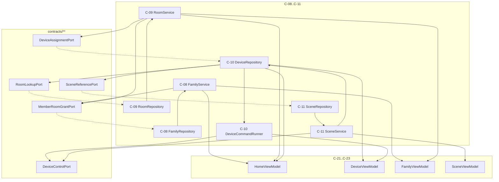

> 实线 = 编译期依赖（consumer → provider）；虚线 = 端口实现绑定（C-28 组合根）。`RoomService` 与 `DeviceRepository` 的运行时反向边通过 `DeviceAssignmentPort`/`RoomLookupPort` 解耦，不形成编译期环（CG §4.4）。

### 2.4 组合根与初始化顺序（C-28）

**契约级装配顺序**（`AppCompositionRoot.initialize()`）：

```text
1.  Platform: ClockPort / RandomPort / IdPort / LoggerPort / MetricsPort
2.  PreferencesStore / RdbStore / SecretStore / SecretDraftPort
3.  MigrationRegistry:
      C-06 v1  (gw_route/gw_sequence/gw_dismissed_device)
      C-08 v2  (family/family_member/invitation)
      C-12 v3  (auth_profile)
      C-08/C-09/C-10/C-11/C-15 v4 (DES-B：room/device_state/scene/cloud_config)
4.  StorageService.initialize()
5.  CryptoService (CryptoPort)
6.  SecurityService (CanonicalBuilder/RequestSigner/ResponseVerifier/NonceCache/ClockSkewTracker)
7.  AuthService.initialize()
8.  GatewayRepository.initialize()
9.  FamilyRepository.initialize()
10. RoomRepository.initialize()
11. SceneRepository.initialize()
12. DeviceRepository.initialize()
13. RoomService / FamilyService / SceneService (注入端口实现)
14. GatewayControlAdapter (DeviceControlPort)
15. UI_CONTROL IGatewayClient + BACKGROUND IGatewayClient
16. LocalGatewayService x2（同一依赖，不同 GatewayRequestPolicy）
17. GatewayDiscoveryService
18. BleProvisioningService
19. CloudConfigStore / CloudCredentialPort / CloudCommandClient / ShadowReader / CloudCompletionEvaluator / CloudService
20. DeviceCommandRunner（UI 客户端）
21. DeviceControlCoordinator（LAN/云回退；依赖 20 + CloudService）
22. I18nService.initialize()
23. AppContext（activeFamily、session、foreground 状态）
24. UI 页面按需构造 VM（页面生命周期内，不全局单例）
```

**约束**：
- 必须显式构造器注入；禁止全局单例/服务定位器（DES-A §2.3）。
- 组合根不得 import `Mock*`/`ohosTest/**`；`DEV-ONLY` 只在 C-17 拒收路径出现。
- `UI_CONTROL` 客户端策略（对齐 UIUX 3s；`DES-B-PARAM`）：
  - `connectTimeoutMs=2000`、`readTimeoutMs=3000`、`maxAttempts=1`、`discoverTimeoutMs=3000`。
- `BACKGROUND` 客户端策略：DES-A `GatewayRequestPolicy.defaults()`（3 次精确重传）。
- 两个客户端共享 `GatewayCredentialPort`/`GatewaySequencePort`/`ClockPort`/`ClockSkewTracker`；不得共享 `PendingCommand` 状态（各自实例）。
- 场景执行/诊断/绑定探针使用 `BACKGROUND`；用户单次控制使用 `UI_CONTROL`。该分配由 C-28 固定，页面不得自行 `new` 客户端。

**启动失败处理**：
| 失败点 | 行为 |
|---|---|
| `StorageService.initialize`/迁移失败 | 阻断启动，显示 `StartupErrorPage`（`errors.app.storage_*`），提供重试/退出；不得进入业务页 |
| `CryptoService`/`SecurityService` 不可用 | 阻断控制但允许只读本地数据；显示 `errors.app.crypto_unavailable` |
| `AssetStore` 不可用 | 阻断配网/控制/新增绑定；本地只读可浏览；不得回退 Preferences/明文（SC-09） |
| `I18nService.initialize` 失败 | 用内置最小键表 + `t()` 返回 key 文本启动；记录 `I18N_RESOURCE_LOAD_FAILED`；设置页可重试 |
| `CloudConfig` 无效 | 云状态 `NOT_CONFIGURED`/`UNAVAILABLE`；不影响 LAN |

### 2.5 与 DES-A 端口/错误体系的接入点

| DES-A 端口/类型 | DES-B 消费者 | 接入方式 |
|---|---|---|
| `ClockPort` | 所有 VM/领域服务 | 构造注入；超时/时间戳统一 UTC/epoch ms |
| `RandomPort`/`IdPort` | C-08/C-09/C-11/C-15 | 仅服务层使用；UI/VM 不生成 ID |
| `LoggerPort`/`MetricsPort` | C-08..C-28 | 只记英文诊断字段；禁止 secret/用户数据（DES-A §3.5） |
| `PreferencesStore` | C-14 locale mode、C-08 activeFamily、C-22 settings | 只存非秘密小配置 |
| `RdbStore`/`RdbTransaction` | C-08/C-09/C-10/C-11/C-15 | 事务边界见 §2.7；迁移注册见 §2.4 |
| `SecretStore` | C-08 join/seed、C-15 token、C-07 hmac | 回调式访问；不返回裸字节（DES-A §3.5） |
| `MigrationSink` | C-08..C-11/C-15 | 静态 `registerMigrations`；版本连续 |
| `IGatewayClient` | C-21/C-23/C-15? | C-21 用 `UI_CONTROL` 做 discover/control；C-23 用 `BACKGROUND` 做绑定探针/发现 |
| `GatewayRoutePort` | C-09/C-10/C-21/C-23/C-15 | 只读路由；不修改 profile |
| `GatewayCredentialPort` | C-15/C-17 适配器 | C-15 只用 `commandSecret` 签名云命令 |
| `GatewaySequencePort` | C-15/C-17 | 云与 LAN 共用 per-gateway 序列（`RISK-CLOUD-SEQ-SHARED`） |
| `IBleProvisioningClient` | C-23 | `provision` + `ProvisioningProgressListener` |
| `DiscoveryReport`/`DiscoveryCandidate` | C-21/C-23 | 只作定位/状态提示；不据此创建设备/绑定 |
| `AppError`/`Result<T>` | 所有 DES-B 组件 | 错误只经 `AppError`；UI 只展示 `i18nKey`/`t()`，不展示 `message` |

**错误命名空间扩展规则**：新增错误码必须 `SCREAMING_SNAKE`、有稳定 i18n key、不得复用网关 `result_code`；云错误统一 `CLOUD_*` + `errors.cloud.*`（CB §4.2；DES-A §3.2.3/§24）。

### 2.6 状态、事件与订阅模型

DES-B 的 VM 不依赖 ArkUI 装饰器；统一使用 `ObservableState<S>` + 显式订阅：

```ts
export class ObservableState<S> {
  constructor(initial: S);
  get(): S;
  set(next: S): void;
  update(reducer: (current: S) => S): void;
  subscribe(listener: (state: S) => void): () => void; // 返回取消订阅函数
}

export interface ViewModelBase<S> {
  getState(): S;
  subscribe(listener: (state: S) => void): () => void;
  dispose(): void;
}
```

**事件类型（按组件）**：
- C-08：`FamilyChangeEvent`（`FAMILY_CREATED/SWITCHED/UPDATED/MEMBER_ADDED/MEMBER_UPDATED/MEMBER_REMOVED/INVITE_UPDATED`）。
- C-09：`RoomChangeEvent`（`ROOM_CREATED/RENAMED/REORDERED/DELETED/DEVICE_ASSIGNED`）。
- C-10：`DeviceChangeEvent`（`DEVICE_ADDED/UPDATED/REMOVED/DISMISSED/RESTORED/GATEWAY_REMOVED/STATE_APPLIED`）。
- C-11：`SceneExecutionEvent`（`STARTED/STEP_STARTED/STEP_SUCCEEDED/STEP_FAILED/FINISHED/CANCELLED`）。
- C-14：`LocaleChangedEvent`（`locale`, `mode`, `revision`）。
- C-15：`CloudStateChangedEvent`（`config`, `token`, `lastError`）。

**规则**：
1. 事件是**通知**，不是事实源；事实源仍是仓储/服务状态。
2. 订阅者必须在 `dispose()`/`aboutToDisappear` 取消订阅；不得泄漏监听器。
3. 事件 payload 不含 secret/完整 token/Wi-Fi 密码/PoP。
4. VM 收到事件后重新读取状态或合并事件；不得凭事件文本推断成功。

### 2.7 持久化与迁移（DES-B v4）

**版本分配**：

| 版本 | 注册者 | 表 |
|---|---|---|
| v1 | C-06 `StorageService` | `gw_route`、`gw_sequence`、`gw_dismissed_device`（DES-A §9.1.6） |
| v2 | C-08 `FamilyRepository` | `family`、`family_member`、`invitation`（DES-A §11.4） |
| v3 | C-12 `AuthService` | `auth_profile`（DES-A §12.4） |
| v4 | DES-B `DomainMigrations.register` | `room`、`device_state`、`scene`、`cloud_config` |

**v4 DDL（契约）**：

```sql
CREATE TABLE IF NOT EXISTS room (
  room_id TEXT PRIMARY KEY NOT NULL,
  family_id TEXT NOT NULL,
  room_name TEXT NOT NULL,
  icon TEXT,
  order_index INTEGER NOT NULL,
  created_at TEXT NOT NULL,
  updated_at TEXT NOT NULL
);
CREATE INDEX IF NOT EXISTS idx_room_family_order ON room(family_id, order_index);

CREATE TABLE IF NOT EXISTS device_state (
  gateway_id TEXT NOT NULL,
  device_id TEXT NOT NULL,
  family_id TEXT NOT NULL,
  device_name TEXT NOT NULL,
  room_id TEXT NOT NULL DEFAULT '',
  is_enabled INTEGER NOT NULL,
  is_unassigned INTEGER NOT NULL,
  snapshot_json TEXT NOT NULL,
  state_epoch_ms INTEGER NOT NULL,
  last_merge_at TEXT,
  gateway_removed INTEGER NOT NULL DEFAULT 0,
  last_applied_request_id TEXT,
  last_applied_seq INTEGER,
  PRIMARY KEY (gateway_id, device_id)
);
CREATE INDEX IF NOT EXISTS idx_device_family_room ON device_state(family_id, room_id);
CREATE INDEX IF NOT EXISTS idx_device_family_unassigned ON device_state(family_id, is_unassigned);

CREATE TABLE IF NOT EXISTS scene (
  scene_id TEXT PRIMARY KEY NOT NULL,
  family_id TEXT NOT NULL,
  scene_name TEXT NOT NULL,
  icon TEXT NOT NULL,
  actions_json TEXT NOT NULL,
  is_enabled INTEGER NOT NULL,
  updated_at TEXT NOT NULL
);
CREATE INDEX IF NOT EXISTS idx_scene_family ON scene(family_id);

CREATE TABLE IF NOT EXISTS cloud_config (
  singleton_id INTEGER PRIMARY KEY NOT NULL,
  endpoint TEXT NOT NULL,
  project_id TEXT NOT NULL,
  device_id TEXT NOT NULL,
  access_token_alias TEXT NOT NULL,
  shadow_endpoint TEXT,
  updated_at TEXT NOT NULL,
  CHECK (singleton_id = 1)
);
```

**规则**：
- `snapshot_json` 是 `DeviceSnapshot` 的规范 JSON；解析失败 → `STORAGE_RDB_ERROR`，该设备不出现在列表（记录诊断）。
- `is_dismissed` **不落 `device_state`**；由 `gw_dismissed_device`（DES-A v1）按 `(gateway_id, device_id)` 派生，避免双源。
- `gateway_removed` 是本地提示位，仅在全量 discover 未出现该设备时置 1；`isPartial=true` 不改。
- `actions_json` 是 `SceneAction[]`；解析失败 → `STORAGE_RDB_ERROR`，场景不可执行。
- `cloud_config.access_token_alias` 必须等于 `StorageConstants.ASSET_CLOUD_TOKEN`（`yaocore.cloud.token.v2`）；token 本体只在 Asset Store。
- 迁移单向；`DomainMigrations.register(registry)` 在 `StorageService` 构造前调用；重复版本 → `CONFIGURATION_ERROR`。
- 不在 v4 存 VM 状态、UI 临时值、节流缓冲、PendingCommand、通知已读状态（内存/Preferences 非秘密小配置）。

### 2.8 并发、取消与时间

| 主题 | 契约 |
|---|---|
| 单写者 | 每个仓储实例对其表串行写；`RdbStore.transaction` 内完成复合操作 |
| 同网关命令 | C-17 每网关串行；C-10/C-11 不并行发同网关命令（场景串行；VM 单次控制；节流器保证 1 在途） |
| 跨网关 | 可并行；场景仍按动作数组顺序串行（`SceneAction.delayMs` 生效） |
| 取消 | C-11 场景执行、C-15 影子轮询、C-23 配网接受 `CancellationToken`；每步/每轮检查 |
| 定时器 | `TimerPort` 注入；host 用 `FakeTimer.advance(ms)`；禁止 VM 直接 `setInterval` |
| 时间 | 领域仲裁用 `DateTimeUtil.parseUtcCompact`；UI 计时用 `ClockPort.nowMs()`；超时差值不用 wall clock 直接相减跨重启 |
| 应用后台 | C-28 调用 `AuthService.lockAll()`、`SecretDraftStore.clearAll()`、`BleProvisioningService.cancel()`、`CloudService.stopPolling()`、`PreferencesStore.flush()`；取消所有 VM 定时器 |
| 重启 | `PendingCommand` 不持久化；重启后控制显示未确认，不自动重放；`seq` 持久化继续递增（DES-A §14.3） |

---

## 3. C-08 FamilyRepository / FamilyService（家庭、成员、邀请生命周期）

**契约 ID**：`DES-B-C08-API` / `DES-B-C08-ERR` / `DES-B-C08-STATE` / `DES-B-C08-SEAM` / `DES-B-C08-TRACE`
**职责**：在 DES-A `FamilyRepository` 数据访问面之上，提供家庭创建/切换、成员管理、邀请/回执状态机、GUEST 到期、退出/转让/解散的用例编排；消费 C-13 `InviteService`，不实现邀请加密容器。
**路径**：`entry/src/main/ets/repository/FamilyRepository.ets`（DES-A + 增量）、`entry/src/main/ets/service/family/**`。

### 3.1 公开契约（`DES-B-C08-API`）

#### 3.1.1 视图/结果类型（`model/FamilyViewModels.ets`）

```ts
export enum FamilyContactSyncState {
  NEVER = 'NEVER',          // 从未与该成员接触同步
  SYNCED = 'SYNCED',        // 本机最近一次接触式同步
  STALE = 'STALE'           // 存在未同步的本地变更（提示，不是在线）
}

export enum InvitationReceiptState {
  PENDING = 'PENDING',
  ACCEPTED = 'ACCEPTED',
  REVOKED = 'REVOKED',
  EXPIRED = 'EXPIRED'
}

export class FamilyMemberView {
  readonly member: FamilyMember;
  readonly syncState: FamilyContactSyncState;
  readonly lastSyncedAt?: string;          // 仅“本机最近接触式同步”，禁止表述为在线
  readonly roleI18nKey: string;            // errors 之外的状态键，如 member.role.admin
  readonly statusI18nKey: string;
  readonly allowedRoomNames: ReadonlyArray<string>;
}

export class InvitationView {
  readonly record: InvitationRecord;
  readonly receiptState: InvitationReceiptState;
  readonly remainingMs: number;            // 0 = 已过期
  readonly usesRemaining: number;
  readonly isWeakMode: boolean;            // CODE_KEK
  readonly targetRoleI18nKey: string;
  readonly modeI18nKey: string;
}

export class FamilySwitchResult {
  readonly family: Family;
  readonly requiresUnlock: boolean;        // 切换家庭后必须重新解锁该家庭档案
  readonly activeProfileId?: string;
}

export class RemoveMemberResult {
  readonly memberId: string;
  readonly removed: boolean;
  readonly rotationPlan?: RotationPlan;    // C-13 返回的轮换引导；不在本服务执行 BLE
  readonly requiresRotation: boolean;
}

export class MemberChangeResult {
  readonly memberId: string;
  readonly changed: boolean;
  readonly rotationPlan?: RotationPlan;
  readonly requiresRotation: boolean;
}

export class ExpireGuestsResult {
  readonly expiredCount: number;
  readonly expiredMemberIds: ReadonlyArray<string>;
  readonly rotationPlan?: RotationPlan;
}

export class FamilyDissolutionPlan {
  readonly familyId: string;
  readonly gatewayIds: ReadonlyArray<string>;
  readonly requiresRotation: boolean;      // 旧密钥仍在网关有效
  readonly requiresGatewayUnbind: boolean; // 是否建议逐网关重新配网/解绑
}

export class JoinSessionState {
  readonly phase: FamilyJoinPhase;
  readonly joinRequestText?: string;       // YCR1；可展示二维码/复制
  readonly mode?: InviteMode;
  readonly inviteId?: string;
  readonly accepted?: AcceptedInvitation;
  readonly error?: AppError;
  readonly revision: number;
}

export enum FamilyJoinPhase {
  IDLE = 'IDLE',
  JOIN_REQUEST_READY = 'JOIN_REQUEST_READY',
  WAITING_FOR_INVITATION = 'WAITING_FOR_INVITATION',
  CODE_REQUIRED = 'CODE_REQUIRED',
  VALIDATING = 'VALIDATING',
  APPLYING = 'APPLYING',
  COMPLETED = 'COMPLETED',
  FAILED = 'FAILED',
  CANCELLED = 'CANCELLED'
}
```

> `FamilyMemberView` 不包含 `isOnline` 字段；D-010 明确禁止跨设备在线状态。`syncState` 只表达本机接触式同步信息。

#### 3.1.2 `FamilyRepository` 增量方法（不改变 DES-A §11.1 已冻结签名）

```ts
export class FamilyRepository implements MemberRoomGrantPort {
  // ... DES-A §11.1 已有方法保持不变 ...

  /** 原子切换 activeFamilyId；familyId 必须存在。 */
  switchActiveFamily(familyId: string): Promise<void>;

  /** 从所有成员的 allowedRoomIds 中移除该房间；返回受影响成员数。 */
  removeRoomGrant(tx: RdbTransaction, familyId: string, roomId: string): Promise<number>;

  /** 转让 Admin：newAdminMemberId 必须是 ACTIVE MEMBER；保留至少一个 ADMIN。 */
  transferAdmin(familyId: string, currentAdminMemberId: string,
                newAdminMemberId: string): Promise<void>;

  /** 本地解散：删除 family/member/invitation；不删除 gateway route/secret。 */
  removeFamilyLocal(tx: RdbTransaction, familyId: string): Promise<ReadonlyArray<string>>; // 返回 gatewayIds

  /** 本地退出：删除当前成员记录；若为最后一个 ADMIN 则失败。 */
  removeMemberLocal(tx: RdbTransaction, familyId: string, memberId: string): Promise<void>;

  /** 读取家庭下所有邀请（含过期判定所需字段）。 */
  listInvitationsByFamily(familyId: string): Promise<ReadonlyArray<InvitationRecord>>;

  /** 事务内写 acceptedAt/acceptedByMemberId/receipt + status=ACCEPTED + usedCount++。 */
  applyReceipt(inviteId: string, patch: InvitationPatch): Promise<void>;

  /** 读取成员的全部本地授权房间。 */
  listMemberRoomGrants(familyId: string, memberId: string): Promise<ReadonlyArray<string>>;
}
```

**实现约束**：
- `removeRoomGrant`/`removeFamilyLocal`/`removeMemberLocal` 必须在调用方提供的事务内执行；自身不 `beginTransaction`。
- `removeFamilyLocal` 删除 `invitation`/`family_member`/`family` 行；不删除 `auth_profile`（C-12 负责，见 §3.3.6 退出/解散流程）。
- `transferAdmin` 同时更新 `family.owner_member_id` 与两个成员的 `role`；失败整体回滚。
- `switchActiveFamily` 只写 `StorageConstants.PREF_ACTIVE_FAMILY_ID`；不触碰 `auth_profile`。

#### 3.1.3 `FamilyService`（用例编排）

```ts
export class FamilyService {
  constructor(families: FamilyRepository,
              invites: InviteService,
              auth: AuthService,
              routes: GatewayRoutePort,
              clock: ClockPort,
              ids: IdPort,
              logger: LoggerPort);

  initialize(): Promise<void>;

  // 家庭
  listFamilies(): Promise<ReadonlyArray<Family>>;
  getActiveFamily(): Promise<Family | undefined>;
  createFamily(familyName: string, ownerDisplayName: string): Promise<Family>;
  switchFamily(familyId: string): Promise<FamilySwitchResult>;
  updateFamilyName(familyId: string, familyName: string): Promise<void>;
  dissolveFamily(familyId: string): Promise<FamilyDissolutionPlan>;
  leaveFamily(familyId: string, memberId: string): Promise<FamilyDissolutionPlan>;

  // 成员
  listMemberViews(familyId: string): Promise<ReadonlyArray<FamilyMemberView>>;
  removeMember(familyId: string, memberId: string): Promise<RemoveMemberResult>;
  changeMemberRole(familyId: string, memberId: string, role: MemberRole): Promise<MemberChangeResult>;
  extendGuest(familyId: string, memberId: string, expiresAt: string): Promise<MemberChangeResult>;
  expireGuests(familyId: string, nowMs: number): Promise<ExpireGuestsResult>;
  transferAdmin(familyId: string, currentAdminMemberId: string,
                newAdminMemberId: string): Promise<void>;
  markContactSync(familyId: string, memberId: string, atMs: number): Promise<void>;

  // 邀请（Admin 侧）
  createInvitationForJoinRequest(joinRequestText: string,
                                 input: CreateInvitationInput): Promise<InvitationCreationResult>;
  createCodeInvitation(input: CreateInvitationInput): Promise<InvitationCreationResult>;
  listInvitationViews(familyId: string): Promise<ReadonlyArray<InvitationView>>;
  revokeInvitation(inviteId: string): Promise<void>;
  importReceipt(inviteId: string, receiptText: string): Promise<AcceptedInvitation>;
  expireInvitations(familyId: string, nowMs: number): Promise<number>;

  // 成员侧加入
  createJoinSession(): FamilyJoinSession;
}
```

**方法语义**：
- `createFamily`：生成 `familyId`（`UuidUtil.newUuid(ids)`），在本机事务内创建 `Family` + `ADMIN` 成员；`ownerDisplayName` 只用于本地成员 `displayName`；不创建 `LocalProfile`（C-22 在返回后调用 `AuthService.createProfile`，密码由 UI 收集）。
- `switchFamily`：调用 `families.switchActiveFamily`；使当前会话失效（`auth.lockAll()`），返回 `requiresUnlock=true`，并要求 `activeProfileId` 指向该家庭的本地档案；**不**在服务内自动解锁。
- `changeMemberRole`：更新角色后调用 `auth.invalidateSessionsForMember(memberId)`；降级/升级 Admin 需满足“至少一个 ADMIN”；返回轮换引导（角色变更不强制轮换，但高风险时提示）。
- `transferAdmin`：调用 `families.transferAdmin`；随后 `auth.invalidateSessionsForMember` 对原/新 Admin 都执行；不发送网络请求；不改变网关密钥。
- `removeMember`：最后一次 ADMIN 检查；删除成员；调用 `auth.invalidateSessionsForMember`；返回 `RotationPlan`（`requiresRotation=true`，因为被移除者可能仍持有 `commandSecret`）；**不**执行 BLE 轮换。
- `expireGuests`：`families.expireGuests` 后对每个过期成员调用 `auth.invalidateSessionsForMember`；返回轮换引导但**不强制**（D-013）。
- `extendGuest`：仅 ADMIN；`expiresAt` 必须是未来 UTC 紧凑时间；更新后调用 `auth.invalidateSessionsForMember`（让新时效生效）；更新 GUEST 时效，不改角色；返回 `MemberChangeResult`。
- `dissolveFamily`：仅 ADMIN；`families.removeFamilyLocal` 删除本地数据；随后 `auth.removeProfilesForFamily(familyId)` 删除该家庭的本地档案（若失败，返回 `CONFIGURATION_ERROR` 并提示重试；家庭数据已删除，档案残留需清理）；返回 `FamilyDissolutionPlan`，其中 `gatewayIds` 来自 `routes.listRoutesByFamily`；**不**删除 route/secret（C-22 在用户确认后调用 `GatewayRepository.removeLocalBinding` 或保留为“待重新配网”）。
- `leaveFamily`：普通成员自退出；若为最后一个 ADMIN → `AUTH_RBAC_DENIED`；删除成员记录；删除该成员在该家庭的本地档案（`auth.removeProfilesForMember(familyId, memberId)`）；返回轮换引导；不删除家庭（家庭仍属其他成员）。
- `importReceipt`：调用 `invites.verifyReceipt`；成功后 `families.applyReceipt(inviteId, patch)`（单事务：ACCEPTED + accepted 字段 + `usedCount++`）；若成员不存在则 `upsertMember(ACTIVE)`；失败抛 `INVITE_RECEIPT_INVALID`；不改变 `payloadString`/`seedAlias`。
- `createInvitationForJoinRequest`：`joinRequestText` 必须是 `YCR1`；调用 `invites.createInvitation({ mode: KEY_WRAP, joinRequest })`；`putInvitation(record)`；`seedAlias` 已由 C-13 写入 Asset Store。
- `createCodeInvitation`：强制 `mode=CODE_KEK`；`maxUses` 默认 1（可显式 >1，UI 必须标弱模式）；返回 `code` 仅本次展示；不持久化明文码。
- `expireInvitations`：`PENDING` 且 `expireAt <= now` → `EXPIRED`；已 `ACCEPTED/REVOKED` 不变。
- `markContactSync`：只调用 `families.markSynced(memberId, atMs)`；表示本机最近接触式同步，不产生在线/心跳语义（D-010）。

#### 3.1.4 `FamilyJoinSession`（成员侧）

```ts
export class FamilyJoinSession {
  constructor(invites: InviteService,
              families: FamilyRepository,
              auth: AuthService,
              clock: ClockPort,
              logger: LoggerPort);

  getState(): JoinSessionState;
  subscribe(listener: (state: JoinSessionState) => void): () => void;

  start(displayName?: string): Promise<JoinRequestContainer>; // -> JOIN_REQUEST_READY
  waitForInvitation(): void;                                  // -> WAITING_FOR_INVITATION
  submitInvitation(text: string, code?: string): Promise<AcceptedInvitation>;
  cancel(): Promise<void>;                                    // 清理 join 私钥/临时缓冲
  dispose(): void;
}
```

**语义**：
- `start` 调用 `invites.createJoinRequest(displayName)`；`memberId`/`YCR1` 文本存入 state；私钥由 C-13 存 Asset Store（`yaocore.invite.join.<memberId>`）。
- `submitInvitation`：
  1. 解析前缀：`YCI1` → 调用 `invites.acceptInvitation(text, { code, nowMs })`；
  2. 若容器 `kdf.mode=CODE_KEK` 且未提供 `code` → 状态 `CODE_REQUIRED`，不尝试解封；
  3. 成功后 `families.getMember` 不存在则 `upsertMember`（C-13 正常已写入；此处幂等）；
  4. 更新 state `COMPLETED`；不创建 `LocalProfile`（C-22 负责密码与档案）。
- `cancel`：调用 `invites.discardJoinRequest(memberId)`（§23 扩展请求）或直接删除 join 私钥别名；清空 state 中的 `joinRequestText`；状态 `CANCELLED`。
- 同一 `inviteId` 在本地只接受一次：再次 `submitInvitation` 同一容器 → `INVITE_INVALID`/`INVITE_MAX_USES` 由 C-13 决定；session 记录已接受 ID 防止重复。

#### 3.1.5 `MemberRoomGrantPort`（由 C-08 实现，供 C-09 事务调用）

```ts
export interface MemberRoomGrantPort {
  removeRoomGrant(tx: RdbTransaction, familyId: string, roomId: string): Promise<number>;
}
```

- 实现方法直接调用 `FamilyRepository.removeRoomGrant(tx, familyId, roomId)`；不开启新事务。
- C-09 `RoomService.deleteRoom` 在删除房间的同一事务内调用；失败则整个房间删除回滚。

### 3.2 错误（`DES-B-C08-ERR`）

| 场景 | 错误 | 备注 |
|---|---|---|
| 家庭不存在 | `CONFIGURATION_ERROR` | 调用方先 `getFamily`；UI 显示通用失败 |
| 家庭名空/超长 | `PROTOCOL_VALUE_OUT_OF_RANGE` | 1..31 字符（trim 后） |
| 最后一个 ADMIN 被移除/降级/退出 | `AUTH_RBAC_DENIED` | DES-A §11.2 既有语义 |
| 成员不存在 | `CONFIGURATION_ERROR` | 不新增码，避免错误空间膨胀 |
| 成员已存在 | `CONFIGURATION_ERROR` | `upsertMember` 幂等；显式创建重复才失败 |
| 邀请 targetRole=ADMIN | `PROTOCOL_VALUE_OUT_OF_RANGE` | DES-A §11.2 |
| GUEST 缺 expiresAt | `PROTOCOL_VALUE_OUT_OF_RANGE` | DES-A §11.2 |
| 邀请过期/撤销/用尽 | `INVITE_EXPIRED` / `INVITE_REVOKED` / `INVITE_MAX_USES` | C-13 映射 |
| 回执非法 | `INVITE_RECEIPT_INVALID` | C-13 |
| 加入请求非法 | `INVITE_JOIN_REQUEST_INVALID` | C-13 |
| CODE_KEK 缺码 | `INVITE_CODE_INVALID` | 状态 `CODE_REQUIRED` 时不抛，提交空码才抛 |
| 家庭切换时无对应档案 | `AUTH_PROFILE_NOT_FOUND` | C-22 引导创建/解锁 |
| 解散/退出时存在未完成配网 | `CONFIGURATION_ERROR` | 先取消配网，避免半绑定 |
| RDB/迁移/Asset 失败 | 透传 `STORAGE_*`/`ASSET_*` | 不吞错 |

**新增错误码**：本文不新增 C-08 专属码；复用 DES-A 表。若实现需要 `FAMILY_*` 细分，必须按 §23 登记并补 i18n 键。

### 3.3 状态机与不变量（`DES-B-C08-STATE`）

#### 3.3.1 家庭生命周期（本地）

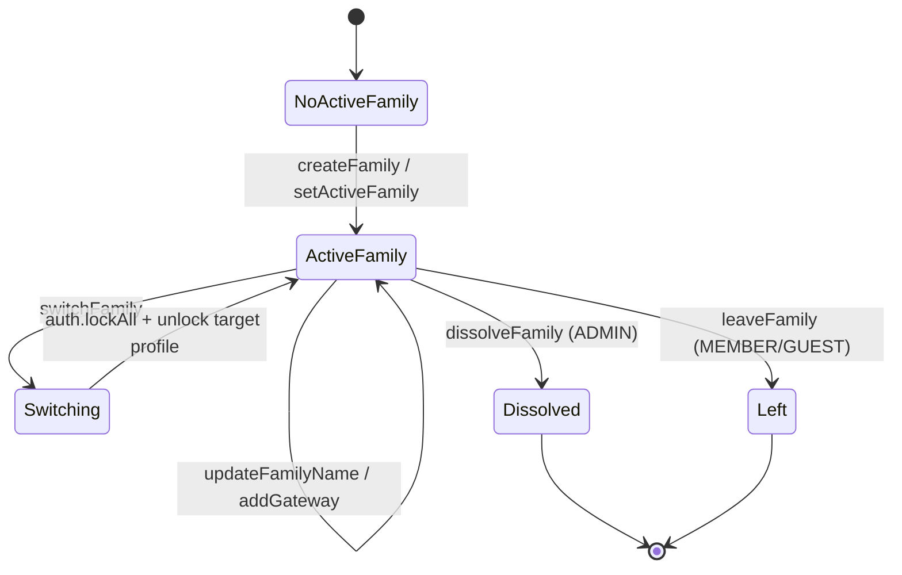

- `Family` 无 `status` 字段；不存在“已解散”持久状态。解散/退出是本地删除。
- `activeFamilyId` 只指向存在的家庭；`switchActiveFamily` 校验。
- 多家庭：v1 每家庭一个 `LocalProfile`（`LocalProfile.familyId` 单值）；切换家庭必须锁当前会话并解锁目标家庭档案（`RISK-MULTIFAMILY-PROFILE`）。同一 `displayName` 可对应多个家庭档案，但无跨家庭统一账户（无服务器）。

#### 3.3.2 成员状态机

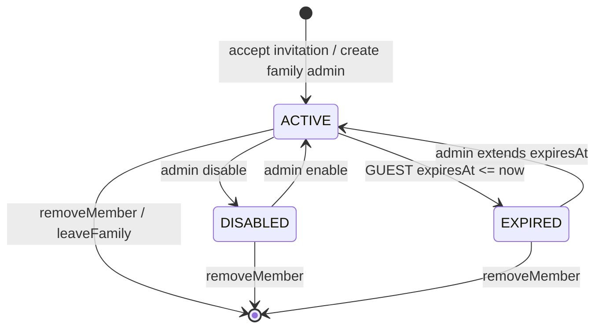

- `MemberStatus.INVITED`：v1 正常流程**不创建** `INVITED` 成员记录；邀请的待接受状态由 `InvitationStatus.PENDING` 表达。`INVITED` 仅保留给未来“Admin 预登记”能力，不参与 RBAC。
- `EXPIRED` 是 GUEST 冻结态；不自动恢复；续期需 Admin 显式 `extendGuest`。
- 角色变更/状态变更/到期后，调用方必须 `auth.invalidateSessionsForMember(memberId)`；C-08 服务内部已调用。
- 成员删除只删本地记录；不发送网络请求；不擦除实体网关（SC-12）。
- `lastSyncedAt` 只表示本机最近接触式同步；UI 不得显示“在线”。

#### 3.3.3 邀请状态机

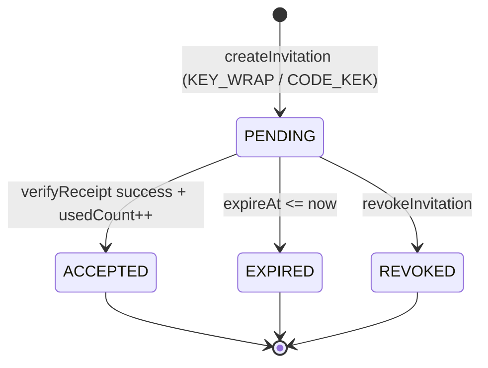

- `PENDING → ACCEPTED` 仅在**回执到达并校验通过**后发生；成员设备本地接受但回执未达时，Admin 仍看到 `PENDING`（ADR-003 §5.4）。
- `usedCount` 单调递增；`ACCEPTED` 时 `acceptedAt/acceptedByMemberId/receipt` 必须同时写入。
- `KEY_WRAP.maxUses` 必须 1；`CODE_KEK.maxUses>=1`，>1 时 UI 必须显示弱模式警告与“可重复使用（安全性降低）”。
- 撤销只改本地状态；真正失效需逐网关 BLE 轮换（ADR-003 §6）；`revokeInvitation` 返回/触发轮换引导，不执行 BLE。
- 邀请容器 `payloadString` 是密文，可重复分享；`seedAlias` 只存别名；不得在日志/异常中输出 seed/码。

#### 3.3.4 加入流程（D-009 主路径）

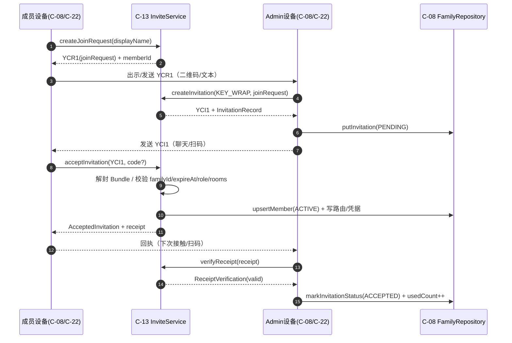

- D-009：成员**先出示** `YCR1`；Admin 默认扫码/粘贴加入请求后生成 `YCI1`。`CODE_KEK` 仅在无法回传加入请求时由 Admin 显式选择，UI 必须显示弱模式警告。
- `submitInvitation` 在成员设备完成解封；不依赖服务器/网关家庭端点。
- 成员设备接受后生成回执；Admin 在下次接触（扫码/同 LAN 用户触发）导入回执；未到达则保持 `PENDING` 至过期。
- 加入成功后成员设备拥有 `commandSecret`/pins；无需 BLE 配网（ADR-003 §7）。
- 任何解封失败统一 `INVITE_INVALID`，不区分“版本/码/篡改”（防 oracle）。

#### 3.3.5 GUEST 到期与撤销（D-013）

- 到期：`expireGuests` 或读取时惰性判定；`status=EXPIRED`；冻结控制与房间可见性（v1 采用“只读可见”，ADR-004 §4）。
- 到期只提示轮换，不自动/不强制（D-013）；`ExpireGuestsResult.rotationPlan` 供 UI 引导。
- 移除成员：`RemoveMemberResult.rotationPlan`；UI 默认勾选“执行轮换引导”，可跳过但记录；实际轮换 = 逐网关 BLE 重新配网（C-23）。
- 安全边界：GUEST 房间限制是 App 策略，不是密码学边界；持有 `commandSecret` 可控制该网关任意设备（ADR-003 §6.3；DP-06）。

#### 3.3.6 退出/转让/解散（FR-FAM-004 v1 限制声明）

| 场景 | v1 行为 | 限制 |
|---|---|---|
| 普通成员退出 | 删除本机成员记录/家庭数据/凭据；返回轮换引导 | 不通知其他设备；Admin 在下次接触时收敛；退出者可能保留旧密钥 |
| Admin 转让 | 本地更新 `owner_member_id` + 两个成员角色；使双方会话失效 | 仅本地；其他设备接触式收敛；不改变网关密钥 |
| 解散家庭 | 仅 ADMIN；删除本机 family/member/invitation；返回 `FamilyDissolutionPlan` | 不自动删除网关绑定/不自动轮换；旧密钥仍有效；需逐网关重新配网 |
| GUEST 到期 | 冻结 + 提示轮换 | 不自动轮换 |

**FR-FAM-004 声明**：v1 为**本地语义 + 引导流程**，不承诺跨设备强一致；无服务器协调点；家庭成员/角色/房间的跨设备一致性为接触式收敛（ADR-003 §5.2/§10；D-010）。UI 必须如实展示该限制，不得暗示实时同步。

### 3.4 依赖注入与测试 seam（`DES-B-C08-SEAM`）

- 依赖：`FamilyRepository`、`InviteService`、`AuthService`、`GatewayRoutePort`、`ClockPort`、`IdPort`、`LoggerPort`；不 import 平台 API。
- host 测试：
  - 家庭创建 + ADMIN 不变量 + activeFamily 切换；
  - 最后一个 ADMIN 删除/降级/退出失败；
  - GUEST 到期/续期/不自动恢复；
  - 邀请状态 PENDING→ACCEPTED/EXPIRED/REVOKED；`usedCount` 上限；KEY_WRAP `maxUses!=1` 拒绝；
  - 回执校验成功/篡改；重复回执拒绝；
  - 加入 session：`start → submitInvitation(KEY_WRAP) → COMPLETED`；CODE_KEK 缺码 → `CODE_REQUIRED`；取消清理 join 私钥别名；
  - removeMember 调用 `auth.invalidateSessionsForMember`（fake 记录）；
  - D-010：`markContactSync` 只写字段，不产生“在线”语义；
  - 退出/转让/解散不产生任何网络请求（fake `IGatewayClient` 记录 0 调用）。
- device/IT：RDB 持久化、重启、Asset Store join/seed 别名；无设备标 `UNAVAILABLE`。
- 夹具：`FamilyFixture`（家庭/成员/邀请 JSON）、`InviteGolden`（DES-A T-05 提供）；禁止真实家庭数据。

### 3.5 Traceability（`DES-B-C08-TRACE`）

| 需求/约束 | 映射 |
|---|---|
| FR-FAM-001 家庭创建/多家庭 | `FamilyService.createFamily/switchFamily`；`FamilyViewModel` |
| FR-FAM-002 成员邀请 | `FamilyService.createInvitationForJoinRequest/createCodeInvitation/importReceipt`；`FamilyJoinSession` |
| FR-FAM-003 权限/移除 | `removeMember/changeMemberRole`；`AuthService.invalidateSessionsForMember` |
| FR-FAM-004 退出家庭 | `leaveFamily/transferAdmin/dissolveFamily`；§3.3.6 v1 限制声明 |
| FR-SET-001 成员管理面板 | `listMemberViews/listInvitationViews`；C-26 |
| ADR-003 §5/§6/§9/§10 | 离线凭据、撤销=轮换、成员/邀请字段、生命周期 |
| ADR-004 §4 | GUEST 时效/只读冻结 |
| D-009/D-010/D-013 | 加入主路径、无实时在线、到期不强制轮换 |
| DP-05/DP-06、SC-16 | 接触式收敛、GUEST 非密码学边界、离线凭据 |
| T-09/T-13 | C-08 基础由 T-09；邀请容器/回执由 T-13 |

---

## 4. C-09 RoomRepository / RoomService（房间与未分配池）

**契约 ID**：`DES-B-C09-API` / `DES-B-C09-ERR` / `DES-B-C09-STATE` / `DES-B-C09-SEAM` / `DES-B-C09-TRACE`
**职责**：房间 CRUD、排序/图标、改名不改 ID、删除保护、未分配池、换房；只做本地数据，不下行协议；通过 `DeviceAssignmentPort` 协调 C-10，通过 `MemberRoomGrantPort` 清理 C-08 授权。
**路径**：`entry/src/main/ets/repository/RoomRepository.ets`、`entry/src/main/ets/service/room/**`。

### 4.1 公开契约（`DES-B-C09-API`）

#### 4.1.1 端口（`contracts/RoomPorts.ets`）

```ts
export interface RoomLookupPort {
  getRoom(roomId: string): Promise<Room | undefined>;
  exists(roomId: string): Promise<boolean>;
  listRooms(familyId: string): Promise<ReadonlyArray<Room>>;
}

export interface DeviceAssignmentPort {
  /** 在调用方事务内：把该房间下设备置为未分配/禁用，返回受影响设备数。 */
  onRoomDeleted(tx: RdbTransaction, familyId: string, roomId: string): Promise<number>;

  /** 指派/换房：校验房间存在、设备未 dismissed；返回更新后的 DeviceState。 */
  assignRoom(familyId: string, key: DeviceKey, targetRoomId: string): Promise<DeviceState>;

  /** 手动移入未分配池（保护性禁用）。 */
  unassignDevice(familyId: string, key: DeviceKey): Promise<DeviceState>;

  /** 统计房间下设备数（删除确认用）。 */
  countByRoom(familyId: string, roomId: string): Promise<number>;
}
```

#### 4.1.2 `RoomRepository`

```ts
export class RoomRepository implements RoomLookupPort {
  static registerMigrations(registry: MigrationSink): void; // v4 中 room 表

  constructor(rdb: RdbStore, clock: ClockPort, ids: IdPort);

  initialize(): Promise<void>;

  createRoom(familyId: string, roomName: string, icon?: string,
             orderIndex?: number): Promise<Room>;
  getRoom(roomId: string): Promise<Room | undefined>;
  exists(roomId: string): Promise<boolean>;
  listRooms(familyId: string): Promise<ReadonlyArray<Room>>;
  listRoomsOrdered(familyId: string): Promise<ReadonlyArray<Room>>;
  updateRoomName(roomId: string, roomName: string): Promise<void>;
  updateRoomIcon(roomId: string, icon: string | undefined): Promise<void>;
  updateOrder(familyId: string, orderedRoomIds: ReadonlyArray<string>): Promise<void>;
  deleteRoom(tx: RdbTransaction, roomId: string): Promise<void>;
  nextOrderIndex(familyId: string): Promise<number>;
}
```

#### 4.1.3 `RoomService`

```ts
export class RoomService {
  constructor(rooms: RoomRepository,
              devices: DeviceAssignmentPort,
              grants: MemberRoomGrantPort,
              rdb: RdbStore,
              clock: ClockPort,
              logger: LoggerPort);

  listRooms(familyId: string): Promise<ReadonlyArray<Room>>;
  createRoom(familyId: string, roomName: string, icon?: string): Promise<Room>;
  renameRoom(roomId: string, roomName: string): Promise<Room>;
  setIcon(roomId: string, icon: string | undefined): Promise<void>;
  reorderRooms(familyId: string, orderedRoomIds: ReadonlyArray<string>): Promise<void>;

  previewDelete(roomId: string): Promise<RoomDeletionPreview>;
  deleteRoom(roomId: string, confirmation: RoomDeletionConfirmation): Promise<RoomDeletionResult>;

  assignDevice(familyId: string, key: DeviceKey, roomId: string): Promise<DeviceState>;
  unassignDevice(familyId: string, key: DeviceKey): Promise<DeviceState>;
  moveDevice(familyId: string, key: DeviceKey, targetRoomId: string): Promise<DeviceState>;

  subscribe(listener: (event: RoomChangeEvent) => void): () => void;
  dispose(): void;
}

export class RoomDeletionPreview {
  readonly room: Room;
  readonly deviceCount: number;
  readonly deviceNames: ReadonlyArray<string>;
  readonly requiresConfirmation: boolean;   // 恒 true；UI 阻断式确认
}

export class RoomDeletionConfirmation {
  readonly confirmed: boolean;              // 必须 true；否则取消
  readonly userAcknowledgedDeviceCount: number; // 必须等于删除时的当前设备数
}

export class RoomDeletionResult {
  readonly roomId: string;
  readonly deleted: boolean;
  readonly affectedDeviceCount: number;
  readonly affectedMemberCount: number;
}
```

**方法语义**：
- `createRoom`：`roomName` trim 后 1..31；`orderIndex` 默认 `nextOrderIndex`；生成 UUID；**不**校验重名（允许同名，ID 区分）。返回 `Room`。
- `renameRoom`：只更新 `room_name`/`updated_at`；`room_id` 不变；不触发任何 LAN/云请求（DP-01）。
- `reorderRooms`：必须包含该家庭全部房间 ID 且无重复；否则 `CONFIGURATION_ERROR`；事务内批量更新 `order_index`。
- `previewDelete`：只读；返回设备数/名称（最多 20 个用于 UI，`deviceCount` 完整）；`requiresConfirmation=true`。
- `deleteRoom`：
  1. 校验 `confirmation.confirmed`；重新读取房间并 `devices.countByRoom`；若 `userAcknowledgedDeviceCount != 当前设备数` → `ROOM_DELETE_NOT_CONFIRMED`（防止预览后设备变化）；房间不存在 → `ROOM_NOT_FOUND`；
  2. `rdb.transaction`：`rooms.deleteRoom(tx, roomId)` → `devices.onRoomDeleted(tx, familyId, roomId)` → `grants.removeRoomGrant(tx, familyId, roomId)`；
  3. 成功发 `ROOM_DELETED` 事件；失败整体回滚并抛 `STORAGE_RDB_ERROR`。
- `assignDevice`：校验 `roomId` 存在；调用 `devices.assignRoom`；成功后发 `DEVICE_ASSIGNED`；`roomId` 空串 → 委托 `unassignDevice`。
- `unassignDevice`：调用 `devices.unassignDevice`；发 `DEVICE_ASSIGNED`。
- `moveDevice`：等价 `assignDevice`；不产生协议命令。
- `subscribe`：只通知房间变化；设备变化由 C-10 事件提供。

### 4.2 错误（`DES-B-C09-ERR`）

| 场景 | 错误 |
|---|---|
| 房间不存在 | `ROOM_NOT_FOUND`（新增；§23） |
| 房间名空/超长/纯空白 | `ROOM_NAME_INVALID`（新增；或复用 `PROTOCOL_VALUE_OUT_OF_RANGE`） |
| 排序列表缺项/重复/跨家庭 | `CONFIGURATION_ERROR` |
| 删除未确认/设备数不一致 | `ROOM_DELETE_NOT_CONFIRMED`（新增） |
| 指派到不存在房间 | `ROOM_NOT_FOUND` |
| 设备不存在/已 dismissed | `DEVICE_NOT_FOUND`/`DEVICE_DISMISSED`（C-10） |
| 事务失败 | `STORAGE_RDB_ERROR` |
| 迁移失败 | `STORAGE_MIGRATION_FAILED` |

**错误码取舍**：优先复用 DES-A 的 `CONFIGURATION_ERROR`/`PROTOCOL_VALUE_OUT_OF_RANGE`；仅对 UI 需要区分的 `ROOM_NOT_FOUND`/`ROOM_DELETE_NOT_CONFIRMED` 新增，按 §23 登记并补 `errors.app.*`。

### 4.3 状态机与不变量（`DES-B-C09-STATE`）

#### 4.3.1 `roomId` 不变性与本地边界

- `Room.roomId` 创建后不可变；`roomName`/`icon`/`orderIndex` 可变。
- 所有索引/场景/授权只使用 `roomId`；`roomName` 仅展示（FR-ROOM-002；DP-01）。
- 房间不进入 LAN/云协议；网关 `roomName` 只是首次导入提示（ADR-004 §1.2）。

#### 4.3.2 删除/未分配池状态迁移

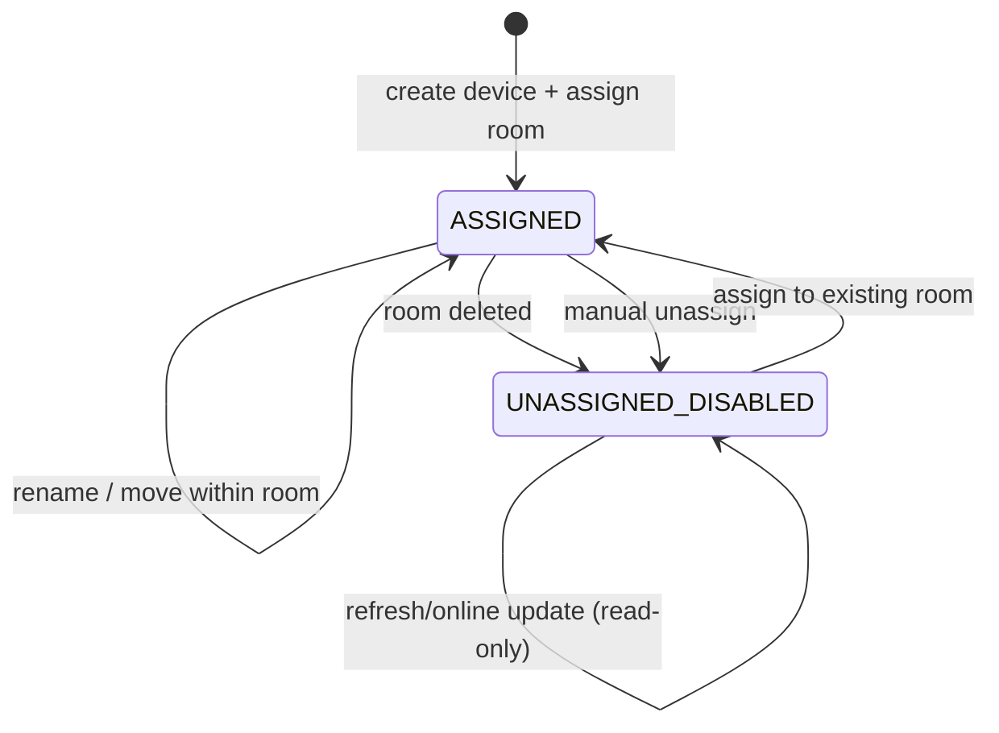

| 状态 | `roomId` | `isUnassigned` | `isEnabled` | 可控制 |
|---|---|---|---|---|
| `ASSIGNED` | 非空 | false | true | 是（且设备受支持/在线） |
| `UNASSIGNED_DISABLED` | `''` | true | false | 否（只读展示在线/离线） |

- 房间删除：设备 `roomId=''`、`isUnassigned=true`、`isEnabled=false`；**不删除设备**（FR-ROOM-004；DP-02）。
- 重新指派：`isUnassigned=false`、`isEnabled=true`；不恢复已删除的房间；必须选择存在的房间。
- 手动 unassign：与房间删除同态（保护性禁用），避免“未分配但可控制”的歧义。
- `online` 与 `isEnabled` 正交：禁用设备仍显示网关在线状态，但控制入口置灰（ADR-004 §2.1-4）。
- 删除最后一个房间允许；设备进入未分配池；首页/房间页显示空态与池入口。

#### 4.3.3 删除事务

```text
BEGIN
  SELECT room WHERE room_id=? AND family_id=?  -- 不存在 -> ROOM_NOT_FOUND（rollback）
  DELETE room
  UPDATE device_state SET room_id='', is_unassigned=1, is_enabled=0
    WHERE family_id=? AND room_id=?
  UPDATE family_member SET allowed_room_ids_json = remove(room_id)
    WHERE family_id=?
COMMIT
```

- 成员授权 JSON 解析失败 → 整个事务回滚 `STORAGE_RDB_ERROR`；不得留下半删除状态。
- 删除房间**不**修改场景：场景动作只引用设备 ID，不引用房间 ID；设备仍存在（未分配/禁用），场景执行预检会拒绝未分配设备。
- 删除房间**不**发送任何网络请求；`IGatewayClient` fake 记录 0 调用（DP-01）。

### 4.4 依赖注入与测试 seam（`DES-B-C09-SEAM`）

- 依赖：`RoomRepository`、`DeviceAssignmentPort`、`MemberRoomGrantPort`、`RdbStore`、`ClockPort`、`LoggerPort`；不 import 平台 API。
- host 测试：
  - 创建/改名/排序/图标；改名后 `roomId` 不变；
  - 删除预览设备数；确认不一致拒绝；
  - 删除事务：设备 onRoomDeleted 调用一次、成员 grant 清理一次、失败回滚（fake 注入失败）；
  - 重新指派后 `isUnassigned=false/isEnabled=true`；
  - `IGatewayClient` 零调用断言；
  - 空房间删除；最后一个房间删除。
- device/IT：RDB 持久化/重启；无设备 `UNAVAILABLE`。
- 夹具：`RoomDeviceFixture`（房间 + 设备 + 成员授权 JSON）。

### 4.5 Traceability（`DES-B-C09-TRACE`）

| 需求/约束 | 映射 |
|---|---|
| FR-ROOM-001 房间创建/ID | `RoomService.createRoom`；`RoomRepository` |
| FR-ROOM-002 命名/ID 不变 | `renameRoom`；`roomId` 唯一索引 |
| FR-ROOM-003 加入/换房 | `assignDevice/moveDevice`；C-10 `assignRoom` |
| FR-ROOM-004 删除保护 | `previewDelete/deleteRoom`；`DeviceAssignmentPort.onRoomDeleted` |
| FR-ROOM-005 设备删除 | 由 C-10 `removeDevice`；房间不受影响 |
| FR-ROOM-006 设备命名/ID | 由 C-10；房间只按 `roomId` 引用 |
| DP-01/DP-02；ADR-004 §1/§2 | 本地实体、仅 ID 索引、未分配/禁用 |
| FR-HOME-002；C-21/C-25 | 房间快捷栏/未分配池数据源 |
| T-09 | 本组件主交付 |

---

## 5. C-10 DeviceRepository（设备 SSOT、仲裁、tombstone、ACK 应用）

**契约 ID**：`DES-B-C10-API` / `DES-B-C10-ERR` / `DES-B-C10-STATE` / `DES-B-C10-SEAM` / `DES-B-C10-TRACE`
**职责**：设备状态的单一真实可信源（SSOT）；discover 合并/`stateEpochMs` 仲裁；本地归属/启用/未分配；dismissed tombstone；ACK 状态应用；场景引用清理；**不直接发网络请求**。
**路径**：`entry/src/main/ets/repository/DeviceRepository.ets`、`entry/src/main/ets/model/DeviceRecord.ets`、`entry/src/main/ets/service/device/DeviceCommandRunner.ets`（新增）。

### 5.1 公开契约（`DES-B-C10-API`）

#### 5.1.1 设备视图与合并元数据（`model/DeviceRecord.ets`）

```ts
export enum DeviceMergeResult {
  ADDED = 'ADDED',
  UPDATED = 'UPDATED',
  UNCHANGED = 'UNCHANGED',
  STALE_DROPPED = 'STALE_DROPPED',
  SAME_EPOCH_OVERWRITE = 'SAME_EPOCH_OVERWRITE',
  TOMBSTONED_SKIPPED = 'TOMBSTONED_SKIPPED',
  PARTIAL_MERGED = 'PARTIAL_MERGED',
  INVALID_DROPPED = 'INVALID_DROPPED'
}

export class DeviceMergeState {
  readonly lastSnapshotAtMs: number;       // 最近一次成功合并的本地接收时刻
  readonly lastEpochMs: number;            // 当前 stateEpochMs
  readonly lastResult: DeviceMergeResult;
  readonly lastDeviationCode?: string;     // 诊断；不展示
}

export class DeviceRecord {
  readonly state: DeviceState;             // DES-A 冻结模型
  readonly merge: DeviceMergeState;
  readonly gatewayRemoved: boolean;        // 全量 discover 未出现；不是删除
  readonly hasPartialState: boolean;       // 最近一次合并有缺字段/跳项
  readonly isSupported: boolean;           // 派生：DeviceConstants.isSupported(state.snapshot.deviceType)
  readonly isControlAllowed: boolean;      // 派生：enabled && assigned && supported && !dismissed
}
```

> `DeviceRecord` 不修改 `DeviceState` 的冻结字段；UI/VM 使用 `DeviceRecord` 以避免把“网关已移除/部分状态/只读降级”塞进协议模型。DES-A `DeviceStatePort` 仍以 `DeviceState` 为输出。

#### 5.1.2 端口（`contracts/DevicePorts.ets`）

```ts
export interface DeviceControlPort {
  /** 发送一条控制命令；实现方（C-17 适配器）负责解析路由/目标。 */
  send(command: DeviceControlCommand): Promise<ControlOutcome>;
}

export interface DeviceStatePort {
  applyDiscoverSnapshot(snapshot: DiscoverySnapshot,
                        options?: DiscoverApplyOptions): Promise<DiscoverApplyResult>;
  applyControlAck(context: ControlApplyContext,
                  outcome: ControlOutcome): Promise<ControlApplyResult>;
}
```

#### 5.1.3 `DeviceRepository`

```ts
export class DeviceRepository implements DeviceStatePort, DeviceAssignmentPort {
  static registerMigrations(registry: MigrationSink): void; // v4 device_state

  constructor(rdb: RdbStore,
              rooms: RoomLookupPort,
              scenes: SceneReferencePort,
              clock: ClockPort,
              logger: LoggerPort);

  initialize(): Promise<void>;

  // 合并/仲裁
  applyDiscoverSnapshot(snapshot: DiscoverySnapshot,
                        options?: DiscoverApplyOptions): Promise<DiscoverApplyResult>;
  applyControlAck(context: ControlApplyContext,
                  outcome: ControlOutcome): Promise<ControlApplyResult>;
  applyCloudState(context: ControlApplyContext,
                  reportedState: DeviceStatePatch | undefined,
                  verification: StateVerification,
                  requestId: string,
                  seq: number,
                  accepted: boolean): Promise<ControlApplyResult>;

  // 查询
  getRecord(key: DeviceKey): Promise<DeviceRecord | undefined>;
  listRecords(familyId: string): Promise<ReadonlyArray<DeviceRecord>>;
  listRecordsByRoom(familyId: string, roomId: string): Promise<ReadonlyArray<DeviceRecord>>;
  listUnassigned(familyId: string): Promise<ReadonlyArray<DeviceRecord>>;
  listByRoom(familyId: string, roomId: string): Promise<ReadonlyArray<DeviceState>>; // CG 兼容
  listDismissed(gatewayId: string): Promise<ReadonlyArray<DeviceKey>>;

  // 本地生命周期
  onRoomDeleted(tx: RdbTransaction, familyId: string, roomId: string): Promise<number>;
  countByRoom(familyId: string, roomId: string): Promise<number>;
  assignRoom(familyId: string, key: DeviceKey, targetRoomId: string): Promise<DeviceState>;
  unassignDevice(familyId: string, key: DeviceKey): Promise<DeviceState>;
  renameDevice(familyId: string, key: DeviceKey, deviceName: string): Promise<void>;
  removeDevice(familyId: string, key: DeviceKey,
               options?: DeviceRemovalOptions): Promise<DeviceRemovalResult>;
  restoreDevice(gatewayId: string, deviceId: string): Promise<boolean>;
  removeDevicesForGateway(gatewayId: string): Promise<number>;
  markGatewayRemoved(gatewayId: string): Promise<number>;

  // 事件
  subscribe(listener: (event: DeviceChangeEvent) => void): () => void;
  dispose(): void;
}

export class DiscoverApplyOptions {
  readonly familyId: string;               // 必填；设备归属
  readonly markMissingAsGatewayRemoved: boolean; // 默认 true；isPartial=true 时强制 false
  readonly nowMs: number;                 // 注入 Clock；测试可固定
}

export class DiscoverApplyResult {
  readonly added: number;
  readonly updated: number;
  readonly unchanged: number;
  readonly staleDropped: number;
  readonly tombstonedSkipped: number;
  readonly invalidDropped: number;
  readonly gatewayRemovedMarked: number;
  readonly partial: boolean;
  readonly deviations: ReadonlyArray<string>; // 稳定偏差码；不含用户数据
  readonly affectedKeys: ReadonlyArray<DeviceKey>;
}

export class ControlApplyContext {
  readonly familyId: string;
  readonly gatewayId: string;
  readonly deviceId: string;
  readonly action: DeviceAction;
  readonly requestedValue?: CommandValue;
  readonly notBeforeMs: number;            // 命令发出时刻（Clock）
}

export class ControlApplyResult {
  readonly ackAccepted: boolean;
  readonly stateApplied: boolean;
  readonly stateVerification: StateVerification;
  readonly reason: ControlApplyReason;
  readonly record?: DeviceRecord;
}

export enum ControlApplyReason {
  APPLIED = 'APPLIED',
  IDEMPOTENT_REPLAY = 'IDEMPOTENT_REPLAY',
  NO_REPORTED_STATE = 'NO_REPORTED_STATE',
  STALE_STATE_DROPPED = 'STALE_STATE_DROPPED',
  DEVICE_MISMATCH = 'DEVICE_MISMATCH',
  DEVICE_NOT_FOUND = 'DEVICE_NOT_FOUND',
  ACK_NOT_ACCEPTED = 'ACK_NOT_ACCEPTED',
  APPLY_FAILED = 'APPLY_FAILED'
}

export class DeviceRemovalOptions {
  readonly removeSceneReferences: boolean; // 默认 true；false 仅诊断/迁移用
  readonly nowMs: number;
}

export class DeviceRemovalResult {
  readonly removed: boolean;
  readonly key: DeviceKey;
  readonly sceneCleanup?: SceneCleanupSummary;
  readonly tombstoneCreated: boolean;
}
```

#### 5.1.4 `DeviceCommandRunner`（C-10 用例；不发网络，只调用端口）

```ts
export class DeviceCommandRunner {
  constructor(port: DeviceControlPort,
              devices: DeviceRepository,
              clock: ClockPort,
              logger: LoggerPort,
              metrics: MetricsPort);

  run(command: DeviceControlCommand,
      options?: DeviceCommandOptions): Promise<DeviceCommandExecution>;
}

export class DeviceCommandOptions {
  readonly familyId: string;
  readonly precheck: boolean;              // 默认 true
  readonly timeoutMs?: number;             // 仅 UI 侧期限提示；传输超时由 C-17 决定
}

export class DeviceCommandExecution {
  readonly command: DeviceControlCommand;
  readonly outcome?: ControlOutcome;
  readonly apply?: ControlApplyResult;
  readonly error?: AppError;
  readonly elapsedMs: number;
  readonly ackAccepted: boolean;
}
```

**语义**：
- `run` 先读取 `DeviceRecord`；若不存在 → `DEVICE_NOT_FOUND`；`state.isDismissed` → `DEVICE_DISMISSED`；`!state.isEnabled` → `DEVICE_DISABLED`；`state.isUnassigned` → `DEVICE_UNASSIGNED`；`!isSupported` → `CONFIGURATION_ERROR`（只读降级）；返回错误，不调用端口。
- 构造/校验 `DeviceControlCommand`：`gatewayId`/`target` 非空；`requestedAtMs = clock.nowMs()`；动作/值由 `ControlPolicy` 在 C-17 再校验（双重防御）。
- 调用 `port.send(command)`；成功 → `devices.applyControlAck(context, outcome)`；返回 `DeviceCommandExecution`。
- `applyControlAck` 抛错时，`DeviceCommandExecution.error` 携带 `AppError`，但 `outcome` 保留；VM 不得把“ACK 接受但状态应用失败”显示为成功。
- `timeoutMs` 不取消底层 Promise；它只用于 VM/UI 的软期限提示；真正失败由 C-17 `GATEWAY_TIMEOUT`/`AppError` 决定。`UI_CONTROL` 客户端的 `readTimeoutMs=3000` 已对齐 UIUX 3s。

### 5.2 错误（`DES-B-C10-ERR`）

| 场景 | 错误 | 备注 |
|---|---|---|
| 设备不存在 | `DEVICE_NOT_FOUND`（新增） | 未纳管/已删除 |
| 设备已 dismissed | `DEVICE_DISMISSED`（新增） | 需先 `restoreDevice` |
| 设备禁用 | `DEVICE_DISABLED`（新增） | 房间删除/手动 unassign |
| 设备未分配 | `DEVICE_UNASSIGNED`（新增） | 房间删除后的池 |
| 只读降级类型 | `CONFIGURATION_ERROR` | `isSupported=false`；不下发 |
| 设备名空/超长 | `DEVICE_NAME_INVALID`（新增）或 `PROTOCOL_VALUE_OUT_OF_RANGE` | 1..31 |
| 指派到不存在房间 | `ROOM_NOT_FOUND` | C-09 |
| `updatedAt` 非法 | `PROTOCOL_INVALID_TIMESTAMP`（内部丢弃 + 偏差） | 不抛给 UI；记录 |
| 快照设备字段非法 | `PROTOCOL_*`（内部丢弃 + 偏差） | 不阻断整份 full snapshot；`isPartial=true` |
| `reportedState.deviceId` 不匹配 | `ACK_STATE_MISMATCH`（内部结果） | 不应用状态 |
| RDB/JSON 失败 | `STORAGE_RDB_ERROR` | 事务回滚 |
| 迁移失败 | `STORAGE_MIGRATION_FAILED` | 不降级 |

### 5.3 状态机与不变量（`DES-B-C10-STATE`）

#### 5.3.1 SSOT 与字段所有权

| 字段组 | 权威 | 合并规则 |
|---|---|---|
| `snapshot.*` | 网关 | 按 `stateEpochMs` 仲裁；缺字段保留旧值 |
| `deviceName` | 本地 | 首次导入用网关 `deviceName` 作为初始值；之后不覆盖（ADR-004 §1.2） |
| `roomId`/`isUnassigned`/`isEnabled` | 本地 | 只由 C-09/C-10 本地动作改变；discover 不覆盖 |
| `isDismissed` | 本地 | 由 `gw_dismissed_device` 派生；discover 不自动清除 |
| `familyId` | 本地 | 由路由绑定/首次发现确定；同一 `DeviceKey` 不得静默迁移家庭 |

#### 5.3.2 `stateEpochMs` 仲裁（核心）

```text
incomingEpoch = max(parse(updatedAt), snapshot.stateEpochMs 合法值)
priorEpoch    = record.merge.lastEpochMs

if incomingEpoch < priorEpoch:
    DROP whole device snapshot; result=STALE_DROPPED; deviation=STALE_SNAPSHOT
elif incomingEpoch == priorEpoch:
    if payload identical (canonical JSON + local fields): UNCHANGED
    else: apply; result=SAME_EPOCH_OVERWRITE; deviation=SAME_EPOCH_OVERWRITE
else:
    apply; result=UPDATED
newEpoch = max(priorEpoch, incomingEpoch)
```

**规则**：
1. `updatedAt` 是秒级 UTC 紧凑格式；同一秒内多条状态可能同 epoch。相等时允许覆盖（DES-A §5.3-2），但记录 `SAME_EPOCH_OVERWRITE` 供诊断；不得把相等当作“旧包”丢弃。
2. 只有整条设备快照丢弃（`STALE_DROPPED`）；不得只丢弃部分字段后混入旧包。
3. ACK 状态应用使用同一仲裁；若 `reportedState.stateEpochMs < record.merge.lastEpochMs` → 不应用，`STALE_STATE_DROPPED`；但 `ackAccepted` 仍可为 true（执行已确认），VM 不因状态陈旧而 REVERT。
4. `ControlOutcome.shouldApplyState=false`（幂等重放且已应用）→ 不应用，`IDEMPOTENT_REPLAY`。
5. `reportedState.deviceId !== context.deviceId` → 不应用，`DEVICE_MISMATCH`；记录偏差；不抛给用户。
6. `MISMATCH` 仍应用 `reportedState`（它是网关真值），但 `ControlApplyResult.stateVerification=MISMATCH`；VM 据此 REVERT 到真值。
7. `idempotent_replay=true` 且 `shouldApplyState=true`（原 ACK 未应用）→ 正常应用；若 `lastAppliedRequestId/Seq` 已相同 → `IDEMPOTENT_REPLAY` no-op。
8. 应用后更新 `last_applied_request_id/seq`；仅对 `ackAccepted` 的 ACK 更新。
9. `applyCloudState`：`accepted` 来自 `CloudCompletionVerdict.completion=CONFIRMED`；同样执行 `stateEpochMs` 仲裁与字段合并；`requestId/seq` 写入 `last_applied_*`；`verification` 原样返回。`accepted=false` 时不应用状态，`reason=ACK_NOT_ACCEPTED`。

#### 5.3.3 discover 合并

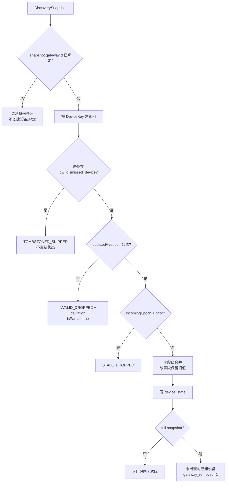

**规则**：
- 新设备：`deviceName = snapshot.deviceName`（初始值）；`roomId=''`；`isUnassigned=true`；`isEnabled=false`（保护性禁用，`RISK-UNASSIGNED-DEFAULT`）；`isDismissed=false`；`gatewayRemoved=false`。
- `roomNameHint` 只保存到 `DeviceRecord`/UI 提示（不进入 `DeviceState`）；不自动指派房间；用户确认后才 `assignRoom`。
- `isPartial=true`：不标记“网关已移除”；已存在设备未出现 → 保留原状。
- 全量快照且某已知设备未出现 → `gateway_removed=1`；不删除、不禁用、不改房间；UI 显示“网关已移除，可删除/恢复”。
- `online=false`：只更新 `snapshot.isOnline`；保留最后已知的 `power/brightness/...`（ADR-004 §2.5）。
- 字段缺失：保留旧值；`hasPartialState=true`；不推断状态变化。
- `deviceType` 未知/不受支持：保留原始 `deviceTypeRaw`；`deviceType=undefined`；`isSupported=false`；UI 只读展示。
- `stateSource`/`mode` 未知：保留原始值；`stateSourceKnown=false`/`modeStandard=false`；UI 用 unknown key。
- 同一 `deviceId` 不同 `gatewayId`：两个独立 `DeviceKey`；不得合并（两级标识）。

#### 5.3.4 本地生命周期

**查询规则**：`listRecords`/`listRecordsByRoom`/`listUnassigned` 排除 `dismissed` 设备；`getRecord` 对 dismissed 返回 `undefined`；`listDismissed` 只返回 tombstone 键。UI 的“已移除设备”入口使用 `listDismissed` + `restoreDevice`。

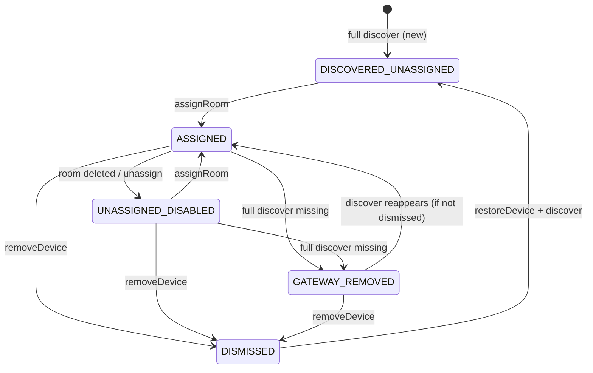

- `onRoomDeleted(tx, familyId, roomId)`：在调用方事务内 `UPDATE device_state SET room_id='', is_unassigned=1, is_enabled=0 WHERE family_id=? AND room_id=?`；返回受影响行数；不删除设备、不清场景。
- `countByRoom(familyId, roomId)`：只读计数；用于 C-09 删除确认。
- `removeDevice` 事务：`DELETE device_state` + `INSERT OR IGNORE gw_dismissed_device` + `SceneReferencePort.removeDeviceReferences(tx, ...)`（默认）；返回受影响场景。
- `restoreDevice`：删除 tombstone；不恢复旧快照；下次 discover 重新纳管（新设备默认未分配/禁用）。
- `removeDevicesForGateway`：网关解绑时删除该网关全部设备行；`SceneReferencePort.removeGatewayReferences` 清理场景；不写 tombstone（网关已不存在）。
- `renameDevice`：只改本地 `device_name`；不发送 `SET_DEVICE_NAME`；不触碰 `deviceId`/`roomId`。
- `assignRoom`：校验房间存在；`isUnassigned=false`、`isEnabled=true`；`roomId` 只存 `roomId`，不存 `roomName`（显示时 join C-09）。

### 5.4 依赖注入与测试 seam（`DES-B-C10-SEAM`）

- 依赖：`RdbStore`、`RoomLookupPort`、`SceneReferencePort`、`ClockPort`、`LoggerPort`；不 import 平台 API/网络。
- host 测试：
  - 陈旧包 `incomingEpoch < prior` 整条丢弃；相等覆盖记录偏差；
  - 缺字段保留旧值；`online=false` 不清空亮度；
  - `isPartial=true` 不标记网关移除；全量缺失标记 `gatewayRemoved`；
  - tombstone：删除→discover 不复活→restore+discover 重新纳管；
  - `removeDevice` 场景引用清理/失败回滚；
  - ACK：`shouldApplyState=false` 不应用；`reportedState` 旧于当前状态丢弃但 `ackAccepted` 保留；`MISMATCH` 应用真值；
  - `idempotent_replay` 二次应用 no-op；
  - 只读降级/禁用/未分配设备 `DeviceCommandRunner` 拒绝且端口零调用；
  - 改名/换房/删除端口零网络调用。
- device/IT：RDB 重启持久化、JSON 解析失败回退；无设备 `UNAVAILABLE`。
- 夹具：`DiscoverSnapshotFixture`（含 stale/partial/unknown type）、`AckFixture`（MATCH/UNVERIFIED/MISMATCH/replay）、`DeviceRecordFixture`。

### 5.5 Traceability（`DES-B-C10-TRACE`）

| 需求/约束 | 映射 |
|---|---|
| FR-DEV-001 真实 ACK | `applyControlAck`；`ControlOutcome` 判定链；`DeviceCommandRunner` |
| FR-DEV-002 灯光/55ms | C-21 节流 + C-10 状态应用 |
| FR-DEV-003 门锁/门磁 | C-10 状态 + C-21 `DoorConfirmationTracker` |
| FR-DEV-005 状态溯源 | `stateSource` 未知值保留 + 偏差 |
| FR-ROOM-003/004/005/006 | `assignRoom`/`removeDevice`/`renameDevice`；房间删除保护 |
| FR-HOME-001..004 | `listRecords`/`listRecordsByRoom`/`listUnassigned` |
| ADR-004 §1/§2/§6 | 本地归属、未分配/禁用、ACK 仲裁、门锁 |
| CB §2.2/§2.5/§8.1；DP-01/DP-02/DP-03 | 字段映射、状态仲裁、设备范围、tombstone |
| D-011；`RISK-PARTIAL-DISCOVER` | 只读降级、部分快照 |
| T-09 | 本组件主交付 |

---

## 6. C-11 SceneService（场景 CRUD、串行执行、局部失败）

**契约 ID**：`DES-B-C11-API` / `DES-B-C11-ERR` / `DES-B-C11-STATE` / `DES-B-C11-SEAM` / `DES-B-C11-TRACE`
**职责**：场景 CRUD、动作串行执行、逐步 ACK 进度、局部失败不回滚、设备/网关引用清理；只经 `DeviceControlPort` 发命令，不 import C-17 实现。
**路径**：`entry/src/main/ets/repository/SceneRepository.ets`、`entry/src/main/ets/service/scene/**`。

### 6.1 公开契约（`DES-B-C11-API`）

#### 6.1.1 执行模型（`model/SceneExecutionModels.ets`）

```ts
export enum SceneRunState {
  IDLE = 'IDLE',
  PREFLIGHT = 'PREFLIGHT',
  RUNNING = 'RUNNING',
  SUCCEEDED = 'SUCCEEDED',
  PARTIAL_FAILED = 'PARTIAL_FAILED',
  FAILED = 'FAILED',
  CANCELLED = 'CANCELLED'
}

export enum SceneStepState {
  PENDING = 'PENDING',
  RUNNING = 'RUNNING',
  SUCCEEDED = 'SUCCEEDED',
  FAILED = 'FAILED',
  SKIPPED = 'SKIPPED',
  CANCELLED = 'CANCELLED'
}

export class SceneStepResult {
  readonly index: number;                  // 0-based
  readonly action: SceneAction;
  readonly state: SceneStepState;
  readonly startedAtMs?: number;
  readonly endedAtMs?: number;
  readonly outcome?: ControlOutcome;
  readonly stateVerification?: StateVerification;
  readonly error?: AppError;
}

export class SceneExecutionResult {
  readonly runId: string;
  readonly sceneId: string;
  readonly sceneName: string;
  readonly state: SceneRunState;
  readonly steps: ReadonlyArray<SceneStepResult>;
  readonly startedAtMs: number;
  readonly endedAtMs?: number;
  readonly executedCount: number;          // 实际下发命令的步骤数
  readonly succeededCount: number;
  readonly failedStepIndex?: number;
  readonly error?: AppError;
  readonly noRollbackNotice: boolean;      // 恒 true；UI 必须展示“已执行步骤未自动回滚”
}

export class SceneExecutionProgress {
  readonly runId: string;
  readonly sceneId: string;
  readonly state: SceneRunState;
  readonly currentIndex: number;
  readonly steps: ReadonlyArray<SceneStepResult>;
  readonly executedCount: number;
  readonly succeededCount: number;
}

export class SceneCleanupSummary {
  readonly removedActionCount: number;
  readonly affectedSceneIds: ReadonlyArray<string>;
  readonly affectedSceneNames: ReadonlyArray<string>;
}
```

#### 6.1.2 端口（`contracts/ScenePorts.ets`）

```ts
export interface SceneReferencePort {
  /** 在调用方事务内移除某设备在所有场景中的动作；返回影响摘要。 */
  removeDeviceReferences(tx: RdbTransaction, familyId: string, key: DeviceKey): Promise<SceneCleanupSummary>;

  /** 在调用方事务内移除某网关的所有动作；用于网关解绑。 */
  removeGatewayReferences(tx: RdbTransaction, familyId: string, gatewayId: string): Promise<SceneCleanupSummary>;

  /** 查询引用该设备的场景（删除确认/影响预览）。 */
  listSceneIdsReferencing(tx: RdbTransaction, familyId: string, key: DeviceKey): Promise<ReadonlyArray<string>>;
}
```

#### 6.1.3 `SceneRepository`

```ts
export class SceneRepository implements SceneReferencePort {
  static registerMigrations(registry: MigrationSink): void; // v4 scene

  constructor(rdb: RdbStore, clock: ClockPort, ids: IdPort);

  initialize(): Promise<void>;

  listScenes(familyId: string): Promise<ReadonlyArray<Scene>>;
  getScene(sceneId: string): Promise<Scene | undefined>;
  putScene(scene: Scene): Promise<void>;
  deleteScene(tx: RdbTransaction, sceneId: string): Promise<void>;

  removeDeviceReferences(tx: RdbTransaction, familyId: string, key: DeviceKey): Promise<SceneCleanupSummary>;
  removeGatewayReferences(tx: RdbTransaction, familyId: string, gatewayId: string): Promise<SceneCleanupSummary>;
  listSceneIdsReferencing(tx: RdbTransaction, familyId: string, key: DeviceKey): Promise<ReadonlyArray<string>>;
}
```

#### 6.1.4 `SceneService`

```ts
export class SceneService {
  constructor(scenes: SceneRepository,
              devices: DeviceRepository,
              control: DeviceControlPort,
              routes: GatewayRoutePort,
              clock: ClockPort,
              timer: TimerPort,
              ids: IdPort,
              logger: LoggerPort,
              metrics: MetricsPort);

  initialize(): Promise<void>;

  listScenes(familyId: string): Promise<ReadonlyArray<Scene>>;
  getScene(sceneId: string): Promise<Scene | undefined>;
  createScene(input: SceneInput): Promise<Scene>;
  updateScene(sceneId: string, input: SceneInput): Promise<Scene>;
  deleteScene(sceneId: string): Promise<void>;

  run(sceneId: string,
      listener?: (progress: SceneExecutionProgress) => void,
      cancellation?: CancellationToken): Promise<SceneExecutionResult>;
  cancel(runId: string): Promise<void>;

  subscribe(listener: (event: SceneExecutionEvent) => void): () => void;
  dispose(): void;
}

export class SceneInput {
  readonly familyId: string;
  readonly sceneName: string;              // 1..31
  readonly icon: string;                   // 资源键/图标名，不含文案
  readonly actions: ReadonlyArray<SceneAction>;
  readonly isEnabled: boolean;
}

export class SceneExecutionPolicy {
  readonly stepTimeoutMs: number;          // 默认 8000；依赖 C-17 BACKGROUND 策略
  readonly totalTimeoutMs: number;         // 默认 60000
  readonly allowCancelBetweenSteps: boolean; // 恒 true
  static defaults(): SceneExecutionPolicy;
}

export class SceneExecutor {
  constructor(control: DeviceControlPort,
              devices: DeviceRepository,
              routes: GatewayRoutePort,
              clock: ClockPort,
              timer: TimerPort,
              logger: LoggerPort);

  execute(scene: Scene,
          runId: string,
          policy: SceneExecutionPolicy,
          listener?: (progress: SceneExecutionProgress) => void,
          cancellation?: CancellationToken): Promise<SceneExecutionResult>;
}
```

**方法语义**：
- `SceneService` 在构造时创建 `SceneExecutor`（同一 `DeviceControlPort`/`DeviceRepository`/`GatewayRoutePort`/`Clock`/`Timer`/`Logger`；纯逻辑，无平台 API）；测试可直接替换 executor。
- `createScene/updateScene`：`sceneName` trim 1..31；`actions` 每项校验 `gatewayId`/`targetDeviceId` 非空、`action` 是 `DeviceAction`、值合法；`SceneAction.targetDeviceId` 只存裸 `deviceId`；`gatewayId` 必须属于同家庭（校验 C-07 route）。`sceneId` UUID。
- `deleteScene`：只删场景；不影响设备。
- `run`：
  1. `PREFLIGHT`：全部动作预检；任一失败 → `FAILED`（`SCENE_PREFLIGHT_FAILED`），**不下发任何命令**；
  2. `RUNNING`：按数组顺序，逐条等待 `ControlOutcome`；可插入 `delayMs`；
  3. 每步成功条件：`outcome.ackAccepted === true` 且 `stateVerification !== MISMATCH`；`MISMATCH` → `FAILED`；
  4. 任一步失败/超时 → 停止后续；剩余步骤标 `SKIPPED`；结果 `PARTIAL_FAILED`（若已有成功步骤）或 `FAILED`（第一步即失败）；**不回滚**已成功步骤；
  5. `cancellation` 在每步前/延迟期间检查 → `CANCELLED`，剩余 `SKIPPED`；已执行步骤保留；
  6. 返回 `SceneExecutionResult`；全程通过 `listener` 推送 `SceneExecutionProgress`。
- `runId` = `ids.newId()`；返回/进度均带 `runId`。`cancel(runId)`：设置取消标志；不强制中断在途 C-17 请求（等其返回/超时），后续步骤不再下发。
- `SceneExecutor` 用 `TimerPort` 对每步施加 `stepTimeoutMs`；超时 → 该步 `FAILED`（`SCENE_STEP_FAILED` + `GATEWAY_TIMEOUT` 语义），后续 `SKIPPED`；迟到的 `ControlOutcome` 不得改写已结束的步骤结果（operation token 丢弃）。
- 场景执行不自动重试；C-17 `BACKGROUND` 客户端负责传输级精确重传。
- 并发：同一场景同一时间只允许一个 run；不同场景可并行但共享网关时由 C-17 串行；建议 UI 全局串行执行场景。

### 6.2 错误（`DES-B-C11-ERR`）

| 场景 | 错误 |
|---|---|
| 场景不存在 | `SCENE_NOT_FOUND`（新增） |
| 场景名为空/超长 | `SCENE_NAME_INVALID`（新增）或 `PROTOCOL_VALUE_OUT_OF_RANGE` |
| 场景无动作 | `SCENE_EMPTY`（新增） |
| 场景禁用 | `SCENE_DISABLED`（新增） |
| 预检失败 | `SCENE_PREFLIGHT_FAILED`（新增；含 failedIndex） |
| 步骤失败 | `SCENE_STEP_FAILED`（新增；含 step index/AppError） |
| 网关/设备引用失效 | `SCENE_REFERENCE_INVALID`（新增） |
| 取消 | `SCENE_CANCELLED`（新增） |
| 值非法 | `PROTOCOL_VALUE_OUT_OF_RANGE`/`CONFIGURATION_ERROR` |
| RDB/JSON 失败 | `STORAGE_RDB_ERROR` |
| 场景引用清理失败 | 透传 `STORAGE_RDB_ERROR`（调用方事务回滚） |

### 6.3 状态机与不变量（`DES-B-C11-STATE`）

#### 6.3.1 场景执行状态机

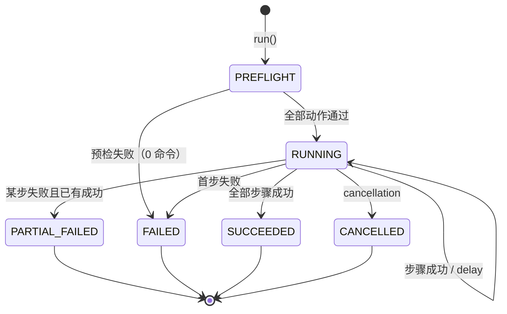

#### 6.3.2 预检清单（全部通过才发第一条命令）

对每个 `SceneAction`：
1. `gatewayId` 存在且属于场景 `familyId`（`GatewayRoutePort.getRoute`）。
2. `DeviceKey(gatewayId, targetDeviceId)` 存在；非 `dismissed`；`gatewayRemoved=false`。
3. 设备 `isEnabled=true`、`isUnassigned=false`（未分配池不可执行）。
4. 设备类型受支持（`DeviceConstants.isSupported`）；否则 `SCENE_REFERENCE_INVALID`（只读降级）。
5. 动作与设备类型匹配（door: OPEN/CLOSE；light: ON/OFF/SET_BRIGHTNESS/SET_COLOR；ac: ON/OFF/SET_TARGET_TEMPERATURE/SET_MODE；sensor 无控制）。
6. 值合法：亮度 0..100；颜色 `^#[0-9A-F]{6}$`；目标温度 16..30；`SET_MODE` 仅 7 值；`SET_POSITION/SET_SPEED/SET_VOLUME` 拒绝。
7. `delayMs` ≥0；数组非空。

**预检失败**：返回 `failedIndex` + 具体 `AppError`；不修改任何设备状态；不产生 `PendingCommand`。

#### 6.3.3 串行与局部失败

- 严格按 `Scene.actions` 数组顺序；前一步未返回/未超时不得发下一步。
- `delayMs` 在该动作**之前**等待（UIUX/legacy 语义）；取消在等待期间生效。
- 失败后不自动回滚已成功动作；`noRollbackNotice=true` 是结果契约的一部分，UI 必须展示“已执行步骤未自动回滚”。
- 失败步骤保留 `outcome`（若有）与 `error`；后续步骤 `SKIPPED`，不伪造执行。
- 全部成功才 `SUCCEEDED`；部分成功 `PARTIAL_FAILED`；首步失败 `FAILED`。
- 场景禁用/空动作在 UI 层禁用“执行”，服务层仍返回 `SCENE_DISABLED`/`SCENE_EMPTY`。

#### 6.3.4 引用清理

| 事件 | 调用 | 结果 |
|---|---|---|
| 设备删除 | `SceneReferencePort.removeDeviceReferences(tx, familyId, key)` | 移除所有 `(gatewayId,targetDeviceId)` 匹配动作；返回受影响场景 |
| 网关解绑 | `SceneReferencePort.removeGatewayReferences(tx, familyId, gatewayId)` | 移除该网关全部动作 |
| 设备换房/改名 | 不调用 | 场景只引用 `deviceId`，不受影响 |
| 场景动作为空 | 保留场景，`isEnabled=false` 建议 | UI 显示“无可用动作”；`run` 返回 `SCENE_EMPTY` |

- 清理与设备/网关删除同事务；失败整体回滚。
- `SceneCleanupSummary.affectedSceneNames` 用于删除确认/结果提示；名称是本地数据，不进入日志。

### 6.4 依赖注入与测试 seam（`DES-B-C11-SEAM`）

- 依赖：`SceneRepository`、`DeviceRepository`、`DeviceControlPort`、`GatewayRoutePort`、`ClockPort`、`TimerPort`、`LoggerPort`、`MetricsPort`；不 import C-17 实现/平台 API。
- host 测试：
  - 预检失败 0 命令（fake port 记录 0 调用）；
  - 串行顺序（fake port 记录调用顺序/时间）；
  - 首步失败 → `FAILED`，后续 `SKIPPED`；
  - 第二步失败 → `PARTIAL_FAILED`，第一步 `SUCCEEDED`，无回滚调用；
  - `MISMATCH` → 失败；`UNVERIFIED` → 成功但标记未验证；
  - `delayMs` 由 `FakeTimer.advance` 驱动；
  - 取消 → 剩余 `SKIPPED`，已执行保留；
  - 设备删除清理场景动作；事务失败回滚；
  - 改名/换房/房间删除不影响场景动作（仅设备状态变化）。
- device/IT：Mock/仿真器端到端场景执行；无设备 `UNAVAILABLE`。
- 夹具：`SceneFixture`（成功/局部失败/预检失败/取消）。

### 6.5 Traceability（`DES-B-C11-TRACE`）

| 需求/约束 | 映射 |
|---|---|
| FR-SCN-001 场景编排与执行 | `SceneService.run`；`SceneExecutionResult` |
| UIUX §4.6 | 串行、逐步反馈、局部失败不回滚 |
| FR-ROOM-005 | 设备删除时场景引用清理 |
| FR-DEV-001 | 每步 `ControlOutcome` 判定 |
| ADR-004 §2.1-3 | 设备删除/dismissed |
| CB §6.2/§6.3 | 动作/值/7 值 mode |
| CG §4.4 | 只经 `DeviceControlPort`；不 import C-17 实现 |
| T-09/T-16 | 服务由 T-09；进度 VM 由 T-16 |

---

## 7. C-14 I18nService 与资源包（locale、fallback、键空间、迁移、检查器）

**契约 ID**：`DES-B-C14-API` / `DES-B-C14-ERR` / `DES-B-C14-STATE` / `DES-B-C14-SEAM` / `DES-B-C14-TRACE`
**职责**：locale 解析/持久化、rawfile 加载、`t(key, params)`、fallback、复数、观察者通知、错误码/状态来源键映射；资源包布局与 CHK-01..09 检查器契约。
**路径**：`entry/src/main/ets/service/i18n/**`、`resources/base|en_US/element/string.json`、`resources/rawfile/i18n/{zh-CN,en-US}.json`、`tools/i18n/check_i18n.py`。
**规范来源**：I18N-DESIGN §2-§7；INT L7-67；CB §4.4/§6.1/§6.3；ADR-004 §7.2；STD L26-28；PC I18N-01..08。

### 7.1 公开契约（`DES-B-C14-API`）

#### 7.1.1 locale 与参数类型（`model/I18nModels.ets`）

```ts
export enum SupportedLocale {
  ZH_CN = 'zh-CN',
  EN_US = 'en-US'
}

export enum LocaleMode {
  AUTO = 'auto',
  ZH_CN = 'zh-CN',
  EN_US = 'en-US'
}

export class I18nParams {
  readonly entries: ReadonlyArray<NameValue>;
  readonly count?: number;                 // 复数选择用；仅 en-US 使用 _one/_other
  constructor(entries?: ReadonlyArray<NameValue>, count?: number);
  static empty(): I18nParams;
  static of(entries: ReadonlyArray<NameValue>): I18nParams;
  static countOf(count: number, entries?: ReadonlyArray<NameValue>): I18nParams;
  get(name: string): string | undefined;
}

export class I18nResourceBundle {
  readonly locale: SupportedLocale;
  readonly entries: ReadonlyArray<NameValue>; // 已扁平化的点分键；值必须非空
  readonly revision: string;                  // 内容哈希/版本；用于 parity 报告
}

export class LocaleChangedEvent {
  readonly previous: SupportedLocale;
  readonly current: SupportedLocale;
  readonly mode: LocaleMode;
  readonly platformApplied: boolean;          // $r 资源是否已随平台切换
  readonly revision: number;
}

export class I18nLoadResult {
  readonly locale: SupportedLocale;
  readonly loaded: boolean;
  readonly missingKeys: ReadonlyArray<string>;
  readonly error?: AppError;
}
```

#### 7.1.2 端口（`contracts/I18nPorts.ets`）

```ts
export interface I18nResourceLoaderPort {
  load(locale: SupportedLocale): Promise<I18nResourceBundle>;
}

export interface LocaleApplierPort {
  /** 读取系统 locale（BCP-47）；失败返回空串，由 I18nService 回退 zh-CN。 */
  getSystemLocale(): Promise<string>;
  /** 将 App 资源 locale 应用到平台（影响 $r 文案）；失败抛 AppError。 */
  apply(locale: SupportedLocale): Promise<void>;
}
```

- 生产实现：`RawfileI18nLoader`（`resourceManager.getRawFileContent`）、`OhosLocaleApplier`（`@ohos.i18n`/ApplicationContext，T-10 验证精确 API）。
- host fake：`FakeI18nResourceLoader`、`FakeLocaleApplier`（记录调用、可注入失败）。
- **禁止** I18nService 直接 import `@ohos.*`；平台细节只在适配器。

#### 7.1.3 `I18nService`

```ts
export class I18nService {
  constructor(loader: I18nResourceLoaderPort,
              localeApplier: LocaleApplierPort,
              preferences: PreferencesStore,
              logger: LoggerPort);

  initialize(): Promise<I18nLoadResult>;
  getLocale(): SupportedLocale;
  getLocaleMode(): LocaleMode;
  getSystemLocale(): string;               // 最近一次解析结果；可能为空
  setLocaleMode(mode: LocaleMode): Promise<void>; // 持久化 + 重载 + 通知
  reload(): Promise<I18nLoadResult>;

  /** 同步查找；初始化前/缺 key 时返回 key 文本，不抛异常。 */
  t(key: string, params?: I18nParams): string;
  tKey(key: I18nKey): string;              // DES-A §24 I18nKey
  has(key: string): boolean;

  onLocaleChanged(listener: (event: LocaleChangedEvent) => void): () => void;
  getMissingKeys(): ReadonlyArray<string>; // 当前 locale 缺失、已回退的 key（诊断/CHK）
  dispose(): void;
}
```

**方法语义**：
- `initialize`：
  1. 读 Preferences `StorageConstants.PREF_LOCALE_MODE`（缺省 `auto`）；非法值 → `auto` + `I18N_LOCALE_UNSUPPORTED` warning；
  2. `auto`：`localeApplier.getSystemLocale()` → `zh*` → `zh-CN`；`en*` → `en-US`；其他 → `zh-CN`；系统读取失败 → `zh-CN`；
  3. 加载当前 locale + 基准 `zh-CN` bundle（基准缺失 → 仍可 `t()` 返回 key；记录错误）；
  4. 调用 `localeApplier.apply(current)`（失败不阻断 rawfile 文案；`platformApplied=false`；记录 `I18N_PLATFORM_LOCALE_FAILED`）。
- `setLocaleMode`：写 Preferences → 解析/加载 → `apply` → 通知；失败回滚内存 locale，不破坏旧 bundle；`AUTO` 重新读系统 locale。
- `t(key, params)`：
  1. 当前 bundle 精确 key；2. 复数变体（`count==1 ? _one : _other`，仅 en-US；缺变体回退基键）；3. 当前 bundle 基键；4. 基准 `zh-CN` bundle（同样规则）；5. 返回 `key` 文本；记录 missing（去重，Debug 日志）。
  - 插值：把 `{name}` 替换为 `params.get(name)`；缺失参数保留 `{name}` 原文并记录 warning；不做 HTML/正则替换；不拼接句子。
  - 不抛异常、不返回空白；`t` 必须同步（UI build 中可用）。
- `tKey`：`I18nKey.key` + `I18nParams.of(key.params)`；用于 `ErrorI18nMapper` 输出。
- `onLocaleChanged`：订阅者立即收到当前事件？定义：注册时不立即触发；`setLocaleMode`/`reload` 成功才触发；`platformApplied` 指示 `$r` 是否同步。
- `getMissingKeys`：当前 locale 缺失且已回退的 key 集合；供 CHK-05/诊断；不包含基准缺失。

#### 7.1.4 `I18nKeys`（键构造与映射）

```ts
export class I18nKeys {
  static appError(code: string): string;                 // errors.app.<code 小写>；HTTP_<status> -> errors.app.http_error
  static gatewayError(stableName: string, resultCode?: number): I18nKey;
  static stateSource(value: string, known: boolean): I18nKey;
  static acMode(value: string, standard: boolean): I18nKey;
  static provisioningError(code: string): string;        // provisioning.error.<code 小写>
  static cloudError(code: string): string;                // errors.cloud.<code 小写>
  static memberRole(role: MemberRole): string;            // member.role.admin|member|guest
  static memberStatus(status: MemberStatus): string;      // member.status.*
  static inviteMode(mode: InviteMode): string;            // invite.mode.*
  static invitationStatus(status: InvitationStatus): string;
  static deviceType(type: DeviceType | undefined): string; // device.type.* 或 device.type.unknown
  static securityProfile(profile: TransportProfile, cause?: string): I18nKey;
}
```

- `ErrorI18nMapper`（DES-A §24）仍是唯一错误映射函数；`I18nKeys` 只是便捷包装，不得复制映射表。
- `gatewayError` 规则：已知 `error_code` → `errors.gateway.<snake>`；否则 `errors.gateway.<stableName>`；未知 → `errors.gateway.unknown` + `{code}`。
- `stateSource`：已知 5 值 → `stateSource.<点转下划线>`；未知 → `stateSource.unknown` + `{value}`。
- `acMode`：7 值 → `ac.mode.<lower>`；非标准 → `ac.mode.unknown` + `{mode}`。
- `cloudError`：`errors.cloud.<code 小写>`；不得复用网关键族。

### 7.2 错误（`DES-B-C14-ERR`）

| 场景 | 错误 | 可重试 | i18n 键 |
|---|---|---|---|
| rawfile 缺失/读取失败 | `I18N_RESOURCE_LOAD_FAILED` | 是 | `errors.app.i18n_resource_load_failed` |
| bundle JSON 非法/重复键/空值 | `I18N_BUNDLE_INVALID` | 否 | `errors.app.i18n_bundle_invalid` |
| locale mode 非法 | `I18N_LOCALE_UNSUPPORTED` | 否 | `errors.app.i18n_locale_unsupported` |
| 平台 locale 应用失败 | `I18N_PLATFORM_LOCALE_FAILED` | 是 | `errors.app.i18n_platform_locale_failed` |
| key 缺失 | **不抛错**；返回 key 文本 | — | — |
| 参数缺失 | **不抛错**；保留占位符 + warning | — | — |
| Preferences 失败 | 透传 `STORAGE_PREFERENCES_ERROR` | 是 | `errors.app.storage_error` |

- `t()` 永不抛异常；`initialize`/`setLocaleMode` 可 reject `AppError`，但 UI 必须能继续用 key 文本显示。
- 错误 `details` 只允许 `locale`/`key`/`revision`；不得含翻译内容/用户数据。

### 7.3 状态机与不变量（`DES-B-C14-STATE`）

#### 7.3.1 locale 解析

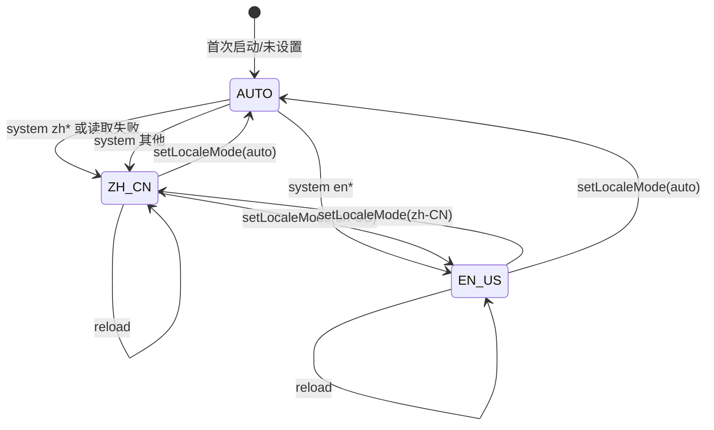

- 支持 locale **只有** `zh-CN`/`en-US`；其他系统语言 → `zh-CN`（与平台 `base` 资源行为一致，避免双存储劈裂）。
- `auto` 不持久化具体 locale，只持久化 mode；系统语言变化在下一次 `initialize`/`reload` 生效（v1 不监听系统语言变更）。
- `LocaleMode` 持久化键 `app.locale.mode`；非法值回落 `auto`。
- 语言切换即时生效：重新加载 rawfile + `localeApplier.apply` + 通知；不重启（I18N-06；ADR-004 §7.2）。
- 若平台 apply 失败：`t()` 文案已切换，`$r` 文案可能仍旧；`LocaleChangedEvent.platformApplied=false`，UI 显示“部分文案需重启”提示；不得假装完全成功。

#### 7.3.2 双存储边界（决定性）

| 情形 | 存储 | 访问 |
|---|---|---|
| 非 UI 层文本/带参数/通知/错误映射 | `rawfile/i18n/*.json` | `I18nService.t()` |
| ArkUI 静态字面量（Tab/标题/按钮/固定标签） | `base` / `en_US` 的 `string.json` | `$r('app.string.*')` |
| 元数据（app 名/ability label/通知 label） | `string.json` | 资源引用 |
| 动态数据（设备名/房间名/数值） | 不进资源包 | 数据 + 标签 key |

- **一个 key 只能存在于一个存储**；禁止同一逻辑文案两处各写一份（CHK-07/评审）。
- `string.json` 键名 `snake_case`；rawfile 键名点分命名空间（≤4 层）。
- 域清单（v1）：`common`、`home`、`room`、`device`、`door`、`ac`、`scene`、`family`、`invite`、`member`、`provisioning`、`gateway`、`ble`、`security`、`cloud`、`settings`、`onboarding`、`errors`、`stateSource`、`notifications`、`a11y`、`brand`。
- 参数只允许 `{name}`；禁止 `+` 拼接句子；英文复数 `_one`/`_other`，中文只用基键。
- 禁止在代码中写中文键/中文文案；品牌名作为数据/`brand.*` 专名表，不进入业务分支。

#### 7.3.3 fallback 链（精确）

```text
t(key, params):
  current = bundle[currentLocale]
  base    = bundle[zh-CN]
  suffix  = (current==en-US && params.count != undefined) ? (count==1 ? '_one' : '_other') : ''
  1. current[key + suffix] (suffix 非空)   -> hit
  2. current[key]                          -> hit
  3. base[key + suffix] (suffix 非空)      -> hit（record missing-in-locale）
  4. base[key]                             -> hit（record missing-in-locale）
  5. return key                            -> no exception, no blank
```

- `current == zh-CN` 时第 4 步与第 1 步重复；直接返回 key。
- 若 key 存在但值为空/占位符 → 视为缺失，走 fallback；CHK-04 阻断。
- 插值在命中文本上执行；缺失参数保留 `{name}`，记录 warning；不得把缺失参数替换为空串（避免句子歧义）。
- `string.json` 侧由平台处理 `en_US → base`；`I18nService` 不重复解析 `string.json`。

### 7.4 资源包、键空间与迁移

#### 7.4.1 文件布局

```text
entry/src/main/resources/
├── base/element/string.json       # zh-CN 基准（静态 UI + 元数据）
├── en_US/element/string.json      # en-US（键集与 base 100% 对齐）
├── base/element/color.json        # 主题色（浅色）
├── dark/element/color.json        # 暗黑主题色
└── rawfile/i18n/
    ├── zh-CN.json                 # 动态/参数化（源语言）
    └── en-US.json                 # en-US（键集与 zh-CN 100% 对齐）
```

#### 7.4.2 键空间（最小基线）

| 域 | 必需键示例 | 用途 |
|---|---|---|
| `common` | `common.confirm`、`common.cancel`、`common.retry`、`common.save`、`common.delete`、`common.loading`、`common.unknown` | 通用交互 |
| `home` | `home.tab.title`、`home.gateway.online`、`home.gateway.offline`、`home.metric.rtt_ms`、`home.room.all` | 首页 |
| `room` | `room.unassigned.title`、`room.delete.title`、`room.delete.warning`、`room.assign.title` | 房间/池 |
| `device` | `device.type.*`、`device.state.online/offline`、`device.unsupported.read_only`、`device.disabled.unassigned` | 设备 |
| `door` | `door.state.secured/unconfirmed/unknown`、`door.alert.unconfirmed`、`door.link.unverified` | 门锁 |
| `ac` | `ac.mode.*`、`ac.temperature.target`、`ac.brand.*` | 空调 |
| `scene` | `scene.run`、`scene.running`、`scene.partial_failed`、`scene.no_rollback`、`scene.step.failed` | 场景 |
| `family` | `family.switch`、`family.create`、`family.member.remove`、`family.last_admin` | 家庭 |
| `invite` | `invite.mode.key_wrap`、`invite.mode.code_kek`、`invite.security.weak_mode_warning`、`invite.security.guest_scope_not_crypto`、`invite.receipt.pending` | 邀请 |
| `member` | `member.role.*`、`member.status.*`、`member.sync.last_at`、`member.sync.never` | 成员 |
| `provisioning` | `provisioning.step.*`、`provisioning.error.*`、`provisioning.cancel` | 配网 |
| `gateway` | `gateway.security.hmac_only`、`gateway.security.tls_pinned`、`gateway.security.pin_mismatch`、`gateway.security.handshake_failed` | 安全通道 |
| `cloud` | `cloud.token.expired`、`cloud.token.missing`、`cloud.command.accepted_not_confirmed`、`cloud.completion.unsupported`、`errors.cloud.token_expired`、`errors.cloud.token_invalid` | 云/错误 |
| `errors` | `errors.app.*`、`errors.gateway.*`、`errors.cloud.*` | 错误 |
| `stateSource` | `stateSource.sensor_physical/device_feedback/automation_local/app_lan/app_cloud`、`stateSource.unknown` | 溯源 |
| `a11y` | `a11y.*` | 可访问性 |

> 上表是**最小基线**；T-10 按 UIUX/页面清单扩展，不要求一次覆盖 615 条旧文案。所有新增键必须同时写入两个 rawfile/两个 string.json。

#### 7.4.3 旧 615 条迁移（I18N-DESIGN §5）

- **禁止机械迁移中文键**：旧 `case '中文'` 只作翻译记忆；新键必须是语义化点分键。
- **禁止整体导入**旧 `I18nService.ets`；新代码库从零建立键空间。
- 逐条分类（A 迁移重键 / B 重译 / C 废弃 / D 排除），登记表列：`旧中文 | 旧英文 | 分类 | 目标存储 | 目标键 | 审查结论 | 负责人`。
- 登记表落位：`tools/i18n/legacy_migration.csv`（T-10 写范围；不进入产品运行时）；报告 `reports/i18n/legacy-migration-report.json`。
- 迁移完成判据：v1 全部 UI/代码路径文本经 CHK-01..09；零硬编码；key parity 100%；无 missing；旧字典不被任何构建产物引用。
- 术语以 CB 术语表为准（gateway/device/room/family/ACK/影子），禁止 “AP/热点/路由” 混用。
- 品牌名（Gree/Haier/Midea/Generic）作为数据显示/`brand.*` 专名表；不得作为业务分支键。

#### 7.4.4 CHK-01..CHK-09 检查器契约

**工具**：`tools/i18n/check_i18n.py`（Python 3 标准库；开发机/CI；不进入 ArkTS 构建链）。
**命令**：

```bash
python3 tools/i18n/check_i18n.py \
  --root . \
  --report reports/i18n/latest-i18n-report.json \
  --allowlist tools/i18n/allowlist.json \
  --strict-ui
```

**输入**：`resources/base/element/string.json`、`resources/en_US/element/string.json`、`resources/rawfile/i18n/{zh-CN,en-US}.json`、`entry/src/main/ets/**`、allowlist。
**退出码**：`0` = 全部通过；`1` = 阻断项失败；`2` = 工具/输入错误（文件缺失、JSON 非法）。

| ID | 检查 | 失败级别 |
|---|---|---|
| CHK-01 | rawfile 键集对齐（含 `_one/_other` 展开） | 阻断 |
| CHK-02 | string.json 键集对齐（base/en_US） | 阻断 |
| CHK-03 | 插值参数集合跨 locale 相同；参数名 `[a-zA-Z][a-zA-Z0-9_]*` | 阻断 |
| CHK-04 | 空值/占位符/未闭合大括号 | 阻断 |
| CHK-05 | 未使用键（`t('…')`/`$r('app.string.…')`；禁止动态拼键，例外登记） | 告警 + 评审确认 |
| CHK-06 | 未定义键（代码引用必须存在） | 阻断 |
| CHK-07 | 硬编码扫描：CJK 或英文句子（≥3 词）；UI 目录命中即阻断；非 UI 走 allowlist | 阻断（UI）/告警（其余） |
| CHK-08 | 多语言代码分叉：`_en`/`_zh`/`English`/`Chinese` 文件名、`if (isChinese())` 直接返回字面量 | 阻断 |
| CHK-09 | locale 目录结构：只存在声明的 locale；两存储 locale 集合一致 | 阻断 |

**报告 JSON（最小契约）**：

```json
{
  "schemaVersion": 1,
  "generatedAt": "2026-10-17T00:00:00Z",
  "root": ".",
  "locales": ["zh-CN", "en-US"],
  "checks": [
    { "id": "CHK-01", "status": "PASS", "blocking": true, "findings": [] }
  ],
  "summary": { "blockingFailures": 0, "warnings": 0, "missingKeys": 0, "hardcoded": 0 },
  "allowlist": { "path": "tools/i18n/allowlist.json", "entries": 0 }
}
```

**allowlist 规则**：注释/文档；协议常量/header/端点名；`console.*`/异常技术文本（英文、无用户数据）；测试夹具/ohosTest；`DEV-ONLY` 标记；其他逐条登记（文件+行+理由），纳入版本控制。

### 7.5 依赖注入与测试 seam（`DES-B-C14-SEAM`）

- 依赖：`I18nResourceLoaderPort`、`LocaleApplierPort`、`PreferencesStore`、`LoggerPort`；不 import 平台 API。
- host 测试：
  - `auto` 解析：`zh-Hans-CN`→zh-CN、`en-GB`→en-US、`fr-FR`→zh-CN、系统读取失败→zh-CN；
  - fallback：当前缺失→zh-CN；基准也缺失→key 文本；不抛异常/不空白；
  - 复数：`count=1`→`_one`、`count=0/2`→`_other`、缺变体→基键；中文忽略变体；
  - 插值：命中/缺参数保留占位符/多参数/特殊字符；
  - `setLocaleMode` 持久化 + 通知；apply 失败时 `platformApplied=false` 但仍切换 rawfile；
  - `getMissingKeys` 去重；`t()` 在 initialize 前返回 key；
  - 键构造器：app/gateway/stateSource/acMode/cloud/provisioning；未知值走 unknown；
  - 资源包重复键/空值 → `I18N_BUNDLE_INVALID`。
- CT：CHK-01..09 在 fixture 资源树上运行；断言报告 schema/退出码；故意引入缺失键/硬编码/分叉文件，确认阻断。
- IT：运行时切换后 UI 文案与 `t()` 同步（设备/模拟器可用时）；无设备标 `UNAVAILABLE`。
- 夹具：`I18nFixture`（最小 zh-CN/en-US 包，含复数/插值/缺失键）。

### 7.6 Traceability（`DES-B-C14-TRACE`）

| 需求/约束 | 映射 |
|---|---|
| FR-SET-003 云/i18n | `I18nService.setLocaleMode`；Settings 语言入口 |
| I18N-01 单代码库 | `I18nService` 单一实现；CHK-08 |
| I18N-02 禁止硬编码 | CHK-07；`t()`/`$r` |
| I18N-03 分 locale 文件 | §7.4.1；CHK-09 |
| I18N-04 语义键/插值 | `I18nKeys`；`{name}`；CHK-03 |
| I18N-05 fallback/parity | §7.3.3；CHK-01/02/06 |
| I18N-06 语言入口即时生效 | `setLocaleMode`；`LocaleApplierPort` |
| I18N-07 UI 文本膨胀 | C-24 `AppTypography`/布局；评审 |
| I18N-08 颜色资源 | `color.json` + `$r`；C-24 |
| I18N-DESIGN §2-§7；INT；ADR-004 §7.2 | 全部 |
| T-10 | 本组件主交付 |

---

## 8. C-15 CloudService（IoTDA 配置、签名云命令、影子轮询、完成判定）

**契约 ID**：`DES-B-C15-API` / `DES-B-C15-ERR` / `DES-B-C15-STATE` / `DES-B-C15-SEAM` / `DES-B-C15-TRACE`
**职责**：IoTDA 配置（endpoint/projectId/deviceId/token alias）、Token 手工管理、CreateCommand 签名命令、影子轮询、完成判定、错误映射；**不做 Token 自动刷新**（D-012），**不把 IoTDA 受理当执行确认**（PR-10）。
**路径**：`entry/src/main/ets/service/cloud/**`、`entry/src/main/ets/contracts/CloudPorts.ets`、`model/CloudModels.ets`。
**规范来源**：CB §7.1/§8.2；ADR-001 §2；D-012/D-014；CC/SR schema；PR-09/PR-10；GWO §5；`A-CB-1`（影子 REST 字段假设）。

### 8.1 公开契约（`DES-B-C15-API`）

#### 8.1.1 配置/状态模型（`model/CloudModels.ets`）

```ts
export enum CloudTransportState {
  NOT_CONFIGURED = 'NOT_CONFIGURED',
  TOKEN_MISSING = 'TOKEN_MISSING',
  CONFIGURED = 'CONFIGURED',
  TOKEN_EXPIRED = 'TOKEN_EXPIRED',
  TOKEN_INVALID = 'TOKEN_INVALID',
  UNAVAILABLE = 'UNAVAILABLE'
}

export class CloudConfigView {
  readonly config?: CloudConfig;
  readonly state: CloudTransportState;
  readonly tokenPresent: boolean;
  readonly tokenUpdatedAt?: string;        // UTC 紧凑；不是 token
  readonly lastError?: AppError;
}

export class CloudConfigValidation {
  readonly valid: boolean;
  readonly errors: ReadonlyArray<AppError>;
  readonly commandEndpoint?: string;       // 派生 URL（不含 token）
  readonly shadowEndpoint?: string;
}

export class CloudTokenStatus {
  readonly present: boolean;
  readonly updatedAt?: string;
  readonly lastAuthFailureAt?: string;
  readonly state: CloudTransportState;
}
```

#### 8.1.2 命令/影子/完成模型

```ts
export class CloudCommandExpectation {
  readonly gatewayId: string;
  readonly targetDeviceId: string;
  readonly action: DeviceAction;
  readonly requestedValue?: CommandValue;
  readonly requestId: string;
  readonly seq: number;
  readonly notBeforeMs: number;            // 命令发出时刻
}

export class CloudCommandReceipt {
  readonly gatewayId: string;
  readonly requestId: string;
  readonly seq: number;
  readonly httpStatus: number;
  readonly acceptedAtMs: number;
  readonly commandId?: string;             // IoTDA 返回的 command_id（若存在）
  readonly responseBodySha256?: string;    // 诊断；不含 token/body
}

export class CloudCommandResponseDto {
  readonly commandId?: string;             // command_id / commandId（容忍）
  readonly errorCode?: string;             // error_code / errorCode
  readonly errorMessage?: string;          // 仅诊断，不展示
  readonly rawShape: string;               // 'COMMAND_ID' | 'ERROR' | 'UNKNOWN'
}

export class InventoryDeviceState {
  readonly deviceId: string;
  readonly online?: boolean;
  readonly power?: boolean;
  readonly open?: boolean;
  readonly brightness?: number;
  readonly color?: string;
  readonly temperature?: number;
  readonly humidity?: number;
  readonly presence?: boolean;
  readonly targetTemperature?: number;
  readonly mode?: string;
  readonly stateSource?: string;
  readonly triggerDeviceId?: string;
  readonly automationId?: string;
  readonly eventTime?: string;
  readonly lastRequestId?: string;
  readonly lastSeq?: number;
}

export class ShadowSnapshot {
  readonly gatewayDeviceId: string;
  readonly eventTime: string;              // service/状态级 event_time
  readonly eventEpochMs: number;
  readonly properties: ReadonlyArray<NameValue>; // 原始属性扁平化；值已转字符串
  readonly deviceInventory: ReadonlyArray<InventoryDeviceState>;
  readonly receivedAtMs: number;
  readonly rawSha256: string;              // 诊断；不保留原始 body
  readonly shape: ShadowShape;
}

export enum ShadowShape {
  SERVICES = 'SERVICES',
  SHADOW = 'SHADOW',
  DEVICES = 'DEVICES',
  UNKNOWN = 'UNKNOWN'
}

export enum CloudCompletion {
  PENDING = 'PENDING',
  CONFIRMED = 'CONFIRMED',
  STALE = 'STALE',
  UNSUPPORTED = 'UNSUPPORTED',
  INVALID = 'INVALID'
}

export class CloudCompletionVerdict {
  readonly completion: CloudCompletion;
  readonly stateVerification: StateVerification;
  readonly matchedRequestId?: string;
  readonly matchedSeq?: number;
  readonly eventTime?: string;
  readonly reportedState?: DeviceStatePatch;
  readonly reason: string;                 // 稳定诊断码
  readonly error?: AppError;
}

export class CloudControlOutcome {
  readonly receipt: CloudCommandReceipt;
  readonly verdict: CloudCompletionVerdict;
  readonly executionAccepted: boolean;    // completion==CONFIRMED
  readonly elapsedMs: number;
  readonly error?: AppError;
}
```

#### 8.1.3 端口（`contracts/CloudPorts.ets`）

```ts
export interface CloudConfigStore {
  load(): Promise<CloudConfig | undefined>;
  save(config: CloudConfig): Promise<void>;
  clear(): Promise<void>;
}

export interface CloudCredentialPort {
  hasToken(): Promise<boolean>;
  /** 回调内提供 token 字符串用于 HTTP 头；结束后不保留引用。 */
  withToken<T>(fn: (token: string) => Promise<T>): Promise<T>;
  putToken(token: string): Promise<void>;   // 仅 Settings/首次配置；不落日志
  removeToken(): Promise<void>;
  updatedAt(): Promise<string | undefined>;
}
```

- 生产实现：`RdbCloudConfigStore`（`RdbStore` + `cloud_config` 表）、`AssetCloudCredentialStore`（`SecretStore`，别名 `StorageConstants.ASSET_CLOUD_TOKEN`）。
- host fake：`InMemoryCloudConfigStore`、`InMemoryCloudCredentialStore`。
- `CloudCredentialPort` 不提供 `getToken(): string`；避免 token 泄漏到调用方长期持有。

#### 8.1.4 `CloudCommandClient`

```ts
export class CloudCommandClient {
  constructor(transport: HttpTransport,
              configs: CloudConfigStore,
              credentials: CloudCredentialPort,
              gatewayCredentials: GatewayCredentialPort,
              sequences: GatewaySequencePort,
              crypto: CryptoPort,
              clock: ClockPort,
              random: RandomPort,
              logger: LoggerPort);

  send(command: DeviceControlCommand,
       cancellation?: CancellationToken): Promise<CloudCommandReceipt>;
}
```

**`send` 步骤**：
1. `config = configs.load()`；缺失 → `CLOUD_NOT_CONFIGURED`；`CloudConfigValidator.validate(config)`。
2. `token` 必须存在；`credentials.withToken` 内构造 HTTP；token 只放 `X-Auth-Token` 头；不写日志/错误 details。
3. `seq = sequences.nextSequence(command.gatewayId)`；`timestamp = DateTimeUtil.nowUtcCompact(clock)`；`nonce` 16B hex；`requestId = formatRequestId(clock.nowMs(), seq)`。
4. `valueText = JsonAtom.encode(command.value)`；`canonical = CanonicalBuilder.cloudCommand({requestId, cmdId:3001, seq, targetDevice, action, valueText, timestamp, nonce, alg:'HMAC-SHA256', keyId:'app-key-v1'})`。
5. `gatewayCredentials.withCommandSecret(command.gatewayId, secret => hmacSha256(secret, canonical))`；`sign=hexLower`；secret 不离开回调。
6. Body：`{ service_id:'SmartHomeService', command_name:'SetDeviceStatus', paras:{...10 fields...} }`；**不含** `object_device_id`（PR-09）。
7. `POST {endpoint}/v5/iot/{projectId}/devices/{deviceId}/commands`；头 `X-Auth-Token`/`Content-Type: application/json`/`Accept: application/json`。
8. 2xx → `CloudCommandReceipt`（`acceptedAtMs=clock.nowMs()`；`commandId` 若响应体有）；**不判断执行成功**。
9. 4xx/5xx → 映射 §8.2；不得重试 401/403/404；5xx/429 可按策略有限重试（默认 1 次，退避 500ms；`CloudService` 可配置）。
10. 响应体未知字段/结构 → 记录 `CLOUD_RESPONSE_INVALID` 偏差，但 2xx 仍返回 receipt（IoTDA 受理事实）；不得据此确认执行。

**Body 字段（严格 10 项）**：

| `paras` 字段 | 值 |
|---|---|
| `RequestId` | `requestId`（`req-<epochMs>-<seq>`） |
| `CmdId` | `3001` |
| `Seq` | `seq` |
| `TargetDevice` | `command.target`（裸 `deviceId`） |
| `Action` | `command.action`（大写词表） |
| `Value` | `JsonAtom.encode(command.value)`；无值省略 |
| `Timestamp` | UTC 紧凑 |
| `Nonce` | 16B hex |
| `Alg` | `HMAC-SHA256` |
| `KeyId` | `app-key-v1` |
| `Sign` | `hex_lower(HMAC-SHA256(commandSecret, canonical_utf8))` |

#### 8.1.5 `ShadowReader`

```ts
export class ShadowReader {
  constructor(transport: HttpTransport,
              configs: CloudConfigStore,
              credentials: CloudCredentialPort,
              crypto: CryptoPort,
              clock: ClockPort,
              logger: LoggerPort);

  read(gatewayId: string, cancellation?: CancellationToken): Promise<ShadowSnapshot>;
}
```

- URL：`GET https://{endpoint}/v5/iot/{projectId}/devices/{deviceId}/shadow`；`X-Auth-Token`；`Accept: application/json`。
- `ShadowDtoAdapter` 接受三种已知形态（`SERVICES`/`SHADOW`/`DEVICES`），统一为 `ShadowSnapshot`；未知/缺 `event_time`/properties 非对象 → `CLOUD_SHADOW_INVALID`。
- `properties` 值只允许 string/number/boolean；其他类型 → `CLOUD_SHADOW_INVALID`；数字转字符串保留紧凑格式。
- `DeviceInventoryJson` 解析委托 `DeviceInventoryParser`（§8.6）；只解析 `DeviceInventoryJson`，其他分页名记录 `CLOUD_INVENTORY_PAGE_UNSUPPORTED`，不使用。
- `event_time` 解析失败 → `CLOUD_SHADOW_INVALID`；`rawSha256 = hexLower(sha256(response.body))`。
- 响应体大小上限 64 KiB（JsonLimits）；超过 → `CLOUD_SHADOW_INVALID`。
- 不缓存影子；每次轮询新读；不把旧影子当新状态。

#### 8.1.6 `CloudCompletionEvaluator`

```ts
export class CloudCompletionEvaluator {
  constructor(clock: ClockPort);

  evaluate(expectation: CloudCommandExpectation,
           shadow: ShadowSnapshot): CloudCompletionVerdict;
}

export class DeviceInventoryLimits {
  readonly maxBytes: number;               // 8192
  readonly maxEntries: number;             // 32
  readonly maxDeviceIdLength: number;      // 63
  static defaults(): DeviceInventoryLimits;
}

export class DeviceInventoryParser {
  /** 严格解析；未知/超限/缺字段 -> AppError（调用方转 UNSUPPORTED）。 */
  static parse(jsonText: string,
               limits?: DeviceInventoryLimits): ReadonlyArray<InventoryDeviceState>;
}
```

**判定规则**：
1. **新鲜度**：`shadow.eventEpochMs + 2000 < expectation.notBeforeMs` → `STALE`（旧影子，不得确认）。
2. **内置固定属性**（D-014 一等公民）：
   - 目标 `Door_01`/`Light_01`/`AC_01` → 读 `<Prefix>_LastRequestId`/`<Prefix>_LastSeq`；
   - 两者都等于 expectation → `CONFIRMED`；只匹配一个/缺失 → `PENDING`（继续轮询）；
   - 目标 `Sensor_01`/`Presence_01` 是只读传感器，不存在控制命令；返回 `UNSUPPORTED`；
   - 目标 `Gateway`/其他固定名无云完成属性 → `UNSUPPORTED`。
3. **外部模块 inventory**（PB-02）：
   - 在 `shadow.deviceInventory` 中按 `deviceId` 查找；
   - 条目缺 `lastRequestId`/`lastSeq`/`eventTime` → `UNSUPPORTED`（`CLOUD_INVENTORY_UNSUPPORTED`），**绝不** CONFIRMED；
   - 两者匹配 + 条目 `eventTime + 2000 >= notBeforeMs` → `CONFIRMED`；
   - 不匹配/缺失 → `PENDING`（继续轮询），超时由 `CloudService` 判 `CLOUD_COMPLETION_TIMEOUT`。
4. **状态验证**：从固定属性/Inventory 构造 `DeviceStatePatch`；按 action→字段比较：
   - `OPEN/CLOSE`：`Door_01_Status`（`OPEN`/`CLOSED`）→ `open` 布尔；
   - `ON/OFF`：`Light_01_Status`/`AC_01_Status`（`ON`/`OFF`）或固定设备的 `power`；
   - `SET_BRIGHTNESS`：`brightness`；
   - `SET_TARGET_TEMPERATURE`：`targetTemperature`；
   - `SET_MODE`：`mode`（7 值；非标准值 → `UNVERIFIED`）；
   - `SET_COLOR`：云 SR 无颜色属性 → `UNVERIFIED`；
   - 缺字段 → `UNVERIFIED`；值不等 → `MISMATCH`；相等 → `MATCH`。
5. `completion=CONFIRMED` 且 `stateVerification=MISMATCH` → 命令已执行但目标状态不符；`CloudControlOutcome.executionAccepted=true`，VM 必须 REVERT 到 reported state。
6. `completion=INVALID` 只在 shadow 结构非法时返回；`CloudService` 将其视为错误，不应用状态。

#### 8.1.7 `CloudService`

```ts
export class CloudService {
  constructor(configs: CloudConfigStore,
              credentials: CloudCredentialPort,
              commands: CloudCommandClient,
              shadows: ShadowReader,
              evaluator: CloudCompletionEvaluator,
              clock: ClockPort,
              timer: TimerPort,
              logger: LoggerPort,
              metrics: MetricsPort);

  initialize(): Promise<void>;
  getState(): Promise<CloudConfigView>;
  saveConfig(config: CloudConfig, token?: string): Promise<CloudConfigView>;
  clearConfig(): Promise<void>;
  clearToken(): Promise<void>;             // 保留配置，仅删除 Asset Store token
  validateConfig(config: CloudConfig): CloudConfigValidation;
  testConnection(cancellation?: CancellationToken): Promise<CloudConfigValidation>;

  send(command: DeviceControlCommand,
       cancellation?: CancellationToken): Promise<CloudCommandReceipt>;
  awaitCompletion(expectation: CloudCommandExpectation,
                  cancellation?: CancellationToken): Promise<CloudControlOutcome>;
  sendAndConfirm(command: DeviceControlCommand,
                 policy?: CloudCompletionPolicy,
                 cancellation?: CancellationToken): Promise<CloudControlOutcome>;

  stopPolling(): void;
  subscribe(listener: (event: CloudStateChangedEvent) => void): () => void;
  dispose(): void;
}

export class CloudCompletionPolicy {
  readonly initialDelayMs: number;         // 500
  readonly intervalMs: number;             // 1000
  readonly maxElapsedMs: number;           // 30000
  readonly maxAttempts: number;            // 30
  readonly freshnessToleranceMs: number;   // 2000
  readonly maxShadowAgeMs: number;         // 120000（用于离线判定，不用于确认）
  static defaults(): CloudCompletionPolicy;
}

export class CloudStateChangedEvent {
  readonly view: CloudConfigView;
  readonly revision: number;
}
```

**语义**：
- `getState`：无配置 → `NOT_CONFIGURED`；有配置无 token → `TOKEN_MISSING`；有配置有 token 且最近无 401/403 → `CONFIGURED`；最近 401/403 → `TOKEN_EXPIRED`/`TOKEN_INVALID`；网络持续失败 → `UNAVAILABLE`。
- `saveConfig`：`CloudConfigValidator` 校验；写 `cloud_config`；`token` 非空时 `credentials.putToken(token)`；token 只写 Asset Store；保存后状态 `CONFIGURED`（token 存在）或 `TOKEN_MISSING`（token 为空）。
- `clearConfig`：删除 `cloud_config` + 删除 Asset Store token（避免孤儿）；状态 `NOT_CONFIGURED`。`clearToken`：只删 token，保留配置；状态 `TOKEN_MISSING`。
- `validateConfig`：endpoint 必须 `https://`，只允许 host（可含端口），不得含路径/查询；projectId/deviceId 非空且匹配 ID 词表；`shadowEndpoint` 若存在必须 `https://`；`accessTokenAlias` 必须为固定别名（`yaocore.cloud.token.v2`）。
- `testConnection`：`ShadowReader.read`；成功 → `valid=true`；401/403 → `TOKEN_EXPIRED`/`TOKEN_INVALID`；其他错误返回 `valid=false` + errors；不写入状态。
- `sendAndConfirm`：先以 `clock.nowMs()` 记录 `notBeforeMs`（命令发出时刻），`send` → 构造 `CloudCommandExpectation`（同一 `notBeforeMs`；`requestId/seq` 取 receipt）→ `awaitCompletion`。
- `awaitCompletion`：轮询 `ShadowReader.read`；每轮 `evaluator.evaluate`；`CONFIRMED` → 返回；`UNSUPPORTED` → 立即返回 `CLOUD_COMPLETION_UNSUPPORTED`；`INVALID` → `CLOUD_SHADOW_INVALID`；`STALE/PENDING` → 等待 `intervalMs`；超过 `maxElapsedMs`/`maxAttempts` → `CLOUD_COMPLETION_TIMEOUT`；取消 → `PROVISIONING_CANCELLED`/调用方映射。
- `stopPolling`：取消当前轮询定时器；不删除状态；应用后台调用。
- **Token 生命周期**：不自动刷新；401/403 后状态 `TOKEN_EXPIRED`/`TOKEN_INVALID`；UI 提示用户更新；更新后 `saveConfig` 重新置 `CONFIGURED`。不得在后台用旧 token 重试。
- **云不影响 LAN**：云不可用/Token 过期时，LAN 控制仍可用；Home 显示“云不可用”但不阻断本地。

### 8.2 错误（`DES-B-C15-ERR`）

| 场景 | 错误码 | 可重试 | i18n 键 |
|---|---|---|---|
| 未配置 | `CLOUD_NOT_CONFIGURED` | 否 | `errors.cloud.not_configured` |
| endpoint 非 HTTPS/含路径 | `CLOUD_ENDPOINT_INVALID` | 否 | `errors.cloud.endpoint_invalid` |
| token 缺失 | `CLOUD_TOKEN_MISSING` | 否 | `errors.cloud.token_missing` |
| token 过期（401/403） | `CLOUD_TOKEN_EXPIRED` | 否 | `errors.cloud.token_expired` |
| token 无效（401/403 细分） | `CLOUD_TOKEN_INVALID` | 否 | `errors.cloud.token_invalid` |
| 限流 429 | `CLOUD_RATE_LIMITED` | 是 | `errors.cloud.rate_limited` |
| 网络/超时 | `CLOUD_REQUEST_FAILED` | 是 | `errors.cloud.request_failed` |
| 4xx/5xx 业务错误 | `CLOUD_SERVICE_UNAVAILABLE` / `CLOUD_RESPONSE_INVALID` | 5xx 是 | `errors.cloud.service_unavailable` |
| 设备不存在 404 | `CLOUD_DEVICE_NOT_FOUND` | 否 | `errors.cloud.device_not_found` |
| 影子结构非法 | `CLOUD_SHADOW_INVALID` | 是（重试读取） | `errors.cloud.shadow_invalid` |
| 完成判定超时 | `CLOUD_COMPLETION_TIMEOUT` | 是 | `cloud.command.accepted_not_confirmed` |
| 完成判定不支持 | `CLOUD_COMPLETION_UNSUPPORTED` | 否 | `cloud.completion.unsupported` |
| inventory 结构未定义/缺字段 | `CLOUD_INVENTORY_UNSUPPORTED` | 否 | `cloud.completion.unsupported` |
| 序列失败 | `CLOUD_SEQUENCE_UNAVAILABLE` | 是 | `errors.cloud.sequence_unavailable` |

**映射纪律**：
- 云错误不得复用网关 `result_code` 数值空间；不得用 `errors.gateway.*` 显示云错误（CB §4.2；ADR-001 §2.2-6）。
- HTTP 状态不构成成功判定；只有 `CloudCompletionVerdict.completion=CONFIRMED` 才 `executionAccepted`。
- `AppError.details` 可含 `httpStatus`/`requestId`/`seq`/`deviceId`/`shape`；不得含 token/body/证书。

### 8.3 状态机与不变量（`DES-B-C15-STATE`）

#### 8.3.1 配置/Token 状态

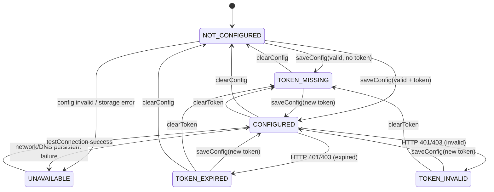

- 状态是**UI 提示**，不参与 LAN 控制权限。
- `saveConfig` 不自动测试网络；`testConnection` 单独调用。
- Token 过期后不得自动刷新/重试旧 token；用户必须更新。
- `CloudConfig` 中 `accessTokenAlias` 只是别名；token 本体只在 Asset Store。
- **v1 云配置为单网关作用域**：`CloudConfig.deviceId` 是该网关的 IoTDA 设备 ID；`CloudService` 只对当前 active gateway 使用。多网关家庭需要多份 cloud config/本地 `gatewayId` 映射，`CloudConfig` 无 `gatewayId` 字段，属 Change Impact（`RISK-CLOUD-MULTIGATEWAY`）。在单配置下，若命令 `gatewayId` 与当前云配置网关不一致，返回 `CLOUD_NOT_CONFIGURED`，不得用错误网关的 token/设备 ID。

#### 8.3.2 云命令生命周期

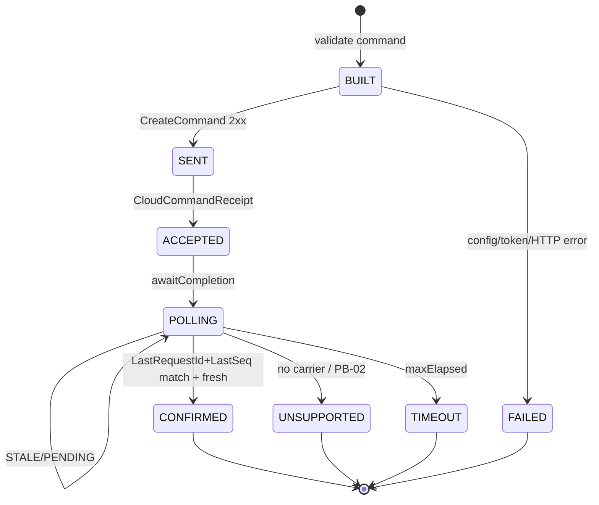

- `SENT/ACCEPTED` 不是成功；UI 只能显示“云端已受理，等待设备确认”。
- `CONFIRMED` 才允许 `COMMITTED`；`UNSUPPORTED/TIMEOUT` → 未确认提示；不得显示成功。
- 同一命令的 `requestId`/`seq` 在轮询中不变；不得为轮询重新签名/改 seq。
- 轮询期间用户取消 → 停止轮询；已发送命令可能已执行，结果标未确认（不得回滚云端）。

#### 8.3.3 影子/完成判定

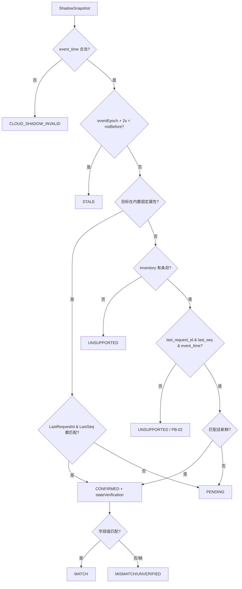

- 固定属性映射表（v1，来自 SR）：
  - `Door_01` → `Door_01_*`；`Light_01` → `Light_01_*`；`AC_01` → `AC_01_*`；`Sensor_01`/`Presence_01` 只读。
  - 其他 deviceId → inventory（PB-02）。
- `LastRequestId`/`LastSeq` 必须**同时**匹配；只看其一不得确认。
- 新鲜度容差 2s（CB §7.1；归档 `NetworkService.ets` L520-525 行为参考）。
- 旧影子/网关缓存/IoTDA 受理均不构成确认（PR-10；需求 L10）。
- `event_time` 未来超过 5 分钟视为时钟异常 → `CLOUD_SHADOW_INVALID`（防误判新鲜）。

### 8.4 PB-02 处置（`UNRESOLVED-PB02-INVENTORY`）

**结论**：`DeviceInventoryJson` 字段级结构在冻结语料中**未定义**（SR L47-51 仅属性存在性/长度；无内部 schema/示例）。本文**不把它升级为冻结契约**；采取“内置路径完整 + 外部路径 fail-closed + 固件协同提案”的去风险方案。

**已确定可实现部分（T-14 必须实现）**：
1. 内置固定属性路径：`Door_01/Light_01/AC_01` 的 `*_LastRequestId`/`*_LastSeq` + `event_time` 新鲜度；完整测试。
2. `DeviceInventoryJson` 解析器：严格上限（≤8192 字符、≤32 条、`device_id` 非空 ≤63）；只接受 §8.6 候选字段；缺 `last_request_id`/`last_seq`/`event_time` → `UNSUPPORTED`；任何未知/非法结构 → `UNSUPPORTED`/`CLOUD_SHADOW_INVALID`，**绝不 CONFIRMED**。
3. 合成 fixture（`CloudFixture.inventory.*`）标注 `PUBLIC TEST DATA ONLY` + `PROPOSED_PB02`；不声称与真实固件互操作。
4. UI/验收：外部模块云完成判定标记 `FIRMWARE_PENDING`/`UNSUPPORTED`；不得写成 PASS。

**固件协同提案 `PROPOSAL-PB02-1`（非规范，仅供协商）**：

```json
[
  {
    "device_id": "MODULE_01",
    "online": true,
    "power": true,
    "open": false,
    "brightness": 80,
    "color": "#FFFFFF",
    "temperature": 24.5,
    "humidity": 50,
    "presence": false,
    "target_temperature": 24,
    "mode": "COOL",
    "state_source": "device.feedback",
    "trigger_device_id": "Presence_01",
    "automation_id": "rule-1",
    "event_time": "20261017T120000Z",
    "last_request_id": "req-1729000000000-101",
    "last_seq": 101
  }
]
```

- 字段命名沿用 SR/`DeviceState` 的 snake_case 映射；`last_request_id`/`last_seq` 是完成判定必需；`event_time` 必须为 UTC 紧凑。
- 提案不进入 CB/SR；若固件确认，走 Change Impact 更新 DES-A/DES-B/TEST-001；若固件给出不同 schema，以固件为准并重写 parser。
- 若无法获得固件 schema：外部模块设备仅走 LAN 状态，云路径只读属性，不参与完成判定（DP §9 PB-02 候选 C 的降级），并在发布说明中声明。

### 8.5 依赖注入与测试 seam（`DES-B-C15-SEAM`）

- 依赖：`HttpTransport`、`CloudConfigStore`、`CloudCredentialPort`、`GatewayCredentialPort`、`GatewaySequencePort`、`CryptoPort`、`ClockPort`、`RandomPort`、`TimerPort`、`LoggerPort`、`MetricsPort`；不 import `@ohos.net.http`。
- host 测试：
  - `paras` 10 字段/`CmdId=3001`/`Value` 紧凑 JSON 原子/无 `object_device_id`；
  - canonical 与 HMAC（可用 DES-A 云向量；无向量时用固定 secret 的 golden）；
  - 2xx 仅 receipt，不产生 `executionAccepted`；
  - 401/403 → `TOKEN_EXPIRED`/`TOKEN_INVALID`，不自动重试；
  - 404/429/5xx/网络错误映射；
  - 影子三种 shape；非法 shape/缺 event_time → `CLOUD_SHADOW_INVALID`；
  - 完成判定：LastRequestId/Seq 双匹配、单匹配 PENDING、旧影子 STALE、2s 容差、未来时间 INVALID；
  - inventory：候选 fixture 匹配/缺字段 UNSUPPORTED/未知字段忽略但记录偏差；
  - 轮询超时/取消/Token 过期中途停止；
  - `stopPolling`/`dispose` 取消定时器；
  - UI 状态：`NOT_CONFIGURED`/`CONFIGURED`/`TOKEN_EXPIRED`。
- IT（Mock/仿真器）：CreateCommand → 影子 → 确认全链路；真实 IoTDA 不在自动门禁（`UNAVAILABLE`）。
- 夹具：`CloudCommandGolden`（固定 secret/seq/时间）、`ShadowFixture`（services/shadow/devices、fresh/stale/missing）、`InventoryFixture`（候选/缺字段/超限）。

### 8.6 Traceability（`DES-B-C15-TRACE`）

| 需求/约束 | 映射 |
|---|---|
| FR-SET-003 云端配置 | `CloudService.saveConfig/validateConfig`；Settings 页 |
| FR-HOME-001 云状态展示 | `CloudConfigView.state`；Home 状态胶囊 |
| PR-09 `paras` 10 字段/无 `object_device_id` | `CloudCommandSerializer`；测试 |
| PR-10/IoTDA 受理≠执行 | `CloudCommandReceipt` vs `CloudCompletionVerdict` |
| CB §7.1/§8.2；D-012/D-014 | 配置/Token/命令/影子/`DeviceInventoryJson` |
| D-012 手工 Token | `CloudCredentialPort`；无自动刷新 |
| `UNRESOLVED-PB02-INVENTORY` | §8.4；`DeviceInventoryParser` |
| `A-CB-1` 影子 DTO 假设 | `ShadowDtoAdapter`；`CLOUD_SHADOW_INVALID` |
| T-14 | 本组件主交付 |

---

## 9. C-16 AC 品牌适配层（Gree/Haier/Midea/Generic）

**契约 ID**：`DES-B-C16-API` / `DES-B-C16-ERR` / `DES-B-C16-STATE` / `DES-B-C16-SEAM` / `DES-B-C16-TRACE`
**职责**：统一 AC 命令模型与品牌映射；7 值 `mode`、16..30°C、亮度/风速 percent 单位；**仅做参数映射，不发网络、不访问仓储**。
**路径**：`entry/src/main/ets/adapter/ac/**`。

### 9.1 公开契约（`DES-B-C16-API`）

```ts
export enum AcBrand {
  GREE = 'GREE',
  HAIER = 'HAIER',
  MIDEA = 'MIDEA',
  GENERIC = 'GENERIC'
}

export enum AcModeViewKind {
  STANDARD = 'STANDARD',
  NON_STANDARD = 'NON_STANDARD',
  UNKNOWN = 'UNKNOWN'
}

export class AcModeView {
  readonly raw: string;                    // 原始入站值；展示用
  readonly mode?: AcMode;                  // 仅标准 7 值时
  readonly kind: AcModeViewKind;
  readonly i18nKey: string;                // ac.mode.* / ac.mode.unknown
}

export class AcCommand {
  readonly action: DeviceAction;
  readonly value?: CommandValue;
}

export class AcCapabilities {
  readonly brand: AcBrand;
  readonly supportedModes: ReadonlyArray<AcMode>;
  readonly minTargetTemperature: number;   // 16
  readonly maxTargetTemperature: number;   // 30
  readonly supportsColor: boolean;         // false（AC 无颜色）
  readonly supportsFanSpeed: boolean;      // false（v1 LAN 无 speed 字段）
}

export interface AcAdapter {
  readonly brand: AcBrand;
  readonly capabilities: AcCapabilities;

  power(on: boolean): AcCommand;
  setTargetTemperature(celsius: number): AcCommand;
  setMode(mode: AcMode): AcCommand;

  normalizeInboundMode(raw: string): AcModeView;
  normalizeInboundTemperature(raw: number): number; // 16..30 校验；越界抛错
  toViewState(patch: DeviceStatePatch): AcViewState;
}

export class AcViewState {
  readonly power?: boolean;
  readonly targetTemperature?: number;
  readonly mode: AcModeView;
  readonly brand: AcBrand;
  readonly brandI18nKey: string;           // brand.gree 等
  readonly isReadOnly: boolean;            // 设备不受支持/离线只读
}

export class AcAdapterFactory {
  static create(brand: string | undefined): AcAdapter;
  static normalizeBrand(brand: string | undefined): AcBrand;
  static supportedBrands(): ReadonlyArray<AcBrand>;
}
```

**品牌映射**：
- `normalizeBrand`：trim + 小写；接受 ASCII `gree/haier/midea/generic` 与已知互操作别名 `gree/格力`、`haier/海尔`、`midea/美的`（协议别名，allowlist 登记；不进入 UI 分支）；未知/空 → `GENERIC`。
- 所有 adapter 的 `setMode` 只接受 `AcMode` 7 值；不得发送厂商私有码（厂商差异由网关适配器承担；App 只发 canonical 词表）。
- `GreeAcAdapter`/`HaierAcAdapter`/`MideaAcAdapter` 可覆盖 `capabilities`/`normalizeInboundMode` 的差异（例如入站中文/别名归一），但**不得**改变 7 值出站词表；不得 import 仓储/网络/I18nService（品牌显示键由 `brandI18nKey` 提供，不调用 `t()`）。
- `GenericAcAdapter` 是默认；未知品牌回退 Generic，不阻断控制。
- `toViewState`：`mode` 表内 → `STANDARD`；表外 → `NON_STANDARD` + 原文；`patch.mode` 缺失 → `UNKNOWN`；`brandI18nKey` 只返回键，不返回文案。
- `normalizeInboundTemperature`：数值必须在 16..30；越界 → `PROTOCOL_VALUE_OUT_OF_RANGE`；不得静默 clamp（入站展示可标记异常，但适配器不 clamp）。

### 9.2 错误（`DES-B-C16-ERR`）

| 场景 | 错误 |
|---|---|
| 非标准 mode 出站 | `PROTOCOL_VALUE_OUT_OF_RANGE` |
| 温度越界 | `PROTOCOL_VALUE_OUT_OF_RANGE` |
| 非数值/NaN/Infinity | `PROTOCOL_INVALID_TYPE` |
| 未知品牌 | 不报错；回退 `GENERIC`（记录诊断） |
| 设备类型非 AC | `CONFIGURATION_ERROR`（由调用方/ControlPolicy 保证） |

- 适配器不产生网络/存储错误；不抛裸 `Error`。

### 9.3 状态机与不变量（`DES-B-C16-STATE`）

1. **7 值唯一**：`AUTO/COOL/HEAT/DRY/FAN/ECO/SLEEP`；入站表外值保留原文、`modeStandard=false`、禁止回发（CB §6.3）。
2. **温度**：目标 16..30；UI 滑杆可 clamp 到边界后再调用 `setTargetTemperature`；适配器对越界抛错，不静默。
3. **单位**：`brightness` 0..100；`speed` 如未来启用为 percent 0..100，不是 1..5 档（CB §6.2/E-10）。
4. **品牌**：品牌只影响显示/能力/入站归一，不改变线格式；`brand` 字符串不是主键。
5. **无网络**：适配器方法同步返回 `AcCommand`/`AcViewState`；不得 async 发请求。
6. **只读降级**：`DeviceConstants.isSupported(AC)` 为 true；若设备 `isSupported=false`（未知类型），适配器不参与控制，UI 只读。
7. **模式回发**：`AcViewState.mode.kind != STANDARD` 时，UI 禁止把该值传给 `setMode`；`AcAdapter.setMode` 类型上只接受 `AcMode`，编译期防御。

### 9.4 依赖注入与测试 seam（`DES-B-C16-SEAM`）

- 依赖：仅 `common/**`、`model/**`；无构造注入；工厂静态。
- host 测试：
  - 品牌归一（ASCII/中文别名/空/未知）；
  - 7 值出站；表外入站 `NON_STANDARD` 且不回发；
  - 温度 16/30 边界；15.9/30.1 抛错；NaN/Infinity；
  - `toViewState` 缺字段/未知 mode；
  - 四个 adapter 的 `capabilities` 一致（7 值/16..30）；
  - 适配器不 import 仓储/网络（静态扫描）。
- CT：与 C-21 `ClimateViewModel` 联合：滑杆 55ms/TouchUp 只发标准值。
- 夹具：`AcFixture`（品牌/模式/温度边界）。

### 9.5 Traceability（`DES-B-C16-TRACE`）

| 需求/约束 | 映射 |
|---|---|
| FR-DEV-004 空调/多品牌 | `AcAdapterFactory` + 四个 adapter |
| CB §6.2/§6.3 | 7 值/16..30/percent/非标准不回发 |
| ADR-001 §2 | 统一动作/值 |
| DM §2.2 | `targetTemperature`/`mode`/`brand` |
| PC PL-08 | 适配器解耦、纯映射 |
| T-14 | 本组件主交付 |

---

## 10. C-21 Home / Device / Climate / Door ViewModel 组

**契约 ID**：`DES-B-C21-API` / `DES-B-C21-ERR` / `DES-B-C21-STATE` / `DES-B-C21-SEAM` / `DES-B-C21-TRACE`
**职责**：首页/设备/温控/门锁状态流、过滤、三态 PENDING/COMMITTED/REVERT、55ms 节流、TouchUp 强同步、门锁四阶段/10s 超时/离线区分。
**路径**：`entry/src/main/ets/viewmodel/{HomeViewModel,DeviceViewModel,ClimateViewModel,DoorViewModel}.ets`、`viewmodel/core/**`。

### 10.1 公开契约（`DES-B-C21-API`）

#### 10.1.1 公共状态类型（`viewmodel/core/**`）

```ts
export enum LoadPhase {
  IDLE = 'IDLE',
  LOADING = 'LOADING',
  READY = 'READY',
  ERROR = 'ERROR'
}

export class ViewModelError {
  readonly error: AppError;
  readonly i18nKey: string;                // 已由 ErrorI18nMapper/I18nKeys 生成
  readonly atMs: number;
}

export enum DeviceFilterKind {
  ALL = 'ALL',
  ROOM = 'ROOM',
  UNASSIGNED = 'UNASSIGNED'
}

export class DeviceFilter {
  readonly kind: DeviceFilterKind;
  readonly roomId?: string;                // 仅 ROOM
  static all(): DeviceFilter;
  static room(roomId: string): DeviceFilter;
  static unassigned(): DeviceFilter;
}

export enum GatewayLinkState {
  ONLINE = 'ONLINE',
  OFFLINE = 'OFFLINE',
  BLOCKED = 'BLOCKED',
  UNKNOWN = 'UNKNOWN'
}

export enum CloudLinkState {
  NOT_CONFIGURED = 'NOT_CONFIGURED',
  CONFIGURED = 'CONFIGURED',
  TOKEN_EXPIRED = 'TOKEN_EXPIRED',
  TOKEN_INVALID = 'TOKEN_INVALID',
  UNAVAILABLE = 'UNAVAILABLE',
  UNKNOWN = 'UNKNOWN'
}

export class GatewayStatus {
  readonly gatewayId: string;
  readonly gatewayName: string;
  readonly lan: GatewayLinkState;
  readonly cloud: CloudLinkState;
  readonly profile: TransportProfile;
  readonly latencyMs?: number;             // 来自本次签名 discover；MOCK_ONLY 可测
  readonly lastSeenAt?: string;
  readonly warningKey?: string;            // 安全通道提示键
}

export class EnvironmentSummary {
  readonly temperature?: number;
  readonly humidity?: number;
  readonly presence?: boolean;
  readonly updatedAt?: string;
  readonly stateSource?: string;
  readonly known: boolean;                 // 至少一个传感器读数
}

export enum ControlPhase {
  IDLE = 'IDLE',
  PENDING = 'PENDING',
  COMMITTED = 'COMMITTED',
  REVERT = 'REVERT'
}

export class ControlUiState {
  readonly key: DeviceKey;
  readonly action: DeviceAction;
  readonly phase: ControlPhase;
  readonly confirmedValue?: CommandValue;  // 最近一次网关确认值
  readonly optimisticValue?: CommandValue;// PENDING 时 UI 显示值
  readonly pendingSinceMs?: number;
  readonly lastOutcome?: ControlOutcome;   // LAN 兼容/诊断
  readonly lastExecution?: ControlExecution; // LAN/CLOUD 统一结果
  readonly lastError?: ViewModelError;
  readonly revision: number;
}
```

#### 10.1.2 `HomeViewModel`

```ts
export class HomeViewState {
  readonly phase: LoadPhase;
  readonly families: ReadonlyArray<Family>;
  readonly activeFamily?: Family;
  readonly rooms: ReadonlyArray<Room>;
  readonly roomFilter: DeviceFilter;
  readonly records: ReadonlyArray<DeviceRecord>;
  readonly unassignedCount: number;
  readonly gatewayStatuses: ReadonlyArray<GatewayStatus>;
  readonly environment: EnvironmentSummary;
  readonly lastRefreshAtMs?: number;
  readonly error?: ViewModelError;
  readonly revision: number;
}

export class HomeViewModel implements ViewModelBase<HomeViewState> {
  constructor(families: FamilyService,
              rooms: RoomService,
              devices: DeviceRepository,
              gateways: GatewayRoutePort,
              client: IGatewayClient,          // UI_CONTROL/或 BACKGROUND，见 §2.4
              discovery: GatewayDiscoveryService,
              cloud: CloudService,
              appContext: AppContext,
              i18n: I18nService,
              clock: ClockPort,
              timer: TimerPort,
              logger: LoggerPort);

  getState(): HomeViewState;
  subscribe(listener: (state: HomeViewState) => void): () => void;

  initialize(): Promise<void>;
  refresh(): Promise<void>;
  selectFamily(familyId: string): Promise<void>;
  setRoomFilter(filter: DeviceFilter): void;
  refreshEnvironment(): void;              // 从 records 派生；不额外请求
  dispose(): void;
}
```

**语义**：
- `initialize`：加载 families/activeFamily/rooms/records/gateway statuses；`phase=READY`。
- `refresh`：
  1. `routes.listRoutesByFamily(activeFamilyId)`；
  2. 对每个 route 构造 `GatewayTarget`（profile/pins/port/credentialAlias），调用 `client.discover(target)`；用 `clock` 计 `latencyMs`；
  3. 成功 → `devices.applyDiscoverSnapshot(snapshot,{familyId, nowMs, markMissingAsGatewayRemoved:true})`；`lan=ONLINE`；
  4. 失败 → `lan=OFFLINE`/`BLOCKED`（`GATEWAY_PROFILE_BLOCKED`/`TLS_*`），保留旧 records；
  5. `cloud.getState()` → `CloudLinkState`；
  6. 重新 `listRecords`/`listRooms`；`phase=READY`。
- `selectFamily`：`families.switchFamily`；成功后 `appContext.refreshSessionGate()`；`requiresUnlock=true` 时 state 标 `needsUnlock`，由 Index `SessionGateView` 解锁；不自动解锁。
- `setRoomFilter`：只改过滤；派生 selector 不重新请求。
- `environment`：从 records 中 `sensor` 类型聚合（温度/湿度/人体）；多个传感器取最新 `stateEpochMs`；`known=false` 时显示空态；不伪造数值。
- `gatewayStatuses` 的 `latencyMs` 是签名 discover 往返；NFR 4.3 的 p95 口径归 TEST-001，UI 只展示单次值。
- 页面不可直接读 repository；只读 state。

#### 10.1.3 `DeviceViewModel`

```ts
export class DeviceViewState {
  readonly phase: LoadPhase;
  readonly filter: DeviceFilter;
  readonly records: ReadonlyArray<DeviceRecord>;
  readonly rooms: ReadonlyArray<Room>;
  readonly controls: ReadonlyArray<ControlUiState>;
  readonly lastRefreshAtMs?: number;
  readonly error?: ViewModelError;
  readonly revision: number;
}

export class DeviceViewModel implements ViewModelBase<DeviceViewState> {
  constructor(devices: DeviceRepository,
              rooms: RoomService,
              control: DeviceControlCoordinatorPort,
              i18n: I18nService,
              clock: ClockPort,
              timer: TimerPort,
              logger: LoggerPort);

  getState(): DeviceViewState;
  subscribe(listener: (state: DeviceViewState) => void): () => void;
  initialize(familyId: string): Promise<void>;
  refresh(): Promise<void>;
  setFilter(filter: DeviceFilter): void;

  togglePower(key: DeviceKey): Promise<void>;
  openDoor(key: DeviceKey): Promise<void>;
  closeDoor(key: DeviceKey): Promise<void>;
  setColor(key: DeviceKey, color: string): Promise<void>;

  beginContinuous(key: DeviceKey, action: DeviceAction,
                  min: number, max: number): void;
  updateContinuous(key: DeviceKey, value: number): void;
  endContinuous(key: DeviceKey, value: number): Promise<void>;
  cancelContinuous(key: DeviceKey): void;

  settleRevert(key: DeviceKey): void;
  getControl(key: DeviceKey): ControlUiState | undefined;
  dispose(): void;
}
```

**控制流程（单次）**：
1. `runCommand(key, action, value)`：
   - 若该设备有 `PENDING` 控制且 action 相同 → 合并/忽略（单次动作不超过 1 在途；连续控制走 `ThrottleGate`）；
   - 设置 `PENDING` + `optimisticValue` + `pendingSinceMs`（UI 立即反馈，但不写 COMMITTED）；
   - `control.execute(new DeviceControlCommand({gatewayId,key.deviceId,action,value,requestedAtMs:clock.nowMs()}), this.familyId)`；
   - 读取 `execution = await control.execute(...)`；`verification = execution.apply?.stateVerification ?? execution.lan?.outcome?.stateVerification ?? execution.cloud?.verdict.stateVerification`；
   - 成功 `execution.ackAccepted && verification != MISMATCH` → `COMMITTED`，`confirmedValue` 取 `execution.apply?.record?.state.snapshot` 对应字段或请求值；`lastExecution=execution`；`lastOutcome=execution.lan?.outcome`（LAN 时）；
   - `MISMATCH`/`!execution.ackAccepted`/`execution.error` → `REVERT`；`optimisticValue` 丢弃，`confirmedValue` 保持；记录 `lastError`；
   - `REVERT` 保持到 UI 调用 `settleRevert(key)`（页面在回弹动画结束后调用）或 `TIMEOUT_REVERT_SETTLE_MS=320` 后自动回 `IDLE`；不得自动重试。
2. `COMMITTED` 保留到下一次操作/刷新；UI 动画结束后可显示 `IDLE` 但保留 `confirmedValue`；不需要额外 `settleCommitted`。`ControlUiState.phase` 供 UI 动画；VM 不得在下一次操作前把 `confirmedValue` 清空。
3. 失败错误映射：`DEVICE_DISABLED/UNASSIGNED/UNSUPPORTED`、`GATEWAY_TIMEOUT`、`DEVICE_OFFLINE` 等；`error.i18nKey` 由 `ErrorI18nMapper` 生成；UI 只展示 `t(key)`。
4. `UNVERIFIED`：`execution.ackAccepted=true` 但字段缺失 → `COMMITTED` + `lastExecution` 的 `stateVerification=UNVERIFIED`；UI 显示“已执行，状态未回传”，不得显示“已确认到位”。

**连续控制（亮度/温度）**：
- `beginContinuous`：创建/重置 `ThrottleGate`，记录 `min/max`；`updateContinuous` 只更新本地 UI 值与 pending；`endContinuous`（TouchUp）取消 55ms timer，发送最终值；若已有在途，标记 latest，完成后续发最终值。
- 55ms 合并：同一时刻最多 1 条在途；55ms 窗口内只保留最新目标值；不得把每个拖动事件都发网络（PF-02；UIUX §4.4）。
- `cancelContinuous`：取消 timer，丢弃 pending，不发送；UI 回弹到 confirmed。
- 连续控制的 `ControlUiState` 始终 PENDING 直到最终值 COMMITTED/REVERT；中间值不进入 `confirmedValue`。

#### 10.1.4 `ThrottleGate`（纯逻辑，host 可测）

```ts
export enum ThrottlePhase {
  IDLE = 'IDLE',
  COALESCING = 'COALESCING',
  IN_FLIGHT = 'IN_FLIGHT'
}

export class ThrottleGate {
  constructor(timer: TimerPort,
              clock: ClockPort,
              throttleMs: number,          // 55
              dispatch: (value: number) => Promise<void>);

  onInput(value: number): void;            // 记录 latest；启动/续期 55ms timer
  onCommit(value: number): Promise<void>;  // TouchUp：取消 timer；最终值
  onInFlightFinished(): Promise<void>;     // 完成回调；若 latest 更新则立即派发
  cancel(): void;
  getPhase(): ThrottlePhase;
  getLatest(): number | undefined;
  getLastDispatched(): number | undefined;
  dispose(): void;
}
```

**状态机**：

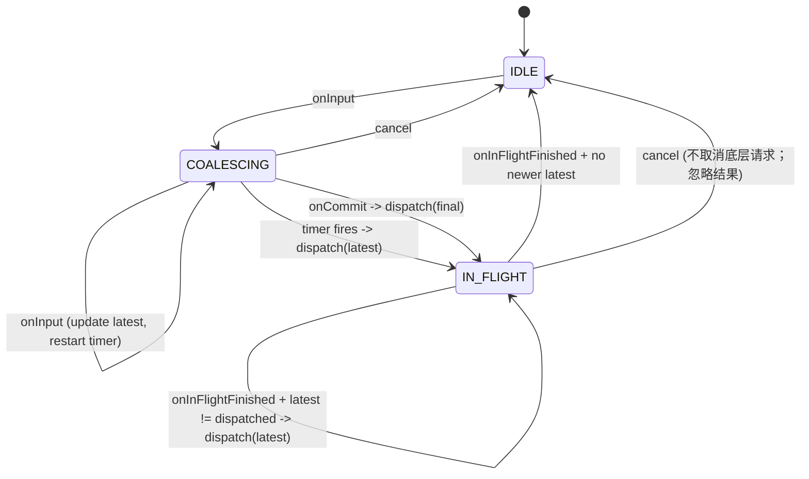

- `onInput` 在 `IN_FLIGHT` 时只更新 latest，不派发；完成回调再派发。
- `onCommit` 必须发送最终值（TouchUp 强同步）；若在途，等完成后派发最终值；最终值不丢。
- `cancel` 只取消本地 timer/忽略结果；底层 C-17 请求继续，但其结果不得写 confirmed（VM 用 revision/operation token 丢弃）。
- `dispatch` 抛错/失败 → phase 回 IDLE（或由 VM 处理）；latest 保留由 VM 决定是否重试；默认不自动重试。

#### 10.1.5 `DeviceControlCoordinator`（LAN 优先 + 云回退）

```ts
export enum ControlTransport {
  LAN = 'LAN',
  CLOUD = 'CLOUD'
}

export class ControlExecution {
  readonly command: DeviceControlCommand;
  readonly transport: ControlTransport;
  readonly lan?: DeviceCommandExecution;
  readonly cloud?: CloudControlOutcome;
  readonly apply?: ControlApplyResult;
  readonly error?: AppError;
  readonly elapsedMs: number;
  readonly ackAccepted: boolean;
}

export interface DeviceControlCoordinatorPort {
  execute(command: DeviceControlCommand, familyId: string): Promise<ControlExecution>;
}

export class DeviceControlCoordinator implements DeviceControlCoordinatorPort {
  constructor(lan: DeviceCommandRunner,
              cloud: CloudService,
              devices: DeviceRepository,
              clock: ClockPort,
              logger: LoggerPort);

  execute(command: DeviceControlCommand, familyId: string): Promise<ControlExecution>;
}
```

**语义**：
- 先 `lan.run`。若 LAN 成功（`ControlOutcome.ackAccepted` 或明确的网关失败结果），直接返回 `ControlTransport.LAN`；不因 `DEVICE_OFFLINE/1007`/`HARDWARE_TIMEOUT` 等网关真实结果回退云端（设备问题，云端同样经网关）。
- 仅在 **LAN 不可达/超时/本地请求失败**（`GATEWAY_UNREACHABLE`/`GATEWAY_TIMEOUT`/`LOCAL_REQUEST_FAILED`）且 `cloud.getState().state == CONFIGURED` 时回退：
  1. `cloud.sendAndConfirm(command)`；
  2. `cloud.executionAccepted` → `devices.applyCloudState(...)`；`transport=CLOUD`；
  3. 返回 `ControlExecution`；UI 显示“云端已确认”或“云端受理未确认”。
- **不回退**：`DEVICE_DISABLED/UNASSIGNED/UNSUPPORTED`、`AUTH_*`、`TLS_*`/`GATEWAY_PROFILE_BLOCKED`、`DEV-ONLY`、`CLOUD_TOKEN_EXPIRED/INVALID`（云状态错误直接显示）。
- `ControlExecution.ackAccepted` = LAN ackAccepted 或 cloud.executionAccepted；VM 仍按 `stateVerification` 决定 COMMITTED/REVERT。
- 回退不改变 `request_id`/`seq` 语义：LAN 已分配的 seq 不用于云；云命令重新分配 seq（`GatewaySequencePort` 单调）。UI 只显示一次控制结果。

#### 10.1.6 `ClimateViewModel`

```ts
export class ClimateViewState {
  readonly phase: LoadPhase;
  readonly record?: DeviceRecord;
  readonly ac?: AcViewState;
  readonly control: ControlUiState;        // 当前设备的控制态
  readonly modeOptions: ReadonlyArray<AcMode>;
  readonly error?: ViewModelError;
  readonly revision: number;
}

export class ClimateViewModel implements ViewModelBase<ClimateViewState> {
  constructor(devices: DeviceRepository,
              control: DeviceControlCoordinatorPort,
              i18n: I18nService,
              clock: ClockPort,
              timer: TimerPort,
              logger: LoggerPort);

  getState(): ClimateViewState;
  subscribe(listener: (state: ClimateViewState) => void): () => void;
  load(key: DeviceKey): Promise<void>;
  togglePower(): Promise<void>;
  setMode(mode: AcMode): Promise<void>;
  beginTemperature(value: number): void;
  updateTemperature(value: number): void;
  endTemperature(value: number): Promise<void>;
  settleRevert(): void;
  dispose(): void;
}
```

- `load`：读 `DeviceRecord`；`AcAdapterFactory.create(record.state.snapshot.brand)`；`ac=adapter.toViewState(record.state.snapshot patch)`；`modeOptions=adapter.capabilities.supportedModes`（7 值）。
- `setMode`：只接受 `AcMode`；adapter `setMode` → `control.execute(..., record.state.familyId)`；不允许把非标准原文回发。
- `beginTemperature/updateTemperature/endTemperature`：55ms/TouchUp；UI 滑杆 clamp 16..30；发送整数/紧凑数字；`endTemperature` 发送最终值。
- 只读/离线/禁用：`ac.isReadOnly` 或 record 状态 → UI 禁控；VM 仍可 `load` 展示；控制方法返回 `DEVICE_*`。
- `togglePower`：AC `ON/OFF`。

#### 10.1.7 `DoorViewModel` / `DoorConfirmationTracker`

```ts
export enum DoorLinkMode {
  NONE = 'NONE',
  CONTACT_SENSOR = 'CONTACT_SENSOR',
  GATEWAY_MERGED = 'GATEWAY_MERGED'
}

export enum DoorStage {
  IDLE = 'IDLE',
  PENDING = 'PENDING',
  GATEWAY_CONFIRMED = 'GATEWAY_CONFIRMED',
  WAITING_CONTACT = 'WAITING_CONTACT',
  SECURED = 'SECURED',
  OPEN = 'OPEN',
  UNCONFIRMED = 'UNCONFIRMED',
  UNKNOWN = 'UNKNOWN',
  UNVERIFIED = 'UNVERIFIED',
  FAILED = 'FAILED'
}

export enum DoorLockState {
  SECURED = 'SECURED',
  UNCONFIRMED = 'UNCONFIRMED',
  UNKNOWN = 'UNKNOWN',
  OPEN = 'OPEN',
  UNKNOWN_INITIAL = 'UNKNOWN_INITIAL'
}

export class DoorLinkConfig {
  readonly mode: DoorLinkMode;
  readonly contactSensorKey?: DeviceKey;   // CONTACT_SENSOR 必填
  readonly configuredAt?: string;
}

export class DoorUiState {
  readonly stage: DoorStage;
  readonly lockState: DoorLockState;
  readonly link: DoorLinkConfig;
  readonly alertActive: boolean;
  readonly lastAckAtMs?: number;
  readonly lastContactAtMs?: number;
  readonly error?: ViewModelError;
  readonly revision: number;
}

export class DoorViewState {
  readonly phase: LoadPhase;
  readonly record?: DeviceRecord;
  readonly door: DoorUiState;
  readonly control: ControlUiState;
  readonly error?: ViewModelError;
  readonly revision: number;
}

export class DoorConfirmationTracker {
  constructor(clock: ClockPort,
              timer: TimerPort,
              policy: DoorConfirmationPolicy);

  startLock(link: DoorLinkConfig): void;
  onResult(execution: ControlExecution): void;  // 读取 ackAccepted + reported open
  onContactState(open: boolean, online: boolean): void;
  onContactOffline(): void;
  onTimeout(): void;
  reset(): void;
  getState(): DoorUiState;
  dispose(): void;
}

export class DoorConfirmationPolicy {
  readonly confirmTimeoutMs: number;       // 10000（ADR-004 §6）
  readonly revertSettleMs: number;         // 320
  static defaults(): DoorConfirmationPolicy;
}

export class DoorViewModel implements ViewModelBase<DoorViewState> {
  constructor(devices: DeviceRepository,
              control: DeviceControlCoordinatorPort,
              i18n: I18nService,
              clock: ClockPort,
              timer: TimerPort,
              logger: LoggerPort);

  getState(): DoorViewState;
  subscribe(listener: (state: DoorViewState) => void): () => void;
  load(key: DeviceKey): Promise<void>;
  lock(): Promise<void>;
  unlock(): Promise<void>;
  configureLink(link: DoorLinkConfig): Promise<void>; // 仅本地；D-016 一次性引导
  onDeviceChanged(event: DeviceChangeEvent): void;
  dismissAlert(): void;
  settleRevert(): void;
  dispose(): void;
}
```

**门锁四阶段（锁闭 CLOSE）**：

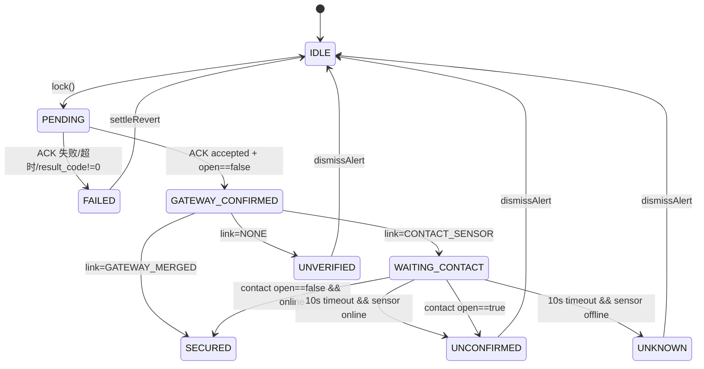

- `lock()`：PENDING → `control.execute(CLOSE, record.state.familyId)` → `tracker.onResult(execution)`；`ackAccepted && reported open==false` → `GATEWAY_CONFIRMED`；否则 `FAILED` + REVERT。
- `link=GATEWAY_MERGED`：ACK `open==false` 即 `SECURED`（固件并入门磁）。
- `link=CONTACT_SENSOR`：进入 `WAITING_CONTACT`；等待关联传感器 `open==false && online`；10s 超时：传感器在线 → `UNCONFIRMED`（Amber + `door.alert.unconfirmed`），离线 → `UNKNOWN`（`door.state.unknown`）。
- `link=NONE`：`GATEWAY_CONFIRMED` → `UNVERIFIED`；设备详情页常驻“未验证到位”提示（D-016）；**禁止**显示“已锁好”。
- `unlock()`：`OPEN`，单次 ACK（`open==true`）→ `OPEN`；不等待门磁。
- `onContactState(open=true)` after SECURED：门被打开 → `OPEN`/`UNCONFIRMED` + alert；不得继续显示 SECURED。
- `onContactOffline` during WAITING_CONTACT → 仍等待到超时，再 `UNKNOWN`；不得提前 `SECURED`。
- 文案：未见门磁确认时只能“已执行/未确认到位”；`door.state.secured` 仅在 SECURED 使用（ADR-004 §6.2-4）。
- 关联配置仅本地存储（Preferences/RDB 本地键），不进入协议；默认无关联；一次性引导可跳过；跳过记录 `UNVERIFIED` 能力缺口。

### 10.2 错误（`DES-B-C21-ERR`）

| 场景 | 错误/i18n |
|---|---|
| 设备禁用/未分配/只读 | `DEVICE_DISABLED`/`DEVICE_UNASSIGNED`/`CONFIGURATION_ERROR`；`device.disabled.unassigned`/`device.unsupported.read_only` |
| 网关离线/超时 | `GATEWAY_UNREACHABLE`/`GATEWAY_TIMEOUT`；`errors.app.gateway_*` |
| ACK 未接受/MISMATCH | `ACK_*`/`CONTROL_RESPONSE_AUTH_FAILED`；`errors.app.*` |
| 门锁未确认 | `door.state.unconfirmed`/`door.alert.unconfirmed`（不是 AppError 失败） |
| 门锁无法确认 | `door.state.unknown` + `door.link.unverified` |
| 家庭切换需解锁 | `AUTH_SESSION_INVALID`/`AUTH_PROFILE_NOT_FOUND`；Index `SessionGateView` |
| 节流取消 | 不报错；UI 回弹 |
| 场景/VM 取消 | `SCENE_CANCELLED`/调用方映射 |

### 10.3 状态机与不变量（`DES-B-C21-STATE`）

#### 10.3.1 控制三态（防乐观）

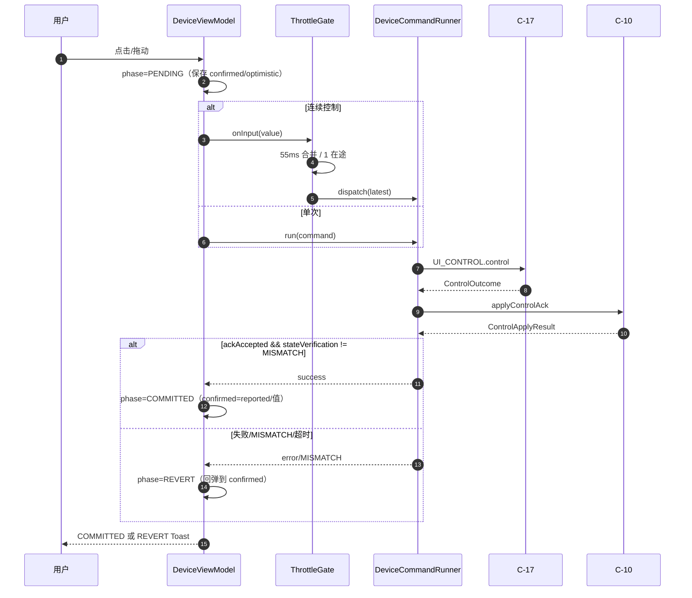

- `PENDING` 只表示“已发出，等待确认”；不得把 `PENDING` 写成成功。
- `COMMITTED` 仅在 `ackAccepted` 且 `stateVerification != MISMATCH` 后；`UNVERIFIED` 显示“已执行/状态未回传”。
- `REVERT` 必须回到 `confirmedValue`（上一次网关确认值）；没有 confirmed 值时回 `IDLE` 并保留原 state。
- 超时/失败不得自动重试；用户再次操作 → 新命令/新 seq/nonce。
- `PENDING` 期间 UI 控件显示流光/微透明；`REVERT` 用 `AppMotionTokens.SPRING_REVERT`；不得用红色错误弹窗打断（轻量 Toast）。

#### 10.3.2 55ms/TouchUp

- 连续拖动：最多 1 在途；55ms 内合并；latest 不丢。
- TouchUp：取消 55ms timer；最终值必须发送；若在途，完成后续发最终值。
- 不同设备各自独立节流；同设备不同 action 串行（一次只允许一个控制态；切换 action 前等待/取消）。
- 页面离开/VM dispose：取消 timer；在途结果不得写 state（operation token/revision 丢弃）。

#### 10.3.3 门锁语义

- 四阶段 + 三结果：`SECURED`（门磁到位/网关并入）、`UNCONFIRMED`（未收到确认，不等于门未锁）、`UNKNOWN`（传感器离线/无法确认）。
- 10s 超时；`DoorConstants.DOOR_CONFIRM_TIMEOUT_MS=10000`；不得把超时判为“未锁”。
- 关联关系仅本地；不进入 LAN/云协议；跳过引导 → `UNVERIFIED` 常驻提示（D-016）。
- 门锁报警只 App 内提示/可选系统通知；v1 不联动声光报警器（ADR-004 §6.2-5）。

### 10.4 依赖注入与测试 seam（`DES-B-C21-SEAM`）

- 依赖：`FamilyService`/`RoomService`/`DeviceRepository`/`DeviceCommandRunner`/`IGatewayClient`/`GatewayDiscoveryService`/`CloudService`/`AcAdapterFactory`/`I18nService`/`ClockPort`/`TimerPort`/`LoggerPort`；不 import 平台 API/仓储实现（注：VM 通过构造注入用例接口）。
- host 测试（`entry/src/test/viewmodel/`）：
  - `ThrottleGate`：55ms 合并、1 在途、latest 不丢、TouchUp 最终值、cancel、dispatch 失败；
  - 三态：PENDING→COMMITTED/REVERT、MISMATCH→REVERT、UNVERIFIED→COMMITTED、超时/错误→REVERT；
  - `DeviceCommandRunner` 预检拒绝（禁用/未分配/只读）且端口 0 调用；
  - `DeviceControlCoordinator`：LAN 成功不回退；LAN `GATEWAY_UNREACHABLE/TIMEOUT` → 云；LAN `DEVICE_OFFLINE`/`TLS_*`/`DEVICE_*` 不回退；云 Token 过期不回退；云 `UNSUPPORTED` 不应用状态；
  - 门锁：GATEWAY_MERGED、CONTACT_SENSOR 到位/超时在线/超时离线/NONE、OPEN、contact offline、alert、10s（FakeTimer）；
  - 家庭切换 `requiresUnlock`；Home 过滤/环境聚合；
  - 失败不产生 COMMITTED；无 confirmed 值时 REVERT 回 IDLE。
- device/UI：三态视觉/回弹动画/门锁提示（设备/模拟器可用时）；无设备 `UNAVAILABLE`。
- 夹具：`ControlOutcomeFixture`（MATCH/UNVERIFIED/MISMATCH/error）、`DoorFixture`（四种 link/states）、`DeviceRecordFixture`。

### 10.5 Traceability（`DES-B-C21-TRACE`）

| 需求/约束 | 映射 |
|---|---|
| FR-DEV-001/002/003 | 三态、55ms/TouchUp、门锁四阶段 |
| FR-HOME-001..004 | HomeViewModel/过滤/环境/快捷卡片 |
| FR-DEV-005 | 环境/设备 `stateSource` 标签 |
| ADR-004 §6；D-016 | 门锁四阶段/关联/未验证提示 |
| UIUX §4.3/§4.4/§5 | 三态/节流/动效 token |
| CB §2.3；SC-13/SC-14 | ACK 判定/禁止虚构成功 |
| PF-01/PF-02 | RTT/55ms 测试口径（TEST-001） |
| T-15 | 本组件主交付 |

---

## 11. C-22 Family / Room / Scene ViewModel 组

**契约 ID**：`DES-B-C22-API` / `DES-B-C22-ERR` / `DES-B-C22-STATE` / `DES-B-C22-SEAM` / `DES-B-C22-TRACE`
**职责**：家庭切换/成员/RBAC、房间 CRUD 与未分配池、场景执行进度、邀请流程状态；消费 C-08..C-14，导航事件交给 C-28。
**路径**：`entry/src/main/ets/viewmodel/{FamilyViewModel,RoomViewModel,SceneViewModel}.ets`。

### 11.1 公开契约（`DES-B-C22-API`）

#### 11.1.1 `FamilyViewModel`

```ts
export enum FamilySection {
  MEMBERS = 'MEMBERS',
  INVITES = 'INVITES',
  JOIN = 'JOIN',
  FAMILY = 'FAMILY'
}

export class FamilyCapabilities {
  readonly canManageFamily: boolean;
  readonly canManageRooms: boolean;
  readonly canInvite: boolean;
  readonly canControlAll: boolean;
  readonly canExecuteScene: boolean;
  readonly allowedRoomIds: ReadonlyArray<string>; // GUEST
  readonly role: MemberRole;
}

export class FamilyViewState {
  readonly phase: LoadPhase;
  readonly families: ReadonlyArray<Family>;
  readonly activeFamily?: Family;
  readonly members: ReadonlyArray<FamilyMemberView>;
  readonly invitations: ReadonlyArray<InvitationView>;
  readonly capabilities?: FamilyCapabilities;
  readonly section: FamilySection;
  readonly join?: JoinSessionState;
  readonly pendingAction: boolean;
  readonly error?: ViewModelError;
  readonly revision: number;
}

export class FamilyViewModel implements ViewModelBase<FamilyViewState> {
  constructor(families: FamilyService,
              auth: AuthService,
              invites: InviteService,
              appContext: AppContext,
              i18n: I18nService,
              clock: ClockPort,
              logger: LoggerPort);

  getState(): FamilyViewState;
  subscribe(listener: (state: FamilyViewState) => void): () => void;

  initialize(): Promise<void>;
  setSection(section: FamilySection): void;
  refresh(): Promise<void>;

  createFamily(familyName: string, displayName: string, password: string): Promise<Family>;
  switchFamily(familyId: string): Promise<void>;
  leaveFamily(familyId: string): Promise<void>;
  transferAdmin(newAdminMemberId: string): Promise<void>;
  dissolveFamily(familyId: string): Promise<void>;

  removeMember(memberId: string): Promise<void>;
  changeMemberRole(memberId: string, role: MemberRole): Promise<void>;
  extendGuest(memberId: string, expiresAt: string): Promise<void>;
  importReceipt(inviteId: string, receiptText: string): Promise<void>;

  startJoin(displayName?: string): Promise<void>;
  submitJoinInvitation(text: string, code?: string): Promise<void>;
  completeJoinWithProfile(displayName: string, password: string): Promise<void>;
  startInviteFromJoinRequest(text: string, input: CreateInvitationInput): Promise<InvitationCreationResult>;
  createCodeInvitation(input: CreateInvitationInput): Promise<InvitationCreationResult>;
  revokeInvitation(inviteId: string): Promise<void>;

  cancelJoin(): Promise<void>;
  clearError(): void;
  dispose(): void;
}
```

**语义**：
- `initialize`：加载 activeFamily、members、invitations、capabilities；`section=MEMBERS`。
- `capabilities`：从 `AuthService.getActiveSession()` + `SessionInfo.role` 派生；`canManageFamily/canManageRooms/canInvite` 用 C-12 的 `canManageFamily/canManageRooms/canInvite`；`canControlAll` = ADMIN/MEMBER；GUEST `allowedRoomIds`。UI 用 capabilities 隐藏/禁用入口；服务层仍再次校验（不依赖 UI 隐藏）。
- `createFamily`：`FamilyService.createFamily` → `AuthService.createProfile({familyId,memberId:owner,...})` → `setActiveFamily` → `appContext.refreshSessionGate()`；密码只在调用期间存在；成功后清空输入。
- `switchFamily`：`FamilyService.switchFamily`；`requiresUnlock` → `appContext.lock()` + `refreshSessionGate()`，由 Index `SessionGateView` 解锁；不自动 unlock。
- `leaveFamily`：C-08 返回 plan；UI 弹确认，展示轮换提示；成功后清空 state。
- `transferAdmin`/`dissolveFamily`：二次确认；dissolve 展示 gatewayIds/rotation；成功后 C-22 可调用 `GatewayRepository.removeLocalBinding`（用户确认）或保留；本 VM 不直接执行 BLE。
- `removeMember`：展示 `rotationPlan` 提示；默认勾选轮换引导；成功后刷新。
- `changeMemberRole`：仅 ADMIN；最后一个 ADMIN 降级失败。
- `extendGuest`：`expiresAt` UTC 紧凑；只延长，不缩短？允许缩短但 UI 警告；C-08 校验。
- `importReceipt`：扫码/粘贴回执；`INVITE_RECEIPT_INVALID` → 错误 toast；成功后刷新成员/邀请。
- `startJoin`：`FamilyJoinSession.start`；state `join.phase=JOIN_REQUEST_READY`；页面展示 QR/复制。
- `submitJoinInvitation`：调用 session；`CODE_REQUIRED` 时页面显示码输入；`COMPLETED` 后提示创建本地档案/密码（`AuthService.createProfile` 由 `completeJoinWithProfile` 调用）。
  - 为避免密码泄漏到 VM 状态，`completeJoinWithProfile(displayName, password)` 为独立方法（签名见 §11.1.1）；密码只在调用期间存在，不写入 state。
  - 在 `submitJoinInvitation` 成功后，`AcceptedInvitation` 存 state；页面收集密码后调用 `completeJoinWithProfile` → `AuthService.createProfile({familyId, memberId, role})` → `families.setActiveFamily` → `appContext.refreshSessionGate()` → `COMPLETED`；密码字符串只在调用期间存在，成功后立即清空输入控件；失败保留 `AcceptedInvitation` 并允许重试（不重复接受容器）。
- `startInviteFromJoinRequest`：Admin 扫码/粘贴 YCR1；`InvitationCreationResult` 返回 `container.text`/`code`；页面展示 QR/复制；`code` 只显示一次。
- `createCodeInvitation`：显式弱模式；UI 强制显示 `invite.security.weak_mode_warning`；`code` 只显示一次。
- `revokeInvitation`：确认；C-08 更新 REVOKED；展示轮换提示（不自动）。
- `clearError`：清 error；不改变数据。

#### 11.1.2 `RoomViewModel`

```ts
export class RoomViewState {
  readonly phase: LoadPhase;
  readonly rooms: ReadonlyArray<Room>;
  readonly unassignedRecords: ReadonlyArray<DeviceRecord>;
  readonly deletionPreview?: RoomDeletionPreview;
  readonly pendingAction: boolean;
  readonly error?: ViewModelError;
  readonly revision: number;
}

export class RoomViewModel implements ViewModelBase<RoomViewState> {
  constructor(rooms: RoomService,
              devices: DeviceRepository,
              i18n: I18nService,
              clock: ClockPort,
              logger: LoggerPort);

  getState(): RoomViewState;
  subscribe(listener: (state: RoomViewState) => void): () => void;

  initialize(familyId: string): Promise<void>;
  refresh(): Promise<void>;

  createRoom(name: string, icon?: string): Promise<Room>;
  renameRoom(roomId: string, name: string): Promise<void>;
  reorderRooms(orderedRoomIds: ReadonlyArray<string>): Promise<void>;
  previewDelete(roomId: string): Promise<RoomDeletionPreview>;
  cancelDelete(): void;
  confirmDelete(roomId: string, acknowledgedCount: number): Promise<RoomDeletionResult>;

  assignDevice(key: DeviceKey, roomId: string): Promise<void>;
  unassignDevice(key: DeviceKey): Promise<void>;
  clearError(): void;
  dispose(): void;
}
```

**语义**：
- `initialize`：`rooms.listRooms` + `devices.listUnassigned`。
- `previewDelete`：只读；state `deletionPreview`；UI 阻断式确认，必须显示设备数与“不删除物理设备”文案。
- `confirmDelete`：传 `acknowledgedCount`；C-09 校验；成功后刷新 rooms/unassigned；错误保留 preview。
- `assignDevice`：C-09；成功后刷新；设备从 unassigned 移出。
- `unassignDevice`：C-09；设备进入未分配池（禁用）；UI 确认。
- 重名允许；UI 可提示但不得阻止（ID 区分）。
- 房间删除不影响场景动作（引用设备仍存在但禁用；场景预检会失败）。

#### 11.1.3 `SceneViewModel`

```ts
export class SceneViewState {
  readonly phase: LoadPhase;
  readonly scenes: ReadonlyArray<Scene>;
  readonly execution?: SceneExecutionProgress;
  readonly lastResult?: SceneExecutionResult;
  readonly runningSceneId?: string;
  readonly error?: ViewModelError;
  readonly revision: number;
}

export class SceneViewModel implements ViewModelBase<SceneViewState> {
  constructor(scenes: SceneService,
              devices: DeviceRepository,
              i18n: I18nService,
              logger: LoggerPort);

  getState(): SceneViewState;
  subscribe(listener: (state: SceneViewState) => void): () => void;

  initialize(familyId: string): Promise<void>;
  refresh(): Promise<void>;
  run(sceneId: string): Promise<SceneExecutionResult>;
  cancel(): Promise<void>;
  createScene(input: SceneInput): Promise<Scene>;
  updateScene(sceneId: string, input: SceneInput): Promise<Scene>;
  deleteScene(sceneId: string): Promise<void>;
  clearResult(): void;
  dispose(): void;
}
```

**语义**：
- `run`：调用 `SceneService.run(sceneId, progress => state.execution=progress)`；`lastResult` 保留；`PARTIAL_FAILED` 必须展示 `scene.no_rollback` 文案；`FAILED` 展示失败步骤/错误；`CANCELLED` 展示已执行/未执行。
- `cancel`：调用 service.cancel(runId)；UI 可重试？不自动；用户可再次 run。
- `createScene/updateScene`：动作编辑器（SceneEditSheet）使用；只允许受支持设备/动作；未分配/禁用设备不可选。
- 场景执行期间禁用“执行”按钮；可取消；不隐藏进度。
- 场景卡片显示 `isEnabled`、动作数、最近结果（不显示“成功”除非 `SUCCEEDED`）。

### 11.2 错误（`DES-B-C22-ERR`）

| 场景 | 错误/i18n |
|---|---|
| 非 ADMIN 管理操作 | `AUTH_RBAC_DENIED`；UI 隐藏/禁用 + `errors.app.auth_rbac_denied` |
| 最后一个 ADMIN | `AUTH_RBAC_DENIED`；`family.last_admin` |
| 邀请/回执错误 | `INVITE_*`；对应 `errors.app.invite_*` |
| 弱模式/安全边界 | 不报错；强制键 `invite.security.weak_mode_warning`/`invite.security.guest_scope_not_crypto` |
| 房间不存在/删除未确认 | `ROOM_NOT_FOUND`/`ROOM_DELETE_NOT_CONFIRMED` |
| 场景预检/步骤失败 | `SCENE_PREFLIGHT_FAILED`/`SCENE_STEP_FAILED`；显示步骤/原因 |
| 场景取消 | `SCENE_CANCELLED`；不显示失败红色警报 |
| 需解锁/无档案 | `AUTH_SESSION_INVALID`/`AUTH_PROFILE_NOT_FOUND`；Index `SessionGateView` |
| 存储失败 | `STORAGE_*`；可重试 |

### 11.3 状态机与不变量（`DES-B-C22-STATE`）

#### 11.3.1 家庭/RBAC 可见性

- ADMIN：全部入口；成员管理/邀请/房间/网关/密钥/场景。
- MEMBER：控制/场景；**不可**成员管理/邀请/房间/网关/密钥；UI 隐藏入口，服务层再次拒绝。
- GUEST：仅 `allowedRoomIds` 内设备；只读/受限；不得管理；到期 `EXPIRED` 冻结。
- UI 可见性 = `FamilyCapabilities`；不得仅靠隐藏（C-12 仍校验）。
- 成员“在线状态”不显示；只显示 `lastSyncedAt`/`syncState`（D-010）。

#### 11.3.2 邀请/加入流程

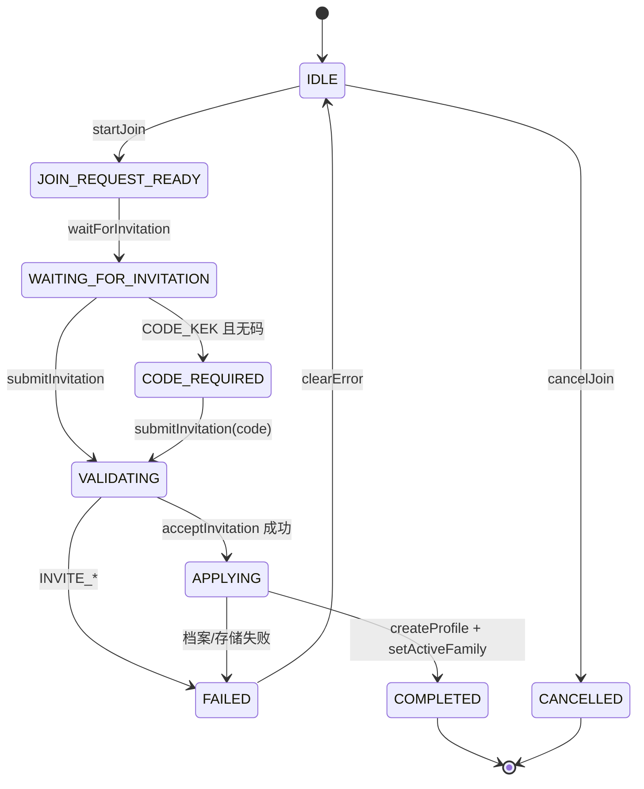

- Admin 生成邀请：`startInviteFromJoinRequest`/`createCodeInvitation` → `PENDING`；UI 展示 24h 倒计时/剩余次数。
- 成员接受后必须创建本地档案（每家庭一个），否则无法控制；`completeJoinWithProfile` 负责。
- `code` 只在生成时显示一次；VM 不得持久化/日志化；页面关闭即清空。
- `YCR1` 文本可复制/二维码；`YCI1` 可扫码/粘贴；不接受手工拼接键。

#### 11.3.3 房间删除/未分配池

- `RoomViewModel` 只展示 C-09 结果；确认必须传实际设备数；不得跳过确认。
- 删除后 `unassignedRecords` 重新加载；设备 `DEVICE_DISABLED` 状态；指派后恢复。
- 房间列表空态；允许创建第一个房间。

#### 11.3.4 场景进度

- `SceneExecutionProgress.steps` 逐项更新；UI 用 `currentIndex` 点亮；失败项红色、后续 `SKIPPED` 灰色；**不**把未执行步骤显示为成功。
- `PARTIAL_FAILED` 显示“已执行步骤未自动回滚”；提供“查看步骤”/“再次执行”（用户显式）。
- `SUCCEEDED` 才显示全部成功；`UNVERIFIED` 步骤显示“已执行，状态未回传”。
- 执行中禁止编辑场景；取消只停止后续步骤。

### 11.4 依赖注入与测试 seam（`DES-B-C22-SEAM`）

- 依赖：`FamilyService`/`RoomService`/`SceneService`/`DeviceRepository`/`AuthService`/`InviteService`/`I18nService`/`ClockPort`/`LoggerPort`；不 import 平台 API。
- host 测试：
  - 角色矩阵：ADMIN/MEMBER/GUEST 可见性/操作拒绝；最后一个 ADMIN；
  - 家庭切换 `requiresUnlock`；创建家庭 + profile；退出/转让/解散 plan；
  - 邀请状态/回执导入/弱模式文案键存在；`CODE_REQUIRED` 流程；
  - 房间删除预览/确认数不一致/成功刷新；未分配池；
  - 场景进度：SUCCEEDED/PARTIAL_FAILED/FAILED/CANCELLED；`noRollbackNotice=true`；
  - 取消/清错/刷新不产生网络请求（除服务调用）。
- device/UI：页面 RBAC 可见性/邀请二维码/场景浮层（可用时）；无设备 `UNAVAILABLE`。
- 夹具：`FamilyMemberFixture`、`InvitationFixture`、`RoomDeletionFixture`、`SceneProgressFixture`。

### 11.5 Traceability（`DES-B-C22-TRACE`）

| 需求/约束 | 映射 |
|---|---|
| FR-FAM-001..004 | FamilyViewModel；C-08 |
| FR-SET-001 | 成员管理面板 |
| FR-ROOM-001..006 | RoomViewModel；C-09/C-10 |
| FR-SCN-001 | SceneViewModel；C-11 |
| FR-FAM-002/003；D-009/D-010/D-013 | 邀请/回执/无实时在线/到期 |
| ADR-003 §5/§6/§9/§10；ADR-004 §2/§4 | 状态/边界 |
| UIUX §4.1/§4.2/§4.6 | 家庭/房间/场景交互 |
| DP-05/DP-06；SC-16 | 接触式收敛、GUEST 非密码学边界 |
| T-16 | 本组件主交付 |

---

## 12. C-23 BleProvisioning / Settings ViewModel 组

**契约 ID**：`DES-B-C23-API` / `DES-B-C23-ERR` / `DES-B-C23-STATE` / `DES-B-C23-SEAM` / `DES-B-C23-TRACE`
**职责**：配网状态机 UI 驱动、权限/取消/重试/清理、设置页语言/云/TLS/高级 IP/关于、Token 过期提示、手动 IP 强校验。
**路径**：`entry/src/main/ets/viewmodel/{BleProvisioningViewModel,SettingsViewModel}.ets`。

### 12.1 公开契约（`DES-B-C23-API`）

#### 12.1.1 `BleProvisioningViewModel`

```ts
export enum WizardStep {
  STEP_0_PERMISSION = 0,
  STEP_1_SCAN = 1,
  STEP_2_HANDSHAKE = 2,
  STEP_3_WIFI_SELECT = 3,
  STEP_4_APPLY = 4,
  STEP_5_BOUND = 5
}

export enum ProvisioningPermissionState {
  UNKNOWN = 'UNKNOWN',
  GRANTED = 'GRANTED',
  DENIED = 'DENIED',
  BLUETOOTH_OFF = 'BLUETOOTH_OFF'
}

export class BleProvisioningViewState {
  readonly phase: LoadPhase;
  readonly step: WizardStep;
  readonly provisioning: ProvisioningState;
  readonly permission: ProvisioningPermissionState;
  readonly scanResults: ReadonlyArray<BleProvisioningDevice>;
  readonly selectedDevice?: BleProvisioningDevice;
  readonly accessPoints: ReadonlyArray<WifiAp>;
  readonly selectedSsid?: string;
  readonly progress?: ProvisioningProgress;
  readonly result?: BleProvisioningResult;
  readonly error?: ViewModelError;
  readonly draftReady: boolean;
  readonly canCancel: boolean;
  readonly revision: number;
}

export class BleProvisioningViewModel implements ViewModelBase<BleProvisioningViewState> {
  constructor(ble: IBleProvisioningClient,
              gateways: GatewayRepository,
              families: FamilyService,
              drafts: SecretDraftPort,
              crypto: CryptoPort,
              permissions: PermissionPort,
              i18n: I18nService,
              clock: ClockPort,
              timer: TimerPort,
              logger: LoggerPort);

  getState(): BleProvisioningViewState;
  subscribe(listener: (state: BleProvisioningViewState) => void): () => void;

  initialize(familyId: string): Promise<void>;
  requestPermission(): Promise<void>;
  startScan(): Promise<void>;
  stopScan(): Promise<void>;
  selectDevice(device: BleProvisioningDevice): void;
  submit(pop: string, ssid: string, wifiPassword: string,
         commandSecretHex?: string): Promise<void>;
  retry(): Promise<void>;
  cancel(): Promise<void>;
  back(): void;
  dispose(): void;
}
```

**语义**：
- `initialize`：`step=STEP_0_PERMISSION`；`permission=UNKNOWN`；不自动扫描。
- `requestPermission`：调用 `permissions.ensure(PermissionKind.BLUETOOTH)`；权限拒绝 → `PROVISIONING_PERMISSION_DENIED`；蓝牙关闭 → `PROVISIONING_BLUETOOTH_OFF`；状态 `ProvisioningPermissionState`；10s 提示（BLE §7；PR-13）。`ble.startScan` 仍由 `BleTransport` 做最终权限检查。
- `startScan`：`step=STEP_1_SCAN`；`ble.startScan(filter, listener)`；结果去重（deviceId）；扫描 10s 无结果 → 提示重试，不伪造设备。
- `selectDevice`：选中后 `step=STEP_2_HANDSHAKE`（尚未真正握手，点击“下一步/开始”后 `submit`）。
- `submit`：
  1. 校验 `pop` 非空、`ssid` 非空、`wifiPassword` 非空（仅内存）；
  2. 生成/读取命令密钥草稿：`commandSecretHex` 为空 → `crypto.randomBytes(32)`；非空 → `BytesUtil.hexToBytes`，长度必须 ≥16B（否则 `PROVISIONING_CREDENTIAL_MISSING`/`SECRET_ENCODING_INVALID`）；`drafts.put(SecureBytes.from(...))` → `draftId`；成功后立即销毁本地副本；
  3. `ble.provision({device: selected, pop, credentialDraftId: draftId, ssid, wifiPassword, familyId, expectedGatewayId?}, listener, cancellation)`；
  4. listener 更新 `provisioning`/`progress`/`accessPoints`/`result`；
  5. 成功 → `gateways.commitBinding(result, draftId, familyId)` → `families.addGatewayToFamily(familyId, result.identity.gatewayId)` → `step=STEP_5_BOUND`；`result.credentialDraftId` 必须等于 draftId；
  6. 失败/取消 → `drafts.destroy(draftId)`（若未被 commitBinding 消费）；清空 pop/wifiPassword 引用；`error`。
- **清理**：任何 cancel/fail/back from step 2+ → `ble.cancel()`（stopScan+disconnect+destroy Security1）；`drafts.clearAll()`? 只销毁本 session 的草稿；清空输入字符串；不得留下 Wi-Fi 密码/PoP。
- `retry`：从 `FAILED` 重试；Wi-Fi AuthError → 回 `STEP_3_WIFI_SELECT` 重新输入；NetworkNotFound → 同；超时 → 提示；不自动重复无限次。
- `back`：STEP_3→STEP_2？配网已开始后“上一步”应取消并清理；只有 STEP_0/1 可自由后退；STEP_2+ 需确认取消。
- `cancel`：`ble.cancel` + `drafts.destroy` + 清空 secret 输入；state `CANCELLED`；不得显示成功。
- **完成判定**：`BleProvisioningResult` + `commitBinding` 成功才算绑定；BLE 成功 ≠ 绑定完成（DES-A §25.3 Note）。`families.addGatewayToFamily` 失败 → `error`（部分成功提示，可重试；route 已存在）。
- **新设备初始归属**：新网关发现的设备由 C-10 discover 导入为未分配/禁用；不在此 VM 直接创建设备。

#### 12.1.2 `SettingsViewModel`

```ts
export enum SettingsSection {
  LANGUAGE = 'LANGUAGE',
  CLOUD = 'CLOUD',
  SECURITY = 'SECURITY',
  ADVANCED = 'ADVANCED',
  NOTIFICATIONS = 'NOTIFICATIONS',
  ABOUT = 'ABOUT'
}

export class GatewaySecurityView {
  readonly gatewayId: string;
  readonly gatewayName: string;
  readonly profile: TransportProfile;      // P-HMAC / P-TLS-PIN（运行期 P-BLOCKED 另示）
  readonly effectiveProfile: TransportProfile;
  readonly tlsEnabled: boolean;
  readonly pinCount: number;
  readonly pinMatched?: string;            // 仅最近一次成功；不展示完整 pin? 可展示前 8 位
  readonly lastErrorKey?: string;
  readonly rotationRecommended: boolean;
}

export class ManualAddressResult {
  readonly accepted: boolean;
  readonly gatewayId: string;
  readonly latencyMs?: number;
  readonly error?: ViewModelError;
}

export class SettingsViewState {
  readonly phase: LoadPhase;
  readonly section: SettingsSection;
  readonly localeMode: LocaleMode;
  readonly currentLocale: SupportedLocale;
  readonly cloud?: CloudConfigView;
  readonly security: ReadonlyArray<GatewaySecurityView>;
  readonly advancedExpanded: boolean;
  readonly manualAddressResult?: ManualAddressResult;
  readonly motionEnabled: boolean;
  readonly notificationsEnabled: boolean;
  readonly appVersion: string;
  readonly pendingAction: boolean;
  readonly error?: ViewModelError;
  readonly revision: number;
}

export class SettingsViewModel implements ViewModelBase<SettingsViewState> {
  constructor(i18n: I18nService,
              cloud: CloudService,
              gateways: GatewayRepository,
              discovery: GatewayDiscoveryService,
              auth: AuthService,
              preferences: PreferencesStore,
              clock: ClockPort,
              logger: LoggerPort);

  getState(): SettingsViewState;
  subscribe(listener: (state: SettingsViewState) => void): () => void;

  initialize(): Promise<void>;
  setSection(section: SettingsSection): void;

  setLocaleMode(mode: LocaleMode): Promise<void>;
  saveCloudConfig(config: CloudConfig, token?: string): Promise<void>;
  testCloudConnection(): Promise<boolean>;
  clearCloudToken(): Promise<void>;

  refreshSecurity(): Promise<void>;
  setMotionEnabled(enabled: boolean): Promise<void>;
  setNotificationsEnabled(enabled: boolean): Promise<void>;

  setAdvancedExpanded(expanded: boolean): void;
  probeManualAddress(gatewayId: string, ip: string, port: number): Promise<ManualAddressResult>;

  clearError(): void;
  dispose(): void;
}
```

**语义**：
- `initialize`：读 locale mode/current locale、cloud state、security views、Preferences motion/notifications、app version（`AppScope/app.json5`/资源；不在代码硬编码）。
- `setLocaleMode`：`i18n.setLocaleMode`；成功后更新 state；`platformApplied=false` → 显示重启提示；失败 → error。
- `saveCloudConfig`：`cloud.validateConfig` → `cloud.saveConfig`；token 为空时保留现有 token；不把 token 写入 state；成功后 `cloud.testConnection` 可选（用户点“测试连接”）。
- `testCloudConnection`：`cloud.testConnection`；401/403 → `TOKEN_EXPIRED`；不自动刷新。
- `clearCloudToken`：调用 `cloud.clearToken()`；保留 endpoint/projectId/deviceId，仅删除 Asset Store token；`CloudTransportState` 变为 `TOKEN_MISSING`；UI 提示“请更新 IAM Token”；不自动删除配置。
- `refreshSecurity`：routes + `GatewaySecurityView`；effective profile 通过 `discovery.probeLastKnown` 获取 `ProbeResult.profile`/`tlsPinMatched`；探测不可用则显示持久 profile + `UNKNOWN`，不得把 P-BLOCKED 当 P-HMAC。
- `probeManualAddress`：`ManualAddressPolicy.validate` + `discovery.probeManual`；仅已绑定；成功更新 last-known；失败提示“不是已绑定的网关”；频率 ≥2s/5 次失败限制由 C-18 执行；Settings VM 只调用一次。
- `setMotionEnabled/setNotificationsEnabled`：Preferences 非秘密；影响 UI 动效/通知；不改变业务逻辑。
- `appVersion`：从 `AppScope/app.json5`/`bundleInfo` 读取（C-28）；不在代码写死版本。
- `about`：隐私/安全边界文案（P-HMAC 无机密性、GUEST 非密码学边界、Token 手工）强制存在。

### 12.2 错误（`DES-B-C23-ERR`）

| 场景 | 错误/i18n |
|---|---|
| 权限拒绝 | `PROVISIONING_PERMISSION_DENIED`；`provisioning.error.permission_denied` |
| 蓝牙关闭 | `PROVISIONING_BLUETOOTH_OFF`；`provisioning.error.bluetooth_off` |
| 未找到设备/多设备 | `PROVISIONING_DEVICE_NOT_FOUND`/`PROVISIONING_MULTIPLE_DEVICES` |
| 连接/MTU/GATT | `PROVISIONING_CONNECT_FAILED`/`MTU_TOO_SMALL`/`GATT_INCOMPLETE` |
| PoP/Security1/身份 | `PROVISIONING_POP_INVALID`/`SECURITY_HANDSHAKE_FAILED`/`IDENTITY_INVALID` |
| Wi-Fi 错误 | `PROVISIONING_WIFI_AUTH_ERROR`/`NETWORK_NOT_FOUND`/`WIFI_TIMEOUT` |
| 绑定探针失败 | `PROVISIONING_BINDING_PROBE_FAILED`/`BINDING_IDENTITY_MISMATCH`/`BOARD_LED_UNCONFIRMED` |
| 取消 | `PROVISIONING_CANCELLED` |
| 密钥草稿 | `PROVISIONING_SECRET_DRAFT_EXPIRED`/`CREDENTIAL_MISSING` |
| 云未配置/Token | `CLOUD_NOT_CONFIGURED`/`CLOUD_TOKEN_MISSING`/`CLOUD_TOKEN_EXPIRED` |
| 手动 IP | `MANUAL_ADDRESS_REJECTED`/`MANUAL_ADDRESS_NOT_BOUND` |
| 语言 | `I18N_*`；设置页回滚 |
| 存储 | `STORAGE_*` |

### 12.3 状态机与不变量（`DES-B-C23-STATE`）

#### 12.3.1 配网 6 步映射

| WizardStep | `ProvisioningState` | UI 要点 |
|---|---|---|
| 0 权限 | `PERMISSION` | 请求蓝牙权限；关闭蓝牙提示；10s 无结果提示 |
| 1 扫描 | `SCANNING` | `YaoCore-GW-*` + service UUID；去重；可取消 |
| 2 握手/身份 | `CONNECTING`/`DISCOVERING`/`CAPABILITY_CHECK`/`SECURITY_HANDSHAKE`/`SECURE_IDENTITY` | PoP 输入；Security1；身份 v2.0/v2.1；失败可重试 |
| 3 Wi-Fi 选择 | `AP_SCANNING` | AP 列表分页；选择 SSID；AuthError/NetworkNotFound 就地重试 |
| 4 下发/等待 | `SENDING_CREDENTIALS`/`WAITING_FOR_WIFI` | 30s 超时；密码错误提示；不显示明文密码 |
| 5 绑定完成 | `DISCOVERING_ON_LAN`/`BOUND` | 签名 discover + identity + board LED + commitBinding；成功才显示绑定 |

- 任一步取消：`ble.cancel()`（stopScan/disconnect/destroy Security1）+ 清 PoP/Wi-Fi/session key + 销毁草稿；状态 `CANCELLED`。
- `FAILED`：保留错误/步骤；可重试；不自动无限重试。
- `BOUND`：只有 `BleProvisioningResult` + `commitBinding` + `addGatewayToFamily` 成功；随后刷新 Home/Rooms（新设备未分配）。
- 配网成功不自动创建房间/设备；C-10 discover 导入。

#### 12.3.2 设置/Token 状态

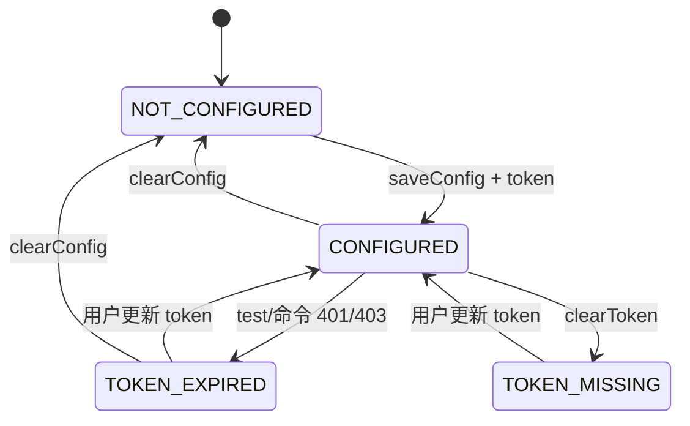

- Token 只手工更新；无自动刷新；过期提示必须明确“更新 IAM Token”。
- 设置页显示 P-HMAC/P-TLS-PIN/运行期 P-BLOCKED；P-HMAC 必须显示“仅完整性，无机密性”；P-TLS-PIN 显示 pin 状态；不得允许手工编辑 pin（仅 BLE 重新配网）。
- 手动 IP：默认折叠；仅已绑定；失败不猜测/不切换；移除硬编码默认 IP（D-015）。
- 语言：跟随系统/简体中文/English；即时生效；失败提示。
- 通知/动效：Preferences；不影响安全/业务。
- 关于：版本/隐私/开源地址；不展示 secret。

### 12.4 依赖注入与测试 seam（`DES-B-C23-SEAM`）

- 依赖：`IBleProvisioningClient`、`GatewayRepository`、`FamilyService`、`SecretDraftPort`、`CryptoPort`、`I18nService`、`CloudService`、`GatewayDiscoveryService`、`AuthService`、`PreferencesStore`、`ClockPort`、`TimerPort`、`LoggerPort`；不 import 平台 API。
- host 测试：
  - 6 步映射：每个 `ProvisioningState` → WizardStep；FAILED/CANCELLED；
  - 权限拒绝/蓝牙关闭；扫描 10s 无结果；
  - 密钥草稿生成/消费/销毁；`commitBinding` 成功后草稿被 C-07 消费；
  - 取消清理：`ble.cancel` 调用、`drafts.destroy`、Wi-Fi/PoP 字段清空；
  - Wi-Fi AuthError → 回 step3；NetworkNotFound；超时；
  - `commitBinding` 失败不显示 BOUND；`addGatewayToFamily` 失败提示；
  - Settings：locale 切换/apply 失败；cloud token 缺失/过期/更新；手动 IP 未绑定拒绝；P-HMAC 文案键存在；
  - 设置持久化/重启。
- device/IT：Mock BLE 全流程；真实 BLE 不在自动门禁（`UNAVAILABLE`）；设置页 UI smoke。
- 夹具：`BleProgressFixture`（每状态）、`CloudConfigFixture`、`GatewaySecurityFixture`。

### 12.5 Traceability（`DES-B-C23-TRACE`）

| 需求/约束 | 映射 |
|---|---|
| FR-GW-001/002/003 | 配网向导/权限/Security1/Wi-Fi/绑定 |
| FR-SET-002/003 | 安全配置/云/i18n 设置 |
| FR-HOME-001 | 云/网关状态展示 |
| ADR-002 §6/§7；ADR-004 §5/§7.2 | 通道档案/语言/高级 IP |
| D-012/D-015/D-016 | 手工 Token/高级 IP/门锁关联提示 |
| BLE §7；PR-13 | 10s 扫描/有限退避/清理 |
| UIUX §3/§4.5 | 6 步向导/设置页 |
| T-16/T-18 | VM 由 T-16；页面由 T-18 |

---

## 13. C-24 设计系统与复用 UI 组件

**契约 ID**：`DES-B-C24-API` / `DES-B-C24-ERR` / `DES-B-C24-STATE` / `DES-B-C24-SEAM` / `DES-B-C24-TRACE`
**职责**：主题 token（颜色/圆角/阴影/光晕/动效/节流常量）、背景光核、StatusBanner/ClimateCard/LightCard/DoorCard/SceneCard/RoomCard、通用按钮/输入/对话框/空状态；组件不直接访问仓储/传输。
**路径**：`entry/src/main/ets/common/theme/**`、`entry/src/main/ets/components/**`。
**规范来源**：UIUX §2/§5；STD §2.1/§2.2；I18N-07/08；CB §4.4。

### 13.1 公开契约（`DES-B-C24-API`）

#### 13.1.1 主题 token（`common/theme/**`）

```ts
export class AppColors {
  static ink(): ResourceColor;              // $r('app.color.ink')
  static inkSoft(): ResourceColor;
  static muted(): ResourceColor;
  static mutedLight(): ResourceColor;
  static surface(): ResourceColor;
  static surfaceStrong(): ResourceColor;
  static field(): ResourceColor;
  static edge(): ResourceColor;
  static line(): ResourceColor;
  static primary(): ResourceColor;
  static primaryDark(): ResourceColor;
  static green(): ResourceColor;
  static amber(): ResourceColor;
  static red(): ResourceColor;
  static orbApricot(): ResourceColor;       // 背景光核
  static orbMint(): ResourceColor;
  static orbAqua(): ResourceColor;
  static orbLilac(): ResourceColor;
}

export class AppMotionTokens {
  // 与 UIUX §5 同名常量（文档/评审可核对）
  static readonly SPRING_TOUCH: string = 'springMotion(0.35, 0.75)';
  static readonly SPRING_MODAL: string = 'springMotion(0.45, 0.82)';
  static readonly SPRING_REVERT: string = 'springMotion(0.50, 0.65)';

  // ArkUI 实际参数（curves.springMotion(response, dampingFraction)）
  static readonly SPRING_TOUCH_RESPONSE: number = 0.35;
  static readonly SPRING_TOUCH_DAMPING: number = 0.75;
  static readonly SPRING_MODAL_RESPONSE: number = 0.45;
  static readonly SPRING_MODAL_DAMPING: number = 0.82;
  static readonly SPRING_REVERT_RESPONSE: number = 0.50;
  static readonly SPRING_REVERT_DAMPING: number = 0.65;

  // 节流/超时（与 DES-A/C-21 对齐）
  static readonly THROTTLE_CONTINUOUS_MS: number = 55;
  static readonly TIMEOUT_CONTROL_ACK_MS: number = 3000;
  static readonly TIMEOUT_BLE_CONNECT_MS: number = 30000;
  static readonly TIMEOUT_DOOR_CONFIRM_MS: number = 10000;
  static readonly REVERT_SETTLE_MS: number = 320;

  // 阴影/光晕（UIUX §5）
  static readonly BASE_SHADOW: string = '0 18vp 60vp rgba(72,112,143,0.085), 0 2vp 9vp rgba(87,119,142,0.035)';
  static readonly ACCENT_SHADOW: string = '0 10vp 40vp rgba(105,159,192,0.13)';
  static readonly GLOW_AMBER: string = '0 13vp 37vp rgba(251,195,117,0.23)';
  static readonly GLOW_AQUA: string = '0 13vp 37vp rgba(127,202,239,0.21)';
  static readonly GLOW_MINT: string = '0 13vp 37vp rgba(115,202,168,0.17)';
  static readonly GLOW_LILAC: string = '0 13vp 37vp rgba(186,168,232,0.17)';

  // 光核周期（UIUX §2.2）
  static readonly ORB_APRICOT_PERIOD_MS: number = 32000;
  static readonly ORB_MINT_PERIOD_MS: number = 29000;
  static readonly ORB_AQUA_PERIOD_MS: number = 37000;
  static readonly ORB_LILAC_PERIOD_MS: number = 35000;
}

export class AppSpacing {
  static readonly xxs: number = 4;
  static readonly xs: number = 8;
  static readonly sm: number = 12;
  static readonly md: number = 16;
  static readonly lg: number = 24;
  static readonly xl: number = 32;
  static readonly xxl: number = 48;
}

export class AppRadius {
  static readonly card: number = 22;
  static readonly button: number = 13;
  static readonly chip: number = 999;
  static readonly modal: number = 28;
  static readonly field: number = 14;
}

export class AppTypography {
  static readonly display: number = 28;
  static readonly title: number = 22;
  static readonly section: number = 18;
  static readonly body: number = 15;
  static readonly label: number = 13;
  static readonly caption: number = 11;
  static readonly weightBold: FontWeight = FontWeight.Bold;
  static readonly weightMedium: FontWeight = FontWeight.Medium;
  static readonly weightRegular: FontWeight = FontWeight.Regular;
}

export class AppShadows {
  static readonly base: string = AppMotionTokens.BASE_SHADOW;
  static readonly accent: string = AppMotionTokens.ACCENT_SHADOW;
  static readonly glowAmber: string = AppMotionTokens.GLOW_AMBER;
  static readonly glowAqua: string = AppMotionTokens.GLOW_AQUA;
  static readonly glowMint: string = AppMotionTokens.GLOW_MINT;
  static readonly glowLilac: string = AppMotionTokens.GLOW_LILAC;
}
```

**规则**：
- 颜色必须来自 `resources/base|dark/element/color.json`，经 `$r` 引用；组件不得写死 `#RRGGBB`（I18N-08）。
- 动效 token 必须引用 `AppMotionTokens`；不得在页面内散落 magic number；`prefers-reduced-motion`/设置“光影动效”关闭时，长动画降级为 150ms 淡入/无位移。
- `AppTypography` 只给字号/字重；文本容器必须允许 20-40% 膨胀（I18N-07），避免固定宽度按钮。
- 光核背景 `GlassSurface`/`AmbientBackground` 使用 `blur` 62px、低饱和；不得遮挡交互/降低对比度。

#### 13.1.2 通用状态/变体

```ts
export enum AsyncUiState {
  LOADING = 'LOADING',
  READY = 'READY',
  EMPTY = 'EMPTY',
  ERROR = 'ERROR',
  DISABLED = 'DISABLED',
  READ_ONLY = 'READ_ONLY'
}

export enum CardVisualState {
  IDLE = 'IDLE',
  PENDING = 'PENDING',
  COMMITTED = 'COMMITTED',
  REVERT = 'REVERT',
  OFFLINE = 'OFFLINE',
  DISABLED = 'DISABLED',
  READ_ONLY = 'READ_ONLY'
}

export class UiAction {
  readonly id: string;
  readonly labelKey: string;               // 页面传入 key；组件不拼接文案
  readonly enabled: boolean;
  readonly destructive: boolean;
}
```

#### 13.1.3 复用组件 props/events

> 以下为 ArkUI 组件的公开字段契约；实现可使用 `@Prop`/`@Link`/`@ObjectLink`，但字段名/语义不得改变。所有组件额外声明 `@Consume('i18n') i18n: I18nService` 与 `@Consume('localeRevision') localeRevision: number`；用户可见文本通过 `t()` 或页面传入的 `*Key` 解析；组件不直接调用仓储/VM。

```ts
@Component
export struct StatusBanner {
  @Prop familyName: string;
  @Prop gateway: GatewayStatus;
  @Prop cloud: CloudLinkState;
  @Prop isRefreshing: boolean;
  onFamilyClick: () => void;
  onGatewayClick: () => void;
  onRefresh: () => void;
}

@Component
export struct RoomChipBar {
  @Prop rooms: ReadonlyArray<Room>;
  @Prop selectedFilter: DeviceFilter;
  onSelect: (filter: DeviceFilter) => void;
}

@Component
export struct ClimateCard {
  @Prop record: DeviceRecord;
  @Prop ac: AcViewState;
  @Prop control: ControlUiState;
  @Prop roomName?: string;
  onPower: () => void;
  onMode: (mode: AcMode) => void;
  onTemperatureChange: (value: number) => void;
  onTemperatureCommit: (value: number) => void;
  onOpenDetail: () => void;
}

@Component
export struct LightCard {
  @Prop record: DeviceRecord;
  @Prop control: ControlUiState;
  @Prop roomName?: string;
  onToggle: () => void;
  onBrightnessChange: (value: number) => void;
  onBrightnessCommit: (value: number) => void;
  onColor: (color: string) => void;
  onOpenDetail: () => void;
}

@Component
export struct DoorCard {
  @Prop record: DeviceRecord;
  @Prop door: DoorUiState;
  @Prop control: ControlUiState;
  @Prop roomName?: string;
  onOpen: () => void;
  onClose: () => void;
  onConfigureLink: () => void;
  onDismissAlert: () => void;
  onOpenDetail: () => void;
}

@Component
export struct SceneCard {
  @Prop scene: Scene;
  @Prop isRunning: boolean;
  @Prop lastResult?: SceneExecutionResult;
  onRun: () => void;
  onEdit: () => void;
}

@Component
export struct RoomCard {
  @Prop room: Room;
  @Prop deviceCount: number;
  @Prop unassignedCount: number;
  onOpen: () => void;
  onRename: () => void;
  onDelete: () => void;
}

@Component
export struct UnassignedPool {
  @Prop records: ReadonlyArray<DeviceRecord>;
  @Prop rooms: ReadonlyArray<Room>;
  onAssign: (key: DeviceKey, roomId: string) => void;
  onDelete: (key: DeviceKey) => void;
  onRefresh: () => void;
}

@Component
export struct DeviceGrid {
  @Prop records: ReadonlyArray<DeviceRecord>;
  @Prop controls: ReadonlyArray<ControlUiState>;
  @Prop rooms: ReadonlyArray<Room>;
  onOpen: (key: DeviceKey) => void;
  onQuickToggle: (key: DeviceKey) => void;
}

@Component
export struct SensorTile {
  @Prop record: DeviceRecord;
  @Prop roomName?: string;
  onOpen: (key: DeviceKey) => void;
}
```

**通用组件**：
- `GlassSurface`：`@Prop blurRadius: number`、`@Prop surface: ResourceColor`、`@Prop radius: number`、`@BuilderParam content`。
- `SectionHeader`：`@Prop titleKey: string`、`@Prop action?: UiAction`、`onAction`。
- `PrimaryButton`：`@Prop labelKey: string`、`@Prop enabled: boolean`、`@Prop loading: boolean`、`@Prop destructive: boolean`、`onClick`。
- `IconButton`：`@Prop icon: Resource`、`@Prop labelKey: string`、`@Prop enabled`、`onClick`；必须有 `accessibilityText`。
- `AppDialog`：`@Prop titleKey: string`、`@Prop messageKey: string`、`@Prop confirmKey: string`、`@Prop cancelKey: string`、`@Prop destructive`、`onConfirm`、`onCancel`。
- `TextField`：`@Prop labelKey`、`@Prop value`、`@Prop placeholderKey`、`@Prop password: boolean`、`@Prop errorKey?`、`onChange`。
- `SliderControl`：`@Prop value: number`、`@Prop min`、`@Prop max`、`@Prop step`、`@Prop enabled`、`onChange`、`onCommit`；内部只做 UI 值，不直接发命令。
- `EmptyState`：`@Prop illustration?`、`@Prop titleKey`、`@Prop messageKey`、`@Prop action?: UiAction`、`onAction`。
- `ErrorState`：`@Prop titleKey`、`@Prop messageKey`、`@Prop retryKey`、`onRetry`；不展示 `AppError.message`。
- `LoadingSkeleton`：`@Prop rows: number`、`@Prop cardHeight: number`。

#### 13.1.4 组件状态与视觉

| 状态 | 视觉 | 交互 |
|---|---|---|
| `IDLE` | 毛玻璃卡片、基础阴影 | 可操作 |
| `PENDING` | 微光环绕/微透明；滑块跟手 | 禁止重复提交同动作 |
| `COMMITTED` | 短暂 accent glow/轻震（可关） | 恢复可操作 |
| `REVERT` | 琥珀色微光脉冲 + 弹性回弹 | 不阻断其他卡片 |
| `OFFLINE` | 降低饱和、显示离线标签 | 可查看，不可控制（按 C-12/设备状态） |
| `DISABLED` | 置灰、锁图标、说明“未分配/已禁用” | 不可控制 |
| `READ_ONLY` | 只读标签“暂不支持控制” | 可查看状态；不显示控制 |

- 禁止用颜色 alone 表达状态；必须有文本/图标（可访问性）。
- `ClimateCard`/`LightCard` 的滑杆视觉值在 PENDING 时跟手；`COMMITTED` 后才更新 confirmed；`REVERT` 动画回 confirmed。
- `DoorCard` 文案严格使用 `door.state.secured/unconfirmed/unknown`；`UNVERIFIED` 用 `door.link.unverified`，不得用“已锁好”。

### 13.2 错误（`DES-B-C24-ERR`）

| 场景 | 处理 |
|---|---|
| props 非法（空场景/负计数/未知状态） | 组件内降级到 `EMPTY`/`UNKNOWN`，记录开发日志；不抛给用户 |
| i18n key 缺失 | `t()` 返回 key 文本；CHK-06 阻断 |
| 颜色资源缺失 | 构建期资源检查/评审；不得回退硬编码 |
| 动效关闭/系统降低动效 | 使用短淡入/无位移；不得失效功能 |
| 长文本溢出 | 允许换行/省略；20-40% 膨胀；不得截断关键安全文案 |

### 13.3 状态机与不变量（`DES-B-C24-STATE`）

1. **单一设计系统**：所有页面/组件使用 `AppColors`/`AppMotionTokens`/`AppSpacing`/`AppRadius`/`AppTypography`；禁止页面自定义一套颜色/圆角。
2. **暗黑模式**：颜色必须同时存在于 `base`/`dark`；组件不判断 `isDark` 分支（由资源系统切换）；背景光核在暗黑下降低不透明度。
3. **文本膨胀**：按钮/卡片不得固定像素宽度；标题/正文允许 2 行；安全边界文案不得省略。
4. **状态一致性**：`CardVisualState` 与 `ControlUiState.phase` 映射固定：IDLE→IDLE，PENDING→PENDING，COMMITTED→COMMITTED，REVERT→REVERT；设备离线/禁用/只读覆盖控制态。
5. **可访问性**：所有交互控件 ≥44vp 触达；`accessibilityText` 必填；状态变化需可被读屏感知（`accessibilityDescription`）；对比度满足 WCAG AA（评审）。
6. **动效**：只使用 `AppMotionTokens`；页面切换/卡片展开/回弹；关闭动效时功能不变。
7. **空/加载/错误**：每个列表/页面必须有 `LoadingSkeleton`/`EmptyState`/`ErrorState`；不得用空白代替错误。
8. **无业务逻辑**：组件不计算 RBAC/状态仲裁/ACK 判定；只展示 VM 传入的值。
9. **运行时语言切换**：组件通过 `@Consume('i18n')` 取 `I18nService`、`@Consume('localeRevision')` 触发重建；`build()` 中调用 `t()` 时必须引用 `localeRevision`（如 `this.localeRevision;`）以确保语言切换后重渲染；不得缓存 `t()` 结果到静态字段。
10. **组件测试**：UI smoke 需 `@Provide` 假 i18n/revision；纯逻辑抽离到 `components/support/**` 以便 host 测试。

### 13.4 依赖注入与测试 seam（`DES-B-C24-SEAM`）

- 依赖：`common/theme/**`、`model/**`、`components/**`、C-14 `I18nService`（`@Consume('i18n')`）；不 import 仓储/传输/平台 API。
- 纯逻辑抽离：`CardVisualState` 映射、`formatValue`/`clamp`/`remainingCountdown` 等放在 `components/support/*.ets` 纯函数，host 可测。
- UI 测试限制：无设备/模拟器时只做 ArkTS 编译 + `ohosTest` smoke；视觉/动画/触感标 `UNAVAILABLE`；不得声称 UI PASS。
- i18n：CHK-07 扫描 `components/**`；所有 `Text`/`Button` 文案键存在；`en-US` 长文本不截断（人工/截图评审）。
- 可访问性：静态检查 `accessibilityText` 覆盖交互控件；评审抽查。

### 13.5 Traceability（`DES-B-C24-TRACE`）

| 需求/约束 | 映射 |
|---|---|
| UIUX §2/§5 | 颜色/光核/动效 token |
| STD §2.1/§2.2 | UI 只建视图树/数据绑定 |
| I18N-07/08 | 文本膨胀/颜色资源 |
| FR-HOME-004、FR-DEV-002/003/004 | 卡片组件 |
| FR-SCN-001 | SceneCard/进度 |
| T-17 | 本组件主交付 |

---

## 14. C-25 Home / Rooms / DeviceControl 页面

**契约 ID**：`DES-B-C25-API` / `DES-B-C25-ERR` / `DES-B-C25-STATE` / `DES-B-C25-SEAM` / `DES-B-C25-TRACE`
**职责**：4 Tab 中的 Home/Rooms、房间列表/未分配池、设备控制页（灯/空调/门锁/传感器）、三态反馈、门锁四阶段、场景入口。
**路径**：`entry/src/main/ets/pages/{HomePage,RoomsPage,DeviceControlPage}.ets`。

### 14.1 公开契约（`DES-B-C25-API`）

#### 14.1.1 页面与路由参数

```ts
export class HomeRouteParams {
  readonly familyId?: string;              // 缺省 activeFamily
}
export class RoomsRouteParams {
  readonly familyId?: string;
  readonly highlightRoomId?: string;
}
export class DeviceControlRouteParams {
  readonly gatewayId: string;
  readonly deviceId: string;
  readonly roomId?: string;                // 仅来源上下文，不作为真相
}
```

- `HomePage`：Tab 0；无参数；`HomeViewModel`。
- `RoomsPage`：Tab 1；`RoomViewModel` + `DeviceViewModel`（房间过滤）；`highlightRoomId` 用于从首页跳转。
- `DeviceControlPage`：NavDestination；`gatewayId`+`deviceId`；按设备类型选择 `DeviceViewModel`/`ClimateViewModel`/`DoorViewModel`。
- 页面不直接 `new` VM；由 C-28 组合根/页面工厂注入。

#### 14.1.2 HomePage 组件树

```text
HomePage
├── AmbientBackground（光核）
├── StatusBanner（家庭名/网关/云/刷新）
├── FamilySwitchSheet（弹窗，按需）
├── EnvironmentPanel（SHT30/PIR，来源/时间戳）
├── RoomChipBar（全部/各房间）
├── QuickDeviceGrid（常用设备卡片）
│   ├── LightCard
│   ├── ClimateCard
│   ├── DoorCard
│   └── SensorTile（只读）
├── SceneShortcutRow（场景入口，可选）
├── EmptyState（无家庭/无设备）
└── ErrorState/LoadingSkeleton
```

- `StatusBanner` 显示家庭名、LAN/云/离线、IP、RTT；点击家庭名打开切换；点击网关打开诊断/设置。
- `EnvironmentPanel` 显示温度/湿度/PIR + 时间戳 + `stateSource` 标签；未知来源用 `stateSource.unknown`；无数据空态。
- `QuickDeviceGrid` 只显示 `isControlAllowed` 或只读降级设备；禁用/只读显示标签；不得隐藏已知设备（D-011）。
- 房间过滤使用 `DeviceFilter`；`ALL`/`ROOM`；未分配设备不在首页快捷卡片（在 Rooms 池）。
- 场景入口可进入 Scenes Tab 或直接运行最近场景；运行进度由 C-26 ScenePage 展示。

#### 14.1.3 RoomsPage 组件树

```text
RoomsPage
├── StatusBanner（简化）
├── RoomGrid（RoomCard）
├── RoomDeviceList（按 selected room 分组）
├── UnassignedPool（安全禁用池）
├── AddRoomButton
├── RoomDeleteDialog（阻断式）
├── AssignRoomDialog
└── EmptyState/ErrorState/LoadingSkeleton
```

- `RoomCard` 显示房间名、设备数、未分配数；点击进入该房间设备列表；长按/菜单改名/删除。
- `RoomDeleteDialog` 必须显示：房间名、设备数、设备将进入未分配池并保护性禁用、不会删除物理设备；确认按钮 destructive；用户必须再次确认。
- `UnassignedPool` 显示设备名/类型/在线状态/“未分配/已禁用”；提供“指派房间”“删除设备”；删除设备需二次确认并提示场景引用将被清理。
- `AssignRoomDialog` 只列出同家庭房间；选择后立即指派并启用。
- 房间空态：创建第一个房间；设备空态：去配网/发现。

#### 14.1.4 DeviceControlPage 组件树

```text
DeviceControlPage
├── DeviceHeader（名称/房间/在线/来源）
├── Type-specific control:
│   ├── LightControl（开关/亮度滑杆/颜色）
│   ├── ClimateControl（开关/目标温度/模式 7 值）
│   ├── DoorControl（开/关/四阶段状态/关联门磁/报警）
│   └── SensorControl（只读温湿度/PIR/来源）
├── UnsupportedBanner（只读降级）
├── DisabledBanner（未分配/禁用）
├── DeviceInfoSection（gatewayId/deviceId/最近更新）
├── RenameDeviceDialog
├── DoorLinkDialog（一次性引导）
└── ErrorState/LoadingSkeleton
```

- 控制页只控制当前设备；跨设备批量控制归场景。
- Light：`SliderControl` 0..100，`begin/update/end` 55ms；颜色选择弹出；TouchUp 强同步。
- Climate：温度滑杆 16..30，模式 7 值；非标准模式只读展示，不显示可选项；品牌显示 `brand.*`。
- Door：`lock/unlock`；四阶段状态条；`UNVERIFIED/UNCONFIRMED/UNKNOWN` 文案；关联门磁入口（可选）；报警提示。
- Sensor：只读；温湿度/PIR/来源/时间戳；不显示控制。
- `UnsupportedBanner`：`device.unsupported.read_only`；`DisabledBanner`：未分配/禁用原因；控制按钮 disabled。
- 设备被删除/网关移除：页面显示“设备已移除”并返回；不崩溃。

### 14.2 错误（`DES-B-C25-ERR`）

| 场景 | UI |
|---|---|
| 设备不存在/已删除 | `ErrorState` + 返回；`device.not_found` |
| 网关离线/超时 | 卡片/页面 Toast + REVERT；`errors.app.gateway_*` |
| 设备禁用/未分配 | `DisabledBanner` + 禁用控件 |
| 只读降级 | `UnsupportedBanner` + 无控制 |
| 门锁未确认/无法确认 | `door.state.unconfirmed/unknown` + 报警；不得显示成功 |
| 家庭切换需解锁 | Index `SessionGateView`；不显示旧家庭数据 |
| 加载/空 | `LoadingSkeleton`/`EmptyState`；不显示空白成功 |

### 14.3 状态机与不变量（`DES-B-C25-STATE`）

1. **页面生命周期**：`aboutToAppear` 订阅 VM → `initialize/refresh`；`aboutToDisappear` 取消订阅/`dispose`；返回时刷新不重复创建 VM。
2. **数据一致性**：页面只渲染 `DeviceRecord`；`roomName` 由 `rooms` join；不得用 `snapshot.roomNameHint` 作为当前归属。
3. **三态**：卡片/控件按 `ControlUiState.phase` 显示；PENDING 不得禁用整个页面；REVERT 只影响当前设备。
4. **门锁**：阶段文案严格；`UNVERIFIED` 常驻提示；跳过关磁引导不阻止开锁。
5. **房间删除**：确认对话框阻断；未确认不得调用服务；设备数变化时重新预览。
6. **导航**：从 Home 房间芯片跳到 Rooms 选中房间；从设备卡片进控制页；返回保持 Tab 状态。
7. **i18n/可访问性**：所有文案键存在；交互控件 ≥44vp；状态变化可读屏；无颜色 alone。

### 14.4 依赖注入与测试 seam（`DES-B-C25-SEAM`）

- 依赖：`HomeViewModel`/`RoomViewModel`/`DeviceViewModel`/`ClimateViewModel`/`DoorViewModel`、C-24 组件、C-14 i18n；不直接 import 仓储/传输。
- host 可测：页面绑定的 selector/格式化纯函数；VM 状态映射；房间删除确认条件；门锁文案键选择。
- UI smoke（ohosTest，设备/模拟器可用）：启动 → Home → Rooms → DeviceControl → 返回；无设备时标 `UNAVAILABLE`。
- 视觉评审：光核/毛玻璃/暗黑/长英文；截图证据（可用时）。
- 夹具：`PageStateFixture`（空/错误/加载/离线/禁用/只读/三态/门锁）。

### 14.5 Traceability（`DES-B-C25-TRACE`）

| 需求/约束 | 映射 |
|---|---|
| FR-HOME-001..004 | HomePage/StatusBanner/EnvironmentPanel/QuickDeviceGrid |
| FR-ROOM-001..006 | RoomsPage/UnassignedPool/RoomDeleteDialog |
| FR-DEV-001..005 | DeviceControlPage/三态/门锁/AC/来源 |
| UIUX §3/§4.2-4.4 | 页面/交互 |
| ADR-004 §2/§6；D-011/D-016 | 池/只读/门锁 |
| T-17 | 本组件主交付 |

---

## 15. C-26 Family / Room / Scene 页面

**契约 ID**：`DES-B-C26-API` / `DES-B-C26-ERR` / `DES-B-C26-STATE` / `DES-B-C26-SEAM` / `DES-B-C26-TRACE`
**职责**：家庭成员/权限/邀请（YCR1/YCI1 展示与扫码/粘贴）、房间管理、场景卡片/执行反馈。
**路径**：`entry/src/main/ets/pages/{FamilyManagePage,RoomManagePage,ScenePage}.ets`。

### 15.1 公开契约（`DES-B-C26-API`）

#### 15.1.1 路由参数

```ts
export class FamilyRouteParams {
  readonly familyId?: string;
  readonly section?: FamilySection;        // 默认 MEMBERS
}
export class RoomManageRouteParams {
  readonly familyId?: string;
  readonly roomId?: string;                // 有值=编辑；无值=新建
}
export class SceneRouteParams {
  readonly familyId?: string;
  readonly sceneId?: string;               // 可选：打开编辑
}
```

#### 15.1.2 FamilyManagePage

```text
FamilyManagePage
├── FamilyHeader（家庭名/角色/切换）
├── SegmentedTabs（成员/邀请/加入/家庭）
├── MembersSection
│   ├── MemberRow（displayName/role/status/syncState/lastSyncedAt）
│   ├── MemberActions（改角色/移出/延长 GUEST）
│   └── AddMemberButton（Admin）
├── InvitesSection
│   ├── JoinRequestPanel（成员出示 YCR1：二维码/复制）
│   ├── CreateInvitePanel（Admin：扫码/粘贴 YCR1；或弱模式 6 位码）
│   ├── InvitationRow（角色/模式/倒计时/剩余次数/回执状态）
│   └── ReceiptImportPanel（Admin 扫码/粘贴回执）
├── JoinSection（成员输入 YCI1/6 位码；状态机）
├── FamilySection（转让 Admin/退出/解散/轮换提示）
├── WeakModeWarning / GuestScopeNotice（强制文案）
└── Dialogs（移除/转让/解散/退出）
```

**行为**：
- ADMIN：成员管理/邀请/移除/转让/解散可见；MEMBER/GUEST 隐藏/禁用；服务层再次校验。
- 成员列表显示 `lastSyncedAt`/`syncState`，**不显示在线**；文案“最近同步/未同步”。
- 邀请：默认 KEY_WRAP（成员先出示 YCR1）；Admin 扫码/粘贴后生成 YCI1，展示二维码/复制；CODE_KEK 仅显式选择，显示弱模式警告 + 6 位码 + 24h 倒计时；码只显示一次。扫码使用系统 ScanKit/相机；扫码入口先 `PermissionPort.ensure(CAMERA)`，相机权限拒绝时**必须**保留粘贴文本入口（不得阻断邀请）。
- 加入：成员出示 YCR1（二维码/复制）；输入 YCI1 或 6 位码；成功后创建本地档案（密码）；显示加入成功；失败按 `INVITE_*` 文案。
- 回执：Admin 导入回执；成功 `ACCEPTED`/`usedCount++`；失败 `INVITE_RECEIPT_INVALID`；未到达显示 `PENDING`。
- 移除成员：二次确认 + 轮换提示（默认勾选“查看轮换引导”）；不自动执行 BLE。
- 转让 Admin：选择 ACTIVE MEMBER；确认；本地更新。
- 解散家庭：仅 ADMIN；二次确认；展示 gatewayIds/轮换/解绑建议；成功后返回 Home/空态。
- GUEST 到期：`EXPIRED` 只读可见；Admin 可续期；到期提示轮换。
- 安全文案强制：`invite.security.weak_mode_warning`、`invite.security.guest_scope_not_crypto`、`family.last_admin`。

#### 15.1.3 RoomManagePage

```text
RoomManagePage
├── RoomList（拖拽排序/图标/名称）
├── RoomEditSheet（新建/改名/图标）
├── DeleteRoomDialog（设备数/未分配池警告）
├── AssignDeviceSheet（房间内设备/未分配设备）
└── EmptyState/ErrorState
```

- 排序保存调用 `RoomViewModel.reorderRooms`；失败回滚 UI 顺序。
- 删除必须走 `previewDelete` + `confirmDelete`；显示设备数与“不删除物理设备”。
- 改名只改 `roomName`；不触发协议/不改变设备归属。
- 未分配设备可指派；指派后启用。

#### 15.1.4 ScenePage

```text
ScenePage
├── SceneList（SceneCard；启用/禁用/动作数/最近结果）
├── RunSceneOverlay（步骤列表/进度/失败原因）
├── SceneEditSheet（名称/图标/动作列表/设备选择/值编辑）
├── NoRollbackBanner（强制）
└── EmptyState/ErrorState
```

- `SceneCard` 显示场景名/图标/动作数；执行中禁用其他执行；可取消。
- 运行浮层逐步显示：`[✓]` 成功、`[✗]` 失败、`[–]` 跳过；失败时显示“已执行步骤未自动回滚”（`scene.no_rollback`）。
- `SceneEditSheet` 只允许受支持、已分配、启用设备；动作类型/值受 C-16/C-11 约束；保存前预检（可复用 C-11 校验）；不合法给字段错误。
- 场景为空/全禁用：显示空态/禁用说明；不得执行。
- 最近结果不持久化为“成功”；仅本次会话展示。

### 15.2 错误（`DES-B-C26-ERR`）

| 场景 | UI |
|---|---|
| 非 ADMIN | 入口隐藏/禁用；`auth_rbac_denied` 文案 |
| 最后一个 ADMIN | 阻断 + `family.last_admin` |
| 邀请/回执失败 | `errors.app.invite_*` toast/dialog；不泄露 oracle 细节 |
| 房间删除未确认/设备数变化 | 重新 preview；不执行 |
| 场景预检失败 | 显示失败项/原因；0 命令提示 |
| 场景局部失败 | 步骤 `[✗]` + no-rollback banner；不显示成功 |
| 场景取消 | 显示已执行/已跳过；不报错红色 |
| 扫码/粘贴非法 | `invite.invalid`；保留输入可编辑 |
| 存储/网络 | `errors.app.storage_*`/`gateway_*`；重试 |

### 15.3 状态机与不变量（`DES-B-C26-STATE`）

1. **RBAC 可见性**：按 `FamilyCapabilities` 渲染；隐藏不是授权；服务层仍拒绝。
2. **邀请流程**：Admin/成员两侧状态机与 C-08/C-22 一致；二维码/文本只含容器，不含 secret；码只显示一次。
3. **家庭切换**：切换后清空旧家庭页面状态；需要解锁时进入 Index `SessionGateView`；不展示旧成员/设备。
4. **删除确认**：房间删除阻断式；设备删除二次确认；解散/退出二次确认；所有 destructive 按钮使用 `AppColors.red()`。
5. **场景进度**：只渲染 C-11 `SceneExecutionProgress`；不推断成功；`PARTIAL_FAILED` 必显 no-rollback。
6. **长文本/暗黑**：邀请码/安全警告在 en-US 下不截断；暗黑对比度；可访问性。

### 15.4 依赖注入与测试 seam（`DES-B-C26-SEAM`）

- 依赖：`FamilyViewModel`/`RoomViewModel`/`SceneViewModel`、C-24、C-14；不直接 import 服务/仓储。
- host 可测：页面 selector（成员/邀请/场景步骤视图模型）、RBAC 可见性、删除确认条件、场景结果文案选择。
- UI smoke：Family/Room/Scene 页面导航/弹窗/二维码占位；无设备 `UNAVAILABLE`。
- 夹具：`FamilyPageFixture`（角色/邀请/到期）、`ScenePageFixture`（进度/失败/取消）。

### 15.5 Traceability（`DES-B-C26-TRACE`）

| 需求/约束 | 映射 |
|---|---|
| FR-FAM-001..004、FR-SET-001 | FamilyManagePage |
| FR-ROOM-001..006 | RoomManagePage |
| FR-SCN-001 | ScenePage |
| ADR-003 §5/§6/§8/§10；D-009/D-010/D-013 | 邀请/回执/撤销/退出 |
| ADR-004 §2/§4 | 房间/池/GUEST |
| UIUX §4.1/§4.2/§4.6 | 页面交互 |
| DP-05/DP-06；SC-16 | 安全文案/无实时在线 |
| T-18 | 本组件主交付 |

---

## 16. C-27 Provisioning / Settings / About / Profile 页面

**契约 ID**：`DES-B-C27-API` / `DES-B-C27-ERR` / `DES-B-C27-STATE` / `DES-B-C27-SEAM` / `DES-B-C27-TRACE`
**职责**：6 步配网向导、权限/取消/错误、设置（语言/云/安全/高级 IP/通知）、关于/隐私说明、Profile Tab。
**路径**：`entry/src/main/ets/pages/{ProvisioningPage,SettingsPage,AboutPage,ProfilePage}.ets`。

### 16.1 公开契约（`DES-B-C27-API`）

#### 16.1.1 路由参数

```ts
export class ProvisioningRouteParams {
  readonly familyId?: string;
  readonly mode?: 'NEW_GATEWAY' | 'RECONFIGURE' | 'ROTATE_SECRET';
  readonly expectedGatewayId?: string;
}
export class SettingsRouteParams {
  readonly section?: SettingsSection;
}
export class AboutRouteParams {
  readonly from?: 'PROFILE' | 'SETTINGS';
}
export class ProfileRouteParams {
  readonly familyId?: string;
}
```

#### 16.1.2 ProvisioningPage（6 步）

```text
ProvisioningPage
├── StepIndicator（0..5；失败/取消态）
├── Step0Permission
│   ├── RequestPermissionButton
│   └── BluetoothOffHint / PermissionDeniedHint
├── Step1Scan
│   ├── ScanList（YaoCore-GW-*；RSSI；去重）
│   └── RescanButton（10s 无结果提示）
├── Step2Handshake
│   ├── PopField（password；仅内存）
│   ├── Progress（CONNECTING..SECURE_IDENTITY）
│   └── RetryButton
├── Step3WifiSelect
│   ├── ApList（SSID/RSSI/分页）
│   └── ManualSsid?（如支持）
├── Step4Apply
│   ├── WifiPasswordField（password；仅内存）
│   ├── ApplyButton
│   └── Progress/Timeout
├── Step5Bound
│   ├── SuccessSummary（gatewayName/id；不显示 secret）
│   ├── AddRoomHint（新设备进入未分配池）
│   └── DoneButton
├── CancelButton（任意步骤）
└── ErrorState（按 provisioning.error.*）
```

**行为**：
- Step0：请求权限；拒绝/蓝牙关闭显示对应提示与“去设置”；不继续扫描。
- Step1：扫描 `YaoCore-GW-*` + service UUID；10s 无结果提示重试；多设备选择；不按名称猜测身份。
- Step2：输入 PoP；Security1；身份 v2.0/v2.1；失败重试；错误按 `provisioning.error.*`；取消清理。
- Step3：AP 列表；选择 SSID；AuthError/NetworkNotFound 就地提示；允许重试。
- Step4：Wi-Fi 密码（password 输入，禁止复制/日志）；30s 超时；失败回 Step3 或重试；取消清理。
- Step5：绑定探针（discover HMAC + identity + board LED）成功 + `commitBinding` + `addGatewayToFamily` 后显示成功；新设备进入未分配池；提供“去房间指派”。
- 任意步骤取消：停止扫描/断开 GATT/销毁 Security1/清 PoP/Wi-Fi/草稿；显示已取消，不显示成功。
- `RECONFIGURE`/`ROTATE_SECRET`：复用同一向导，`expectedGatewayId` 校验；轮换需重新输入/生成 command secret；成功后更新 route/secret；提示成员需重新分发凭据（ADR-003 §6.1）。

#### 16.1.3 SettingsPage

```text
SettingsPage
├── LanguageSection（跟随系统/简体中文/English；即时切换）
├── CloudSection（endpoint/projectId/deviceId/token；测试连接；Token 过期提示）
├── SecuritySection（逐网关 P-HMAC/P-TLS-PIN/P-BLOCKED；pin 状态；轮换引导）
├── AdvancedSection（折叠：手动 IP/端口；仅已绑定；强校验）
├── NotificationsSection（通知开关；系统权限状态）
├── AppearanceSection（光影动效开关；暗黑跟随系统）
├── AboutEntry
└── ErrorState/Toast
```

**行为**：
- 语言：三项；切换即时生效；`platformApplied=false` 显示“部分文案需重启”；失败回滚。
- 云：输入 endpoint/projectId/deviceId/token；token password 输入；保存前 `validateConfig`；`testConnection` 显示成功/401/403/网络错误；Token 过期明确提示“更新 IAM Token”，无自动刷新；`clearToken` 保留配置。
- 安全：显示每网关持久 profile/effective profile/pinCount/最近错误；P-HMAC 显示“仅完整性，无机密性”；P-TLS-PIN 显示“TLS + pin”；P-BLOCKED 显示重新配网入口；**不允许手工添加/编辑 pin**；轮换引导进入 ProvisioningPage `ROTATE_SECRET`。
- 高级 IP：默认折叠；仅已绑定网关；输入 IPv4/port；`probeManualAddress` 验签+identity；失败“该地址不是已绑定的网关”；不得创建新绑定；移除硬编码默认 IP。
- 通知：开关 + 系统权限状态；不承诺后台常驻。
- 动效：关闭长动画/光核；保留功能。
- 关于：版本/隐私/安全边界/开源地址；不显示 token/secret。

#### 16.1.4 AboutPage / ProfilePage

- `AboutPage`：app 版本（资源/bundleInfo）、构建信息（非 secret）、隐私说明（本地存储/无服务器/Token 手工）、安全边界（P-HMAC 无机密性、GUEST 非密码学边界、邀请撤销=轮换）、开源地址/许可证；不得展示内部端点/token/密钥。
- `ProfilePage`（Tab 3）：本地档案卡（displayName/role/family）、家庭管理入口、设置、关于、锁定/切换档案；无跨设备在线状态；GUEST 显示到期时间；ADMIN 显示管理入口。
- `ProfilePage` 的“锁定”调用 `appContext.lock()`（内部 `AuthService.lockAll` + `refreshSessionGate`）；Index 显示 `SessionGateView`（不保留旧页面数据）。

### 16.2 错误（`DES-B-C27-ERR`）

| 场景 | UI |
|---|---|
| 权限拒绝/蓝牙关闭 | `provisioning.error.permission_denied/bluetooth_off` + 去设置 |
| 扫描无结果 | 10s 提示 + 重扫；不伪造设备 |
| Security1/PoP/身份失败 | `provisioning.error.pop_invalid/security_handshake_failed/identity_invalid`；重试/取消 |
| Wi-Fi AuthError/NetworkNotFound/超时 | 就地提示 + 回 Step3/重试 |
| 绑定探针/LED 失败 | `provisioning.error.binding_probe_failed/board_led_unconfirmed`；不显示成功 |
| 取消 | 显示已取消；清理提示 |
| 云未配置/Token 过期 | `cloud.token.*`；更新入口 |
| 手动 IP 拒绝/未绑定 | `MANUAL_ADDRESS_REJECTED/NOT_BOUND`；不猜测 |
| 语言 apply 失败 | 提示部分文案重启；不阻断 |
| 存储/Asset | `storage_*`/`asset_*`；阻断配网/控制 |

### 16.3 状态机与不变量（`DES-B-C27-STATE`）

1. **6 步单向推进**：失败可重试当前/回退到 Wi-Fi；成功后不可回到 Step0-4（除非重新开始）；取消随时可用。
2. **清理**：任意失败/取消/离开页面 → `BleProvisioningViewModel.cancel`；清 PoP/Wi-Fi/session key/草稿；不得残留 GATT/扫描。
3. **绑定成功**：必须 `BleProvisioningResult` + `commitBinding` + `addGatewayToFamily`；BLE 成功不等于绑定完成；成功后新设备未分配。
4. **Token**：手工、无自动刷新；过期提示明确；不得把 token 写入 Preferences/日志/UI state。
5. **手动 IP**：高级折叠、仅已绑定、成功才更新 last-known；失败不切换候选/不创建绑定（ADR-004 §5）。
6. **安全文案**：P-HMAC/弱邀请/GUEST/Token 手工是强制键；缺失评审不通过。
7. **Profile**：GUEST 到期显示只读；锁定清会话；不展示在线。

### 16.4 依赖注入与测试 seam（`DES-B-C27-SEAM`）

- 依赖：`BleProvisioningViewModel`/`SettingsViewModel`、C-24、C-14、C-28 导航；不直接 import 服务/仓储。
- host 可测：步骤映射/错误文案选择/Token 状态/手动 IP 校验结果/语言切换状态；页面 selector。
- UI smoke：引导步骤/取消/错误/设置分区/关于/Profile；无设备 `UNAVAILABLE`。
- 安全文案评审：逐键检查 P-HMAC/弱模式/GUEST/Token。
- 夹具：`ProvisioningPageFixture`（每步/失败/取消）、`SettingsPageFixture`（云/安全/IP/语言）。

### 16.5 Traceability（`DES-B-C27-TRACE`）

| 需求/约束 | 映射 |
|---|---|
| FR-GW-001..003 | ProvisioningPage |
| FR-SET-001/002/003 | Settings/About/Profile |
| FR-HOME-001 | 云/网关状态入口 |
| ADR-002 §6/§8；ADR-003 §6/§8；ADR-004 §5/§7.2 | 安全/轮换/手动 IP/语言 |
| D-012/D-015/D-016 | Token/高级 IP/门锁 |
| BLE §7；PR-13 | 10s/退避/清理 |
| UIUX §3/§4.5 | 向导/设置 |
| T-18 | 本组件主交付 |

---

## 17. C-28 应用壳、EntryAbility、导航、组合根与权限

**契约 ID**：`DES-B-C28-API` / `DES-B-C28-ERR` / `DES-B-C28-STATE` / `DES-B-C28-SEAM` / `DES-B-C28-TRACE`
**职责**：EntryAbility 生命周期、Index/Tabs/Navigation 导航壳、组合根/依赖注入、权限声明与运行时申请、`module.json5`/`pages` 配置、应用级资源/主题/备份配置、Mock 生产排除。
**路径**：`entry/src/main/ets/entryability/**`、`pages/Index.ets`、`app/{AppContext,AppCompositionRoot,NavigationService,PermissionGate}.ets`、`module.json5`、`resources/base/profile/main_pages.json`、`AppScope/app.json5`。

### 17.1 公开契约（`DES-B-C28-API`）

#### 17.1.1 路由与导航

```ts
export enum AppRoute {
  HOME_TAB = 'home',
  ROOMS_TAB = 'rooms',
  SCENES_TAB = 'scenes',
  PROFILE_TAB = 'profile',
  DEVICE_CONTROL = 'device-control',
  FAMILY = 'family',
  ROOM_MANAGE = 'room-manage',
  PROVISIONING = 'provisioning',
  SETTINGS = 'settings',
  ABOUT = 'about'
}

export class AppRouteParams {
  readonly familyId?: string;
  readonly gatewayId?: string;
  readonly deviceId?: string;
  readonly roomId?: string;
  readonly sceneId?: string;
  readonly section?: string;
  readonly mode?: string;
  readonly expectedGatewayId?: string;
  readonly highlightRoomId?: string;
}

export class NavigationService {
  constructor(stack: NavPathStack);
  getStack(): NavPathStack;
  push(route: AppRoute, params?: AppRouteParams): void;
  pop(): void;
  replace(route: AppRoute, params?: AppRouteParams): void;
  popTo(route: AppRoute): void;
  switchTab(route: AppRoute): void;
  onBack(): boolean;                       // 返回 true = 已消费
}
```

- `Index.ets` 是唯一 `@Entry` 页面；`main_pages.json` 只注册 `pages/Index`。
- `Home/Rooms/Scenes/Profile` 是 `TabContent` 内的页面组件；`DeviceControl/Family/RoomManage/Provisioning/Settings/About` 是 `NavDestination`。
- 路由名称/参数固定；页面不得自行 `router.pushUrl` 绕过 `NavigationService`。
- `NavigationService` 只操作 `NavPathStack`；不持有业务服务。

#### 17.1.2 `AppCompositionRoot`

```ts
export class AppCompositionRoot {
  static create(context: common.UIAbilityContext): AppCompositionRoot;

  initialize(): Promise<void>;
  isInitialized(): boolean;
  getInitializationError(): AppError | undefined;

  // 基础服务
  get i18n(): I18nService;
  get auth(): AuthService;
  get families(): FamilyService;
  get rooms(): RoomService;
  get devices(): DeviceRepository;
  get scenes(): SceneService;
  get cloud(): CloudService;
  get gateways(): GatewayRepository;
  get discovery(): GatewayDiscoveryService;
  get ble(): IBleProvisioningClient;
  get uiGatewayClient(): IGatewayClient;       // UI_CONTROL
  get backgroundGatewayClient(): IGatewayClient; // BACKGROUND
  get appContext(): AppContext;

  // VM 工厂（每次页面构造，不全局单例）
  createHomeViewModel(): HomeViewModel;
  createDeviceViewModel(): DeviceViewModel;
  createClimateViewModel(): ClimateViewModel;
  createDoorViewModel(): DoorViewModel;
  createFamilyViewModel(): FamilyViewModel;
  createRoomViewModel(): RoomViewModel;
  createSceneViewModel(): SceneViewModel;
  createBleProvisioningViewModel(): BleProvisioningViewModel;
  createSettingsViewModel(): SettingsViewModel;

  dispose(): Promise<void>;
}
```

- 构造顺序见 §2.4；所有依赖构造器注入。
- `initialize()` 幂等；重复调用返回同一 Promise；失败保留 `initializationError`，不部分启动业务页。
- `dispose()`：取消订阅、停止轮询、关闭 Storage/RDB/Asset 句柄、清空会话/草稿；只用于应用退出/测试。
- **禁止** `AppCompositionRoot` 单例全局变量；由 `AppContext`/`Index` 持有实例。UI 通过 `@Provide('appContext')` 获取（C-28 根组件），不通过 import 全局。

#### 17.1.3 `AppContext` 与生命周期

```ts
export interface AppLifecycleObserver {
  onForeground(): Promise<void>;
  onBackground(): Promise<void>;
}

export enum SessionGateState {
  NO_PROFILE = 'NO_PROFILE',               // 首次使用/无档案：引导创建/加入
  LOCKED = 'LOCKED',                       // 有档案但无会话
  UNLOCKED = 'UNLOCKED'
}

export class AppContext {
  constructor(root: AppCompositionRoot);

  get activeFamilyId(): string | undefined;
  get session(): SessionInfo | undefined;   // 委托 AuthService.getActiveSession()
  get isForeground(): boolean;
  get sessionGate(): SessionGateState;
  get initializationError(): AppError | undefined;

  initialize(): Promise<void>;
  refreshSessionGate(): Promise<void>;     // 重新计算 NO_PROFILE/LOCKED/UNLOCKED
  subscribeSessionGate(listener: (state: SessionGateState) => void): () => void;
  setActiveFamily(familyId: string): Promise<void>;
  unlock(profileId: string, password: string): Promise<SessionInfo>;
  lock(): Promise<void>;

  subscribeLifecycle(observer: AppLifecycleObserver): () => void;
  onForeground(): Promise<void>;
  onBackground(): Promise<void>;
}
```

**`onBackground` 固定动作（顺序）**：
1. `auth.lockAll()` + `refreshSessionGate()`；
2. `SecretDraftStore.clearAll()`；
3. `ble.cancel()`（stopScan + disconnect + Security1 destroy）；
4. `cloud.stopPolling()`；
5. 通知所有 `AppLifecycleObserver.onBackground()`（VM 取消 timer/忽略在途 UI 结果）；
6. `PreferencesStore.flush()`。

**`onForeground`**：
1. 通知 observers；
2. 重新读取 `activeFamilyId`/locale（不强制网络）；
3. 不自动重新配网/不自动重放命令。

**`unlock`**：调用 `AuthService.unlock(profileId,password)`；成功后 `AuthService.getActiveSession()` 即为当前会话（`AppContext.session` 委托读取）；失败透传 `AUTH_*`；密码字符串不进入 `AppContext` 状态。`SessionGateView` 只展示档案显示名/家庭名，不展示旧家庭设备。

**`initialize`**：`await root.initialize()`；加载 activeFamilyId；`refreshSessionGate()`；失败保留 `initializationError`，不渲染业务页。
**`refreshSessionGate`**：读取 `auth.listProfiles(activeFamilyId)` 更新 `hasProfile` 缓存；`sessionGate` 的同步 getter 用“`hasProfile` + `auth.getActiveSession()`”计算：无档案 → `NO_PROFILE`；有档案无会话 → `LOCKED`；有会话 → `UNLOCKED`。切换家庭/创建档案/加入完成/锁定后必须调用。
**`lock`**：`await auth.lockAll()` → `refreshSessionGate()`；不删除档案/家庭数据。

#### 17.1.4 `EntryAbility`

```ts
export default class EntryAbility extends UIAbility {
  onCreate(want: Want, launchParam: AbilityConstant.LaunchParam): void;
  onWindowStageCreate(windowStage: window.WindowStage): void;
  onForeground(): void;
  onBackground(): void;
  onWindowStageDestroy(): void;
  onDestroy(): void;
}
```

**生命周期契约**：
- `onCreate`：创建 `AppCompositionRoot` + `AppContext`，启动 `root.initialize()` 并保存 Promise（生命周期方法不阻塞/不抛未捕获异常）；设置颜色模式跟随系统；不申请蓝牙权限。
- `onWindowStageCreate`：用 `initPromise.then(...).catch(...)` 在初始化完成后加载内容（不阻塞生命周期、不抛未捕获异常）；创建 ability 级 `LocalStorage`，写入 `appContext`（C-28 实例）；`windowStage.loadContent('pages/Index', storage)`；设置窗口全屏/安全区（UIUX 428×872 基准，实际自适应）；失败显示启动错误页（Index 内 `StartupErrorState`）。不使用全局单例；`Index` 通过 `@LocalStorageProp('appContext')` 取得实例，再 `@Provide` 给子树。
- `onForeground`：`appContext.onForeground()`。
- `onBackground`：`appContext.onBackground()`。
- `onWindowStageDestroy`：释放 window 引用；不销毁 root（Ability 可能恢复）。
- `onDestroy`：`root.dispose()`；清空 secret/草稿；取消所有订阅。
- **不做**：启动时自动发现/自动云轮询/自动解锁；权限请求只在配网/通知入口。

#### 17.1.5 `Index.ets` 导航壳

```text
Index (@Entry)
├── @LocalStorageProp('appContext') appContext
├── @State sessionGate: SessionGateState
├── @Provide('i18n') i18n
├── @Provide('localeRevision') localeRevision   // i18n.onLocaleChanged 递增，驱动重建
├── @Provide('appContext') appContext
├── @Provide('navigation') navigation
├── if appContext.initializationError -> StartupErrorView(retry)
├── else if sessionGate != UNLOCKED -> SessionGateView
│   ├── NO_PROFILE -> 创建家庭/加入家庭入口
│   └── LOCKED -> 档案选择 + 密码解锁（SessionGate，覆盖层/全屏，不是路由）
├── else Navigation(navStack)
│   ├── Tabs(selectedTab)
│   │   ├── TabContent HomePage
│   │   ├── TabContent RoomsPage
│   │   ├── TabContent ScenePage
│   │   └── TabContent ProfilePage
│   └── navDestination(routeBuilder)
│       ├── DeviceControlPage
│       ├── FamilyManagePage
│       ├── RoomManagePage
│       ├── ProvisioningPage
│       ├── SettingsPage
│       └── AboutPage
└── CustomTabBar（4 Tab；安全区/手势条）
```

- `Tabs` 使用自定义 `TabBar`（毛玻璃/圆角 24vp）；4 Tab 文案 `$r('app.string.tab_*')`。
- `Navigation` 使用 `NavPathStack`；`navDestination` builder 根据 `AppRoute` 构造页面；未知路由 → `ErrorState`（不崩溃）。
- `onBackPress`：优先 `navigation.onBack()`；在 Tab 根页返回 false（系统退出/后台）。
- `SessionGateView`：无会话/切换家庭需解锁时，在 Tabs 前显示；不渲染旧家庭设备/成员；解锁成功后才进入 Tabs。它是 UI 覆盖层/全屏组件，不是 `NavDestination`，避免在无会话时暴露业务页。
- `aboutToAppear`：`appContext.initialize()`（内部确保 root 初始化）→ 订阅 `i18n.onLocaleChanged`（`localeRevision++`）与 `appContext.subscribeSessionGate`（`sessionGate` state 更新）；`aboutToDisappear`：取消订阅。
- Tab 切换保留各 Tab 状态；二级页返回不重建 Tab。
- 启动失败：`StartupErrorView` 显示 `errors.app.storage_*`/`crypto_unavailable`；提供重试/退出；不显示空白。

#### 17.1.6 权限与配置

```ts
export enum PermissionKind {
  INTERNET = 'INTERNET',
  BLUETOOTH = 'BLUETOOTH',
  CAMERA = 'CAMERA',
  NOTIFICATIONS = 'NOTIFICATIONS',
  LOCATION_OPTIONAL = 'LOCATION_OPTIONAL'
}

export enum PermissionState {
  GRANTED = 'GRANTED',
  DENIED = 'DENIED',
  NOT_DETERMINED = 'NOT_DETERMINED',
  UNAVAILABLE = 'UNAVAILABLE'
}

export class PermissionResult {
  readonly kind: PermissionKind;
  readonly state: PermissionState;
  readonly canOpenSettings: boolean;
  readonly error?: AppError;
}

export interface PermissionPort {
  ensure(kind: PermissionKind): Promise<PermissionResult>;
  check(kind: PermissionKind): Promise<PermissionState>;
  openSettings(): Promise<void>;
  requiredForProvisioning(): ReadonlyArray<PermissionKind>;
}

export class PermissionGate implements PermissionPort {
  constructor(context: common.UIAbilityContext, logger: LoggerPort);
  ensure(kind: PermissionKind): Promise<PermissionResult>;
  check(kind: PermissionKind): Promise<PermissionState>;
  openSettings(): Promise<void>;
  requiredForProvisioning(): ReadonlyArray<PermissionKind>;
}
```

**权限声明（`module.json5`，T-17 按当前 SDK 验证）**：

| 权限 | 类型 | 用途 | 备注 |
|---|---|---|---|
| `ohos.permission.INTERNET` | system_grant | LAN HTTP/HTTPS、IoTDA | 必须声明；无运行时弹窗 |
| `ohos.permission.ACCESS_BLUETOOTH` | user_grant | BLE 扫描/连接/配网 | 运行时申请；拒绝则配网阻断 |
| `ohos.permission.CAMERA` | user_grant（条件） | 邀请二维码扫描（YCR1/YCI1） | 仅扫码入口申请；拒绝则使用粘贴文本；T-18 验证 ScanKit 是否需要 |
| `ohos.permission.GET_NETWORK_INFO` | system_grant（可选） | 网络状态提示 | 若 SDK/实现需要则声明；不阻塞 |
| `ohos.permission.APPROXIMATELY_LOCATION` | user_grant（条件） | 某些 SDK 的 BLE 扫描要求 | **T-17 验证**；仅在 SDK 要求时申请；不在启动时申请 |

- 不声明 `LOCATION` 精确权限，除非 T-17 证明 BLE 扫描必需；不得为“省事”申请无关权限。
- 通知：使用 `notificationManager.requestEnableNotification`（无需声明系统权限）；设置页显示系统状态。
- `PermissionGate` 只申请当前动作需要的权限；拒绝后给“去设置”；不循环弹窗。
- `module.json5` 保持 `mainElement=EntryAbility`、`pages=$profile:main_pages`、`deviceTypes=["phone"]`；新增 `requestPermissions`；不添加调试/Mock 配置。
- `main_pages.json` 只含 `pages/Index`。
- `AppScope/app.json5`：`bundleName`/`versionName`/`label` 由产品配置；不写死版本到代码；不存 secret。
- `backup_config.json`：审查为不备份 RDB/Asset/Preferences 中的家庭/凭据数据；至少不得备份 secret（Asset Store 本身受系统保护）；若无法排除，关闭 `allowToBackupRestore` 或明确风险。T-17 评审。

#### 17.1.7 Mock/DEV-ONLY 生产排除

- 生产组合根只 import 生产适配器：`PreferencesStoreAdapter`、`RdbStoreAdapter`、`AssetStoreSecretStore`、`OhosCryptoProvider`、`OhosHttpTransport`、`SocketTlsPinVerifier`、`OhosBleTransport`、`RawfileI18nLoader`、`OhosLocaleApplier`。
- **禁止** import `MockGatewayService`/`MockBleProvisioningClient`/`MockBleTransport`/`entry/src/ohosTest/**`。
- `DEV-ONLY` 只作为 C-17 的拒收常量出现；不得有用户可开的开发者模式（SC-11）。
- `check_production_mock_exclusion.py` 在 CQG/IG 执行；allowlist 仅允许 `LocalGatewayService.ets` 的 `DEV-ONLY` 常量/测试目录。
- 生产 HAP 不包含 `entry/src/ohosTest/**`；构建脚本/评审确认。

### 17.2 错误（`DES-B-C28-ERR`）

| 场景 | 错误/UI |
|---|---|
| 初始化存储失败 | `STORAGE_*`；`StartupErrorView`；重试/退出 |
| Asset 不可用 | `ASSET_UNAVAILABLE`；阻断配网/控制；只读浏览 |
| Crypto 不可用 | `CRYPTO_UNAVAILABLE`；阻断签名/控制 |
| i18n 加载失败 | `I18N_RESOURCE_LOAD_FAILED`；key 文本启动；设置页重试 |
| 路由未知/参数缺失 | `ErrorState`/返回；不崩溃 |
| 权限拒绝 | `PROVISIONING_PERMISSION_DENIED`；去设置 |
| 蓝牙关闭 | `PROVISIONING_BLUETOOTH_OFF`；提示 |
| 组合根重复初始化 | 返回同一 Promise；不重复创建 |
| 生产 Mock 命中 | CQG FAIL（构建/静态检查） |

### 17.3 状态机与不变量（`DES-B-C28-STATE`）

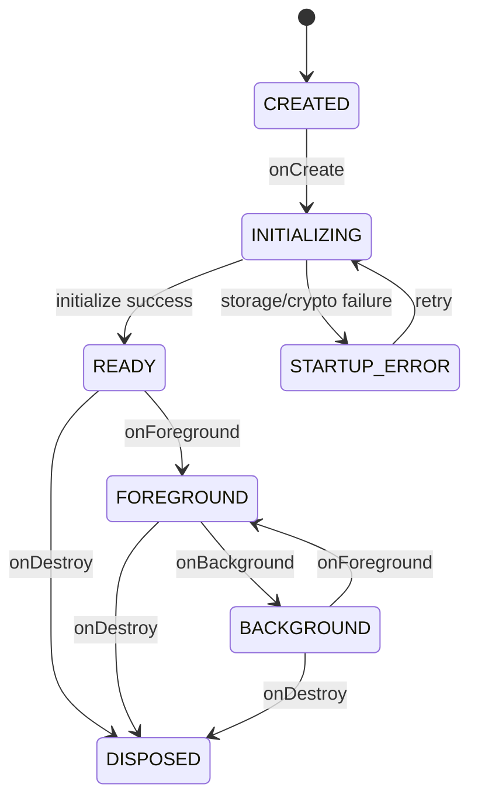

- 组合根初始化只一次；失败不进入业务页。
- 应用后台必须锁会话/清草稿/停扫描/停云轮询；前台不自动恢复敏感操作。
- 导航壳是唯一入口；页面不得绕过。
- 权限只在动作入口申请；不启动时批量申请。
- 生产构建无 Mock/DEV-ONLY 开关。
- 主题/暗黑跟随系统；语言由 I18nService；窗口安全区适配。

### 17.4 依赖注入与测试 seam（`DES-B-C28-SEAM`）

- host 可测：`NavigationService` 路由枚举/参数（可用 fake NavPathStack 或纯路由表）、`AppContext` 生命周期顺序（fake services）、`PermissionGate` 决策（fake context）、启动错误映射。
- UI smoke（ohosTest）：启动 → 4 Tab 可切换 → 二级页返回 → 权限拒绝提示 → 组合根无 Mock import；无设备 `UNAVAILABLE`。
- 静态检查：`check_production_mock_exclusion.py`、`check_layering.py`、`check_host_safe_imports.py`。
- 构建：`hvigorw clean assembleHap`/`assembleApp`；`codelinter`；测试 HAP 编译（BB §7）。
- 夹具：`FakeAppContext`/`FakeNavigationStack`/`FakePermissionGate`。

### 17.5 Traceability（`DES-B-C28-TRACE`）

| 需求/约束 | 映射 |
|---|---|
| FR-GW-001 权限 | `PermissionGate`/`module.json5` |
| FR-HOME-001 导航/家庭入口 | `Index`/Tabs/StatusBanner |
| SC-11 Mock/DEV-ONLY | 组合根排除/检查器 |
| PL-06/PL-07 分层 | 组合根/依赖方向 |
| ADR-004 §7.1/§7.2 | DEV-ONLY/语言入口 |
| UIUX §3 | Tabs + Navigation |
| T-17 | 本组件主交付 |

---

## 18. C-29 构建、仿真、README 与检查器

**契约 ID**：`DES-B-C29-API` / `DES-B-C29-ERR` / `DES-B-C29-STATE` / `DES-B-C29-SEAM` / `DES-B-C29-TRACE`
**职责**：可复现构建/测试脚本、Python 仿真器/TLS 夹具、契约 crosscheck、UI/i18n/分层检查器、README 与限制说明。本文只补 DES-B 相关检查器契约；构建基线引用 DES-A §23 与 BB §7。
**路径**：`tools/build/**`、`tools/simulator/**`、`tools/contract/**`、`tools/i18n/**`、`README.md`。

### 18.1 公开契约（`DES-B-C29-API`）

```text
tools/
├── build/
│   └── verify-baseline.sh                 # T-01；BB §7
├── simulator/
│   └── gateway_contract_server.py         # DEV-only；PUBLIC TEST DATA
├── contract/
│   ├── crosscheck_protocol_assets.py      # 66/66（T-05）
│   ├── check_layering.py                  # D-01..D-17
│   ├── check_host_safe_imports.py         # D-04/D-10
│   └── check_production_mock_exclusion.py # SC-11/F-05
└── i18n/
    ├── check_i18n.py                      # CHK-01..09（C-14）
    ├── allowlist.json
    └── legacy_migration.csv               # 615 条登记表（T-10）
```

**CLI 契约**：

| 工具 | 命令 | 退出码 | 输出 |
|---|---|---|---|
| 构建基线 | `tools/build/verify-baseline.sh` | 0/非0 | 命令/日志路径；未运行项标 BLOCKED |
| 分层 | `python3 tools/contract/check_layering.py --root .` | 0/1 | 违规文件/规则 ID |
| Host 安全 import | `python3 tools/contract/check_host_safe_imports.py --root .` | 0/1 | 文件/import |
| Mock 排除 | `python3 tools/contract/check_production_mock_exclusion.py --root .` | 0/1 | 文件/符号 |
| i18n | `python3 tools/i18n/check_i18n.py --root . --report ...` | 0/1/2 | JSON 报告（C-14 §7.4.4） |
| 契约 crosscheck | `python3 tools/contract/crosscheck_protocol_assets.py` | 0/非0 | 66/66 结果 |

- 工具不进入 ArkTS 构建链；不包含真实 secret；仿真器/夹具标注 `DEV-ONLY`/`PUBLIC TEST DATA`。
- `check_layering.py` 规则映射 §2.3 D-01..D-17；`viewmodel/**` 不得 import 服务实现；`components/**`/`pages/**` 不得 import 仓储/传输。
- `check_production_mock_exclusion.py` allowlist 仅允许 C-17 `DEV-ONLY` 常量与测试目录；生产 import 即失败。
- `check_i18n.py` 输出 C-14 §7.4.4 报告；CI/CQG 留痕。
- README（T-21）必须包含：构建/运行/测试命令、环境限制（无设备/无签名）、Mock/TLS 边界、i18n 检查命令、已知限制；不得把未运行写成 PASS。

### 18.2 错误（`DES-B-C29-ERR`）

| 场景 | 处理 |
|---|---|
| 工具缺失/不可执行 | `BLOCKED`；不伪造 PASS |
| 检查器输入缺失 | 退出码 2；报告错误 |
| 仿真器端口/证书缺失 | 明确错误；DEV-only |
| 构建/测试环境无设备 | `UNAVAILABLE`；记录原因 |
| 工具自身缺陷 | 修复后重跑；不影响产品结论 |

### 18.3 状态机与不变量（`DES-B-C29-STATE`）

1. 所有证据可复现：命令、版本、日志路径、时间；无“手工观察=通过”。
2. 未运行项必须标 `BLOCKED`/`UNAVAILABLE`，不得折算 PASS（CP-03；BB §5.6）。
3. 仿真器/Mock 结果标 `MOCK_ONLY`；真实设备由用户执行。
4. 检查器 allowlist 纳入版本控制；新增例外需评审。
5. 工具不修改 `input/`/生产源码；只读检查。
6. `tools/build/` 被 `.gitignore` 的 `**/build` 忽略；提交用 `git add -f tools/build`（BB §7.6）。

### 18.4 依赖注入与测试 seam（`DES-B-C29-SEAM`）

- 检查器用 fixture 资源树自测：违规 import/分层/硬编码/缺键/分叉 → 必须失败；合法树 → 通过。
- `verify-baseline.sh` 分步命令与 BB §7 一致；`--with-host-tests` 在 `entry/src/test/List.test.ets` 存在时可运行。
- UI smoke 依赖设备/模拟器；无设备标 `UNAVAILABLE`。
- 报告路径：`reports/i18n/<date>-i18n-report.json`、`reports/contract/<date>-layering.json`、`reports/test/<date>-...`。

### 18.5 Traceability（`DES-B-C29-TRACE`）

| 需求/约束 | 映射 |
|---|---|
| AGENTS.md 测试要求 | 构建/测试/证据 |
| BB §5/§7/§9 | 命令/限制 |
| SC-11/F-05 | Mock 排除检查 |
| I18N-02/05 | i18n 检查器 |
| PL-06/PL-07 | 分层检查 |
| T-01/T-05/T-19/T-21 | 工具/证据/README |

---

## 19. 关键时序/状态图（汇总）

> 组件章节已给出细节图；本节提供评审/实现共同引用的 5 张主图。图中错误路径与状态名以组件章节为准。

### 19.1 控制三态（UI/VM/Runner/C-17/C-10）

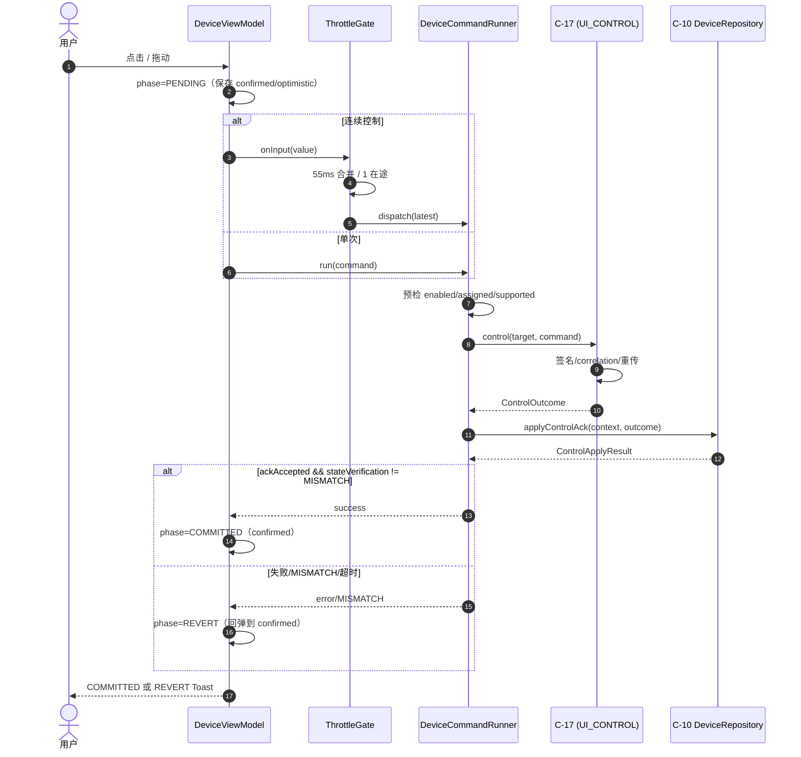

### 19.2 房间删除 / 未分配池

```mermaid
stateDiagram-v2
    [*] --> ASSIGNED: 设备已指派房间
    ASSIGNED --> ASSIGNED: 改名 / 房内移动
    ASSIGNED --> UNASSIGNED_DISABLED: 删除房间（事务）
    ASSIGNED --> UNASSIGNED_DISABLED: 手动移出
    UNASSIGNED_DISABLED --> ASSIGNED: 指派到已存在房间
    UNASSIGNED_DISABLED --> UNASSIGNED_DISABLED: discover 更新（只读）
    ASSIGNED --> GATEWAY_REMOVED: 全量 discover 未出现
    UNASSIGNED_DISABLED --> GATEWAY_REMOVED: 全量 discover 未出现
    GATEWAY_REMOVED --> ASSIGNED: discover 重新出现
    ASSIGNED --> DISMISSED: 删除设备（tombstone）
    UNASSIGNED_DISABLED --> DISMISSED: 删除设备（tombstone）
```

**事务**：删除房间 → `room` 删除 → 该房间设备 `roomId=''`/`isUnassigned=true`/`isEnabled=false` → 成员 `allowedRoomIds` 清理 → commit；失败全回滚。不删除设备、不发网络（DP-01/DP-02）。

### 19.3 邀请加入（D-009 主路径 + 回执）

```mermaid
sequenceDiagram
    autonumber
    participant M as 成员设备
    participant I as C-13 InviteService
    participant A as Admin 设备
    participant R as C-08 FamilyRepository
    participant G as C-07 GatewayRepository

    M->>I: createJoinRequest(displayName)
    I-->>M: YCR1 + memberId
    M->>A: 出示/发送 YCR1
    A->>I: createInvitation(KEY_WRAP, YCR1)
    I-->>A: YCI1 + InvitationRecord
    A->>R: putInvitation(PENDING)
    A-->>M: 发送 YCI1
    M->>I: acceptInvitation(YCI1, code?)
    I->>I: 解封 Bundle / 校验头
    I->>G: applyInvitedGateway(secret/pins)
    I->>R: upsertMember(ACTIVE)
    I-->>M: AcceptedInvitation + receipt
    M-->>A: 回执（下次接触）
    A->>I: verifyReceipt(receipt)
    I-->>A: valid
    A->>R: ACCEPTED + usedCount++
    Note over M,A: CODE_KEK 仅弱路径；UI 强制弱模式警告；<br/>回执未达保持 PENDING；撤销=轮换
```

### 19.4 场景串行执行（预检 → 逐步 → 局部失败不回滚）

```mermaid
sequenceDiagram
    autonumber
    participant U as 用户
    participant VM as SceneViewModel
    participant S as SceneService
    participant E as SceneExecutor
    participant D as C-10 DeviceRepository
    participant P as C-17 (BACKGROUND)

    U->>VM: run(sceneId)
    VM->>S: run(sceneId, listener)
    S->>S: PREFLIGHT（全部动作）
    alt 预检失败
        S-->>VM: FAILED(failedIndex, error)
        VM-->>U: 0 命令；显示失败项
    else 通过
        loop 按 actions 顺序
            S->>E: execute(step)
            E->>D: getRecord/校验
            E->>P: control(command)
            P-->>E: ControlOutcome
            E->>D: applyControlAck
            alt ACK 接受且非 MISMATCH
                E-->>S: SUCCEEDED
                S-->>VM: progress(step ✓)
            else 失败
                E-->>S: FAILED
                S->>S: 后续 SKIPPED
                S-->>VM: PARTIAL_FAILED / FAILED
                VM-->>U: 失败项 + “已执行步骤未自动回滚”
            end
        end
        S-->>VM: SUCCEEDED（全部）
    end
```

### 19.5 云命令完成判定（受理 ≠ 执行）

```mermaid
sequenceDiagram
    autonumber
    participant VM as DeviceViewModel/CloudService
    participant C as CloudCommandClient
    participant I as IoTDA
    participant S as ShadowReader
    participant E as CloudCompletionEvaluator

    VM->>C: send(command)
    C->>C: 分配 seq / canonical / HMAC
    C->>I: POST /commands (paras 10)
    I-->>C: 2xx + command_id（受理）
    C-->>VM: CloudCommandReceipt（不是成功）
    loop initial 500ms, then 1s, max 30s
        VM->>S: read(gatewayId)
        S-->>VM: ShadowSnapshot(event_time/properties/inventory)
        VM->>E: evaluate(expectation, snapshot)
        alt LastRequestId+LastSeq 匹配且新鲜
            E-->>VM: CONFIRMED + stateVerification
        else 旧影子
            E-->>VM: STALE（继续）
        else 无承载/PB-02
            E-->>VM: UNSUPPORTED
        else 未匹配
            E-->>VM: PENDING（继续）
        end
    end
    Note over VM,I: 超时 -> CLOUD_COMPLETION_TIMEOUT；<br/>未知 inventory -> UNSUPPORTED；<br/>不得用 IoTDA 受理/旧影子确认
```

---

## 20. FR/NFR → 组件 → 接口 → 测试映射

> 口径：本表是**设计与测试映射**，不是实现完成度。26 项 FR 全部有主责组件/接口/测试入口；FR-FAM-004 为 v1 声明性本地语义，FR-HOME-001 的 RTT 测量口径归 TEST-001，NFR 4.3 需实现后测量。WP3 §3 的原始覆盖矩阵作为历史证据引用，本表补全其缺口。

| FR/NFR | 主责组件 | 接口/契约 | Host/CT 测试（建议命名） | Device/IT | 状态/备注 |
|---|---|---|---|---|---|
| FR-FAM-001 家庭创建/多家庭 | C-08, C-12, C-22, C-26 | `FamilyService.createFamily/switchFamily`；`AuthService.createProfile` | `C08_FamilyService_createFamily_adminInvariant`、`C22_FamilyViewModel_switchFamily_requiresUnlock` | RDB 持久化/重启 | 完整；每家庭一个本地档案（`RISK-MULTIFAMILY-PROFILE`） |
| FR-FAM-002 成员邀请 | C-13, C-08, C-12, C-04, C-05, C-22, C-26 | `FamilyJoinSession`、`createInvitationForJoinRequest/createCodeInvitation/importReceipt` | `C08_JoinSession_keyWrap_completes`、`C08_Invite_codeKek_requiresCode`、`C13_Invite_*`（DES-A） | Mock/仿真器；回执导入 | 完整（D-009 主路径；CODE_KEK 弱路径） |
| FR-FAM-003 权限/移除 | C-08, C-12, C-22, C-26 | `removeMember/changeMemberRole`；`AuthService.invalidateSessionsForMember` | `C08_removeMember_lastAdmin_rejected`、`C08_removeMember_rotationPlan`、`C12_Rbac_*` | 角色变更会话失效 | 完整；撤销=轮换引导 |
| FR-FAM-004 退出家庭 | C-08, C-12, C-22, C-26 | `leaveFamily/transferAdmin/dissolveFamily` | `C08_leaveFamily_localOnly_noNetwork`、`C08_transferAdmin_lastAdminGuard` | 无（本地） | **v1 声明性限制**：本地语义+引导，不承诺跨设备强一致（§3.3.6） |
| FR-ROOM-001 房间创建/ID | C-09, C-22, C-26 | `RoomService.createRoom` | `C09_RoomService_create_uuid`、`C22_RoomViewModel_create` | RDB 持久化 | 完整 |
| FR-ROOM-002 命名/ID 不变 | C-09, C-10, C-22, C-25/26 | `renameRoom`；`roomId` 索引 | `C09_renameRoom_idUnchanged`、`C10_renameDevice_idUnchanged` | 零网络断言 | 完整 |
| FR-ROOM-003 加入/换房 | C-09, C-10, C-22, C-25 | `assignDevice/moveDevice` | `C09_assignRoom_enables`、`C10_assignRoom_requiresExistingRoom` | Mock discover/控制 | 完整；本地动作 |
| FR-ROOM-004 房间删除保护 | C-09, C-10, C-22, C-25 | `previewDelete/deleteRoom`；`DeviceAssignmentPort.onRoomDeleted` | `C09_deleteRoom_unassignsDisables_noNetwork`、`C09_deleteRoom_transactionRollback` | RDB 事务 | 完整；DP-02 |
| FR-ROOM-005 设备删除 | C-10, C-11, C-22, C-25 | `DeviceRepository.removeDevice`；`SceneReferencePort` | `C10_removeDevice_tombstone_sceneCleanup`、`C10_removeDevice_transactionRollback`、`C11_sceneRemoval` | RDB/场景 | **补全删除流程**：tombstone+场景引用清理；不复活 |
| FR-ROOM-006 设备命名/ID | C-03, C-10, C-22, C-25 | `renameDevice`；线上裸 `deviceId` | `C10_renameDevice_localOnly`、`C03_ControlRequest_bareDeviceId` | 契约向量 | 完整；`ControlPolicy` 禁止 SET_DEVICE_* |
| FR-HOME-001 家庭/网关状态 | C-07, C-10, C-15, C-17, C-21, C-25 | `HomeViewModel`；`ProbeResult.latencyMs`；`CloudConfigView` | `C21_Home_refresh_lanCloudStatus`、`C21_Home_latencyFromProbe` | Mock/仿真器 | 部分：RTT 口径/测量归 TEST-001；UI 只展示单次 |
| FR-HOME-002 房间快捷栏 | C-09, C-10, C-21, C-25 | `RoomChipBar`；`DeviceFilter` | `C21_Home_filterByRoom`、`C24_RoomChipBar` | UI smoke | 完整 |
| FR-HOME-003 环境/人体看板 | C-03, C-10, C-21, C-25 | `EnvironmentSummary`；5 值 `stateSource` | `C21_Home_environmentAggregate`、`C10_stateSourceUnknown` | Mock discover | 完整 |
| FR-HOME-004 快捷设备卡片 | C-10, C-16, C-21, C-25 | `QuickDeviceGrid`；`DeviceRecord` | `C21_Home_quickDevices`、`C24_LightCard_states` | UI smoke | 完整；只读降级也显示 |
| FR-GW-001 BLE 权限/扫描 | C-19, C-23, C-28 | `PermissionGate`；`startScan` | `C23_Ble_permissionDenied`、`C23_Ble_scan10sNoResult` | Mock BLE | 完整；权限 API 由 T-17 验证 |
| FR-GW-002 Security1 | C-04, C-19 | DES-A `Security1Session`/identity | DES-A 向量（5/5） | Mock BLE/真机用户 | 完整（DES-A） |
| FR-GW-003 Wi-Fi/绑定 | C-07, C-17, C-18, C-19, C-23, C-27 | `BleProvisioningViewModel.submit/commitBinding` | `C23_Ble_commitBinding_success`、`C23_Ble_cancelCleans` | Mock BLE + 仿真器 | 完整；绑定三要素 |
| FR-DEV-001 真实 ACK | C-05, C-10, C-17, C-21, C-25 | `ControlOutcome`/`DeviceCommandRunner` | `C21_Control_pendingThenCommitted`、`C21_Control_mismatchRevert`、`C10_applyAck_*` | Mock/仿真器 | 完整；禁止虚构成功 |
| FR-DEV-002 灯光/55ms | C-10, C-17, C-21, C-25 | `ThrottleGate`；`LightCard` | `C21_Throttle_55msLatest`、`C21_Throttle_touchUpFinal` | UI 动画/性能估算 | 完整；PF-02 |
| FR-DEV-003 门锁/门磁 | C-10, C-17, C-21, C-25 | `DoorConfirmationTracker`；`DoorCard` | `C21_Door_merged_secured`、`C21_Door_contactTimeout_online/offline`、`C21_Door_noLink_unverified` | Mock/仿真器 | 完整；D-016 |
| FR-DEV-004 空调/多品牌 | C-16, C-17, C-21, C-25 | `AcAdapterFactory`；`ClimateViewModel` | `C16_Ac_7modes`、`C16_Ac_temperatureBounds`、`C21_Climate_modeStandardOnly` | Mock/仿真器 | 完整；品牌差异仅显示/入站归一 |
| FR-DEV-005 状态溯源 | C-03, C-10, C-14, C-21, C-25 | `stateSource` 5 值；`stateSource.*` | `C10_stateSourceUnknown_preserved`、`C14_stateSourceKeys` | Mock discover | 完整；未知值记录偏差 |
| FR-SCN-001 场景执行 | C-11, C-17, C-22, C-26 | `SceneService.run`；`SceneStepResult` | `C11_Scene_serial`、`C11_Scene_preflightZeroCommands`、`C11_Scene_partialNoRollback` | Mock/仿真器 | 完整；局部失败不回滚 |
| FR-SET-001 成员管理面板 | C-08, C-12, C-22, C-26 | `FamilyViewModel`；`FamilyCapabilities` | `C22_Family_rbacVisibility`、`C22_Family_removeMember` | UI smoke | 完整 |
| FR-SET-002 加密/密钥配置 | C-04, C-05, C-07, C-13, C-17, C-19, C-23, C-27 | `SettingsViewModel.refreshSecurity`；`GatewaySecurityView` | `C23_Settings_pHmacDisclosure`、`C23_Settings_tlsPinStatus`、`C23_Settings_noManualPinEdit` | Mock TLS/BLE | 完整（P-TLS 依赖 FC-01；证据 MOCK_ONLY） |
| FR-SET-003 云/i18n | C-14, C-15, C-23, C-27 | `I18nService`；`CloudService`；Settings | `C14_localeFallback`、`C15_cloud_receiptNotExecution`、`C23_Settings_tokenExpired` | Mock IoTDA/语言切换 | 完整；Token 手工；PB-02 外部模块标 UNSUPPORTED |
| NFR-4.1 传输安全 | C-04, C-05, C-17, C-19, C-23 | DES-A HMAC/TLS；`GatewaySecurityView` | DES-A 向量/负例；`C23_Settings_pHmacDisclosure` | Mock TLS/真机用户 | 部分：P-TLS 依赖固件；P-HMAC 无机密性如实标注 |
| NFR-4.2 存储隐私 | C-06, C-07, C-12, C-13, C-08 | DES-A Asset/PBKDF2；`SecretStore` | DES-A 存储测试；`C08_joinKey_destroyed` | Asset/RDB 设备测试 | 完整（无设备 `UNAVAILABLE`） |
| NFR-4.3 性能 | C-21, C-25, C-29 | `MetricsPort`；TEST-001 harness | `C21_Throttle_55ms`（逻辑）；`NFR43` harness | 真机/模拟器 | **测量口径归 TEST-001**；无设备只作 `ESTIMATE`/`UNAVAILABLE` |

**汇总**：26/26 FR 有 component→interface→test 映射；其中 FR-FAM-004 为 v1 声明性限制、FR-HOME-001/NFR-4.3 的测量口径待 TEST-001、FR-SET-002/NFR-4.1 的 P-TLS 证据依赖固件。设计输入完整，不等于实现完成。

---

## 21. 测试 seam 与 fixtures（D-018 对齐）

### 21.1 Host 可测边界

| 目录 | 可测内容 | 不测 |
|---|---|---|
| `entry/src/test/domain/` | C-08 家庭/成员/邀请状态机；C-09 房间删除事务；C-10 仲裁/合并/tombstone；C-11 预检/串行/局部失败 | RDB 真实持久化、Asset |
| `entry/src/test/cloud/` | C-15 命令序列化/canonical/错误映射/影子解析/完成判定/PB-02 parser | 真实 IoTDA、TLS 公网 |
| `entry/src/test/adapter/` | C-16 品牌/7 值/温度边界 | 真实空调 |
| `entry/src/test/i18n/` | C-14 fallback/插值/复数/locale 解析/键构造/CHK fixture | 真实 `$r` 渲染 |
| `entry/src/test/viewmodel/` | C-21 三态/55ms/门锁；C-22 RBAC/房间/场景；C-23 配网映射/设置 | ArkUI 渲染/动画/触感 |
| `entry/src/test/support/` | fakes/fixtures | 平台 API |

**强制**：上述源文件不得 import `@ohos.*`；`check_host_safe_imports.py` 扫描；发现平台 import → CQG FAIL（DES-A §23.2）。

### 21.2 新增 fake/测试替身

| Fake | 端口/用途 | 行为 |
|---|---|---|
| `FakeTimer` | `TimerPort` | 手动 `advance(ms)`；记录 schedule/cancel；host 驱动 55ms/10s/30s |
| `FakeI18nResourceLoader` | `I18nResourceLoaderPort` | 返回 fixture bundle；可注入缺失/重复/空值 |
| `FakeLocaleApplier` | `LocaleApplierPort` | 记录 apply；可注入失败；system locale 可设 |
| `InMemoryCloudConfigStore` | `CloudConfigStore` | 内存配置；可注入读写失败 |
| `InMemoryCloudCredentialStore` | `CloudCredentialPort` | 内存 token；断言不泄漏/清除 |
| `FakeCloudHttpTransport` | `HttpTransport` | 预置 CreateCommand/Shadow 响应；可注入 401/403/429/5xx/超时/非法 JSON |
| `FakeShadowServer` | C-15 测试 | 序列化 shadow 快照；支持 fresh/stale/inventory |
| `FakeBleProvisioningClient` | `IBleProvisioningClient` | 按状态机发进度；可注入失败/取消/超时 |
| `FakePermissionGate` | C-23/C-28 | 权限 granted/denied/bluetooth-off |
| `FakeDeviceControlPort` | `DeviceControlPort` | 记录命令顺序/参数；返回 MATCH/UNVERIFIED/MISMATCH/错误 |
| `FakeGatewayRoutePort` | `GatewayRoutePort` | 内存路由；记录 0 网络 |
| `InMemorySecretStore`（DES-A） | `SecretStore` | 已有；C-08 join/cloud token 复用 |
| `InMemoryRdbStore`（DES-A） | `RdbStore` | 扩展 v4 表 SQL 子集；T-05 维护 |

### 21.3 Fixtures 清单

| Fixture | 内容 | 标注 |
|---|---|---|
| `RoomDeviceFixture` | 房间/设备/成员授权 JSON；已指派/未分配/禁用 | `PUBLIC TEST DATA ONLY` |
| `DiscoverSnapshotFixture` | full/partial/stale/unknown type/unknown source/missing fields | 同上 |
| `ControlOutcomeFixture` | MATCH/UNVERIFIED/MISMATCH/idempotentReplay/error | 同上 |
| `DoorFixture` | link NONE/CONTACT_SENSOR/GATEWAY_MERGED；SECURED/UNCONFIRMED/UNKNOWN/UNVERIFIED | 同上 |
| `SceneFixture` | 成功/预检失败/局部失败/取消/空/禁用 | 同上 |
| `CloudCommandGolden` | 固定 secret/seq/时间；paras/canonical/sign | `PUBLIC TEST DATA ONLY`；非生产密钥 |
| `ShadowFixture` | services/shadow/devices；fresh/stale/missing/invalid | 同上 |
| `InventoryFixture` | `PROPOSAL-PB02-1` 候选/缺字段/超限；标 `PROPOSED_PB02` | `FIRMWARE_PENDING` |
| `I18nFixture` | 最小 zh-CN/en-US bundle；复数/插值/缺失/空值 | `PUBLIC TEST DATA ONLY` |
| `BleProgressFixture` | 每个 `ProvisioningState` 的进度序列 | 同上 |
| `FamilyFixture` | 家庭/成员/邀请/回执；角色/到期 | 同上 |
| `AcFixture` | 品牌/7 值/温度边界 | 同上 |

- 禁止真实家庭数据、真实 token、真实 Wi-Fi 密码、生产密钥。
- 夹具文件头写源路径/SHA-256/生成命令（DES-A §23.4）。
- 每个用例新建 fake/VM，不共享可变状态。

### 21.4 UI/无设备限制

- **可做**：ArkTS 编译、`ohosTest` HAP 编译、host 纯逻辑测试、组件/VM 状态映射测试、i18n CHK 检查、静态分层/Mock 排除检查。
- **不可做/标 UNAVAILABLE**：真实渲染布局/动画/触感、真实 BLE、真实 LAN/TLS、真实 IoTDA、NFR 4.3 p95/60-120fps、跨设备家庭收敛。
- **替代**：把 UI 逻辑抽成 `*UiModel`/selector 纯函数；VM 状态机 host 测试；用 `FakeTimer`/`FakeClock` 驱动超时；用 fixture 做 golden 状态断言；视觉评审用截图（设备可用时）。
- **禁止**：把“测试 HAP 编译成功”写成“测试通过”；把 Mock 结果写成真实设备证据（BB §5.6；CP-03）。

### 21.5 CQG 证据模板（T-09/T-10/T-14..T-18）

```text
CQG-Txx
- build: hvigorw clean assembleHap --no-daemon -> PASS/FAIL (log)
- lint: codelinter -c code-linter.json5 -p default . -> PASS/FAIL
- host tests: hvigorw test --no-daemon -> PASS (n tests) / FAIL / BLOCKED
- device tests: onDeviceTest -> PASS / UNAVAILABLE (reason)
- contract: crosscheck/云 golden/场景 fixture -> PASS/FAIL
- i18n: CHK-01..09 -> PASS/FAIL (report path)
- layering/mock: check_layering/check_production_mock_exclusion -> PASS/FAIL
- security: no secret logs / fail-closed / PM-02 -> PASS/FAIL
- traceability: FR/SC IDs -> test names
```

---

## 22. 未决项、风险与固件协同

### 22.1 `UNRESOLVED` / `RISK` 清单

| ID | 项 | 类型 | 影响 | 处置 | 关闭条件 |
|---|---|---|---|---|---|
| `UNRESOLVED-PB02-INVENTORY` | `DeviceInventoryJson` 字段结构 | `UNRESOLVED`（PB-02） | 外部模块云完成判定 | §8.4：内置路径完整；inventory fail-closed；`PROPOSAL-PB02-1`；验收标 `FIRMWARE_PENDING` | 固件 schema/fixture；Change Impact |
| `RISK-CLOUD-SHADOW-DTO` | IoTDA 影子 REST 字段（A-CB-1） | `RISK` | 影子解析/完成判定 | `ShadowDtoAdapter` 三形态 + fail-closed；`CLOUD_SHADOW_INVALID` | Mock/真实 IoTDA 验证；文档补全 |
| `RISK-I18N-RUNTIME-LOCALE` | 运行时 `$r` 切换 API | `RISK` | 语言切换一致性 | `LocaleApplierPort`；T-10 验证；失败提示重启 | T-10 设备/模拟器验证 |
| `RISK-I18N-LEGACY-MIGRATION` | 615 条迁移成本/术语 | `RISK` | 缺文案/硬编码 | 逐条登记表；CHK-01..09；T-10 只建键空间/检查器 | T-10/T-19 报告 |
| `RISK-UI-NO-DEVICE` | 无设备/模拟器验证 | `RISK` | UI 运行时证据不足 | VM 纯逻辑 host 测试；UI 标 `UNAVAILABLE` | 用户设备/模拟器 |
| `RISK-ACK-TIMEOUT-PROFILE` | UI 3s 与传输重试 | `RISK` | 三态误判 | `UI_CONTROL`（1 次/3s）与 `BACKGROUND`（3 次）分离；T-15 验证 | T-15/仿真器计时 |
| `RISK-MULTIFAMILY-PROFILE` | `LocalProfile.familyId` 单值 | `RISK` | 多家庭切换/档案 | v1 每家庭一个档案；切换锁会话；声明限制 | 产品确认/未来模型扩展 |
| `RISK-UNASSIGNED-DEFAULT` | 新设备未分配默认禁用 | `RISK` | 新设备控制体验 | 指派后启用；UI 解释；与“安全禁用池”一致 | T-17/T-18 产品评审 |
| `RISK-CLOUD-SEQ-SHARED` | 云/LAN 共用 `seq` | `RISK` | 固件序列预期 | 复用 `GatewaySequencePort`；文档化 | 固件确认/仿真器 |
| `RISK-CLOUD-MULTIGATEWAY` | `CloudConfig` 无 `gatewayId`，v1 单配置 | `RISK` | 多网关云命令/Token | v1 单网关作用域；多网关需 Change Impact（多行配置/`gatewayId` 映射） | 产品/架构确认 |
| `UNRESOLVED-BLE-PERMISSIONS` | BLE 权限集合/API | `UNRESOLVED`（T-17） | 配网权限 | `PermissionGate` 配置化；预期 INTERNET+ACCESS_BLUETOOTH；位置权限仅按 SDK | T-17 设备验证 |
| `RISK-DEVICE-EPOCH-SECONDS` | 秒级 `updatedAt` 同秒冲突 | `RISK` | 状态覆盖顺序 | 同 epoch 覆盖 + `SAME_EPOCH_OVERWRITE` 偏差 | 固件/联调确认 |
| `RISK-SCENE-NO-ROLLBACK` | 局部失败不回滚 | `RISK`（产品语义） | 用户误解 | UI 强制 `scene.no_rollback`；步骤明细 | 评审/用户确认 |
| `RISK-CLOUD-TOKEN-STRING` | token 字符串无法擦除 | `RISK`（安全） | 内存残留 | 回调式访问；不落日志；短生命周期；Asset Store | 安全评审 |
| `RISK-BINDING-FAMILY-INDEX` | `commitBinding` 与 `addGatewayToFamily` 非同一事务 | `RISK` | 绑定成功但家庭索引失败 | 幂等重试；错误提示；下次启动修复 | T-12/T-16 测试 |
| `RISK-ROOM-DELETE-CROSS-REPO` | 房间删除跨 C-08/C-10/C-09 | `RISK` | 半删除 | 同一 RDB 事务 + 端口；回滚测试 | T-09 集成测试 |
| `RISK-HOME-PERF` | 大列表/光核性能 | `RISK`（NFR 4.3） | 卡顿 | `LazyForEach`/分页；TEST-001 口径 | 设备测量 |
| `RISK-I18N-DUAL-STORE` | 双存储文案漂移 | `RISK` | 中英混排 | 一个 key 一处；CHK-01/02/09；运行时同时切换 | T-10/T-19 |
| `RISK-PB02-INVENTORY-PARSER` | 候选 parser 与固件不一致 | `RISK` | 外部模块误判 | fail-closed；`UNSUPPORTED`；不声明 PASS | 固件 schema |
| `RISK-FR-FAM-004-CONSISTENCY` | 退出/解散跨设备一致性 | `RISK`（v1 声明） | 旧成员仍可控制 | 轮换引导；UI 声明；不承诺实时 | 产品/安全评审 |
| `RISK-FR-HOME-001-RTT` | RTT 口径未定义 | `RISK`（测量） | 性能声明 | TEST-001 定义样本/环境；UI 单次值 | T-05/T-19 |
| `RISK-C29-TOOLS` | 检查器自身缺陷/误报 | `RISK` | 门禁误判 | 工具自测 fixture；allowlist；评审 | T-05/T-19 |

### 22.2 需固件协同

| ID | 项 | v1 策略 |
|---|---|---|
| `FC-CLOUD-INVENTORY-01` | `DeviceInventoryJson` schema/fixture | 内置属性完整；外部 fail-closed；`PROPOSAL-PB02-1`；不声明 PASS |
| `FC-CLOUD-SHADOW-01` | IoTDA 影子 REST 字段/形态 | `ShadowDtoAdapter` 三形态；未知 fail-closed |
| `FC-CLOUD-TOKEN-01` | 短期 IAM Token/后端换取 | v1 不做；用户手工 Token；正式部署用受控后端 |
| `FC-ACK-ERRCODE-01` | `error_code`/1008 补齐 | 容忍缺失；1008 映射；CB §11 FC-02 |
| `FC-TLS-PIN-01` | `yaocore-id` v2.1/TLS pin | 无 v2.1 → P-HMAC；P-TLS 证据 `MOCK_ONLY`；FC-01 |
| `FC-SECRET-ENCODING-01` | command secret hex→raw | DES-A `RISK-SECRET-ENCODING`；联调确认 |
| `FC-INVITE-ROTATION-01` | 轮换流程 | BLE 重配唯一路径；App 只给引导 |
| `FC-AC-MODE-01` | 品牌专有模式/能力 | App 只发 7 值 canonical；网关适配厂商码 |

### 22.3 设计期残留风险声明

- 本文不声明任何真实 TLS/云/BLE/硬件行为已验证；所有相关证据标 `MOCK_ONLY`/`FIRMWARE_PENDING`/`UNAVAILABLE`。
- `FR-FAM-004`、`FR-HOME-001`、`FR-SET-002`、`NFR-4.1`、`NFR-4.3` 的能力边界必须在 UI/README/评审中如实声明（DP-05/DP-06；SC-16）。
- PB-02 未关闭前，不得把外部模块云完成判定写入验收 PASS；T-14 报告必须列出 `UNSUPPORTED`/`FIRMWARE_PENDING`。

---

## 23. 对 DES-001A 的扩展请求（供 G-007 / Change Impact）

> **原则**：DES-A 已冻结的公开方法名/参数顺序/返回类型/错误语义**不修改**。以下均为**增量**（新文件/新类型/新方法/新错误码）。G-007 批准后，应更新 DES-A §27.2/§27.3 的“DES-B 拥有/扩展”清单并记录；若 T-06..T-14 已实现，受影响组件标 `STALE` 并重跑 CQG。

### 23.1 新增端口/文件（`contracts/**`，纯接口）

| ID | 文件 | 类型 | 用途 | 兼容性 |
|---|---|---|---|---|
| `EXT-DES-B-01` | `contracts/TimerPort.ets` | `TimerPort`/`TimerHandle` | VM 55ms/10s/30s 超时；host `FakeTimer` | 新增，无破坏 |
| `EXT-DES-B-02` | `contracts/I18nPorts.ets` | `I18nResourceLoaderPort`/`LocaleApplierPort` | C-14 平台隔离 | 新增 |
| `EXT-DES-B-03` | `contracts/CloudPorts.ets` | `CloudConfigStore`/`CloudCredentialPort` | C-15 配置/Token 隔离 | DES-A §4.4 提到但未定义；补齐 |
| `EXT-DES-B-04` | `contracts/RoomPorts.ets` | `RoomLookupPort`/`DeviceAssignmentPort` | C-09↔C-10 解耦/事务 | 新增 |
| `EXT-DES-B-05` | `contracts/RoomPorts.ets` | `MemberRoomGrantPort` | C-09→C-08 授权清理 | 新增 |
| `EXT-DES-B-06` | `contracts/ScenePorts.ets` | `SceneReferencePort` | C-10/C-07→C-11 引用清理 | 新增 |
| `EXT-DES-B-07` | `contracts/DevicePorts.ets` | `DeviceControlPort` | C-11/C-21 → C-17 端口 | 补齐 DES-A §3.7 未给的签名 |
| `EXT-DES-B-08` | `contracts/DevicePorts.ets` | `DeviceStatePort` | C-10 实现；DES-A §3.7 已列名 | 补齐签名 |
| `EXT-DES-B-09` | `service/i18n/I18nKeys.ets` | `I18nKeys`（纯函数） | 键构造；C-14/C-21..C-23 | 新增 |
| `EXT-DES-B-22` | `contracts/PermissionPort.ets` | `PermissionPort`/`PermissionKind`/`PermissionResult` | C-23 VM 与 C-28 `PermissionGate` 解耦；host fake | 新增 |
| `EXT-DES-B-23` | `contracts/ControlPorts.ets` | `DeviceControlCoordinatorPort` | C-21 VM → LAN/云回退编排；VM 不 import service 实现 | 新增 |

**端口签名补充**：

```ts
export interface TimerPort {
  scheduleOnce(delayMs: number, callback: () => void): TimerHandle;
  scheduleRepeating(periodMs: number, callback: () => void): TimerHandle;
  cancel(handle: TimerHandle): void;
}
export class TimerHandle { readonly id: number; }

export interface DeviceAssignmentPort {
  onRoomDeleted(tx: RdbTransaction, familyId: string, roomId: string): Promise<number>;
  assignRoom(familyId: string, key: DeviceKey, targetRoomId: string): Promise<DeviceState>;
  unassignDevice(familyId: string, key: DeviceKey): Promise<DeviceState>;
  countByRoom(familyId: string, roomId: string): Promise<number>;
}

export interface RoomLookupPort {
  getRoom(roomId: string): Promise<Room | undefined>;
  exists(roomId: string): Promise<boolean>;
  listRooms(familyId: string): Promise<ReadonlyArray<Room>>;
}

export interface MemberRoomGrantPort {
  removeRoomGrant(tx: RdbTransaction, familyId: string, roomId: string): Promise<number>;
}

export interface SceneReferencePort {
  removeDeviceReferences(tx: RdbTransaction, familyId: string, key: DeviceKey): Promise<SceneCleanupSummary>;
  removeGatewayReferences(tx: RdbTransaction, familyId: string, gatewayId: string): Promise<SceneCleanupSummary>;
  listSceneIdsReferencing(tx: RdbTransaction, familyId: string, key: DeviceKey): Promise<ReadonlyArray<string>>;
}

export interface DeviceControlPort {
  send(command: DeviceControlCommand): Promise<ControlOutcome>;
}

export interface DeviceStatePort {
  applyDiscoverSnapshot(snapshot: DiscoverySnapshot,
                        options?: DiscoverApplyOptions): Promise<DiscoverApplyResult>;
  applyControlAck(context: ControlApplyContext,
                  outcome: ControlOutcome): Promise<ControlApplyResult>;
}
```

### 23.2 新增模型/值对象（`model/**`，只增不改）

| ID | 类型 | 用途 | 说明 |
|---|---|---|---|
| `EXT-DES-B-10` | `DeviceRecord`/`DeviceMergeState`/`DeviceMergeResult` | C-10 UI 附加视图 | 不修改 `DeviceState` |
| `EXT-DES-B-11` | `DiscoverApplyOptions/Result`、`ControlApplyContext/Result/Reason`、`DeviceRemoval*` | C-10 仲裁/删除 | 纯值 |
| `EXT-DES-B-12` | `SceneExecutionResult/Progress/StepResult/State`、`SceneCleanupSummary` | C-11 执行/清理 | 纯值 |
| `EXT-DES-B-13` | `FamilyMemberView`/`InvitationView`/`FamilyDissolutionPlan`/`JoinSessionState`/`FamilyJoinPhase` | C-08/C-22 | 不修改 `FamilyMember`/`InvitationRecord` |
| `EXT-DES-B-14` | `CloudConfigView`/`CloudCommandReceipt`/`ShadowSnapshot`/`InventoryDeviceState`/`CloudCompletionVerdict`/`CloudControlOutcome` | C-15 | `InventoryDeviceState` 是 PB-02 候选，非冻结 |
| `EXT-DES-B-15` | `GatewayStatus`/`ControlUiState`/`DeviceFilter`/`FamilyCapabilities`/`DoorUiState`/`DoorLinkConfig`/`WizardStep`/`ProvisioningPermissionState` | C-21..C-28 | UI/VM 纯值 |
| `EXT-DES-B-16` | `I18nParams`/`I18nResourceBundle`/`LocaleChangedEvent`/`I18nLoadResult` | C-14 | 纯值 |

### 23.3 `FamilyRepository` / `InviteService` 增量方法

| ID | 类型 | 方法 | 说明 |
|---|---|---|---|
| `EXT-DES-B-17` | `FamilyRepository` | `switchActiveFamily`、`removeRoomGrant`、`transferAdmin`、`removeFamilyLocal`、`removeMemberLocal`、`listInvitationsByFamily`、`listMemberRoomGrants`、`applyReceipt` | 新方法；不改 DES-A §11.1 签名 |
| `EXT-DES-B-18` | `InviteService` | `discardJoinRequest(memberId: string): Promise<void>` | 取消加入时清理 `YCR1` 私钥别名；新方法 |
| `EXT-DES-B-19` | `GatewayRepository` | 无变更 | C-23 只调用既有 `commitBinding/removeLocalBinding` |
| `EXT-DES-B-20` | `AuthService` | `removeProfilesForFamily(familyId)`、`removeProfilesForMember(familyId, memberId)` | 退出/解散时清理本地档案；新方法，不改变既有会话/RBAC 语义 |
| `EXT-DES-B-21` | `AuthService` | 多家庭实现 | 每家庭一个 `LocalProfile`（§3.3.1）；不新增 `rebindProfile` |

> `AuthService` 不新增 `rebindProfile`：v1 每家庭一个档案，避免修改冻结的 `LocalProfile.familyId` 语义。加入家庭后由 C-22 调用既有 `createProfile`。该选择登记为 `RISK-MULTIFAMILY-PROFILE`。

### 23.4 新增错误码（必须补 i18n 键）

| 组 | code | 类别 | 可重试 | i18n 键 |
|---|---|---|---|---|
| 房间 | `ROOM_NOT_FOUND` | CONFIG | 否 | `errors.app.room_not_found` |
| 房间 | `ROOM_NAME_INVALID` | CONFIG | 否 | `errors.app.room_name_invalid` |
| 房间 | `ROOM_DELETE_NOT_CONFIRMED` | CONFIG | 否 | `errors.app.room_delete_not_confirmed` |
| 设备 | `DEVICE_NOT_FOUND` | CONFIG | 否 | `errors.app.device_not_found` |
| 设备 | `DEVICE_DISMISSED` | CONFIG | 否 | `errors.app.device_dismissed` |
| 设备 | `DEVICE_DISABLED` | CONFIG | 否 | `errors.app.device_disabled` |
| 设备 | `DEVICE_UNASSIGNED` | CONFIG | 否 | `errors.app.device_unassigned` |
| 设备 | `DEVICE_NAME_INVALID` | CONFIG | 否 | `errors.app.device_name_invalid` |
| 场景 | `SCENE_NOT_FOUND` | CONFIG | 否 | `errors.app.scene_not_found` |
| 场景 | `SCENE_NAME_INVALID` | CONFIG | 否 | `errors.app.scene_name_invalid` |
| 场景 | `SCENE_EMPTY` | CONFIG | 否 | `errors.app.scene_empty` |
| 场景 | `SCENE_DISABLED` | CONFIG | 否 | `errors.app.scene_disabled` |
| 场景 | `SCENE_PREFLIGHT_FAILED` | CONFIG | 否 | `errors.app.scene_preflight_failed` |
| 场景 | `SCENE_STEP_FAILED` | CONFIG | 是 | `errors.app.scene_step_failed` |
| 场景 | `SCENE_REFERENCE_INVALID` | CONFIG | 否 | `errors.app.scene_reference_invalid` |
| 场景 | `SCENE_CANCELLED` | CONFIG | 是 | `errors.app.scene_cancelled` |
| i18n | `I18N_RESOURCE_LOAD_FAILED` | CONFIG | 是 | `errors.app.i18n_resource_load_failed` |
| i18n | `I18N_BUNDLE_INVALID` | CONFIG | 否 | `errors.app.i18n_bundle_invalid` |
| i18n | `I18N_LOCALE_UNSUPPORTED` | CONFIG | 否 | `errors.app.i18n_locale_unsupported` |
| i18n | `I18N_PLATFORM_LOCALE_FAILED` | CONFIG | 是 | `errors.app.i18n_platform_locale_failed` |
| 云 | `CLOUD_NOT_CONFIGURED` | CONFIG | 否 | `errors.cloud.not_configured` |
| 云 | `CLOUD_ENDPOINT_INVALID` | CONFIG | 否 | `errors.cloud.endpoint_invalid` |
| 云 | `CLOUD_TOKEN_MISSING` | AUTH | 否 | `errors.cloud.token_missing` |
| 云 | `CLOUD_TOKEN_EXPIRED` | AUTH | 否 | `errors.cloud.token_expired` |
| 云 | `CLOUD_TOKEN_INVALID` | AUTH | 否 | `errors.cloud.token_invalid` |
| 云 | `CLOUD_RATE_LIMITED` | TRANSPORT | 是 | `errors.cloud.rate_limited` |
| 云 | `CLOUD_REQUEST_FAILED` | TRANSPORT | 是 | `errors.cloud.request_failed` |
| 云 | `CLOUD_SERVICE_UNAVAILABLE` | TRANSPORT | 是 | `errors.cloud.service_unavailable` |
| 云 | `CLOUD_RESPONSE_INVALID` | PROTOCOL | 否 | `errors.cloud.response_invalid` |
| 云 | `CLOUD_DEVICE_NOT_FOUND` | CONFIG | 否 | `errors.cloud.device_not_found` |
| 云 | `CLOUD_SHADOW_INVALID` | PROTOCOL | 是 | `errors.cloud.shadow_invalid` |
| 云 | `CLOUD_COMPLETION_TIMEOUT` | TRANSPORT | 是 | `cloud.command.accepted_not_confirmed` |
| 云 | `CLOUD_COMPLETION_UNSUPPORTED` | CONFIG | 否 | `cloud.completion.unsupported` |
| 云 | `CLOUD_INVENTORY_UNSUPPORTED` | CONFIG | 否 | `cloud.completion.unsupported` |
| 云 | `CLOUD_SEQUENCE_UNAVAILABLE` | CONFIG | 是 | `errors.cloud.sequence_unavailable` |

**约束**：
- 全部为**新增**；不得修改 DES-A 已有 code 的类别/重试/i18n 语义（DES-A §27.3）。
- 所有 i18n 键必须同时存在于 zh-CN/en-US rawfile；CHK-06 检查。
- `CLOUD_*` 不复用网关 `result_code` 数值空间；`errors.cloud.*` 与 `errors.gateway.*` 分离。

### 23.5 不构成 DES-A 变更的内容

以下由 DES-B 拥有，不需要修改 DES-A：
- C-14/C-15/C-16/C-21..C-29 的类/接口/页面/组件（DES-A §27.2 已列）。
- v4 存储表（`room`/`device_state`/`scene`/`cloud_config`）与迁移注册（DES-A §9.1.6 明确由 DES-B 注册）。
- `PROPOSAL-PB02-1` 候选 schema（非合同；不进入 CB/SR/DES-A）。
- UI 主题/动效 token/C-24 组件（DES-A 未定义）。

**Change Impact**：G-007 批准后，若 T-08/T-09/T-11/T-12 已有实现，需检查：
1. `FamilyRepository` 新方法是否影响 v2 表/迁移（无新表；只读/写 JSON 授权）。
2. `DeviceRepository` 是否实现 `DeviceStatePort` 签名（如已实现旧签名，按本契约补齐）。
3. `GatewayRepository` 是否被 C-23 调用 `commitBinding`（已完成）。
4. `I18nService`/`CloudService` 为新增，不影响已实现组件。
5. 任何已冻结签名不匹配 → 标 `STALE`，走 Change Impact；不得静默改 DES-A。

---

## 24. 追溯、任务消费索引与自检

### 24.1 组件 → 任务 → Gate

| 组件 | 主任务 | Gate | 本文契约 |
|---|---|---|---|
| C-08 | T-09（+T-13 邀请容器） | CQG-T09；SEC 供 T-20 | §3 |
| C-09 | T-09 | CQG-T09 | §4 |
| C-10 | T-09 | CQG-T09 | §5 |
| C-11 | T-09 | CQG-T09 | §6 |
| C-14 | T-10 | CQG-T10 | §7 |
| C-15 | T-14 | CQG-T14 | §8 |
| C-16 | T-14 | CQG-T14 | §9 |
| C-21 | T-15 | CQG-T15；IG-2 | §10 |
| C-22 | T-16 | CQG-T16；IG-2 | §11 |
| C-23 | T-16 | CQG-T16；IG-2 | §12 |
| C-24 | T-17 | CQG-T17；IG-3 | §13 |
| C-25 | T-17 | CQG-T17；IG-3 | §14 |
| C-26 | T-18 | CQG-T18；IG-3 | §15 |
| C-27 | T-18 | CQG-T18；IG-3 | §16 |
| C-28 | T-17 | CQG-T17；IG-3 | §17 |
| C-29 | T-01/T-05/T-19/T-21 | Gate 证据 | §18 |

### 24.2 任务直接消费索引

| 任务 | 必读章节 | 输入契约 ID | 主要输出 |
|---|---|---|---|
| T-09 | §2/§3/§4/§5/§6/§21 | `DES-B-C08..C11-*` | 仓储/用例/场景 + host 测试 |
| T-10 | §2.2/§7/§21 | `DES-B-C14-*` | I18nService/资源/CHK |
| T-14 | §2.4/§8/§9/§21 | `DES-B-C15..C16-*` | CloudService/AC + fixtures |
| T-15 | §10/§19.1/§21 | `DES-B-C21-*` | Home/Device/Climate/Door VM |
| T-16 | §11/§12/§19.3/§19.4 | `DES-B-C22..C23-*` | Family/Room/Scene/Provisioning/Settings VM |
| T-17 | §2.1/§13/§14/§17/§18 | `DES-B-C24/C25/C28-*` | UI 壳/页面/组合根/权限 |
| T-18 | §15/§16/§2.1 | `DES-B-C26/C27-*` | 二级页面/设置/关于/Profile |
| T-19 | §20/§21/§22 | 全部 | 测试报告/覆盖矩阵 |
| T-20 | §22/§24.3 | 全部 | 独立评审 |

### 24.3 契约条目索引（80 条）

| 组件 | API | ERR | STATE | SEAM | TRACE |
|---|---|---|---|---|---|
| C-08 | `DES-B-C08-API` | `DES-B-C08-ERR` | `DES-B-C08-STATE` | `DES-B-C08-SEAM` | `DES-B-C08-TRACE` |
| C-09 | `DES-B-C09-API` | `DES-B-C09-ERR` | `DES-B-C09-STATE` | `DES-B-C09-SEAM` | `DES-B-C09-TRACE` |
| C-10 | `DES-B-C10-API` | `DES-B-C10-ERR` | `DES-B-C10-STATE` | `DES-B-C10-SEAM` | `DES-B-C10-TRACE` |
| C-11 | `DES-B-C11-API` | `DES-B-C11-ERR` | `DES-B-C11-STATE` | `DES-B-C11-SEAM` | `DES-B-C11-TRACE` |
| C-14 | `DES-B-C14-API` | `DES-B-C14-ERR` | `DES-B-C14-STATE` | `DES-B-C14-SEAM` | `DES-B-C14-TRACE` |
| C-15 | `DES-B-C15-API` | `DES-B-C15-ERR` | `DES-B-C15-STATE` | `DES-B-C15-SEAM` | `DES-B-C15-TRACE` |
| C-16 | `DES-B-C16-API` | `DES-B-C16-ERR` | `DES-B-C16-STATE` | `DES-B-C16-SEAM` | `DES-B-C16-TRACE` |
| C-21 | `DES-B-C21-API` | `DES-B-C21-ERR` | `DES-B-C21-STATE` | `DES-B-C21-SEAM` | `DES-B-C21-TRACE` |
| C-22 | `DES-B-C22-API` | `DES-B-C22-ERR` | `DES-B-C22-STATE` | `DES-B-C22-SEAM` | `DES-B-C22-TRACE` |
| C-23 | `DES-B-C23-API` | `DES-B-C23-ERR` | `DES-B-C23-STATE` | `DES-B-C23-SEAM` | `DES-B-C23-TRACE` |
| C-24 | `DES-B-C24-API` | `DES-B-C24-ERR` | `DES-B-C24-STATE` | `DES-B-C24-SEAM` | `DES-B-C24-TRACE` |
| C-25 | `DES-B-C25-API` | `DES-B-C25-ERR` | `DES-B-C25-STATE` | `DES-B-C25-SEAM` | `DES-B-C25-TRACE` |
| C-26 | `DES-B-C26-API` | `DES-B-C26-ERR` | `DES-B-C26-STATE` | `DES-B-C26-SEAM` | `DES-B-C26-TRACE` |
| C-27 | `DES-B-C27-API` | `DES-B-C27-ERR` | `DES-B-C27-STATE` | `DES-B-C27-SEAM` | `DES-B-C27-TRACE` |
| C-28 | `DES-B-C28-API` | `DES-B-C28-ERR` | `DES-B-C28-STATE` | `DES-B-C28-SEAM` | `DES-B-C28-TRACE` |
| C-29 | `DES-B-C29-API` | `DES-B-C29-ERR` | `DES-B-C29-STATE` | `DES-B-C29-SEAM` | `DES-B-C29-TRACE` |

### 24.4 G-007 自检清单

- [x] 16 个组件均有 API/ERR/STATE/SEAM/TRACE 五类条目（80 条）。
- [x] DES-A 共享类型被引用而非重复定义；扩展列 §23。
- [x] 每个组件有明确职责/边界/依赖/构造注入/测试 seam。
- [x] 领域语义：SSOT/`stateEpochMs` 仲裁（§5.3.2）、房间删除/未分配池（§4.3.2/§19.2）、设备删除 tombstone（§5.3.4）、场景局部失败（§6.3.3）、邀请/回执（§3.3.3/§3.3.4）。
- [x] 云路径：配置/Token/命令/影子/完成判定/PB-02（§8）。
- [x] i18n：API/资源布局/fallback/键规则/迁移/CHK（§7）。
- [x] VM：state/event/selector/异步/错误映射/节流/防乐观（§10-§12）。
- [x] UI：页面/导航/组件 props/events/主题/动效/空态/加载/错误/可访问性（§13-§16）。
- [x] 应用壳：EntryAbility/导航/组合根/权限/Mock 排除（§17）。
- [x] 测试 seam：host/device 分工、fixtures、无设备限制（§21）。
- [x] 时序/状态图：控制三态/房间删除/邀请/场景/云（§19）。
- [x] 未决/风险/固件协同（§22）。
- [x] 26 FR + 3 NFR 有 component→interface→test 映射（§20）。
- [x] 每个关键设计点引用基线/证据路径+章节（全文）。
- [x] 未写产品实现代码；代码块仅为契约声明。
- [x] 未修改 `input/`/现有代码/其他 Artifact。
- [x] PB-02 明确 `UNRESOLVED` + 去风险方案（§8.4），未擅自补契约。
- [x] 中文输出；接口标识符保留英文；头部 Producer/Status 符合要求。

### 24.5 评审抽查点（T-20）

1. 随机抽取 5 个契约方法，确认参数/返回/错误与实现任务可直接编码，无隐含决策。
2. 检查 `DeviceRepository.applyDiscoverSnapshot` 的 stale/partial/tombstone 三分支与测试断言。
3. 检查房间删除事务是否真的覆盖 C-08/C-09/C-10 且无网络调用。
4. 检查场景预检失败是否 0 命令、局部失败是否无回滚提示。
5. 检查 `I18nService.t` fallback 链与 CHK-01..09 报告字段。
6. 检查云完成判定是否拒绝旧影子/受理/未知 inventory；PB-02 是否标 `UNSUPPORTED`。
7. 检查 VM 三态是否只在 `ackAccepted && !MISMATCH` 后 COMMITTED；55ms 是否 1 在途 + 最终值。
8. 检查门锁 `UNVERIFIED/UNCONFIRMED/UNKNOWN` 文案与“已锁好”禁用。
9. 检查 C-28 组合根是否只装配生产适配器、无 Mock import、权限最小化。
10. 检查 §23 扩展是否全部为增量，未改 DES-A 冻结签名。

---

## 附录 A：基线引用索引

| 主题 | 来源（路径+章节/行） | 本文使用 |
|---|---|---|
| 线格式/字段映射 | CB §2.1-§2.5 | §5/§8/§9 |
| 错误码/用户提示 | CB §4.1-§4.4；DES-A §3.2.3/§24 | 全文 |
| 云路径 | CB §7.1/§8.2；GWO §5；CC/SR | §8 |
| 设备范围/枚举 | CB §6.1-§6.3/§8.1 | §5/§9/§20 |
| 家庭/房间/设备边界 | ADR-004 §1/§2/§5/§6/§7 | §3/§4/§5/§10/§17 |
| 家庭凭据/邀请 | ADR-003 §3-§10；D-009/D-010/D-013 | §3/§11 |
| LAN 安全 | ADR-002 §2/§4/§6/§8；DES-A §14/§18 | §8/§17 |
| i18n | I18N-DESIGN §2-§7；INT；ADR-004 §7.2 | §7/§13-§16 |
| UI/交互 | UIUX §2/§3/§4/§5 | §10-§16 |
| 数据模型 | DM §1/§2/§5 | §3-§6 |
| 需求 | REQ FR/NFR | §20 |
| 构建/测试 | BB §5/§7/§9；DES-A §23 | §2/§21/§24 |
| 组件边界 | CG §3/§4/§5/§6 | 全文 |
| 任务/Gate | DP §3.1/§3.3/§6/§9 | §24 |

## 附录 B：默认参数与限制汇总

| 参数 | 默认 | 位置 |
|---|---|---|
| 连续控制节流 | 55ms | `AppMotionTokens`/`ThrottleGate` |
| UI 控制 ACK 期望 | 3000ms（UI_CONTROL：connect 2000/read 3000/1 次） | C-28 |
| 后台控制重试 | 3 次（300/900ms），DES-A | C-28 |
| 门锁到位确认超时 | 10000ms | `DoorConfirmationPolicy` |
| 门锁回弹动画 | 320ms | `AppMotionTokens.REVERT_SETTLE_MS` |
| BLE 扫描超时 | 10000ms | C-23/DES-A |
| BLE 联网超时 | 30000ms | `AppMotionTokens.TIMEOUT_BLE_CONNECT_MS` |
| 云命令轮询 | 500ms 初始，1000ms 间隔，30s/30 次 | `CloudCompletionPolicy` |
| 云影子新鲜度容差 | 2000ms | C-15 |
| 云影子最大年龄（离线判定） | 120000ms | C-15（不用于确认） |
| `DeviceInventoryJson` 上限 | 8192 字符/32 条 | C-15/PB-02 |
| 房间名/设备名/场景名 | 1..31 字符（trim） | C-09/C-10/C-11 |
| 邀请有效期/次数 | 24h/默认 1 | C-08/C-13 |
| 邀请码 | 6 位 Crockford Base32 | ADR-004 §3 |
| 语言 | zh-CN/en-US；auto 回退 zh-CN | C-14 |
| 家庭档案 | 每家庭一个 `LocalProfile` | §3.3.1 |
| 新设备未分配 | `isEnabled=false`，指派后启用 | §5.3.3 |
| 场景总超时 | 60s（单步 8s） | `SceneExecutionPolicy` |
| UI 文本膨胀 | 20-40% | C-24 |
| 触达目标 | ≥44vp | C-24 |

## 附录 C：与任务提示的编号差异记录

- 本任务提示的组件编号与 `component-graph.md` 一致：C-08 FamilyRepository、C-09 RoomRepository、C-10 DeviceRepository、C-11 SceneService、C-14 I18nService、C-15 CloudService、C-16 AC 适配、C-21..C-23 VM、C-24..C-29 UI/应用壳/工具。
- DES-A §0.1 保留的前序任务编号映射（“C-12 FamilyRepository / C-13 AuthService”）不适用于本任务；本文不重复该映射。CG 的 **C-13 InviteService** 由 DES-A 覆盖，本文 C-08 消费其接口。
- 任务提示 “C-21..C-23” 与 CG §3.5 的 VM 组一致；本文按 Home/Device/Climate/Door（C-21）、Family/Room/Scene（C-22）、BleProvisioning/Settings（C-23）划分。
- 任务提示 “C-24..C-29” 中 C-29 为构建/仿真/README 工具；本文只补 DES-B 检查器契约，构建基线引用 BB/DES-A。
- 任务提示 “C-09 RoomRepository” 与 CG 一致；本文新增 `RoomService` 用例层，不改变组件边界。
- 任务提示 “C-10 DeviceRepository” 与 CG 一致；本文新增 `DeviceCommandRunner`（C-10 用例）与 `DeviceRecord` 视图，不改变 SSOT 职责。

---

*DES-001B 结束。本文为 T-04 的详细设计交付；所有契约以 G-004 + DES-A 为上游，扩展项见 §23；实现证据由 T-09/T-10/T-14..T-18 产出，G-007 批准后方可作为实现冻结输入。*
